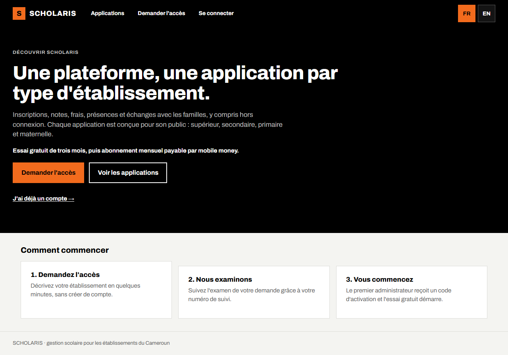
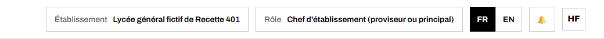

# 01. TRU GROUP et SCHOLARIS en une page

## 1.1 La promesse

**SCHOLARIS, c'est toute la vie de l'établissement dans un seul outil en ligne, pensé pour le Cameroun : inscriptions, frais, appel, notes, bulletins, documents et communication avec les familles, sur ordinateur comme sur téléphone.**

SCHOLARIS est conçu, hébergé et maintenu par **TRU GROUP**. L'établissement n'installe rien : il ouvre **https://scholariserp.trugroup.cm** dans un navigateur.

Le message à faire passer en trente secondes :

> « Avec SCHOLARIS, vous savez chaque jour qui est présent, qui a payé et où en sont les notes. Les parents reçoivent les informations par SMS et peuvent payer par Orange Money ou MTN MoMo. Les documents officiels portent un QR code qui prouve qu'ils sont authentiques. Et vous l'essayez 90 jours sans payer. »

## 1.2 Les points forts

| Point fort | Ce que cela veut dire pour le client | Où le montrer |
|---|---|---|
| **Une application par niveau** | Maternelle, primaire, secondaire et supérieur ont chacun leurs écrans, leurs règles et leur vocabulaire (séquences au secondaire, compétences au primaire, crédits et jurys au supérieur, observation sans note en maternelle). | catalogue public (chapitre 02) |
| **Plusieurs établissements, un seul client** | Un promoteur qui possède une maternelle, une école et un collège a un seul compte client. Chaque personne passe d'un établissement à l'autre sans se reconnecter. | chapitre 10 |
| **Sur téléphone** | Tout s'ouvre dans le navigateur d'un téléphone. Les espaces des parents, des élèves et l'appel des enseignants sont pensés d'abord pour le téléphone. | espace famille, appel |
| **Appel sans réseau** | L'enseignant fait l'appel même sans connexion. L'appel est gardé sur le téléphone et part tout seul au retour du réseau. Au supérieur, la saisie des notes marche aussi hors ligne. | écran d'appel |
| **Mobile Money** | Le parent ou l'étudiant paie depuis son espace par **Orange Money** ou **MTN MoMo** ; le reçu numéroté s'affiche à la confirmation. L'établissement paie aussi son abonnement par Mobile Money. | espace famille |
| **SMS** | Codes d'activation, reçus, absences, rappels d'échéance, « bulletin disponible »… Les messages respectent le consentement des familles et les heures (pas de SMS avant 7 h ni après 21 h, sauf urgence). | chapitre 02, section SMS |
| **Documents avec QR code** | Certificats, cartes, relevés, bulletins, reçus portent un numéro et un QR code. N'importe qui scanne le QR et voit si le document est authentique, sans voir de donnée personnelle superflue. | bulletin, relevé, carte |
| **Conforme au système éducatif camerounais** | Autorisations d'ouverture (MINESUP, MINESEC, MINEDUB), séquences et trimestres, CEP et FSLC, BEPC, probatoire, baccalauréat, GCE, BTS et HND, APEE, catalogue des frais autorisés du public, cartescolaire.cm. | fiches clients |
| **Bilingue français et anglais** | Chaque personne choisit **FR** ou **EN** en haut de l'écran. Les sous-systèmes francophone et anglophone sont pris en charge (niveaux, examens, bulletins en anglais). | barre du haut |
| **Traçabilité** | Rien ne s'efface en cachette : notes, paiements et documents se corrigent par une opération tracée (motif, auteur, date). | tout écran de correction |
| **Séparation des tâches** | Celui qui saisit une note ne la verrouille pas ; celui qui encaisse n'annule pas seul son paiement. | notes, caisse |

## 1.3 Pour qui ?

- **Le promoteur ou fondateur** : il voit la santé de l'établissement (effectifs, recouvrement, résultats) sans être sur place.
- **La direction** : elle pilote, valide et signe.
- **Le secrétariat, la scolarité, la caisse** : moins de registres papier, plus de doubles saisies.
- **Les enseignants** : l'appel et les notes sur téléphone.
- **Les familles et les étudiants** : les informations et le paiement dans la poche.
- **Les autorités** (inspection, délégation, université de tutelle) : un accès limité, en lecture, et dans le public des chiffres sans nom.

## 1.4 Ce que SCHOLARIS n'est pas

Soyez clair avec le prospect, cela évite les déceptions :

- SCHOLARIS **n'est pas une comptabilité générale** (bilan, grand livre). Il gère les frais des élèves, la caisse et les reçus.
- SCHOLARIS **n'invente aucune note officielle** : les résultats d'examens nationaux sont saisis ou importés tels qu'ils sont publiés.
- SCHOLARIS **ne prive jamais un élève** d'inscription, de cours ou d'évaluation pour un impayé (règle du secondaire et du primaire public), et aucun document scolaire ne mentionne une dette.
- **WhatsApp** n'est pas un canal d'envoi branché aujourd'hui : les messages partent par SMS et par e-mail.
