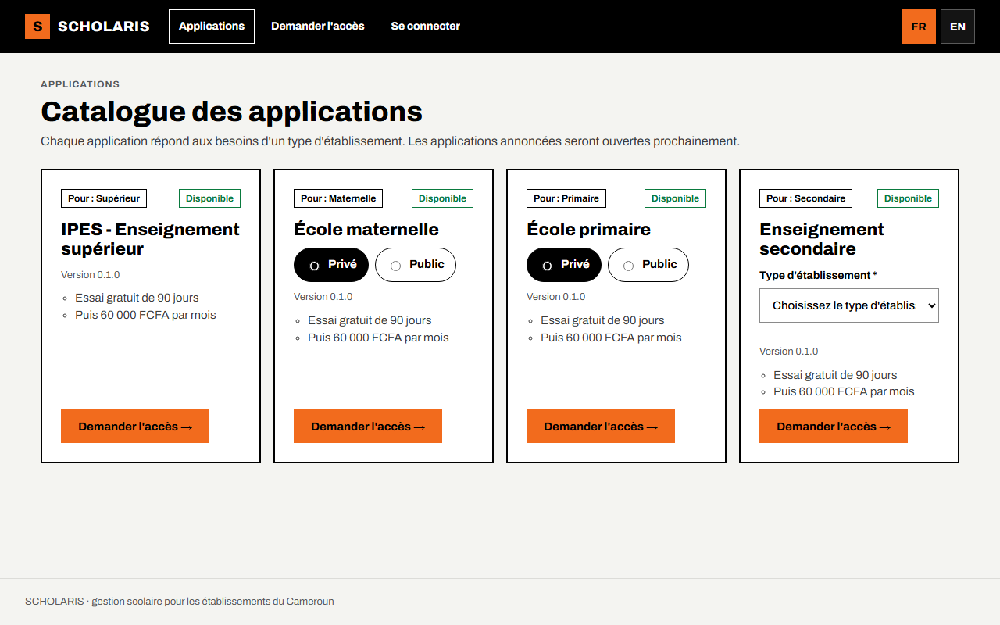
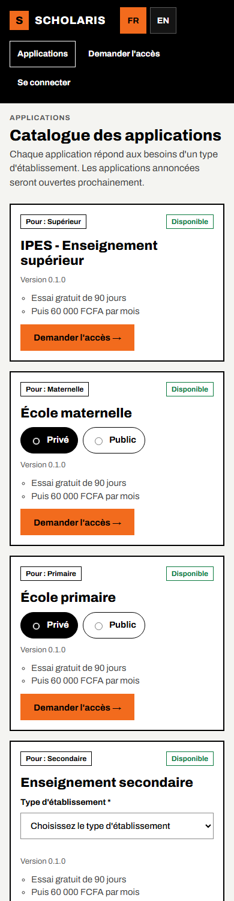
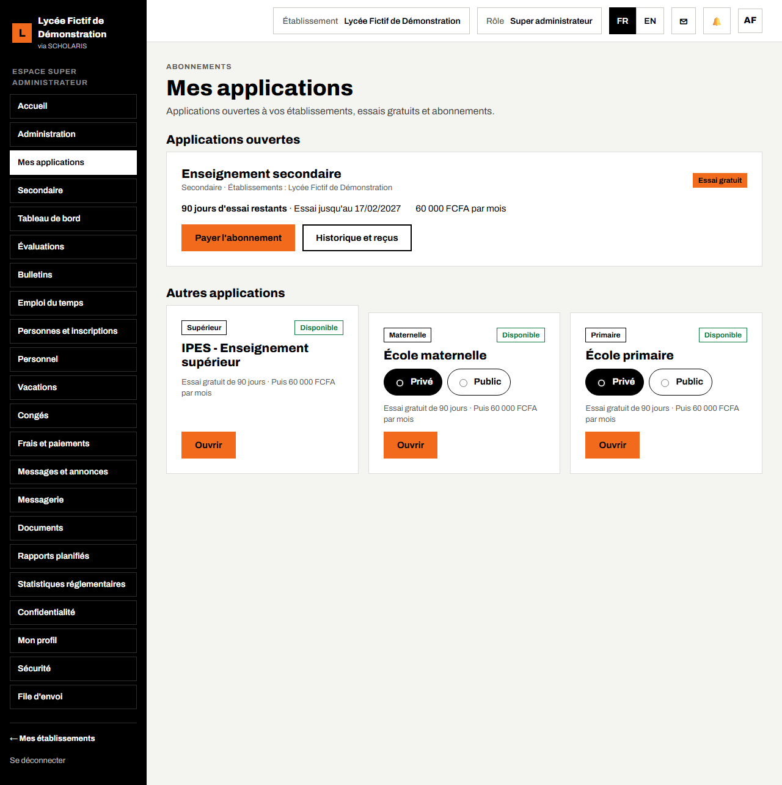
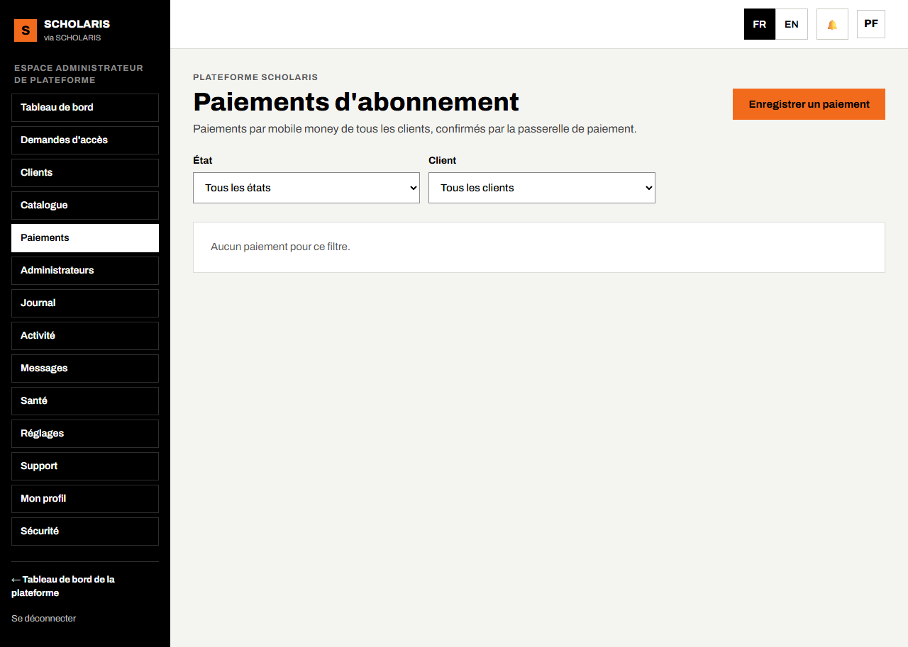
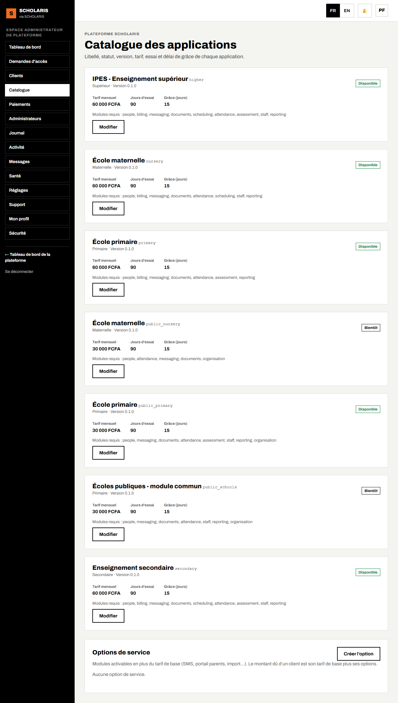

# 02. Le catalogue et les prix

## 2.1 Le catalogue public

Le catalogue est en ligne, sans compte : **https://scholariserp.trugroup.cm/applications-disponibles**. Montrez-le au prospect sur son propre téléphone : il y voit les applications, le prix, l'essai et le bouton **Demander l'accès**.

Les applications sont classées **par niveau** (supérieur, maternelle, primaire, secondaire). Pour la maternelle et le primaire, le prospect choisit d'abord le **régime** : **privé** ou **public**. Le régime décide de l'application ouverte, de ses règles et de son prix.

## 2.2 Les applications et leurs prix

Prix lus sur le catalogue public le **20 novembre 2026**. Ils sont fixés par la plateforme et peuvent changer : vérifiez le catalogue avant chaque rendez-vous.

| Application | Pour qui | Régime | Prix par mois | Essai gratuit | Statut au catalogue |
|---|---|---|---|---|---|
| **IPES - Enseignement supérieur** | instituts privés d'enseignement supérieur, centres de formation professionnelle | privé | **60 000 FCFA** | 90 jours | disponible |
| **École maternelle** | maternelles privées (laïques ou confessionnelles) | privé | **60 000 FCFA** | 90 jours | disponible |
| **École maternelle** | maternelles publiques | public | **30 000 FCFA** | 90 jours | **bientôt** |
| **École primaire** | écoles primaires privées | privé | **60 000 FCFA** | 90 jours | disponible |
| **École primaire** | écoles primaires publiques | public | **30 000 FCFA** | 90 jours | disponible |
| **Enseignement secondaire** | collèges et lycées, publics et privés, généraux et techniques | un seul produit | **60 000 FCFA** | 90 jours | disponible |

Points à connaître :

- **« Bientôt »** : l'application est annoncée mais ne peut pas encore être demandée. Le bouton de demande n'apparaît pas. Ne la vendez pas.
- **Le secondaire n'a qu'un prix**, public ou privé. Un tarif réduit pour un établissement public du secondaire n'existe pas au catalogue : **à confirmer par la direction**.
- **Le prix est par client et par application**, pas par élève. Un établissement de 200 ou de 2 000 élèves paie le même abonnement. C'est un argument fort pour les grands établissements ; pour les très petits, voir les objections (chapitre 13).
- Un client qui possède **deux établissements du même niveau** (deux collèges, par exemple) a techniquement **un seul abonnement « secondaire »**. Le tarif à appliquer dans ce cas est **à confirmer par la direction** (le super admin peut fixer un tarif propre au client, voir 2.5).

## 2.3 L'essai gratuit de 90 jours

- L'essai démarre à l'**acceptation** de la demande par TRU GROUP (ou à l'ouverture d'une nouvelle application par le client lui-même).
- Pendant l'essai, **tout fonctionne** : il n'y a pas de version limitée.
- L'écran **Mes applications** affiche « 90 jours d'essai restants », puis la date de fin.
- Le client peut **ouvrir lui-même une autre application** de son niveau (par exemple ajouter la maternelle à son école primaire) : elle a son propre essai de 90 jours.
- La durée de l'essai peut être changée client par client par le super admin (de 0 à 365 jours, avec un motif). Allonger un essai est une **décision commerciale : à confirmer par la direction**.

## 2.4 Après l'essai : payer, retard, régularisation

1. **Payer** : depuis **Mes applications**, la direction ou le super administrateur du client clique sur **Payer l'abonnement**, choisit le **nombre de mois**, **Orange Money** ou **MTN Mobile Money**, et valide la demande sur son téléphone. Un reçu est émis.
2. **Paiement à la plateforme sans passer par l'écran** : TRU GROUP peut aussi enregistrer un **paiement manuel** (espèces ou virement) avec un reçu.
3. **Retard** : à l'échéance, un **délai de grâce de 15 jours** s'ouvre. Tout fonctionne ; un bandeau jaune avertit tous les utilisateurs et des relances partent (14 jours avant, 3 jours avant, le jour même).
4. **Régularisation** : à la fin du délai de grâce, l'établissement passe en **lecture seule** (consultation et export, aucune modification) ou est **bloqué** (seul l'écran de paiement reste ouvert), selon le niveau choisi par TRU GROUP.
5. **Aucune donnée n'est perdue**, à aucun moment. Dès que le paiement est confirmé, l'accès revient tout de suite.
6. Le client peut aussi **déclarer** un paiement fait directement au numéro Orange Money ou MTN MoMo de TRU GROUP : la déclaration est vérifiée (automatiquement ou par TRU GROUP) avant le déblocage. TRU GROUP peut accorder une **promesse de paiement** (90 jours au plus).

## 2.5 Ce que le super admin peut ajuster pour un client

Depuis la fiche du client, le super admin de TRU GROUP peut, avec un motif :

- fixer un **tarif propre** au client pour une application ;
- changer la **durée de l'essai** et du **délai de grâce** ;
- choisir la **périodicité** : mensuelle, trimestrielle ou annuelle ;
- souscrire des **options de service** payantes (voir 2.7).

Chacun de ces gestes est une **décision commerciale**. Le commercial **propose**, la direction **décide**, le super admin **applique**. Aucune remise, aucun tarif annuel, aucun geste sur l'essai n'est promis au client sans accord écrit : **à confirmer par la direction**.

## 2.6 Ce qui est inclus dans l'abonnement

- **Tous les modules de l'application** ouverte (pas de module de base payant à part). Au secondaire, l'établissement coche les modules utiles (orientation, examens officiels, ateliers, stages, internat, cantine et transport, bibliothèque, infirmerie, paie simplifiée…) sans supplément.
- **Tous les utilisateurs** : l'application ne prévoit aucune limite de comptes (personnel, parents, élèves).
- Les **mises à jour** de l'application.
- Les **sauvegardes** chiffrées de la base, programmées chaque jour par TRU GROUP.
- Les **documents** avec numéro et QR code.
- Le **support** par TRU GROUP (contact affiché sur l'écran de régularisation et dans les messages). Les horaires et délais du support sont **à confirmer par la direction**.

## 2.7 Ce qui se paie à l'usage : les SMS, et les options

### Les SMS

- SCHOLARIS **compte les SMS** envoyés, par établissement.
- Coût indicatif retenu dans la plateforme : **environ 25 FCFA par SMS de 160 caractères** (un message plus long compte pour plusieurs SMS).
- La façon de **refacturer les SMS** au client (forfait inclus, recharge, facture mensuelle) **n'est pas automatisée** dans l'application : **à confirmer par la direction** avant d'en parler au client.
- Les SMS partent seulement aux personnes qui y ont consenti, sauf les **messages de service essentiels** (code d'activation, reçu, enfant non récupéré en maternelle, « bulletin disponible » quand l'établissement l'a choisi). Une personne désinscrite ne reçoit plus de SMS.

Exemple de calcul à faire avec le client (indicatif, prix à confirmer) : un lycée de 900 élèves qui envoie un SMS « bulletin disponible » par élève et par trimestre envoie environ 2 700 SMS par an, soit environ 67 500 FCFA à 25 FCFA l'unité.

### Les options de service

La plateforme sait vendre des **options de service** mensuelles, ajoutées au prix de l'application (par exemple un pack SMS). **Aucune option n'est en vente aujourd'hui** : leur liste et leurs prix sont **à confirmer par la direction**.

## 2.8 Ce que vous pouvez dire, ce que vous ne pouvez pas dire

| Vous pouvez dire | Vous ne pouvez pas dire (sans accord écrit) |
|---|---|
| « 90 jours d'essai gratuit, sans engagement. » | « Je vous fais six mois gratuits. » |
| « 60 000 FCFA par mois pour tout l'établissement, quel que soit le nombre d'élèves. » | « Le prix est négociable. » |
| « Les SMS sont comptés à l'usage ; le tarif vous sera précisé. » | « Les SMS sont gratuits. » |
| « Vos données restent lisibles et exportables même en cas de retard de paiement. » | « On ne coupe jamais. » |
| « Le paiement se fait par Orange Money ou MTN MoMo. » | « Vous pouvez payer quand vous voulez. » |
