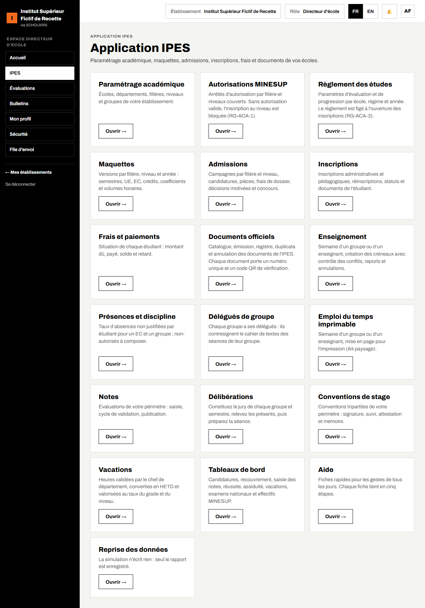
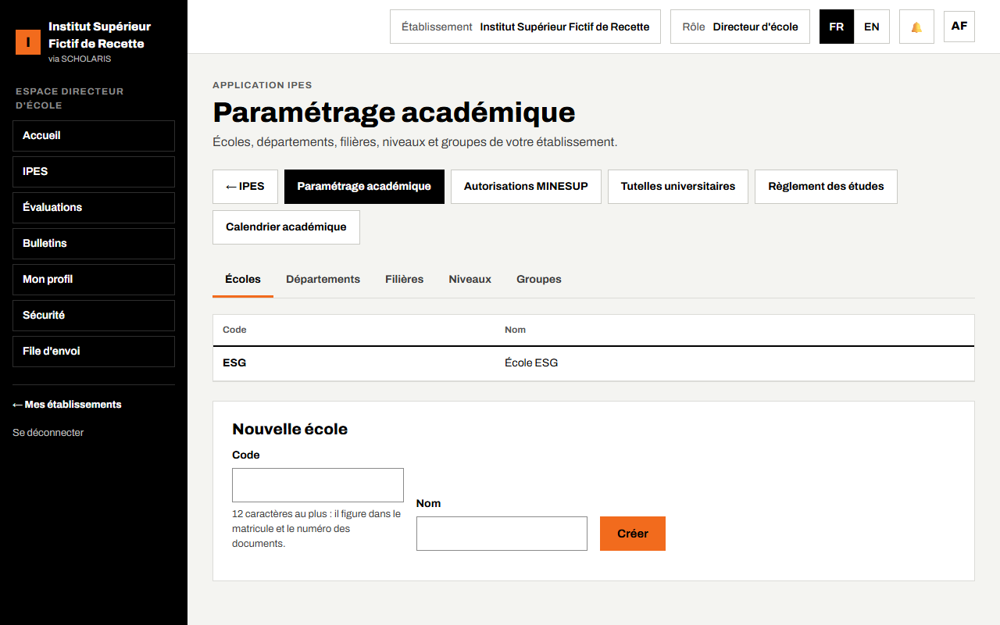
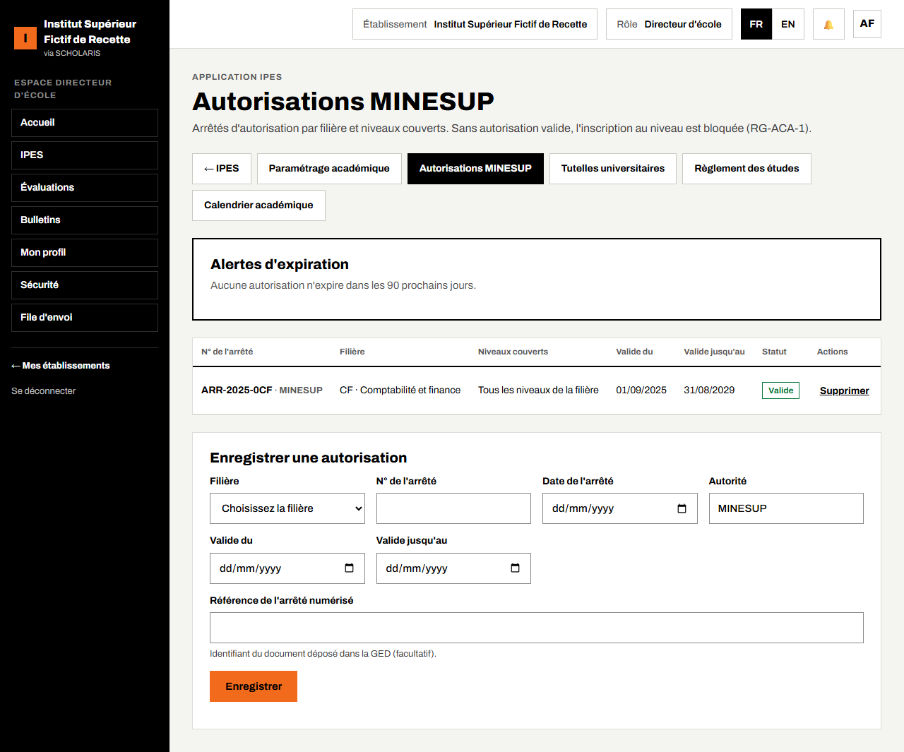
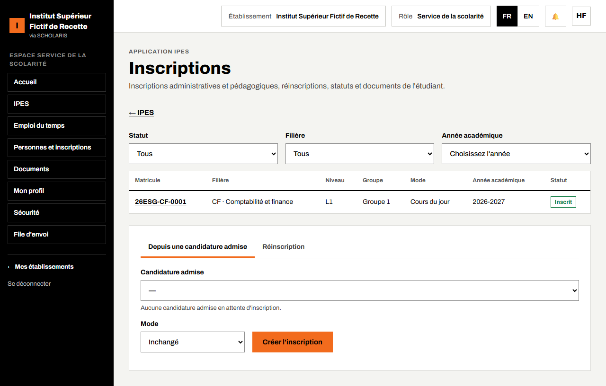
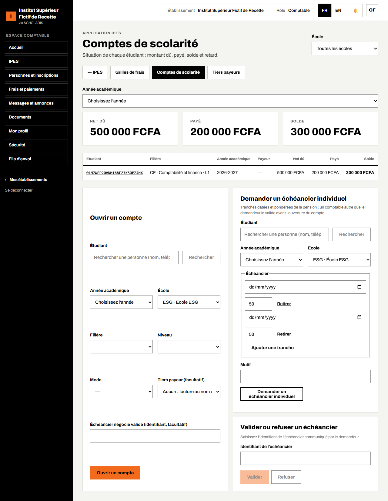
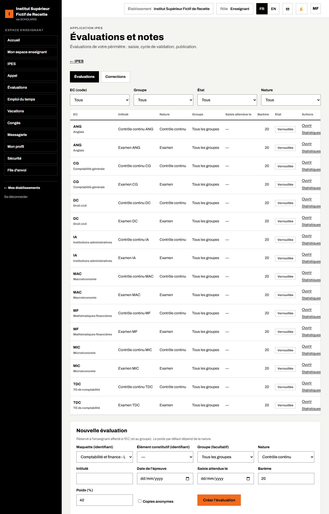
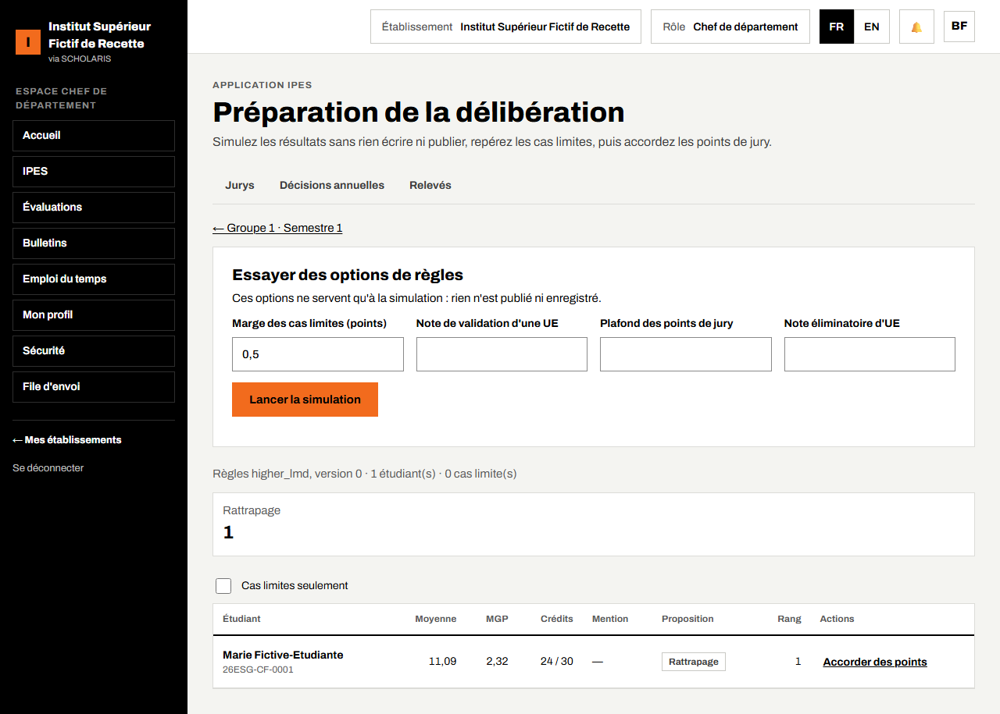
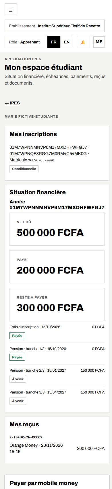
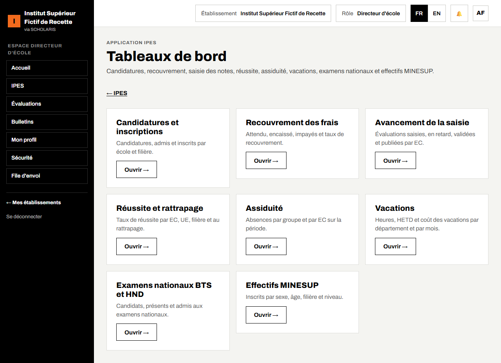

# 03. Fiche client : IPES (supérieur privé)

**Application à proposer** : **IPES - Enseignement supérieur**, 60 000 FCFA par mois, 90 jours d'essai. Statut : disponible.

## 3.1 Profil du client

Un **institut privé d'enseignement supérieur** (IPES) : une ou plusieurs écoles, des filières **BTS**, **HND**, **Licence** (professionnelle ou LMD), parfois un **Master**. Quelques centaines à quelques milliers d'étudiants. Les interlocuteurs : le **promoteur** (fondateur), le **directeur général**, le **directeur académique**, les **directeurs d'école** et le **chef de la scolarité**.

### Ses douleurs

- **Les notes dans Excel** : fichiers multiples, erreurs de copie, moyennes recalculées à la main avant chaque jury.
- **Les délibérations** : PV longs à produire, contestations, pas de trace des décisions.
- **Les relevés et attestations** : faits à la main, faciles à falsifier.
- **Les frais** : tranches, bourses, garants et entreprises payeuses mal suivis ; recouvrement flou.
- **Les autorisations MINESUP et la tutelle universitaire** : dates d'expiration oubliées, listes à transmettre.
- **Les examens nationaux BTS et HND** : liste des candidats à préparer, chaque année.
- **Les vacataires** : heures à vérifier, états de vacation contestés.

## 3.2 Les modules utiles

| Besoin | Ce que fait l'application | Chapitre du guide IPES |
|---|---|---|
| Organisation | écoles, départements, filières, niveaux, groupes, **autorisations MINESUP** avec alerte d'expiration, tutelles, règlement des études, calendrier, **maquettes** (UE, EC, crédits) | 02 |
| Admissions | campagnes, candidatures, pièces, frais de dossier, classement, décision, **matricule** à l'inscription | 03 |
| Finances | grilles de frais, comptes de scolarité, caisse, **bourses et remises**, échéanciers, **tiers payeurs** (entreprises, bailleurs), attestation de paiement et quitus, **paiement mobile** | 04 |
| Enseignement | emploi du temps, **appel (même hors ligne)**, cahier de textes, validation mensuelle des heures, discipline, planning des examens | 05 |
| Notes | évaluations, saisie à l'écran, **sans réseau** ou par fichier, cycle soumis → validé → verrouillé → publié, corrections tracées, requêtes des étudiants | 06 |
| Délibérations et documents | jury, **simulation**, séance, **PV signé**, publication, rattrapage, relevés, **32 documents officiels avec QR** (DOC-01 à DOC-32) | 07 |
| Fin d'études | stages, soutenances, **examens nationaux BTS et HND**, **tutelle universitaire**, **vacations** | 08 |
| Pilotage | tableaux de bord (recouvrement, candidatures, examens nationaux…), exports, reprise de données | 09 |
| Portails | espace étudiant, espace garant, membre de jury, enseignant | 10 |

## 3.3 Démonstration en 15 minutes

Préparez un compte de démonstration (chapitre 14). Suivez cet ordre : le prospect voit d'abord le résultat (le relevé et le tableau de bord), puis comment on y arrive.

| Minute | Écran | Ce que vous dites |
|---|---|---|
| 0-2 | Accueil du directeur | « Chaque personne ne voit que les cartes de son rôle. » |
| 2-4 | Structure et autorisations | « Vos écoles, filières et autorisations MINESUP, avec une alerte avant l'expiration. » |
| 4-6 | Inscriptions et compte d'un étudiant | « Le matricule est attribué à l'inscription ; le compte montre ce qui est dû, payé, et par qui. » |
| 6-9 | Notes de l'enseignant | « L'enseignant saisit, même sans réseau ; le chef de département valide et verrouille. » |
| 9-12 | Simulation du jury | « La moyenne, la MGP et les crédits sont calculés ; le jury décide, le PV est signé. » |
| 12-14 | Espace étudiant sur téléphone | « L'étudiant voit ses notes publiées, ses documents et paie par Mobile Money. » |
| 14-15 | Tableaux de bord | « Le promoteur suit le recouvrement et les inscriptions sans se déplacer. » |

**Écran 1. Accueil du directeur d'école.** Les cartes ouvrent chaque rubrique.

**Écran 2. Structure académique.** Écoles, départements, filières, niveaux et groupes.

**Écran 3. Autorisations MINESUP.** Chaque filière ouverte a son autorisation, avec ses dates.

**Écran 4. Inscriptions.** La scolarité inscrit l'étudiant admis ; le matricule est attribué.

**Écran 5. Comptes de scolarité.** Ce qui est dû, payé, et le reste, étudiant par étudiant.

**Écran 6. Notes de l'enseignant.** Il crée ses évaluations et saisit les notes de ses groupes uniquement.

**Écran 7. Préparation du jury.** La simulation calcule la moyenne, la MGP et les crédits avant la séance.

**Écran 8. Espace étudiant sur téléphone.**

**Écran 9. Tableaux de bord de la direction.**

## 3.4 Les utilisateurs et leurs rôles

L'application IPES compte **23 rôles** (R01 à R23). Chaque rôle a un **périmètre** : tout l'institut, une école, un département, une filière ou un groupe.

| Rôle | Ce qu'il fait | Ce qu'il voit |
|---|---|---|
| Promoteur | suit la santé de l'institut, sans rien saisir | tableaux de bord, finances, toutes les rubriques en lecture |
| Directeur général | publie les maquettes, approuve les vacations, signe les documents institutionnels | tout, en lecture ; double authentification obligatoire |
| Directeur académique | maquettes, calendrier, tutelles, réouverture motivée d'une délibération | son domaine |
| Directeur d'école | paramétrage de son école, admissions, validation des inscriptions, dérogations, présidence des jurys, signature | son école |
| Chef de département | affectations, emploi du temps, validation et verrouillage des notes, préparation des jurys | son département |
| Responsable de filière | emploi du temps de la filière, stages | sa filière |
| Service de la scolarité | candidatures, inscriptions, documents officiels, publication des notes et des résultats, examens nationaux | son école |
| Service des examens | planning des épreuves, anonymat, convocations | son école |
| Enseignant permanent ou vacataire | appel, cahier de textes, saisie des notes | ses groupes et ses EC seulement |
| Responsable de la discipline | assiduité, discipline | son école |
| Caissier | encaisse, délivre les reçus | la caisse |
| Comptable | grilles de frais, bourses, échéanciers, vacations | les finances |
| Responsable des stages, RH, communication, bibliothécaire | stages et soutenances ; dossiers des enseignants ; communication | leur domaine |
| Administrateur fonctionnel | comptes, rôles, paramètres | l'administration |
| Membre de jury | siège au jury, signe le PV | ses jurys, pendant la session |
| Étudiant | consulte notes publiées, documents, paie | lui-même |
| Garant (parent, tuteur, entreprise) | paie, consulte la situation financière ; notes et absences avec l'accord de l'étudiant majeur | ses étudiants |
| Université de tutelle, inspection ou auditeur (externes) | lecture des dossiers concernés | périmètre accordé, **90 jours au plus** |

Les rôles sensibles (direction, caisse, comptabilité, enseignant permanent) ont la **double authentification** obligatoire.

## 3.5 Variantes d'établissements

| Variante | Ce qui change | Réglages au démarrage | Argument | Objection typique |
|---|---|---|---|---|
| **IPES classique (BTS, HND, Licence)** | régimes BTS et HND (examen national) ou LMD (crédits) selon la filière | autorisations MINESUP par filière, maquettes, grilles de frais | « Du relevé au PV, tout est calculé et tracé. » | « Nos maquettes changent tout le temps » : elles sont versionnées et publiées par la direction. |
| **Institut sous tutelle universitaire** | module **Tutelle** : conventions, transmissions à l'université, dossiers de diplôme ; accès **Université de tutelle** en lecture limitée (90 jours au plus) | tutelle déclarée par filière (chapitre 02 du guide IPES), alertes d'expiration des conventions | « L'université reçoit des listes propres, et vous gardez la preuve de chaque transmission. » | « L'université a son propre format » : les formats officiels d'échange ne sont pas tous connus ; l'export suit le modèle de l'application (à vérifier au cas par cas). |
| **École paramédicale** (BTS études médico-sanitaires, certificats d'aide-soignant…) | modèle de démarrage **« santé et paramédical »** : école, département et filières préparés (BTS et certificats d'un an), fermés « à confirmer » | filières à confirmer et autorisations à saisir par l'établissement | « Vos filières sont prêtes en une fois ; vous confirmez celles que vous ouvrez. » | **À vérifier** : une école sous tutelle **MINSANTÉ** (et non MINESUP) ; l'application parle d'autorisations MINESUP. Faites valider l'usage par l'équipe produit avant de vendre. |
| **Centre de formation professionnelle MINEFOP** | voir le chapitre 04 | modèle « formation-pro » | — | — |
| **Plusieurs instituts d'un même promoteur** | **un client par institut** (règle de la plateforme pour le supérieur) ; chaque institut a son abonnement | une demande d'accès par institut | données strictement séparées | « Je veux une vue consolidée » : pas de vue consolidée entre deux clients IPES ; **à confirmer par la direction**. |

Les modèles de démarrage (« santé et paramédical », « gestion et administration », « formation-pro », « complet ») sont installés par **l'équipe technique de TRU GROUP** sur demande, après la création du client. Ils créent écoles, départements et filières marqués **« à confirmer »**, sans aucune autorisation : l'établissement confirme et saisit ses autorisations lui-même.

## 3.6 Objections fréquentes et réponses

| Objection | Réponse |
|---|---|
| « Nos enseignants ne sauront pas saisir les notes. » | « Ils saisissent sur téléphone, même sans réseau, ou importent un fichier. Le chef de département voit qui est en retard. » |
| « Et si un enseignant modifie une note après le jury ? » | « Impossible : une note verrouillée ne se modifie que par une demande de correction validée deux fois, avec motif et trace. » |
| « Nos relevés sont falsifiés. » | « Chaque relevé porte un numéro et un QR code : n'importe qui vérifie en ligne qu'il est authentique. » |
| « Nos étudiants paient en retard. » | « Échéanciers, relances, attestation de paiement et quitus ; paiement Mobile Money depuis l'espace étudiant ou garant. » |
| « Nous avons déjà nos données dans Excel. » | « TRU GROUP fait la reprise de données au démarrage (étudiants, personnel, soldes d'ouverture). » |
| « Les entreprises paient pour certains étudiants. » | « Les tiers payeurs sont gérés : l'entreprise est garant, on suit ce qu'elle doit. » |

## 3.7 Questions de découverte

1. Combien d'étudiants, d'écoles, de filières ? Quels diplômes (BTS, HND, Licence, Master) ?
2. Avez-vous une tutelle universitaire ? Laquelle, pour quelles filières ?
3. Vos autorisations MINESUP sont-elles à jour ? Qui suit leur expiration ?
4. Comment calculez-vous les moyennes et préparez-vous les jurys aujourd'hui ? Combien de jours cela prend-il ?
5. Combien de vacataires ? Comment validez-vous leurs heures ?
6. Comment encaissez-vous ? Quel est votre taux de recouvrement en fin d'année ?
7. Qui délivre les relevés et attestations ? Avez-vous eu des faux ?
8. Les étudiants ont-ils un smartphone ? Le réseau est-il fiable dans vos salles ?
9. Qui sera l'administrateur SCHOLARIS chez vous ?
