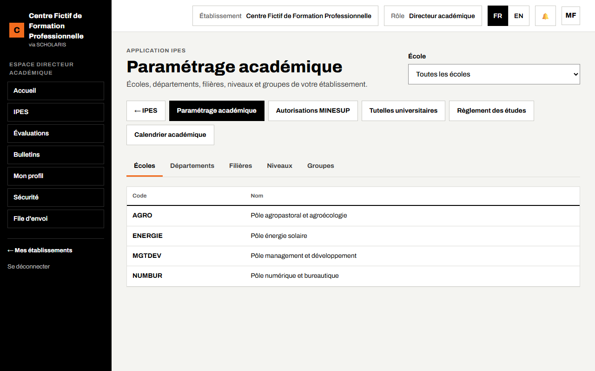
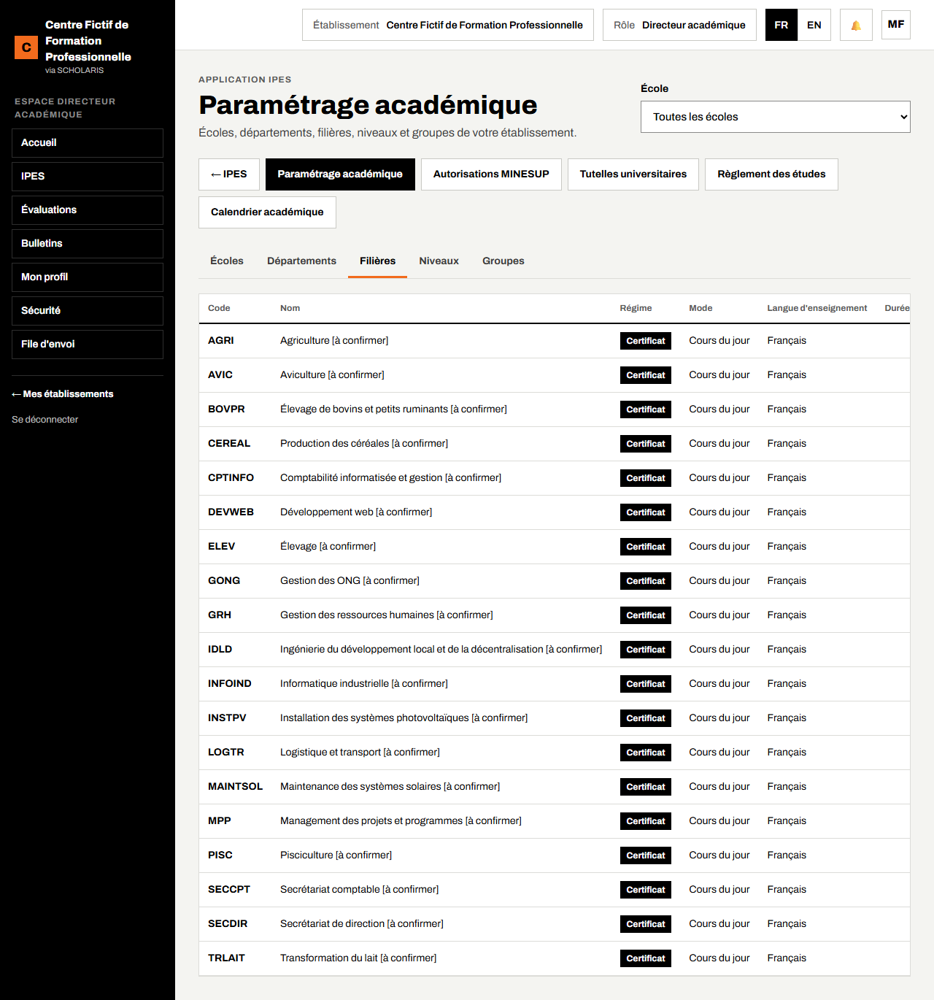
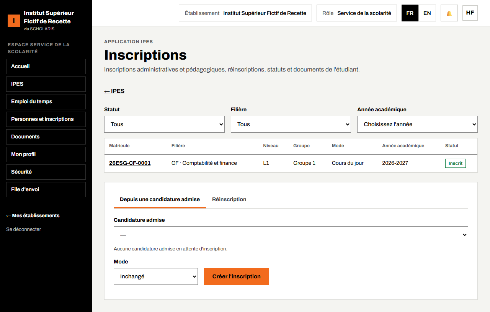

# 04. Fiche client : centre de formation professionnelle agréé MINEFOP

**Application à proposer** : **IPES - Enseignement supérieur**, avec le modèle de démarrage **« formation-pro »**. 60 000 FCFA par mois, 90 jours d'essai.

Il n'existe pas d'application propre à la formation professionnelle : le centre utilise l'application IPES, dont le régime **« certificat »** (formation à crédits, sans examen national BTS ou HND) convient aux formations qualifiantes. Le vocabulaire de l'application reste celui du supérieur (école, filière, étudiant, maquette) : prévenez le client.

## 4.1 Profil du client

Un **centre de formation professionnelle** privé agréé par le **MINEFOP**. Des formations de 12 ou 24 mois, souvent en **alternance** (centre et entreprise), dans des métiers concrets : agriculture, élevage, énergie solaire, informatique, secrétariat, gestion de projets. Des apprenants adultes ou jeunes adultes. Interlocuteurs : le **promoteur**, le **directeur du centre**, le **responsable pédagogique**, le **comptable**.

### Ses douleurs

- Des **spécialités nombreuses** à organiser, chacune avec ses modules.
- Le suivi des **stages en entreprise** (conventions, entreprises, soutenances).
- Des **attestations de fin de formation** faites à la main.
- Des **frais** payés par tranches, parfois par un bailleur ou une ONG.
- Les **formateurs vacataires** à payer à l'heure.

## 4.2 Le modèle « formation-pro »

À la demande du client, **l'équipe technique de TRU GROUP** installe le modèle « formation-pro » sur son institut, après la création du client. Il crée en une fois :

| Pôle (école) | Spécialités (filières, 2 ans par défaut) |
|---|---|
| **Pôle agropastoral et agroécologie** | Agriculture, Élevage, Aviculture, Pisciculture, Transformation du lait, Production des céréales, Élevage de bovins et petits ruminants |
| **Pôle énergie solaire** | Maintenance des systèmes solaires, Installation des systèmes photovoltaïques |
| **Pôle numérique et bureautique** | Secrétariat comptable, Comptabilité informatisée et gestion, Développement web, Informatique industrielle, Secrétariat de direction |
| **Pôle management et développement** | Ingénierie du développement local et de la décentralisation, Management des projets et programmes, Gestion des ONG, Logistique et transport, Gestion des ressources humaines |

Soit **19 spécialités en 4 pôles**, chacune avec son département, ses niveaux et ses groupes, un profil documentaire et une grille de frais vide.

À savoir et à dire au client :

- Chaque spécialité est créée **fermée, marquée « à confirmer »** : le centre ouvre seulement celles de **son agrément**.
- La durée est posée à **2 ans par défaut** ; elle est **à confirmer filière par filière** d'après l'agrément (12 ou 24 mois).
- **Aucune autorisation n'est créée** : le centre saisit lui-même les références de son agrément.
- Les montants des frais ne sont pas remplis : le centre saisit sa grille.

Chaque spécialité porte la mention **« [à confirmer] »** dans son nom tant que le centre ne l'a pas confirmée : c'est voulu, cela évite d'ouvrir par erreur une spécialité hors agrément.

## 4.3 Les modules utiles

- **Admissions et inscriptions** : candidatures, pièces, matricule.
- **Finances** : grilles de frais par tranche, bourses, **tiers payeurs** (bailleur, ONG, entreprise), reçus, paiement Mobile Money.
- **Enseignement et présences** : emploi du temps, appel (même hors ligne), cahier de textes, heures des formateurs.
- **Notes** : évaluations, cycle de validation, relevés.
- **Stages** : conventions de stage, entreprises, sujets, **soutenances**.
- **Vacations** : états de vacation des formateurs, visés puis approuvés.
- **Documents avec QR** : attestations, relevés, certificats.

## 4.4 Démonstration en 15 minutes

| Minute | Écran | Ce que vous dites |
|---|---|---|
| 0-3 | Structure créée par le modèle | « Vos pôles et spécialités sont déjà là ; vous confirmez celles de votre agrément. » |
| 3-6 | Inscriptions et compte de l'apprenant | « Matricule, frais par tranche, payeur : l'apprenant, sa famille ou un bailleur. » |
| 6-9 | Notes du formateur | « Le formateur saisit sur son téléphone ; le responsable valide. » |
| 9-12 | Stages et soutenances (guide IPES, chapitre 08) | « Convention, entreprise, sujet et soutenance suivis jusqu'au bout. » |
| 12-15 | Espace apprenant et tableau de bord | « L'apprenant voit ses notes et ses documents ; vous suivez le recouvrement. » |

Pour les écrans 2 à 5, utilisez les captures de la fiche IPES (chapitre 03) : ce sont les mêmes écrans.

## 4.5 Les utilisateurs et leurs rôles

Ce sont les rôles de l'application IPES (chapitre 03), avec les équivalences suivantes :

| Dans le centre | Rôle IPES à attribuer | Ce qu'il fait | Ce qu'il voit |
|---|---|---|---|
| Promoteur | Promoteur | suit le centre | tableaux de bord, lecture |
| Directeur du centre | Directeur d'école (ou Directeur général) | admissions, inscriptions, signature des documents | tout le centre |
| Chef de pôle | Chef de département | affectations, validation des notes | son pôle |
| Responsable pédagogique | Directeur académique | maquettes, calendrier | la pédagogie |
| Secrétariat | Service de la scolarité | inscriptions, documents | les dossiers |
| Formateur | Enseignant permanent ou vacataire | appel, notes, cahier de textes | ses groupes |
| Responsable des stages | Responsable des stages | conventions, soutenances | les stages |
| Comptable, caissier | Comptable, Caissier | frais, caisse, vacations | les finances |
| Apprenant | Étudiant | notes publiées, documents, paiement | lui-même |
| Parent, bailleur, entreprise | Garant | paiement, situation financière | ses apprenants |

## 4.6 Variantes d'établissements

| Variante | Ce qui change | À dire |
|---|---|---|
| **Formation qualifiante (CQP)** | régime « certificat » de l'application | Le nom exact du diplôme se règle dans les libellés des filières et des documents. Les formats officiels du MINEFOP pour le CQP **ne sont pas intégrés** : **à confirmer**. |
| **Diplôme de qualification professionnelle (DQP)** | même régime | Idem : pas de format officiel DQP intégré ; **à confirmer**. |
| **Alternance** | stages et conventions d'entreprise | L'alternance se suit par les stages. Un calendrier d'alternance (semaines centre, semaines entreprise) **n'est pas un écran dédié** : il se gère avec l'emploi du temps. |
| **Centre multi-domaines** | modèle « formation-pro » complet | Les pôles inutiles restent fermés. |
| **Centre avec une seule spécialité** | modèle installé, puis une seule filière ouverte | Le prix est le même : l'argument est le gain de temps sur les documents et la caisse. |

## 4.7 Objections fréquentes et réponses

| Objection | Réponse |
|---|---|
| « Nous ne sommes pas une université. » | « Le vocabulaire est celui du supérieur, mais les écrans font exactement ce dont vous avez besoin : inscriptions, frais, notes, stages, attestations. » |
| « Nos spécialités ne sont pas toutes dans votre modèle. » | « Le modèle est un point de départ ; le centre crée ses propres filières dans la structure. » |
| « Nos apprenants n'ont pas tous un smartphone. » | « L'espace apprenant est un plus ; la caisse, les reçus et les documents fonctionnent sans lui. » |
| « Le MINEFOP a ses formulaires. » | « Les documents ont des modèles modifiables ; les formats officiels propres au MINEFOP sont à confirmer avec notre équipe produit. » |

## 4.8 Questions de découverte

1. Quel est votre agrément MINEFOP ? Quelles spécialités, pour quelle durée ?
2. Combien d'apprenants par promotion ? Combien de promotions par an ?
3. Pratiquez-vous l'alternance ? Combien d'entreprises partenaires ?
4. Qui paie la formation : l'apprenant, sa famille, un bailleur, une ONG ?
5. Quels documents délivrez-vous en fin de formation ? Qui les signe ?
6. Combien de formateurs vacataires ? Comment les payez-vous ?
