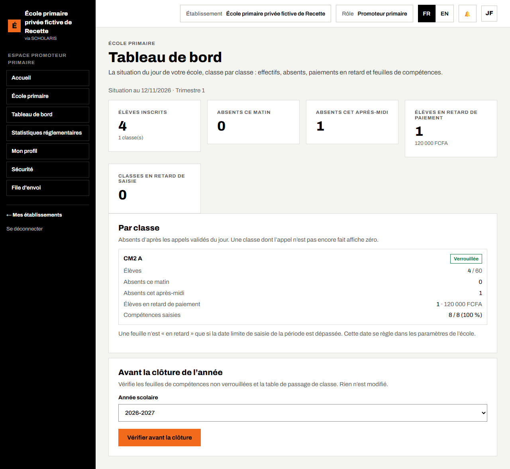
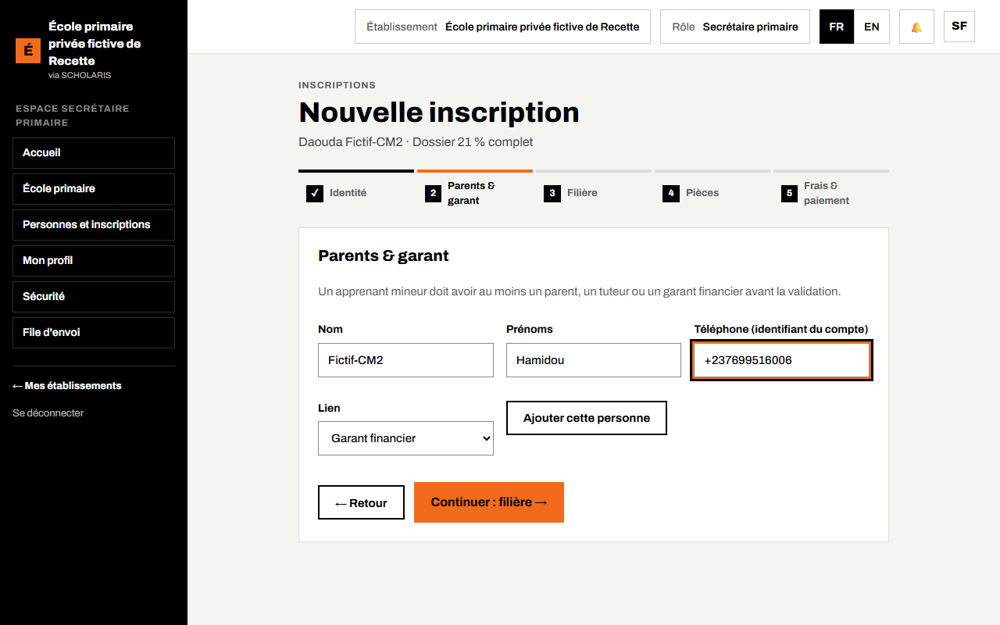
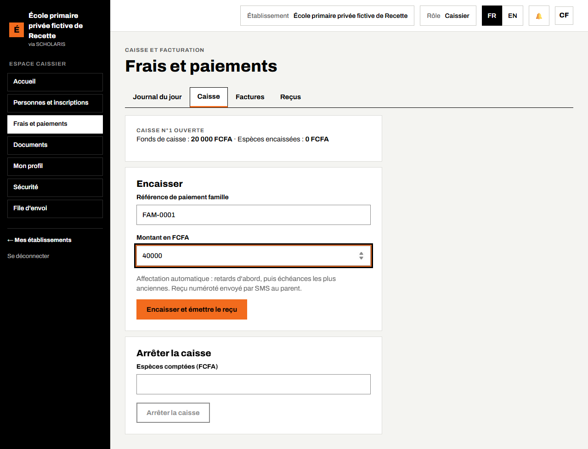
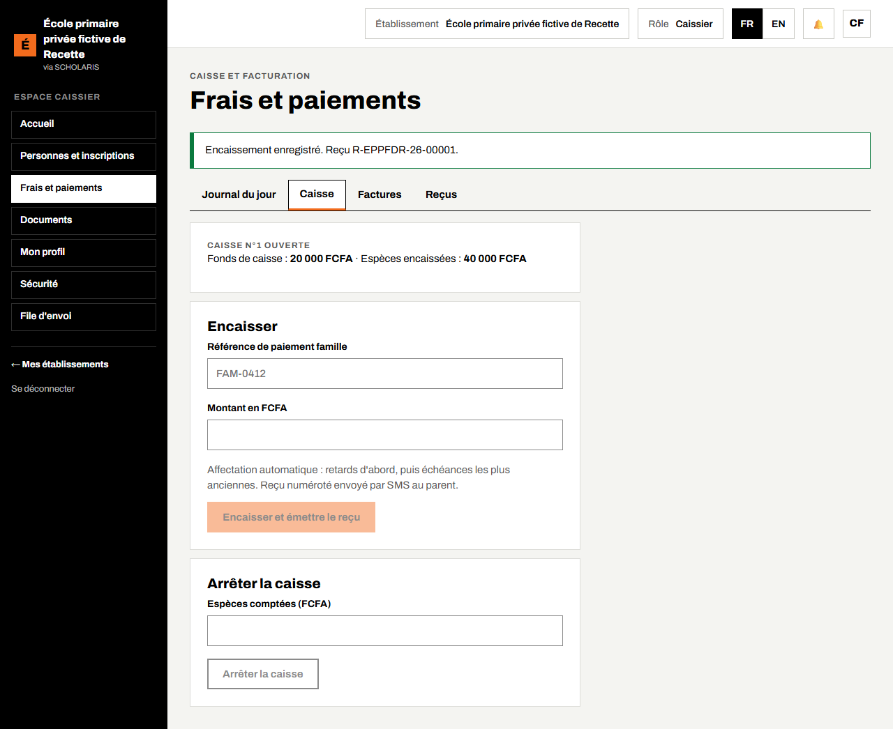
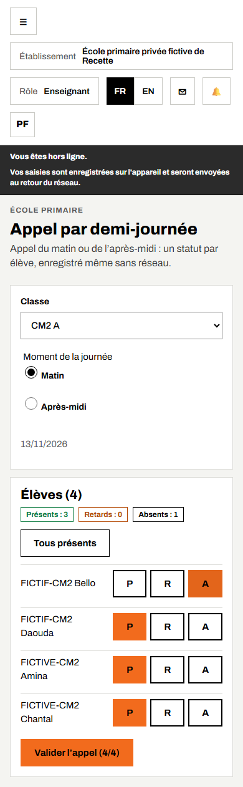
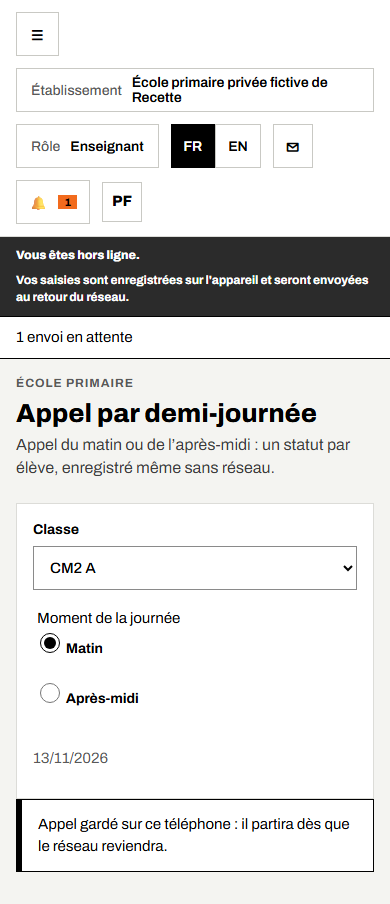
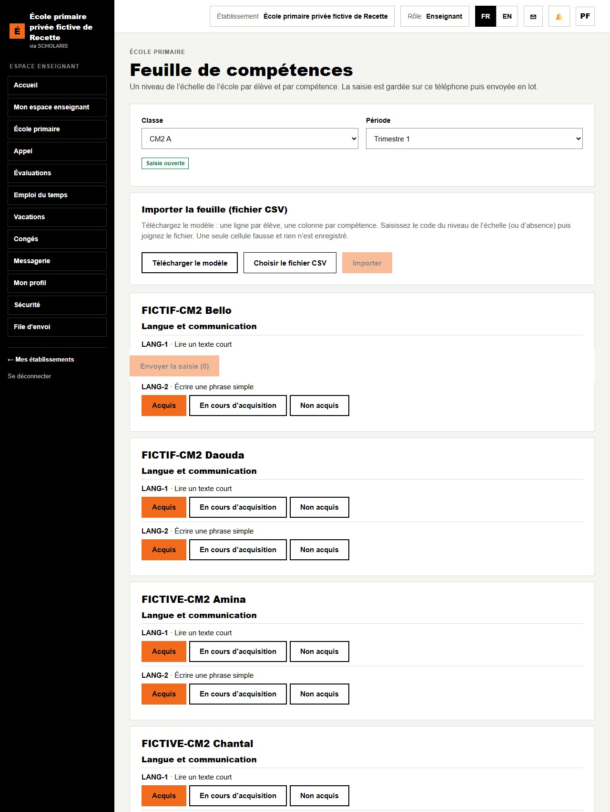
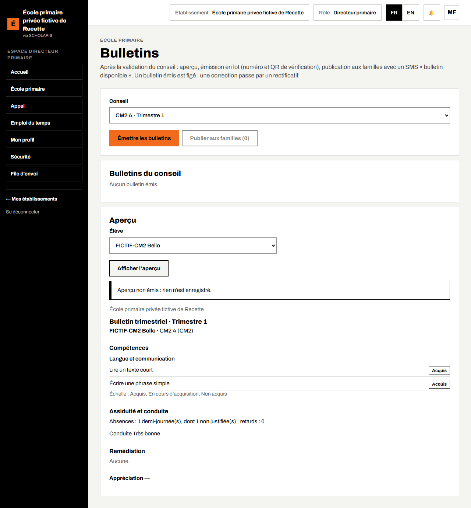
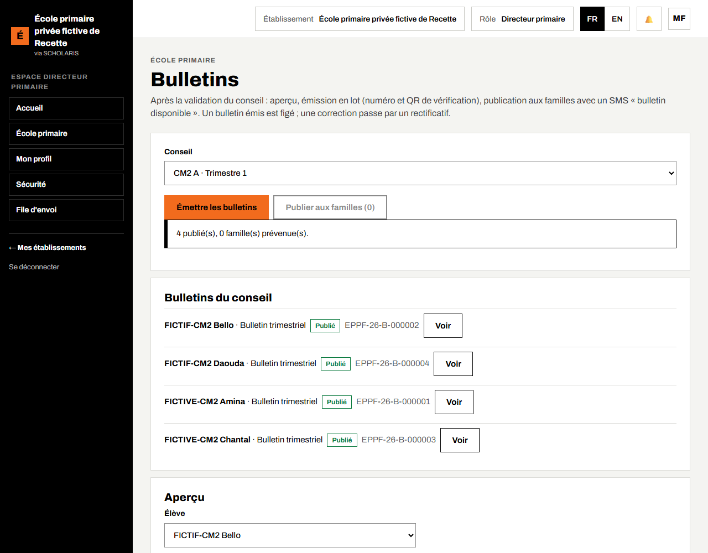
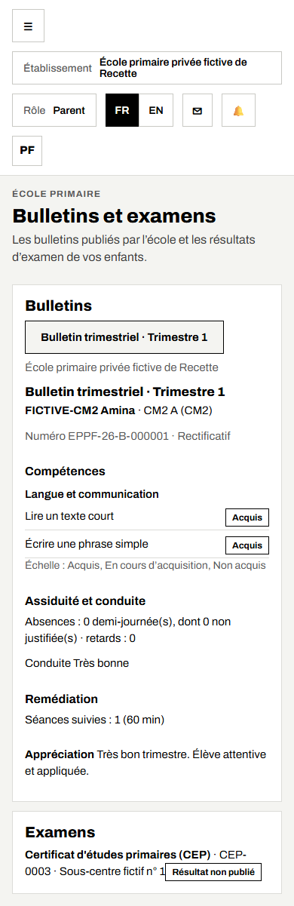

# 05. Fiche client : école primaire privée

**Application à proposer** : **École primaire**, régime **privé**. 60 000 FCFA par mois, 90 jours d'essai. Statut : disponible.

## 5.1 Profil du client

Une **école primaire privée**, laïque ou confessionnelle, de quelques classes à plusieurs groupes par niveau (SIL à CM2, ou Class 1 à Class 6 dans le sous-système anglophone). Interlocuteurs : le **promoteur** (souvent propriétaire), le **directeur** ou la **directrice**, la **secrétaire**, la **comptable** ou la caissière.

### Ses douleurs

- **L'argent** : pensions payées par tranches, cahiers de reçus, relances orales, impayés découverts trop tard.
- **Les bulletins** : feuilles de compétences remplies à la main, recopiées, bulletins tapés un par un.
- **Les parents** : ils veulent savoir, mais l'école n'a pas le temps d'appeler chacun.
- **L'appel** : registres papier, absences non signalées aux parents.
- **La sortie des enfants** : qui vient chercher l'enfant ?
- **L'examen** : listes du CEP ou du FSLC à préparer pour l'inspection.

## 5.2 Les modules utiles

| Besoin | Ce que fait l'application | Chapitre du guide primaire privé |
|---|---|---|
| Paramétrage | année et trimestres, classes, **autorisations d'ouverture**, niveaux, **référentiel de compétences** (à partir d'un modèle) | 02 |
| Inscriptions | **nouvelle inscription en 5 étapes** (identité, parents et **garant financier**, classe, pièces, frais), fiche de l'élève, guichet, documents avec QR, transfert | 03 |
| Frais | factures, **caisse** (ouverture, encaissement, arrêt), reçus, journal du jour, **Orange Money et MTN MoMo** avec la **référence de paiement famille** | 04 |
| Vie de classe | **appel du matin et de l'après-midi, même sans réseau**, conduite, cahier de liaison | 05 |
| Compétences | feuille de compétences à l'écran ou par fichier, correction, verrouillage | 06 |
| Conseil et bulletins | conseil des maîtres, remédiation, **bulletins avec QR**, publication aux familles avec **SMS « bulletin disponible »**, rectificatif | 07 |
| Examen | **CEP** (francophone) et **FSLC** (anglophone) : candidats, numéros, résultats officiels | 08 |
| Services | cantine, garderie, transport ; **sortie sécurisée** | 09 |
| Pilotage | tableau de bord, exports pour la tutelle, clôture de l'année | 10 |
| Parents | espace des parents : enfants, bulletins publiés, résultats d'examen | 11 |

## 5.3 Démonstration en 15 minutes

| Minute | Écran | Ce que vous dites |
|---|---|---|
| 0-2 | Tableau de bord du promoteur | « Vous voyez les effectifs, les absents et les retards de paiement d'un coup d'œil. » |
| 2-5 | Nouvelle inscription | « Cinq étapes : l'enfant, ses parents et qui paie, sa classe, ses pièces, ses frais. » |
| 5-7 | Caisse et reçu | « Chaque paiement a son reçu numéroté. Le soir, la caisse est arrêtée. » |
| 7-9 | Appel sur téléphone, sans réseau | « Le maître fait l'appel, même sans réseau. » |
| 9-12 | Feuille de compétences, puis bulletin | « Le maître saisit, le directeur verrouille, le bulletin sort avec un QR code. » |
| 12-15 | Espace parent sur téléphone | « Le parent reçoit un SMS et voit le bulletin sur son téléphone. » |

## 5.4 Les utilisateurs et leurs rôles

| Rôle (nom à l'écran) | Ce qu'il fait | Ce qu'il voit |
|---|---|---|
| **Super administrateur** (promoteur ou administrateur de l'école) | année et trimestres, classes, autorisations, comptes et rôles, paramètres, frais | l'administration de l'école |
| **Promoteur primaire** | consulte, exporte pour la tutelle ; ne saisit rien | tableau de bord, compétences, conseils, bulletins, examen, services |
| **Directeur primaire** | démarrage, niveaux, appel de toutes les classes, présidence du conseil, bulletins, verrouillage, examen, sortie sécurisée, clôture | toute l'école sauf la caisse |
| **Responsable pédagogique primaire** (adjoint) | référentiel, validation des feuilles, remédiation, emploi du temps | la pédagogie |
| **Secrétaire primaire** | inscriptions et facture d'inscription, fiches, documents, candidats à l'examen | les dossiers |
| **Enseignant** (maître, maîtresse) | appel, feuille de compétences, conduite, cahier de liaison, remédiation | sa classe |
| **Surveillant primaire** | sortie sécurisée, sanctions | la sortie ; pas les bulletins |
| **Comptable** | catalogue des frais, échéanciers, factures, remises, forfaits de services | les finances |
| **Caissier** | caisse, encaissement, reçus ; n'annule pas seul un paiement | la caisse |
| **Parent** (garant financier) | consulte les bulletins publiés et les résultats d'examen | ses enfants seulement |

Dans une petite école, **une même personne cumule plusieurs rôles** (par exemple directeur et enseignant) : elle change de rôle en haut de l'écran.

## 5.5 Variantes d'établissements

| Variante | Ce qui change | Réglages au démarrage | Argument | Objection |
|---|---|---|---|---|
| **École privée laïque** | rien de particulier | frais, référentiel, niveaux | recouvrement et bulletins | « C'est cher pour nous » : comparez au temps passé sur les bulletins et aux impayés. |
| **École privée confessionnelle** (catholique, protestante, islamique) | **même application** ; aucun réglage propre au confessionnel. Les contributions particulières se créent comme des **frais** ; les activités religieuses ne sont pas un module. | frais propres (contributions, uniformes…) | même argumentaire ; l'organisme gestionnaire peut recevoir des exports | « Notre secrétariat diocésain veut une vue de toutes nos écoles » : une vue consolidée par réseau n'existe pas aujourd'hui ; **à confirmer par la direction**. |
| **École bilingue ou anglophone** | niveaux **Class 1 à Class 6** possibles ; examen **FSLC** (anglophone) à côté du **CEP** (francophone) ; **bulletins en anglais** (langue de la section du niveau, ou langue imposée par un paramètre) ; écrans en **EN** | créer les niveaux de chaque sous-système ; choisir la langue des bulletins | une seule école, deux sous-systèmes, un seul outil | « Le Common Entrance ? » : il est prévu dans l'application du primaire **public** ; au privé, seuls le CEP et le FSLC sont proposés. |
| **Petite école rurale** | une ou deux personnes font tout (rôles cumulés) ; réseau faible | appel hors ligne ; ouvrir l'écran d'appel une première fois avec le réseau | l'appel sans réseau, le reçu sur téléphone | « Pas d'ordinateur » : tout marche sur téléphone. « Pas de réseau » : l'appel attend le retour du réseau ; le reste demande une connexion. |
| **Grande école urbaine** | plusieurs classes par niveau, caissiers, comptable, surveillant | rôles séparés, caisse avec arrêt du soir | contrôle de la caisse, SMS aux familles, sortie sécurisée | « Nos parents ne lisent pas les SMS » : le bulletin reste visible dans l'espace parent, SMS reçu ou non. |
| **Primaire dans un groupe scolaire** | voir le chapitre 10 | — | — | — |

## 5.6 Objections fréquentes et réponses

| Objection | Réponse |
|---|---|
| « Nos maîtres ne savent pas utiliser un ordinateur. » | « Ils n'en ont pas besoin : l'appel et la feuille de compétences marchent sur téléphone. » |
| « Si on bloque le bulletin pour impayé, les parents vont crier. » | « Par défaut, l'impayé ne bloque pas le bulletin. C'est l'école qui décide dans ses paramètres. » |
| « Les parents vont nous appeler pour chaque SMS. » | « Le SMS dit seulement que le bulletin est disponible ; le parent le lit dans son espace. » |
| « On a déjà un cahier de reçus. » | « Le cahier ne dit pas qui n'a pas payé. SCHOLARIS, si : le tableau de bord compte les retards. » |
| « Nos bulletins ont un format à nous. » | « Le bulletin a un modèle ; l'adapter à votre format est à étudier avec notre équipe. » |

## 5.7 Questions de découverte

1. Combien d'élèves, de classes, de maîtres ? Francophone, anglophone ou bilingue ?
2. Comment encaissez-vous aujourd'hui ? Combien de tranches ? Quel taux d'impayés en fin d'année ?
3. Comment préparez-vous les bulletins ? Combien de jours par trimestre ?
4. Les parents ont-ils un téléphone ? Paient-ils déjà par Mobile Money ?
5. Proposez-vous la cantine, la garderie, le transport ?
6. Avez-vous une maternelle ou un collège dans le même groupe ?
7. Qui sera l'administrateur SCHOLARIS de l'école ?
