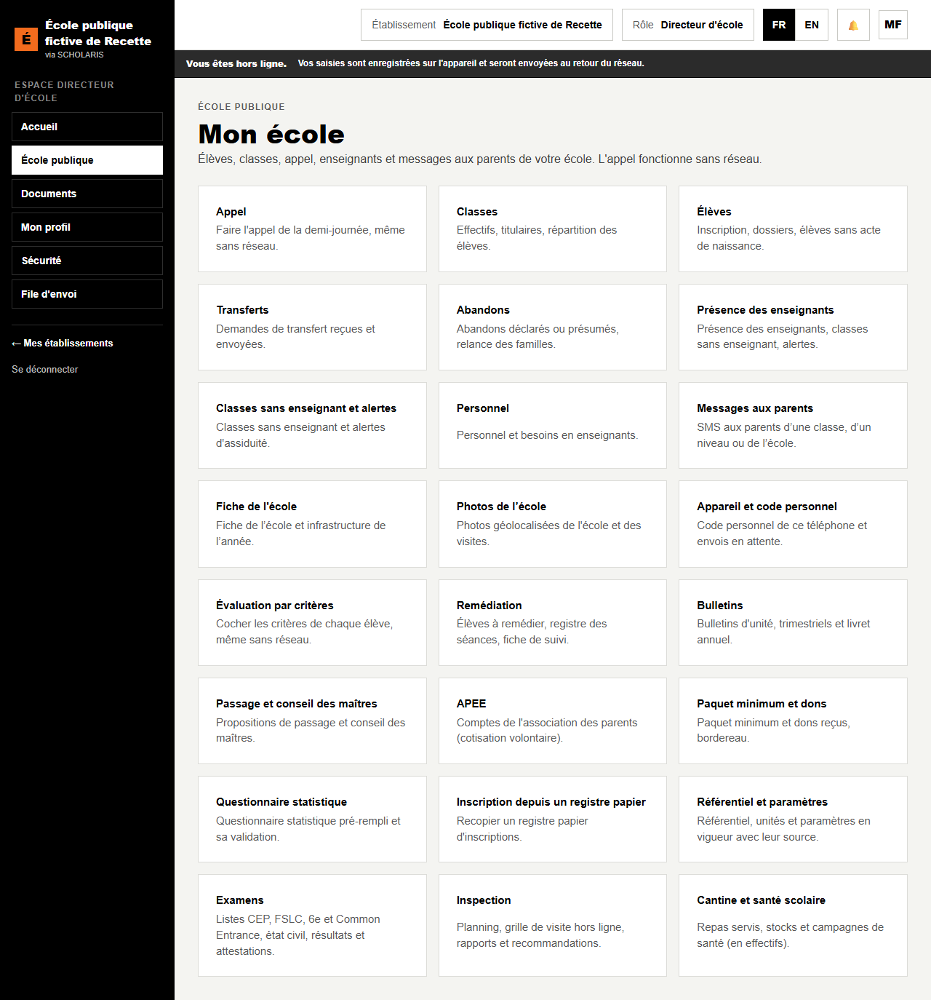
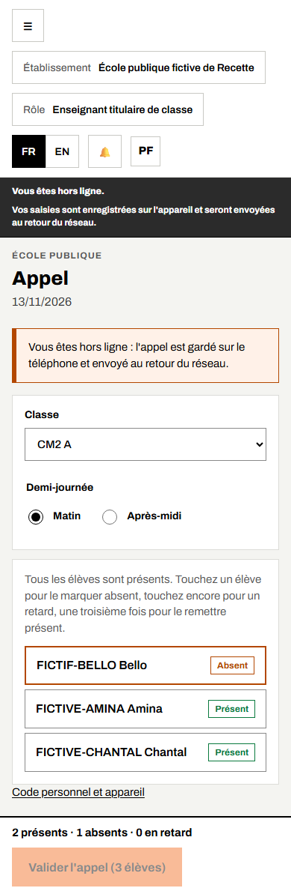
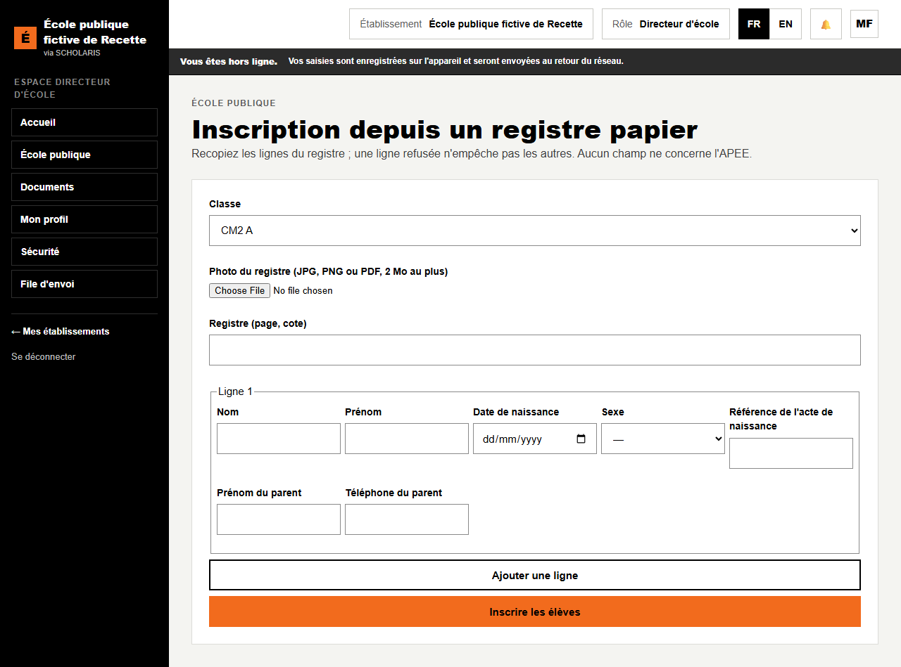
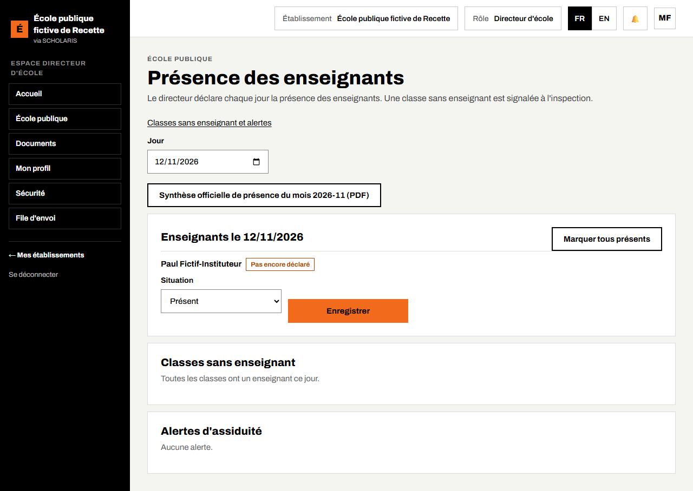
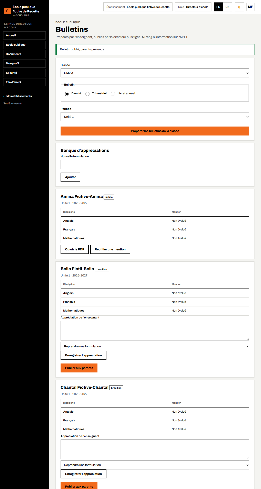
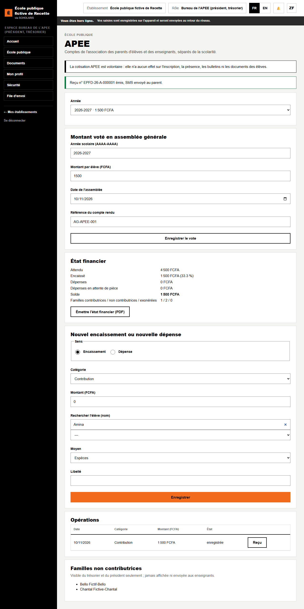
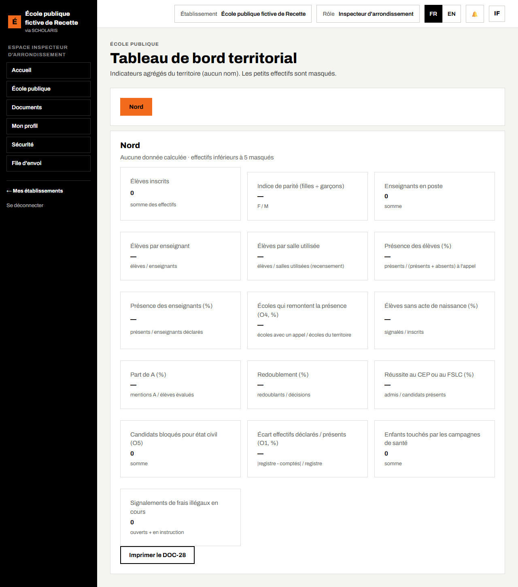

# 06. Fiche client : école primaire publique

**Application à proposer** : **École primaire**, régime **public**. 30 000 FCFA par mois, 90 jours d'essai. Statut : disponible.

## 6.1 Profil du client

Une **école primaire publique** relevant du MINEDUB, souvent avec de grands effectifs, peu de personnel administratif et un réseau irrégulier. Interlocuteurs : le **directeur** ou la **directrice d'école**, le **bureau de l'APEE**, et souvent l'**inspection d'arrondissement**, qui peut porter un projet pour plusieurs écoles.

**Qui paie ?** L'école publique ne réclame aucun frais aux familles. L'abonnement peut être pris par l'école, l'APEE, une commune, un partenaire ou un projet. La forme du contrat pour un ensemble d'écoles publiques est **à confirmer par la direction**.

### Ses douleurs

- **Les registres d'appel** papier et la **présence des enseignants** difficile à suivre.
- Le **questionnaire statistique** de rentrée rempli à la main, puis recopié par l'inspection.
- Les **listes d'examen** (CEP, FSLC, entrée en 6e, Common Entrance) avec leurs erreurs d'état civil.
- Les **comptes de l'APEE** à rendre transparents.
- Les **transferts** et les **abandons** mal suivis.

## 6.2 Trois principes à dire au client

1. **L'appel fonctionne sans réseau.** La liste des élèves est gardée chiffrée sur le téléphone de l'enseignant, protégée par un **code personnel** propre à l'appareil.
2. **L'école ne réclame aucun frais.** La cotisation APEE est **volontaire** : elle n'a aucun effet sur l'inscription, la présence, les bulletins ou les documents.
3. **Les données remontent sans nom.** L'inspection et les délégations voient des chiffres agrégés ; les petits effectifs sont masqués.

## 6.3 Les modules utiles

| Besoin | Ce que fait l'application | Chapitre du guide primaire public |
|---|---|---|
| École et territoire | fiche de l'école (sous-système, cycle, situation), infrastructure, rattachement à l'arrondissement | 02 |
| Classes | classes, **autorisation d'ouverture**, titulaires, effectifs | 03 |
| Élèves | inscription, **inscription groupée depuis un registre papier**, dossier, transferts, abandons | 04 |
| Appel | appel par demi-journée **sans réseau**, cahier d'appel mensuel | 05 |
| Personnel | **présence des enseignants**, alertes, messages aux parents | 06 |
| Évaluation | évaluation par critères, remédiation, bulletins préparés par l'enseignant et publiés par le directeur, SMS de service | 07 |
| Passage | décisions de passage | 08 |
| APEE | vote du montant, encaissements, **reçus avec QR**, dépenses, état financier ; paquet minimum | 09 |
| Statistiques | **questionnaire statistique** validé par l'inspection puis la délégation | 10 |
| Examens | CEP, FSLC, **entrée en 6e**, **Common Entrance** : candidats, contrôle d'état civil, validation, résultats | 11 |
| Inspection | planning, **grille de visite remplie sans réseau**, comptage sur place, rapport | 12 |
| Cantine | repas, stocks | 13 |
| Territoire | tableau de bord de l'inspection et des délégations, chiffres agrégés | 14 |

## 6.4 Démonstration en 15 minutes

| Minute | Écran | Ce que vous dites |
|---|---|---|
| 0-2 | Accueil « Mon école » du directeur | « Une carte par rubrique ; chacun voit les siennes. » |
| 2-5 | Appel sur téléphone, sans réseau | « L'appel est gardé sur le téléphone et part au retour du réseau. » |
| 5-7 | Inscription groupée | « Vous recopiez le registre papier une fois, en série. » |
| 7-9 | Présence des enseignants | « Vous savez qui est là, et l'inspection aussi. » |
| 9-11 | Bulletins préparés et publiés | « L'enseignant prépare, le directeur publie ; le parent est prévenu par SMS. » |
| 11-13 | APEE et reçu avec QR | « Chaque franc de l'APEE a son reçu, et l'état financier est prêt pour l'assemblée. » |
| 13-15 | Tableau de bord de l'inspecteur | « L'inspection voit des chiffres consolidés, sans nom d'élève. » |

## 6.5 Les utilisateurs et leurs rôles

| Rôle | Ce qu'il fait | Ce qu'il voit |
|---|---|---|
| **Directeur d'école** | fiche de l'école, classes, inscriptions, transferts, appel, présence des enseignants, messages, publication des bulletins, passage, questionnaire, listes d'examen | toute l'école ; l'APEE en lecture |
| **Enseignant titulaire de classe** | appel de sa classe (sans réseau), évaluation, remédiation, préparation des bulletins, messages aux parents de sa classe | sa classe ; jamais les familles non contributrices de l'APEE |
| **Bureau de l'APEE** | vote, encaissements, reçus, dépenses, état financier | les comptes de l'APEE ; pas les dossiers scolaires |
| **Membre du conseil d'école** | consultation | lecture |
| **Responsable de la cantine** | repas, stocks | la cantine |
| **Inspecteur d'arrondissement** | inspections, contrôle de la présence des enseignants, validation des listes et du questionnaire | les écoles de son arrondissement |
| **Conseiller pédagogique**, **agent de saisie de l'inspection** | visites ; saisie par procuration pour une école sans connexion | leur périmètre |
| **Délégués départemental et régional**, services centraux | validation du questionnaire et des examens, tableaux de bord | chiffres agrégés, sans nom |

## 6.6 Variantes d'établissements

| Variante | Ce qui change | Réglages au démarrage | Argument | Objection |
|---|---|---|---|---|
| **École publique francophone** | CEP, entrée en 6e | fiche de l'école : sous-système **Francophone** | appel, statistiques, examens | « Le ministère a son outil » : SCHOLARIS produit les chiffres demandés sans double saisie ; les formats officiels sont à vérifier avec l'inspection. |
| **École publique anglophone ou bilingue** | FSLC, Common Entrance ; écrans et bulletins en anglais | sous-système **Anglophone** ou **Bilingue** | un seul outil pour les deux sous-systèmes | — |
| **Petite école rurale** | peu de personnel, réseau faible | **code personnel** sur chaque téléphone ; l'**agent de saisie de l'inspection** peut saisir pour l'école | appel sans réseau, saisie par procuration | « Les enseignants n'ont pas de smartphone » : un téléphone par école suffit pour commencer ; à évaluer au cas par cas. |
| **Grande école urbaine** | plusieurs classes par niveau, cantine | classes et titulaires, cantine | présence des enseignants, APEE transparente | — |
| **Groupe scolaire public** (maternelle et primaire) | cycle **Groupe scolaire** dans la fiche de l'école | la maternelle publique est **bientôt** disponible | — | Ne vendez pas la partie maternelle avant son ouverture. |

## 6.7 Objections fréquentes et réponses

| Objection | Réponse |
|---|---|
| « Nous n'avons pas de budget. » | « 30 000 FCFA par mois pour toute l'école. Qui peut porter ce coût (APEE, commune, partenaire) ? » La forme du contrat est à confirmer par la direction. |
| « L'APEE ne veut pas montrer ses comptes. » | « Les comptes de l'APEE restent séparés ; le directeur les lit, les enseignants ne voient jamais qui n'a pas cotisé. » |
| « Pas de réseau à l'école. » | « L'appel, l'évaluation et l'inspection fonctionnent sans réseau ; il suffit d'ouvrir l'écran une première fois avec le réseau. » |
| « Si un téléphone est volé ? » | « Les données sont chiffrées ; cinq codes faux effacent tout ; le directeur peut révoquer le téléphone. » |
| « L'inspection va tout voir. » | « L'inspection voit des chiffres sans nom ; les petits effectifs sont masqués. » |

## 6.8 Questions de découverte

1. Combien d'élèves, de classes, d'enseignants ? Quel sous-système ?
2. Comment faites-vous l'appel et suivez-vous la présence des enseignants ?
3. Qui remplit le questionnaire statistique ? Combien de temps cela prend-il ?
4. L'APEE tient-elle des reçus ? Présente-t-elle un état financier ?
5. Le réseau passe-t-il à l'école ? Les enseignants ont-ils un smartphone ?
6. L'inspection d'arrondissement porte-t-elle un projet pour plusieurs écoles ?
7. Qui pourrait financer l'abonnement ?
