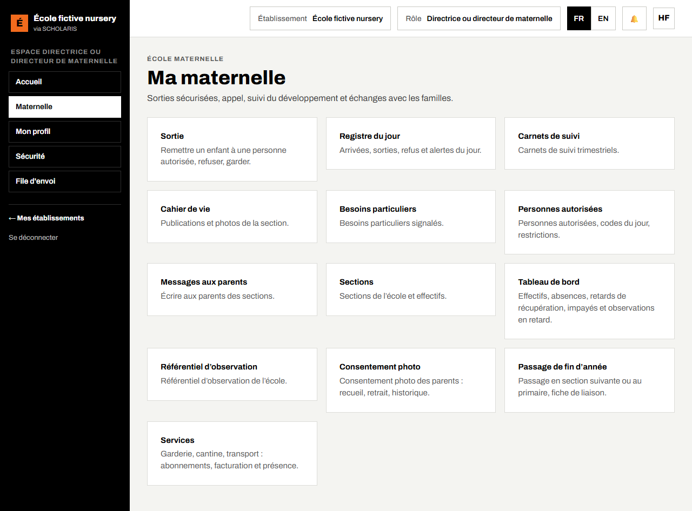
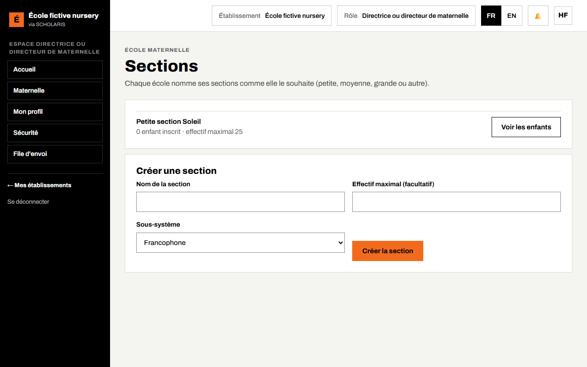
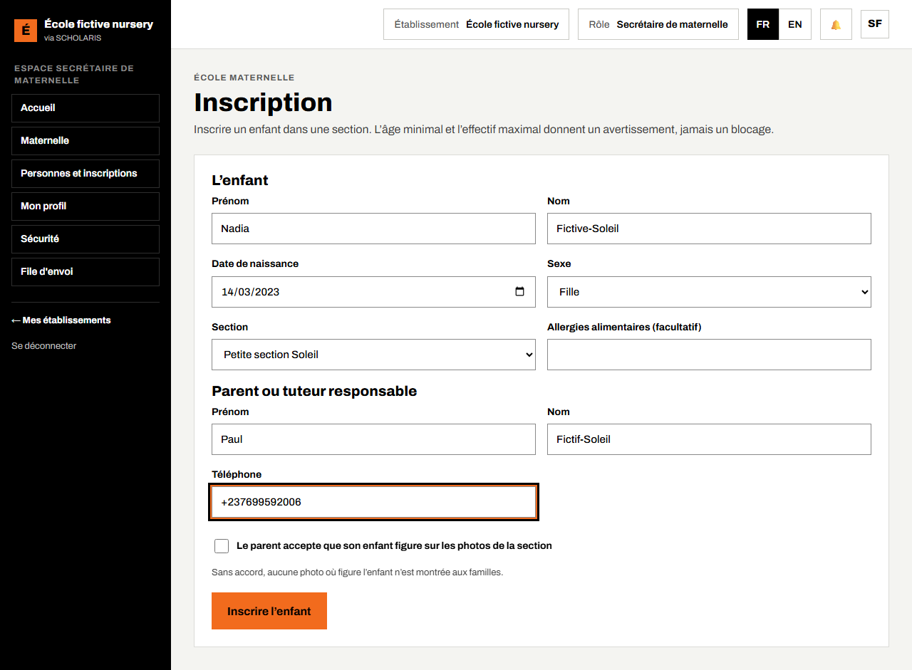
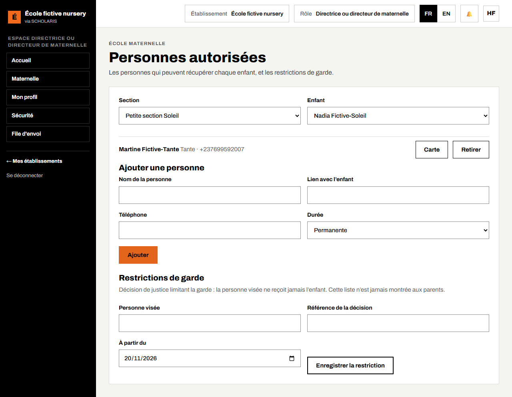
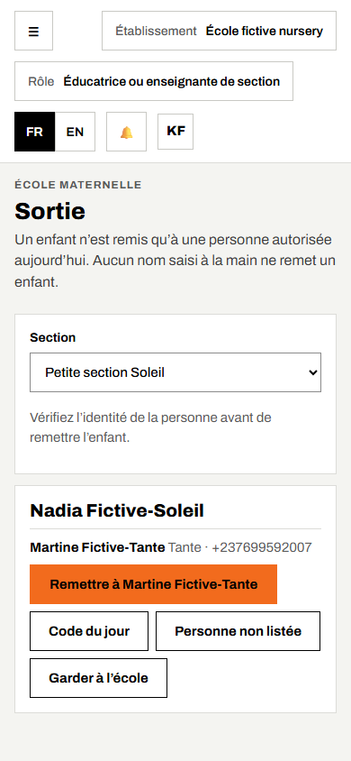

# 07. Fiche client : maternelle privée

**Application à proposer** : **École maternelle**, régime **privé**. 60 000 FCFA par mois, 90 jours d'essai. Statut : disponible.

## 7.1 Profil du client

Une **école maternelle privée** (laïque ou confessionnelle), seule ou adossée à une école primaire. Des sections (petite, moyenne, grande, ou les noms propres à l'école), des enfants de 3 à 6 ans. Interlocuteurs : la **promotrice** ou le promoteur, la **directrice**, la **secrétaire**.

### Ses douleurs

- **La sortie des enfants** : qui a le droit de venir chercher l'enfant ? Que faire si personne ne vient ?
- **Les parents inquiets**, qui veulent des nouvelles et des photos, mais sans que l'image de leur enfant circule.
- **Le carnet de suivi** trimestriel écrit à la main.
- **Les frais** : pension, inscription, garderie, cantine, transport.
- **Les allergies** et besoins particuliers à connaître de toute l'équipe.

## 7.2 L'argument principal : la sortie sécurisée

> « Chez vous, un enfant ne part qu'avec une personne autorisée par ses parents. Si la personne n'est pas sur la liste, l'enfant reste, et les parents et la directrice sont prévenus tout de suite. »

- Les parents tiennent la **liste des personnes autorisées** (avec une **carte à QR code** pour chacune).
- Une **décision de justice** limitant la garde est enregistrée par la directrice : la personne visée ne reçoit pas l'enfant, même si elle figure sur la liste.
- **Enfant non récupéré** : après l'heure de fin, les parents sont alertés, puis la directrice.
- La liste du jour reste disponible **sans réseau** sur le téléphone de l'éducatrice ou de l'aide.
- Le **registre du jour** (arrivées, sorties, refus, alertes) s'imprime chaque soir.

## 7.3 Les modules utiles

| Rubrique à l'écran | Ce qu'elle fait |
|---|---|
| **Sortie** | remettre l'enfant à une personne autorisée, refuser, garder |
| **Registre du jour** | arrivées, sorties, refus et alertes du jour |
| **Personnes autorisées** | liste par enfant, codes du jour, restrictions, carte avec QR |
| **Appel** | présence du jour |
| **Observation** et **Carnets de suivi** | suivi du développement **sans note** (trois niveaux), carnet trimestriel validé par la directrice puis publié aux parents |
| **Cahier de vie** et **Consentement photo** | publications et photos de la section, servies seulement pour les enfants dont le consentement photo est en vigueur |
| **Besoins particuliers** | signalés, suivis, visibles de l'équipe et des parents seulement |
| **Inscription**, **Frais**, **Services** | inscription et facture, garderie, cantine, transport facturés par cycle |
| **Messages aux parents** | écrire aux parents des sections |
| **Passage de fin d'année** | section suivante ou entrée au primaire, **fiche de liaison** |
| **Tableau de bord** | effectifs, absences, retards de récupération, impayés, observations en retard |

## 7.4 Démonstration en 15 minutes

| Minute | Écran | Ce que vous dites |
|---|---|---|
| 0-2 | Accueil de la directrice | « Toute la maternelle sur une page. » |
| 2-4 | Sections | « Vos sections et leurs effectifs. » |
| 4-7 | Inscription | « L'enfant, ses parents, sa section ; la facture suit. » |
| 7-10 | Personnes autorisées | « Les parents disent qui peut venir ; chaque personne a sa carte. » |
| 10-13 | Sortie sur téléphone | « L'éducatrice remet l'enfant ou refuse ; tout est enregistré. » |
| 13-15 | Tableau de bord | « Effectifs, retards de récupération, impayés. » |

## 7.5 Les utilisateurs et leurs rôles

| Rôle (nom à l'écran) | Ce qu'il fait | Ce qu'il voit |
|---|---|---|
| **Promoteur de maternelle** | suit l'école | chiffres agrégés, sans nom d'enfant |
| **Directrice ou directeur de maternelle** | restrictions de garde, registre, validation des carnets, passage, paramètres | toute l'école |
| **Éducatrice ou enseignante de section** | appel, remise de l'enfant, observation, cahier de vie, signalement d'un besoin, avis de passage | sa section |
| **Aide maternelle** | appel, arrivées, remise de l'enfant | sa section |
| **Secrétaire de maternelle** | inscriptions, dossiers, documents, guichet des autorisés | les dossiers |
| **Comptable**, **Caissier** | frais et services ; encaissement | les finances |
| **Responsable de cantine de maternelle** | liste de la cantine | les allergies de sa liste seulement |
| **Parent** | liste des autorisés, cahier de vie, allergies, consentements, paiement | ses enfants |
| Personne autorisée | aucun compte : identifiée par son nom, son téléphone et sa carte | — |

## 7.6 Variantes d'établissements

| Variante | Ce qui change | Argument | Objection |
|---|---|---|---|
| **Maternelle privée laïque** | — | sécurité de la sortie, carnet sans note | — |
| **Maternelle confessionnelle** | même application, aucun réglage propre | idem | — |
| **Maternelle bilingue ou anglophone** | écrans **FR / EN** ; carnet de suivi en français ou en anglais | un seul outil pour les deux langues | Les libellés des sections se choisissent librement (par exemple « Nursery 1 »). |
| **Petite maternelle** (une ou deux sections) | une même personne cumule directrice et secrétaire | la sortie sécurisée seule justifie l'outil | « 60 000 FCFA, c'est beaucoup pour nous » : prix par école, pas par enfant ; geste commercial **à confirmer par la direction**. |
| **Grande maternelle urbaine** | aides par section, garderie, cantine, transport | registre du soir, alertes de non-récupération | — |
| **Maternelle d'un groupe scolaire** | passage vers le primaire **du même client** par la fiche de liaison | continuité du dossier de l'enfant | voir chapitre 10 |

Réglages au démarrage : sections, heure de début et heure de fin de journée (préréglées à 7 h 30 et 13 h 30, modifiables), référentiel d'observation, consentements photo.

## 7.7 Objections fréquentes et réponses

| Objection | Réponse |
|---|---|
| « Les éducatrices n'auront pas le temps. » | « La remise de l'enfant prend quelques secondes sur le téléphone. » |
| « Les parents ne veulent pas de photos. » | « Sans consentement en vigueur, la photo d'un enfant n'est jamais montrée ; le retrait du consentement la retire aussitôt. » |
| « On ne note pas les enfants. » | « Justement : l'application n'a aucune note, aucune moyenne, aucun rang. Seulement l'observation. » |
| « Et si le réseau tombe à la sortie ? » | « La liste du jour est sur le téléphone ; les remises partent au retour du réseau. » |

## 7.8 Questions de découverte

1. Combien d'enfants et de sections ? Qui fait la sortie le soir ?
2. Avez-vous déjà eu un enfant remis à une mauvaise personne, ou non récupéré ?
3. Comment informez-vous les parents ? Envoyez-vous des photos ? Avec quel accord ?
4. Faites-vous un carnet de suivi ? Combien de temps prend-il ?
5. Proposez-vous garderie, cantine, transport ?
6. Vos enfants continuent-ils au primaire chez vous ?
