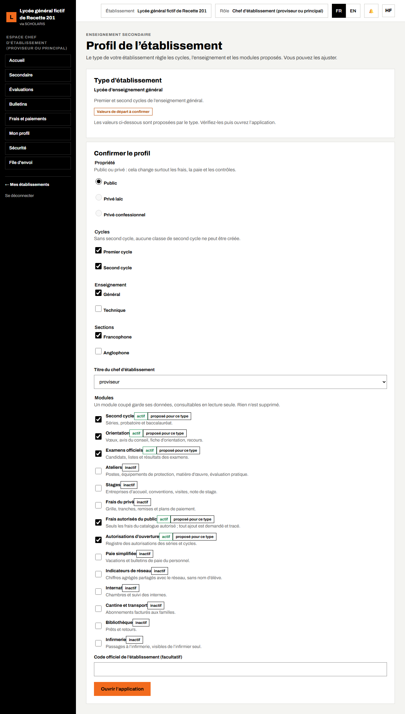
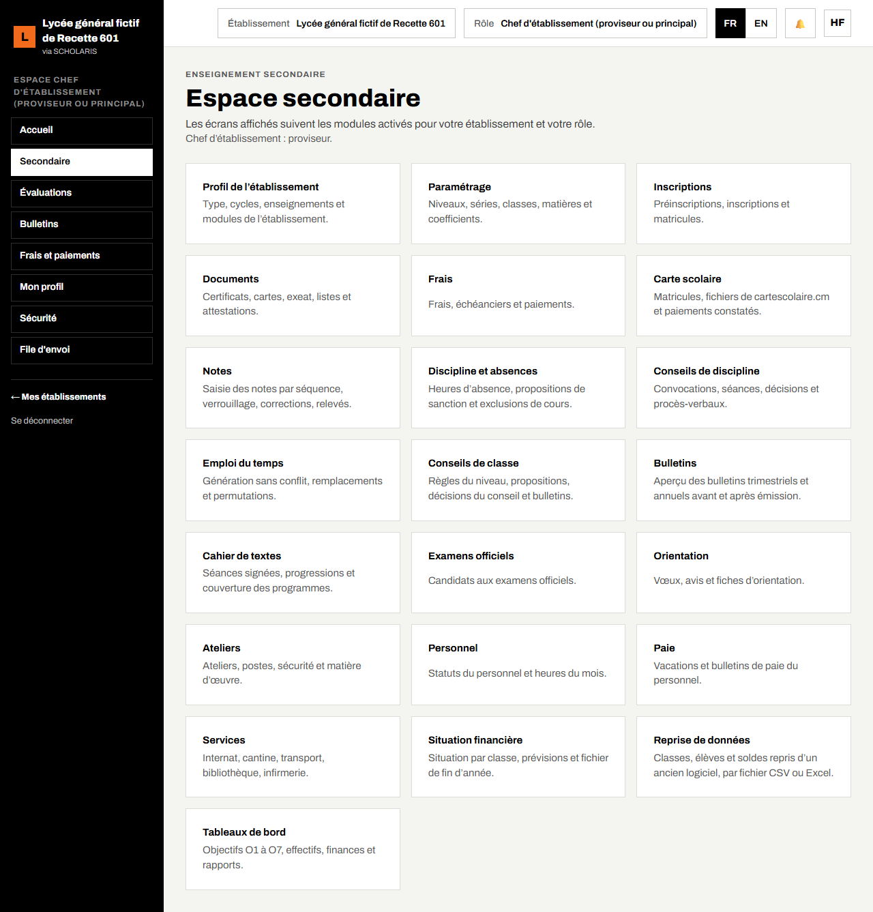
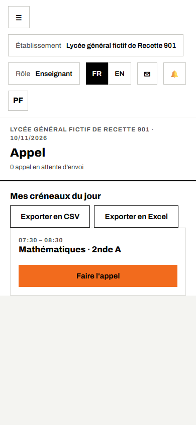
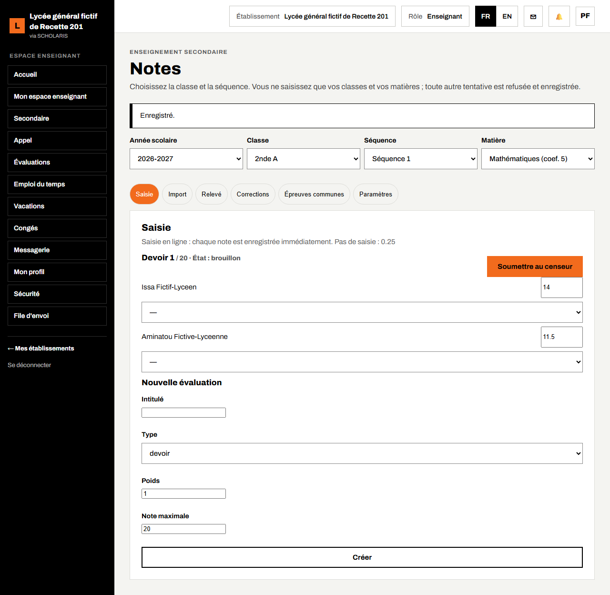
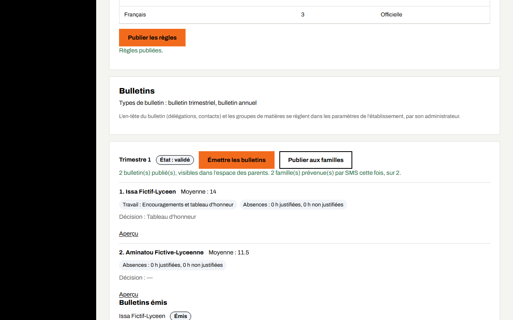
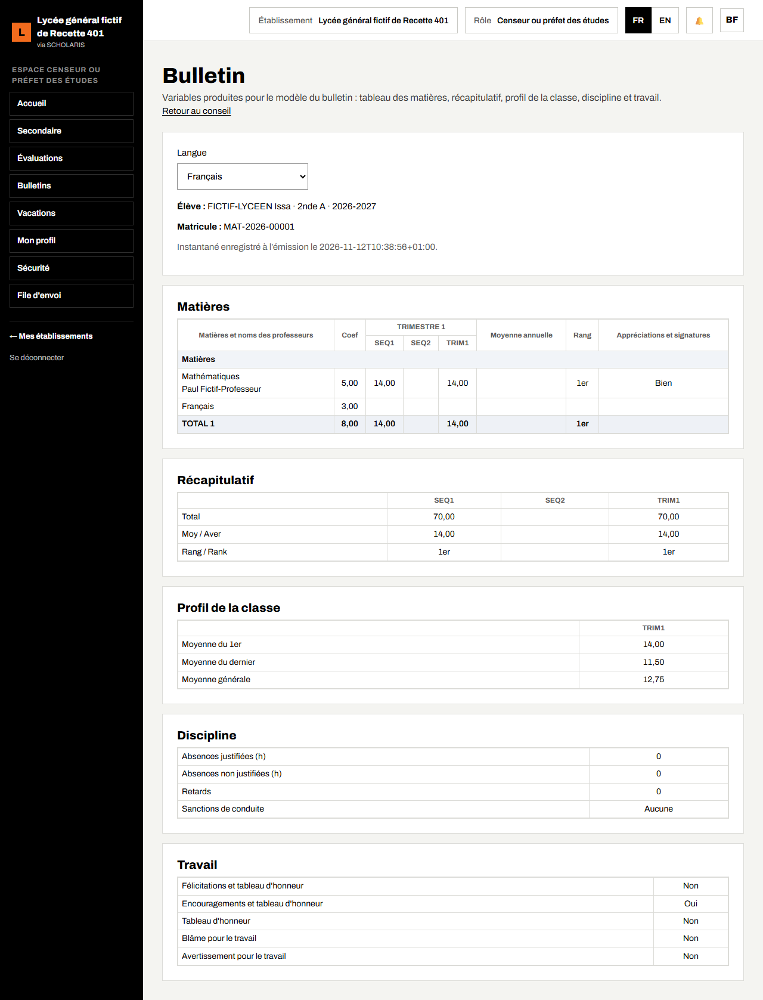
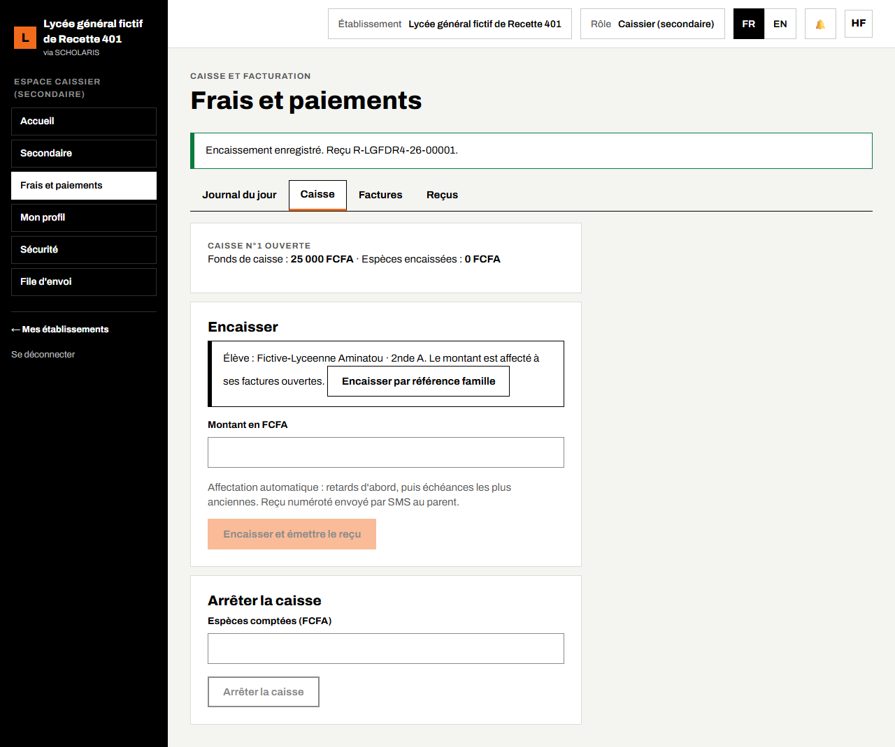
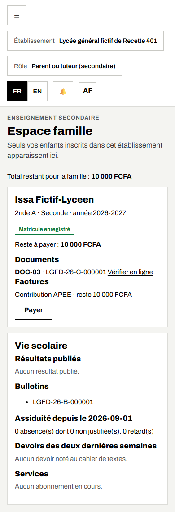
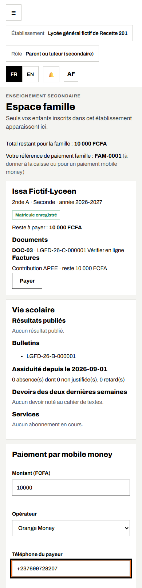

# 09. Fiche client : collège et lycée (secondaire)

**Application à proposer** : **Enseignement secondaire**, 60 000 FCFA par mois, 90 jours d'essai. Statut : disponible.

C'est **une seule application** pour tous les établissements du secondaire, publics et privés, généraux et techniques. Le **type d'établissement**, choisi dans la demande d'accès, la personnalise (cycles, enseignements, modules proposés, titre du chef d'établissement).

## 9.1 Profil du client

Un **collège** ou un **lycée** : de quelques centaines à plusieurs milliers d'élèves, de la 6e à la Terminale (ou Form 1 à Upper Sixth). Interlocuteurs : le **proviseur** ou le **principal**, le **censeur**, l'**intendant** ou l'économe, et dans le privé le **promoteur**.

### Ses douleurs

- **Les notes de séquence** : des centaines de copies, des relevés recopiés, des moyennes et des rangs calculés à la main avant le conseil.
- **Les bulletins** : longs à produire, faciles à falsifier.
- **Les absences** heure par heure et la discipline.
- **Le recouvrement** dans le privé ; le **catalogue des frais autorisés** dans le public.
- **L'emploi du temps** et les remplacements.
- **Les examens officiels** (BEPC, CAP, probatoire, baccalauréat, GCE) : listes et pièces des candidats.
- **Les familles** à informer, au bon moment.

## 9.2 Les modules utiles

Le **noyau** (paramétrage, inscriptions, appel, notes, conseils, bulletins) est toujours actif. Les **modules** se cochent selon l'établissement, **sans supplément de prix**.

| Rubrique | Ce qu'elle fait | Chapitre du guide secondaire |
|---|---|---|
| Ouverture et paramétrage | profil (propriété, cycles, enseignement, sections francophone et anglophone, titre du chef), niveaux, séries, classes, matières, coefficients, autorisations d'ouverture, trimestres et séquences | 02 |
| Inscriptions | inscription avec **garant financier**, matricule, préinscription, réinscription, transferts, **import Excel ou CSV**, carte scolaire (cartescolaire.cm), reprise des données | 03 |
| Frais | catalogue des frais autorisés (public) ou grille, tranches, remises, plans de paiement (privé) ; caisse, reçus, **référence de paiement famille** | 04 |
| Emploi du temps et cahier de textes | affectations, créneaux, **génération**, remplacements, séances, couverture du programme, visas | 05 |
| Appel et discipline | **appel par heure sur téléphone, même sans réseau**, absences, barème, sanctions, conseil de discipline | 06 |
| Notes | cycle saisie → soumission → validation → verrouillage, import, relevé, corrections | 07 |
| Conseil et bulletins | conseil de classe, décisions, émission, **publication aux familles avec SMS « bulletin disponible »** | 08 |
| Modules optionnels | orientation, examens officiels, ateliers et stages (technique), personnel et paie simplifiée, internat, cantine et transport, bibliothèque, infirmerie | 09 à 13 |
| Pilotage | tableaux de bord (effectifs, pédagogie, finances, rapports) | 14 |
| Portails | espace famille (paiement mobile), espace élève, espace enseignant | 15 |
| Documents | certificats, cartes, exeat, listes, attestations, **vérification par QR** | 16 |

## 9.3 Démonstration en 15 minutes

| Minute | Écran | Ce que vous dites |
|---|---|---|
| 0-2 | Assistant de profil | « Votre type d'établissement propose les bons réglages ; vous les confirmez. » |
| 2-4 | Accueil du chef d'établissement | « Une carte par rubrique, selon votre rôle. » |
| 4-6 | Appel sur téléphone | « L'enseignant fait l'appel de son heure ; sans réseau, l'appel attend. » |
| 6-8 | Saisie des notes | « L'enseignant saisit, le censeur valide et verrouille. » |
| 8-10 | Conseil de classe et publication | « Après le conseil, les bulletins sont publiés ; chaque famille reçoit un SMS. » |
| 10-11 | Aperçu du bulletin | « Moyenne, rang, appréciations, QR code. » |
| 11-13 | Caisse et reçu | « Le caissier retrouve l'élève par son nom ou la référence famille. » |
| 13-15 | Espace famille sur téléphone | « Le parent voit le reste à payer et paie par Mobile Money. » |

## 9.4 Les utilisateurs et leurs rôles

| Rôle | Ce qu'il fait | Ce qu'il voit |
|---|---|---|
| **Chef d'établissement** (proviseur ou principal) | ouvre l'application, paramètre, préside conseils de classe et de discipline, valide bulletins et sanctions, signe | presque tout |
| **Censeur** ou préfet des études | emploi du temps, visa du cahier de textes, validation et verrouillage des notes, conseils, examens officiels | la pédagogie |
| **Surveillant général** | absences, retards, discipline, note de conduite | la vie scolaire |
| **Intendant** ou économe | frais, échéanciers, factures, plans de paiement, situation financière | les finances |
| **Caissier** | encaissement, reçus ; demande l'annulation d'un paiement erroné | la caisse |
| **Secrétaire ou chargé de la scolarité** | inscriptions, matricules, carte scolaire, documents, listes d'examen | les dossiers |
| **Enseignant** | appel, cahier de textes, notes de ses classes et matières | ses classes |
| **Professeur principal** | appréciation générale, synthèse de sa classe pour le conseil | sa classe |
| **Animateur pédagogique** ou chef de département | progressions, épreuves communes | sa discipline |
| **Conseiller d'orientation** | vœux et avis d'orientation | l'orientation |
| **Chef des travaux** (technique) | ateliers, sécurité, matière d'œuvre, stages | les ateliers |
| **Infirmier**, responsables de l'internat, de la cantine, du transport, bibliothécaire | registres de leur service ; l'infirmerie n'est visible que de l'infirmier | leur service |
| **Promoteur** (privé) | tableaux de bord et finances en lecture, validation des plans de paiement | lecture |
| **Administrateur fonctionnel** | profil, paramètres, comptes et rôles, modèles de documents, catalogue des frais autorisés | l'administration |
| **Parent ou tuteur** | enfants, documents, factures, reste à payer, paiement mobile s'il est garant financier | ses enfants |
| **Élève** | sa classe, ses documents, sa situation | lui-même |
| **Délégué de classe**, **bureau de l'APEE** | contreseing de la feuille d'appel ; chiffres de l'APEE | leur périmètre |
| **Inspecteur pédagogique régional**, **délégation**, **brigade de contrôle du privé** | lecture seule, **30 jours au plus**, chaque lecture enregistrée | périmètre accordé |

## 9.5 Variantes d'établissements

Le type est choisi **à la demande d'accès** (liste fermée de 7 types). Il propose des **valeurs de départ, marquées « à confirmer »**, que le chef d'établissement vérifie dans l'assistant de profil.

| Variante | Réglages proposés par le type | Modules proposés | Titre du chef | Argument | Objection fréquente |
|---|---|---|---|---|---|
| **LEG** (lycée d'enseignement général) | 1er et 2nd cycles, général, public | second cycle, orientation, examens officiels, **frais autorisés du public** | proviseur | conseils et bulletins de milliers d'élèves sans recopie | « Nos frais sont fixés par l'État » : seul le catalogue des frais autorisés est utilisable, avec sa référence. |
| **Lycée technique** | 1er et 2nd cycles, **technique**, public | les mêmes, plus **ateliers** et **stages** | proviseur | ateliers, sécurité, matière d'œuvre, stages suivis | « Nos spécialités ont des noms officiels » : les noms des niveaux et spécialités se renomment. |
| **CES** | 1er cycle seulement, général, public | examens officiels (BEPC), frais autorisés du public | principal | appel et bulletins sur téléphone | « Nous sommes petits » : même prix, gain de temps sur les bulletins. |
| **CETIC** | 1er cycle, technique, public | examens officiels (CAP), ateliers, stages, frais autorisés du public | principal | ateliers et stages | — |
| **Collège privé** (laïc ou confessionnel) | 1er cycle, général, propriété **privé laïc** ou **privé confessionnel** à choisir | examens officiels, **frais du privé**, **autorisations**, **paie simplifiée** | principal | recouvrement : tranches, remises, plans de paiement, relances, Mobile Money | « Nos parents paient en retard » : la référence famille et le paiement mobile accélèrent le recouvrement. |
| **Lycée privé** (laïc ou confessionnel) | 1er et 2nd cycles, général, privé | second cycle, orientation, examens officiels, frais du privé, autorisations, paie simplifiée | proviseur | idem, plus le promoteur suit tout en lecture | — |
| **Collège ou lycée confessionnel** (catholique, protestant, islamique) | propriété **privé confessionnel** | comme le privé | selon le type | même application | « Notre secrétariat à l'éducation veut une vue de toutes nos écoles » : pas de vue consolidée par réseau aujourd'hui ; **à confirmer par la direction**. |
| **Établissement bilingue** | sections **Francophone** et **Anglophone** cochées dans le profil | selon le type | selon le type | un seul outil pour les deux sections, écrans FR / EN | — |
| **Sous-système anglophone (GCE)** | section **Anglophone** ; noms des niveaux renommables (Form 1… Upper Sixth) ; bulletins en anglais | examens officiels | selon le type | listes de candidats au GCE préparées comme les autres examens | **À dire franchement** : le format propre au **GCE Board** n'est pas intégré ; la liste des candidats sort en **CSV générique**. La correspondance note → lettre des bulletins anglophones existe mais est **désactivée** par défaut (barème à fournir par l'établissement). |
| **Autre** | aucune valeur proposée : l'assistant pose les questions | — | à choisir | — | — |

Réglages au démarrage, pour tous : année, trimestres et **séquences**, niveaux d'exemple à confirmer, séries, classes, **autorisation d'ouverture** de chaque classe, matières et coefficients, cycle des notes, frais.

**Règles du secondaire à rappeler** : aucun élève n'est privé de cours ou d'évaluation pour un impayé ; les frais d'examen se paient sur cartescolaire.cm, jamais à l'établissement ; aucun document scolaire ne mentionne une dette.

## 9.6 Objections fréquentes et réponses

| Objection | Réponse |
|---|---|
| « Nos enseignants n'ont pas d'ordinateur. » | « L'appel et les notes se font sur téléphone ; l'import d'un fichier est aussi possible. » |
| « Le conseil de classe prend des jours. » | « Moyennes, rangs et propositions sont prêts ; le conseil décide, les bulletins sortent ensuite. » |
| « Nos bulletins sont falsifiés. » | « Chaque bulletin émis a un numéro et un QR ; une correction passe par un rectificatif. » |
| « Les SMS vont coûter cher. » | « Un SMS par bulletin et par famille, une seule fois ; l'établissement peut le désactiver. Le tarif des SMS vous sera précisé. » |
| « Nous avons déjà un logiciel. » | « La reprise des données d'un ancien logiciel est prévue ; l'import Excel ou CSV des élèves aussi. » |
| « L'emploi du temps, c'est un casse-tête. » | « Affectations, plages, génération et remplacements sont dans l'application. » |

## 9.7 Questions de découverte

1. Quel type d'établissement ? Public ou privé ? Laïc ou confessionnel ? Francophone, anglophone, bilingue ?
2. Combien d'élèves, de classes, d'enseignants ? Quelles séries ou spécialités ?
3. Combien de temps prend la préparation des bulletins ? Avez-vous eu de faux bulletins ?
4. Comment faites-vous l'appel ? Comment prévenez-vous les familles ?
5. (Privé) Quel est votre taux de recouvrement ? Combien de tranches ?
6. (Public) Votre catalogue des frais autorisés et la délibération de l'APEE sont-ils disponibles ?
7. Quels examens officiels préparez-vous ?
8. Avez-vous un internat, une cantine, un transport, une infirmerie ?
9. Qui sera l'administrateur fonctionnel ?
