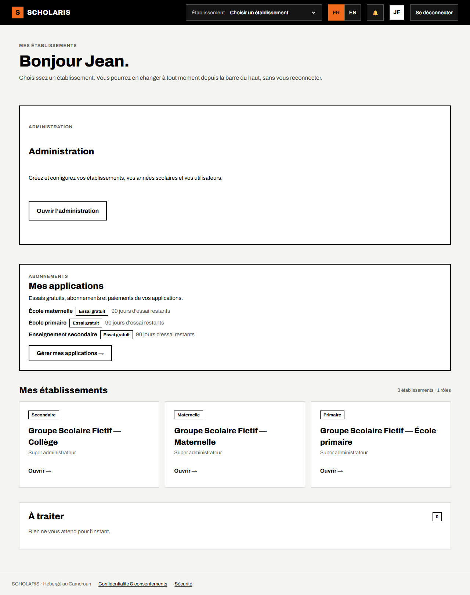
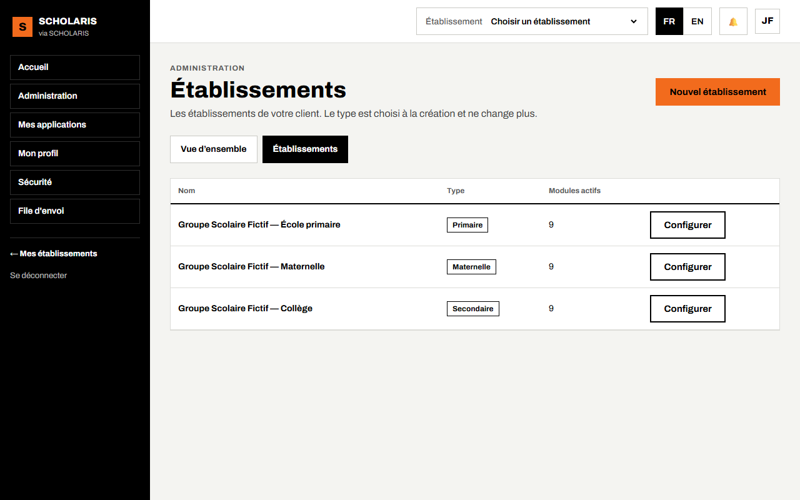
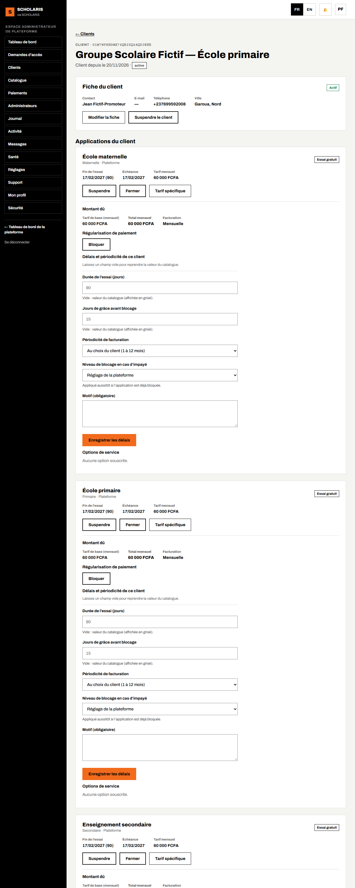
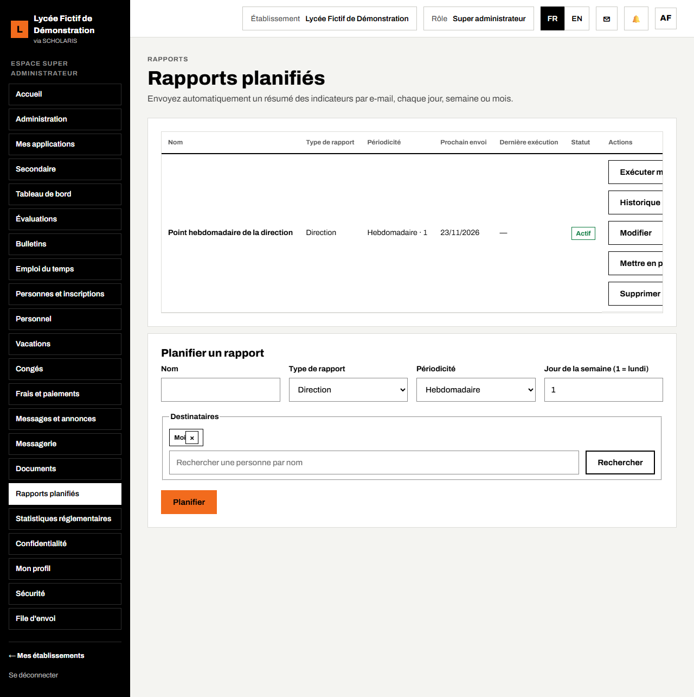

# 10. Fiche client : groupe scolaire et complexe à plusieurs établissements

**Applications à proposer** : une application **par niveau** présent dans le groupe (maternelle, primaire, secondaire), chacune à son prix et avec son propre essai de 90 jours.

Exemple (prix du catalogue, privé) : maternelle 60 000 + primaire 60 000 + secondaire 60 000 = **180 000 FCFA par mois** pour le groupe. Un **tarif de groupe** n'existe pas au catalogue : toute proposition est **à confirmer par la direction** (le super admin peut ensuite fixer un tarif propre au client).

## 10.1 Profil du client

- Un **groupe scolaire** ou **complexe** : maternelle, primaire et collège ou lycée sur un même site, sous un même **promoteur**.
- Ou un **promoteur** qui possède **plusieurs établissements** (deux écoles primaires dans deux quartiers, par exemple).

Interlocuteurs : le **promoteur**, le **directeur général** ou la direction de groupe, les **directions** de chaque établissement, l'**économe** du groupe.

### Ses douleurs

- **Aucune vue d'ensemble** : chaque établissement a ses registres, ses cahiers de caisse, ses fichiers.
- **Les familles** ont des enfants dans plusieurs établissements et doivent payer à plusieurs guichets.
- **Le passage** de la maternelle au primaire, puis au collège, refait le dossier de l'enfant à chaque fois.
- **Le contrôle de la caisse** quand le promoteur n'est pas sur place.

## 10.2 Comment SCHOLARIS organise un groupe

- **Un seul client** pour le groupe, avec **plusieurs établissements** (un par niveau ou par site).
- **Une personne = un compte.** Un parent qui a trois enfants dans trois établissements du groupe a **un seul compte** ; il passe d'un établissement à l'autre en haut de l'écran. De même pour un enseignant qui enseigne au primaire et au collège.
- Chaque application ouverte a **son abonnement** (et son essai).
- La **direction de groupe** (rôle « Direction de groupe », portée : tout le client) voit un **tableau de bord de groupe** : indicateurs consolidés (additionnés) et détail par établissement. Un **rapport planifié** de groupe peut partir chaque semaine par e-mail.
- En maternelle privée, le **passage au primaire** se fait par une **fiche de liaison** vers l'école primaire du même client.

## 10.3 Les modules utiles

Ceux de chaque niveau (chapitres 05, 07, 09), plus :

- l'**administration commune** : utilisateurs et rôles, années et périodes de chaque établissement ;
- le **tableau de bord de groupe** et les **rapports planifiés** ;
- la **messagerie** et les annonces.

## 10.4 Démonstration en 15 minutes

| Minute | Écran | Ce que vous dites |
|---|---|---|
| 0-2 | « Mes établissements » | « Un seul compte, tous vos établissements. » |
| 2-4 | Administration, établissements | « Chaque établissement a ses classes, ses frais, son personnel. » |
| 4-8 | Démonstration courte du niveau le plus important pour le client | voir les chapitres 05, 07 ou 09 |
| 8-11 | Espace famille d'un parent | « Un parent, un compte, tous ses enfants du groupe. » |
| 11-13 | Rapports planifiés | « Chaque lundi, vous recevez le point de la semaine par e-mail. » |
| 13-15 | Mes applications | « Chaque application a son essai ; vous ouvrez celles dont vous avez besoin. » |

## 10.5 Les utilisateurs et leurs rôles

| Rôle | Ce qu'il fait | Ce qu'il voit |
|---|---|---|
| **Super administrateur** du client | établissements, années, comptes et rôles, applications et abonnements | l'administration de tout le groupe |
| **Direction de groupe** | pilote le groupe, ouvre et paie les applications | tableau de bord consolidé et par établissement |
| **Promoteur** (rôle de chaque application) | suit chaque établissement en lecture | chiffres, finances |
| **Directions d'établissement** | dirigent leur établissement | leur établissement |
| **Personnel partagé** (enseignant, comptable) | a un rôle dans chaque établissement où il travaille | chaque établissement de ses rôles |
| **Parent** | un seul compte, tous ses enfants | ses enfants, établissement par établissement |

## 10.6 Variantes d'établissements

| Variante | Comment la monter | Prix (catalogue) | À signaler |
|---|---|---|---|
| **Complexe maternelle-primaire privé** | un client, deux établissements, deux applications | 120 000 FCFA par mois | fiche de liaison maternelle → primaire |
| **Complexe maternelle-primaire-secondaire privé** | un client, trois établissements | 180 000 FCFA par mois | tarif de groupe **à confirmer par la direction** |
| **Promoteur avec deux établissements du même niveau** | un client, deux établissements, **une seule application** pour ce niveau | un abonnement, techniquement | tarif à appliquer **à confirmer par la direction** |
| **Groupe scolaire public** (maternelle et primaire) | le primaire public est disponible | 30 000 FCFA par mois | la maternelle publique est **bientôt** |
| **Plusieurs instituts supérieurs** | **un client par institut** (règle de la plateforme) | 60 000 FCFA par institut | pas de vue consolidée entre instituts |
| **Réseau confessionnel** (secrétariat à l'éducation et ses écoles) | chaque école est un client, ou un client à plusieurs établissements | selon les applications | une vue consolidée de réseau entre clients **n'existe pas** ; le montage est **à confirmer par la direction** |

## 10.7 Objections fréquentes et réponses

| Objection | Réponse |
|---|---|
| « Payer trois abonnements, c'est cher. » | « Chaque application couvre un niveau entier, sans limite d'élèves. Pour un tarif de groupe, je transmets à la direction. » |
| « Nos directeurs ne doivent pas voir les finances des autres. » | « Chaque rôle a sa portée : un directeur d'établissement ne voit que son établissement. » |
| « Nous voulons commencer par un seul niveau. » | « C'est possible : vous ouvrez les autres applications plus tard, chacune avec son essai. » |
| « Les parents vont se perdre. » | « Un seul compte par parent ; il choisit l'établissement en haut de l'écran. » |

## 10.8 Questions de découverte

1. Quels établissements compte le groupe ? Sur un même site ou plusieurs ?
2. Qui dirige quoi ? Y a-t-il une direction de groupe ?
3. La caisse est-elle commune ou propre à chaque établissement ?
4. Combien de familles ont des enfants dans plusieurs établissements ?
5. Par quel niveau voulez-vous commencer ?
