# 11. Créer un client pas à pas

Ce chapitre suit un client de la première demande jusqu'aux premiers usages. Les captures montrent un **lycée fictif** ; le parcours est le même pour tous les niveaux.

## 11.1 Vue d'ensemble

| Étape | Qui la fait | Durée indicative | Résultat |
|---|---|---|---|
| 1. Demander l'accès | le prospect (aidé par le commercial) | 5 minutes | un numéro de suivi |
| 2. Accepter la demande | le super admin de TRU GROUP | 5 minutes, dans les jours ouvrés qui suivent | client, établissement, essai de 90 jours, code d'activation envoyé |
| 3. Activer le compte | l'administrateur de l'établissement | 5 minutes | il se connecte |
| 4. Premiers réglages | l'administrateur et la direction | une demi-journée à deux jours selon la taille | année, périodes, structure, autorisations, frais, rôles |
| 5. Créer le personnel | l'administrateur | quelques minutes par personne, ou un import de fichier | chaque membre du personnel a son compte |
| 6. Inscrire les élèves et leurs garants | la scolarité ou le secrétariat | selon l'effectif ; import possible au secondaire | élèves inscrits, garants rattachés |
| 7. Premiers usages | tout le monde | dès la première semaine | appel, caisse, notes |

Les durées sont des ordres de grandeur à donner au client, pas des engagements.

## 11.2 Avant de commencer : les informations à collecter

Préparez avec le client, **avant** la demande d'accès, la liste ci-dessous. Elle évite les allers-retours.

### Pour la demande d'accès

- Nom exact de l'établissement, ville, région.
- Type d'établissement (et, pour le secondaire, le **type** : LEG, lycée technique, CES, CETIC, collège privé, lycée privé, autre) ; pour la maternelle et le primaire, le **régime** (privé ou public).
- Numéro de l'**autorisation ministérielle** (facultatif à la demande, mais indispensable ensuite).
- Contact : prénom, nom, **adresse e-mail** (obligatoire), **téléphone** (au format +237), fonction.
- Effectifs et calendrier souhaité (dans le message).

### Pour les premiers réglages

- Dates de l'année scolaire ou académique et de ses périodes (trimestres, séquences ou semestres).
- Liste des classes (ou des écoles, filières, niveaux et groupes au supérieur).
- **Autorisations d'ouverture** : pour chaque classe ou filière, l'autorité, la référence de l'acte, les dates de validité.
- Grille des frais (montants, tranches, échéances) ; dans le public, le catalogue des frais autorisés et la référence de la délibération de l'APEE.
- Liste du personnel et rôle de chacun.

### Le modèle Excel de préparation des accès

Pour un institut supérieur, TRU GROUP utilise le classeur **Modele_acces_enseignants_etudiants_SCHOLARIS.xlsx**. Il sert à rassembler les listes au bon format ; il ne contient **aucun mot de passe**, aucune note, aucun montant, aucune pièce d'identité. Une ligne par personne, à partir de la ligne 5 (la ligne 5 est un exemple fictif à remplacer) ; colonnes à en-tête bleu à remplir, à en-tête gris calculées. Un **téléphone ou un e-mail est obligatoire** pour chaque personne : c'est par là qu'elle reçoit son accès.

| Feuille | Colonnes |
|---|---|
| **Instructions** | mode d'emploi du fichier |
| **Enseignants** | N° ; Nom ; Prénoms ; Téléphone ; E-mail ; Langue ; Statut (permanent, vacataire, invité) ; Grade ; Diplômes ; Établissement d'origine ; Fonctionnaire ? ; Autorisation de l'employeur (référence) ; Autorisation valable jusqu'au ; École ou département (périmètre) ; Rôle(s) à attribuer ; Contrôle (calculé) |
| **Étudiants** | N° ; Nom ; Prénoms ; Date de naissance ; Sexe ; Téléphone ; E-mail ; Langue ; Nature (première inscription, transfert) ; Établissement d'origine ; Diplôme d'entrée ; Série ; Année d'obtention ; Mention ; École ; Filière ; Niveau ; Groupe ; Mode d'études (cours du jour, du soir, alternance) ; Matricule d'origine (si reprise) ; Garant : nom ; Garant : téléphone ; Garant : e-mail ; Majeur (18 ans et plus, calculé) ; Contrôle (calculé) |
| **Garants** (facultative) | N° ; Nom ; Prénoms ; Téléphone ; E-mail ; Lien avec l'étudiant (père, mère, tuteur, entreprise, organisme ou bailleur, autre) ; Étudiant(s) rattaché(s) (noms ou matricules) ; Contrôle (calculé) |
| **Listes** | les valeurs des listes déroulantes |

Règles à rappeler au client :

- Un vacataire reçoit les rôles d'enseignant permanent et de vacataire ; ses affectations aux matières et groupes sont faites ensuite par le chef de département.
- Les **étudiants mineurs** ne passent pas par la reprise de données : ils s'inscrivent par l'écran des inscriptions, avec leur garant.
- Un garant voit toujours la situation financière de l'étudiant ; les notes et absences seulement avec l'accord de l'étudiant majeur.

**Données personnelles** : ce fichier contient des données protégées par la **loi n° 2024/017** sur la protection des données personnelles. Le client le remet par un canal convenu avec TRU GROUP, **jamais** par WhatsApp ou par la messagerie personnelle du commercial. Le commercial ne le garde pas.

## 11.3 Étape 1 : le prospect demande l'accès

**Qui** : le responsable de l'établissement, éventuellement aidé par le commercial pendant le rendez-vous. **Durée** : 5 minutes.

1. Ouvrir **https://scholariserp.trugroup.cm**, puis **Demander l'accès** (sous l'écran de connexion, ou depuis le catalogue).

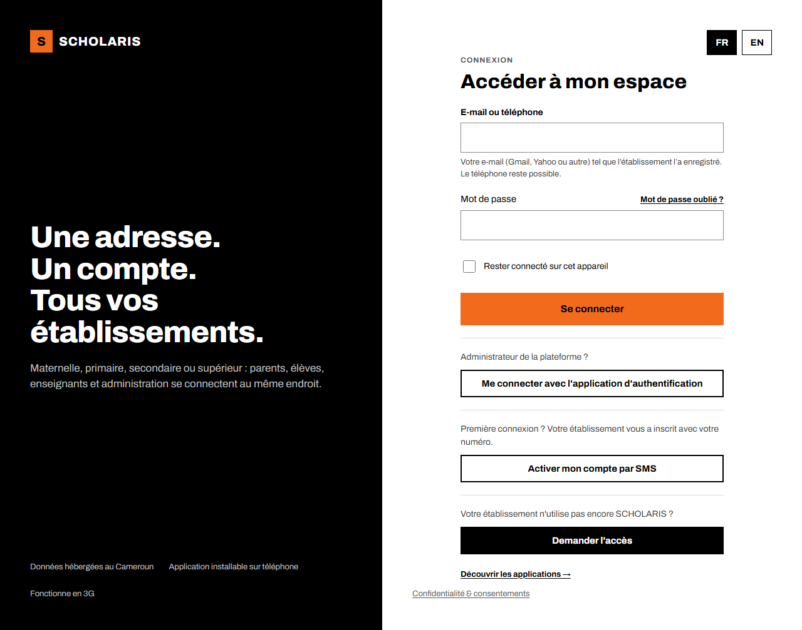

2. Remplir **Votre établissement** : nom, **Type d'établissement**, numéro d'autorisation ministérielle (facultatif), ville, région.
3. Remplir **Personne à contacter** : prénom, nom, **adresse e-mail** (la réponse et le numéro de suivi y sont envoyés), téléphone, fonction.
4. Choisir l'**Application** (et, pour la maternelle ou le primaire, le **régime** ; pour le secondaire, le **type d'établissement**, obligatoire).
5. Ajouter un **Message** utile : effectifs, besoins, date de démarrage souhaitée.
6. Cliquer sur **Envoyer la demande**.

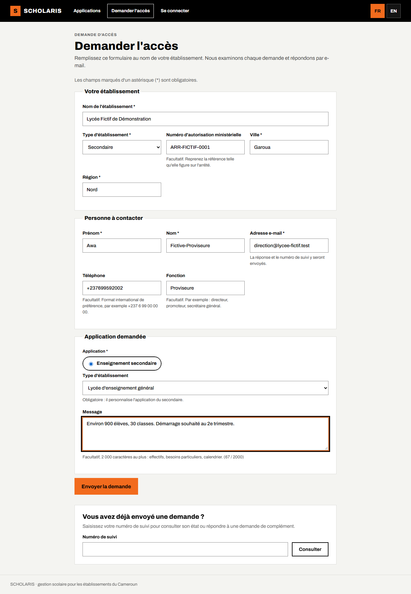

7. L'écran **Demande enregistrée** affiche le **numéro de suivi**. Le prospect le copie et le garde : il ne sera plus affiché.

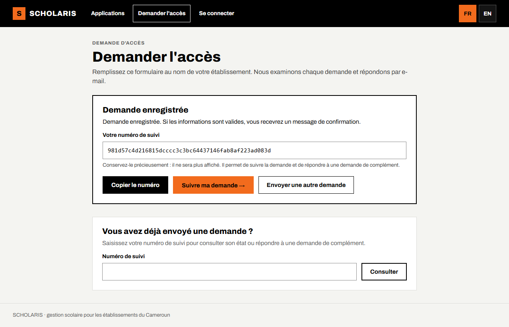

Avec ce numéro, il suit sa demande et répond à une éventuelle **demande de complément**.

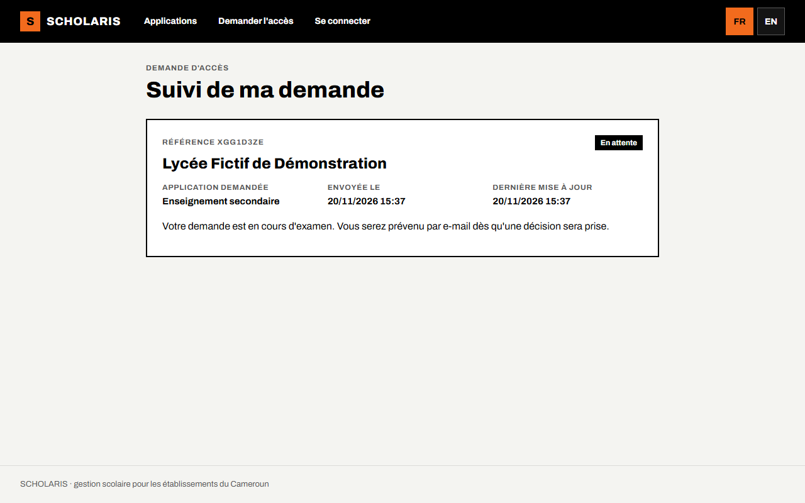

**Erreurs fréquentes**

- Une adresse e-mail mal tapée : le prospect ne reçoit rien. Relisez-la avec lui.
- Le mauvais **régime** (public au lieu de privé) : il ouvre la mauvaise application, avec un autre prix et d'autres règles.
- Le mauvais **type** au secondaire : il propose les mauvais réglages de départ (ils restent modifiables, avec un motif).
- Le numéro de suivi non noté.
- Plusieurs demandes pour le même établissement : prévenez le super admin pour qu'il archive les doublons.

## 11.4 Étape 2 : le super admin accepte dans le back office

**Qui** : le super admin de TRU GROUP (compte de plateforme, double authentification obligatoire). **Durée** : 5 minutes.

Le commercial **prévient le super admin** qu'une demande l'attend (nom de l'établissement, conditions convenues). Le tableau de bord de la plateforme compte les demandes en attente.

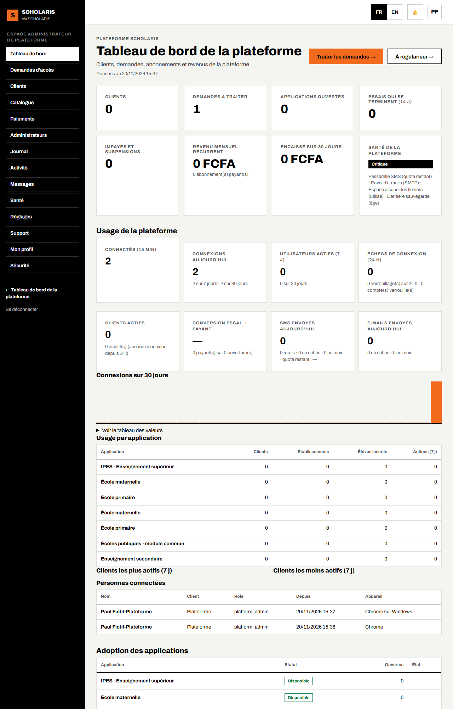

1. **Demandes d'accès** : la plus récente est en haut de la liste.

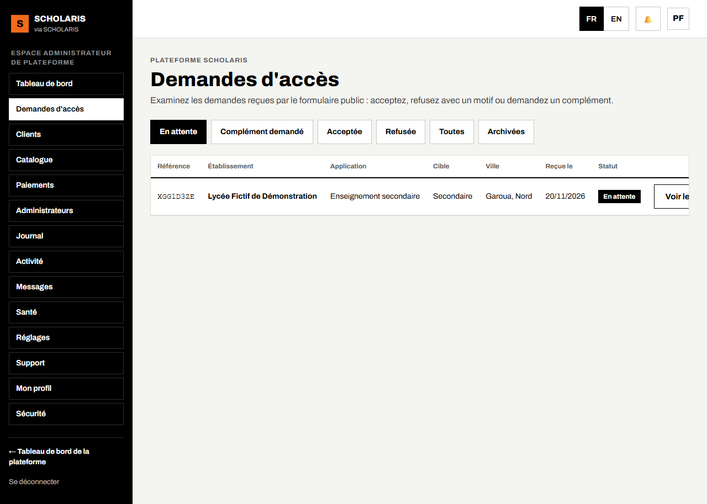

2. Ouvrir la demande : établissement, contact, autorisation, application, message.
3. Décider : **Accepter**, **Refuser** (avec un motif) ou **Demander un complément**.
4. Pour accepter : choisir **Créer un nouveau client** (ou rattacher à un client existant **seulement s'il s'agit de la même institution**), laisser cochée **Envoyer automatiquement l'accès à l'acceptation**, choisir le **Canal d'envoi** (SMS ou e-mail), puis **Confirmer l'acceptation**.

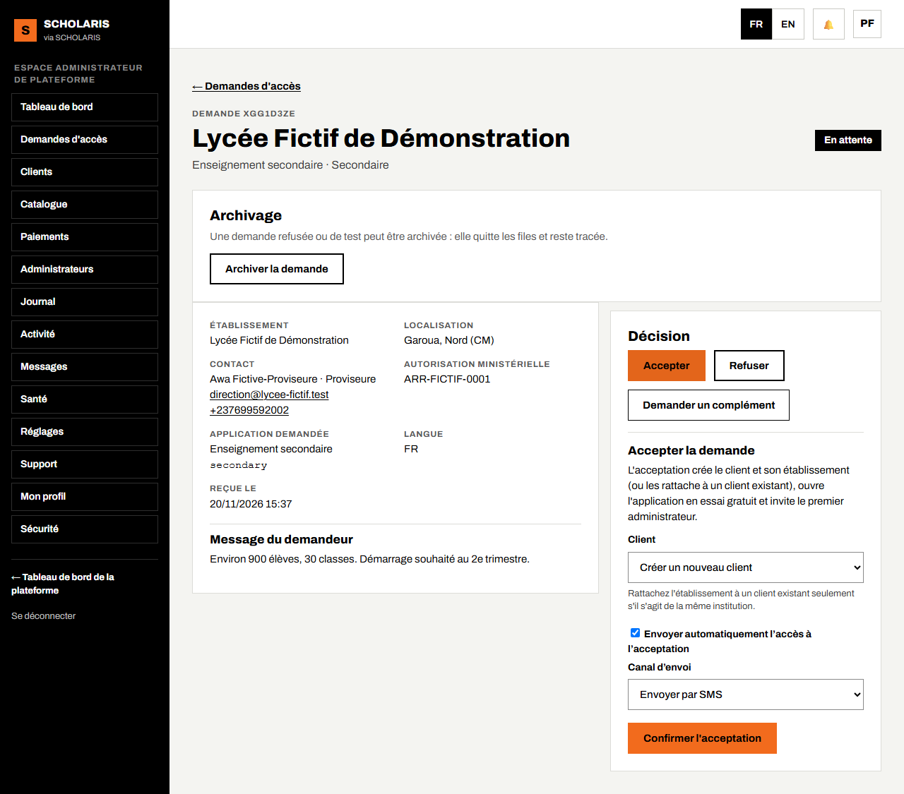

5. L'écran confirme : « Demande acceptée. », la date de fin de l'**essai gratuit**, le premier administrateur invité, et le **code d'activation** (valable 24 heures) avec un **message prêt à partager**.

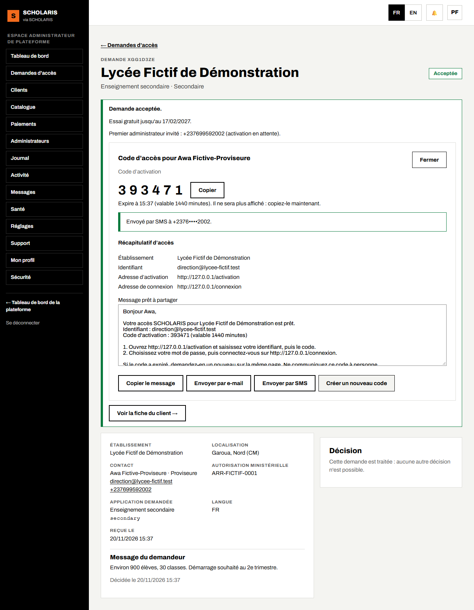

À l'acceptation, la plateforme crée **le client**, **l'établissement** (avec son type), **ouvre l'application en essai de 90 jours** et **invite le premier administrateur** (la personne de contact de la demande).

**Erreurs fréquentes**

- Rattacher la demande au mauvais client existant : les données se mélangeraient. En cas de doute, créer un nouveau client.
- Code d'activation expiré (24 heures) : créer un nouveau code depuis la fiche du client (section 11.11).
- Une demande de test ou en double : la **refuser** puis l'**archiver**.

## 11.5 Étape 3 : l'administrateur reçoit son code et active son compte

**Qui** : l'administrateur de l'établissement (la personne de contact). **Durée** : 5 minutes.

1. Ouvrir la page de connexion, puis **Activer mon compte par SMS**.
2. Saisir son identifiant (téléphone ou e-mail de la demande).

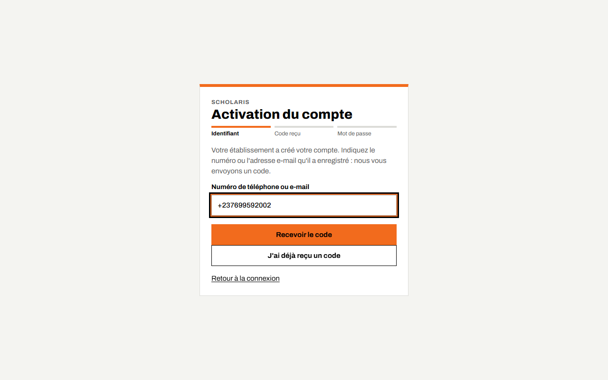

3. Cliquer sur **J'ai déjà reçu un code** et saisir le **code à 6 chiffres**, puis **Vérifier le code** (sans code, **Recevoir le code** en envoie un nouveau).

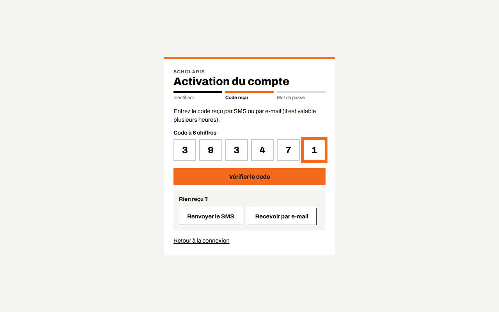

4. Choisir son mot de passe (**10 caractères au moins**), le confirmer, puis **Enregistrer le mot de passe**.

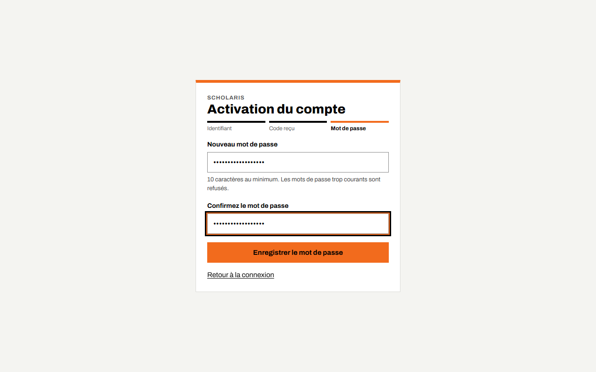

5. Se connecter. L'accueil propose l'**Administration**, **Mes applications** (avec l'essai en cours) et l'établissement.

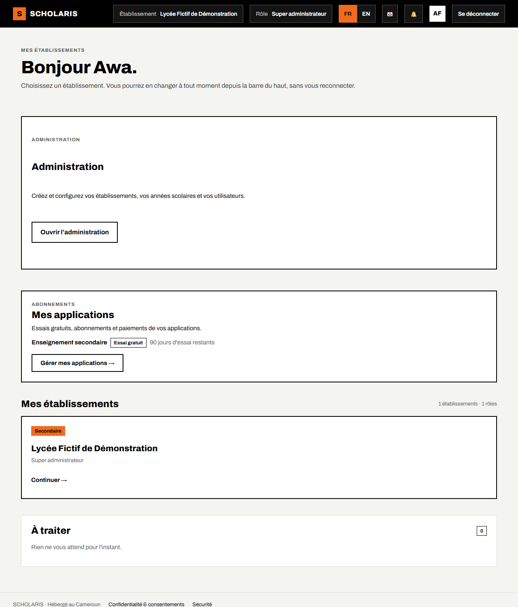

**Erreurs fréquentes**

- Un identifiant différent de celui de la demande (autre numéro, autre e-mail).
- Un mot de passe trop court ou trop simple : il est refusé.
- Plusieurs mots de passe faux : la connexion est bloquée quelques minutes.

## 11.6 Étape 4 : les premiers réglages

**Qui** : l'administrateur de l'établissement (rôle « Super administrateur » du client) et la direction. **Durée** : une demi-journée à deux jours.

L'**Administration** regroupe : établissements, années et périodes, structures, autorisations d'ouverture, utilisateurs et rôles, import de personnes, circuits de validation, paramètres.

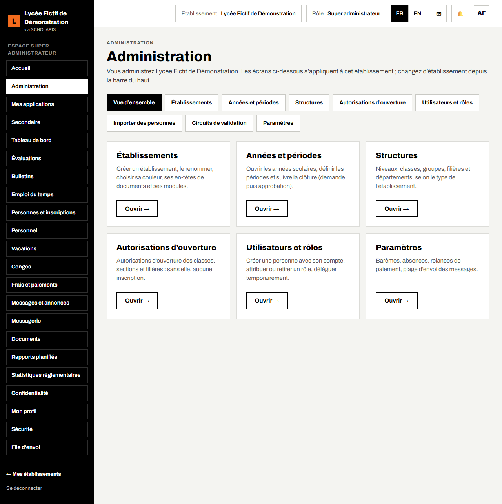

### 1. L'année et ses périodes

**Administration > Années et périodes**. Créer l'année (libellé, début, fin), puis **Gérer** pour ajouter les périodes (trimestres, séquences, semestres). Depuis novembre 2026, une année ouverte et ses périodes se **modifient** (bouton **Modifier**), et une période inutilisée se **supprime**. Les chevauchements sont refusés.

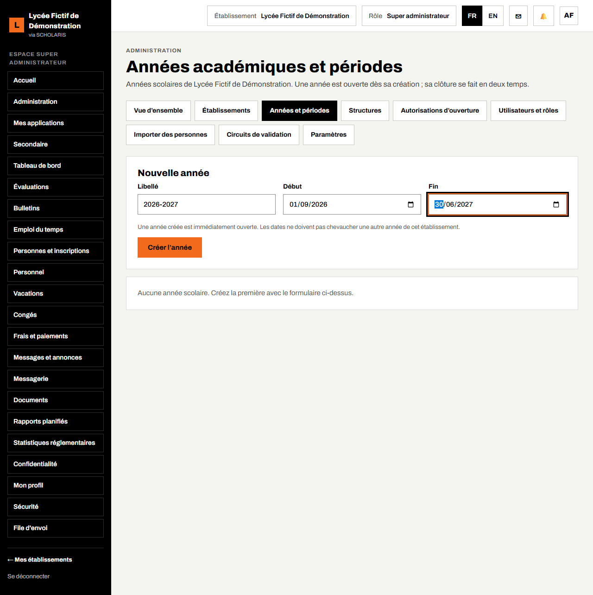

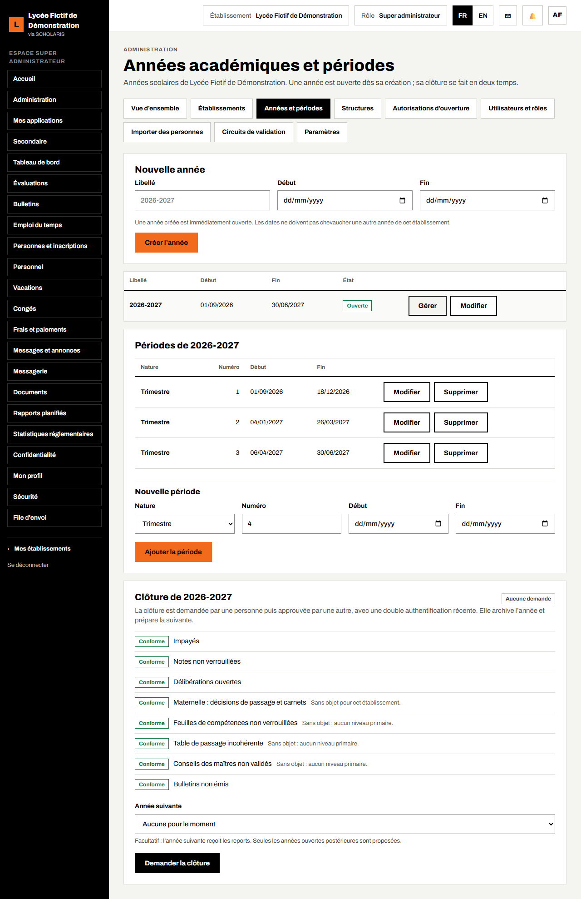

### 2. La structure

**Administration > Structures** (et, selon l'application, l'écran de paramétrage : classes et séries au secondaire, niveaux et référentiel au primaire, sections en maternelle, écoles, filières et groupes au supérieur).

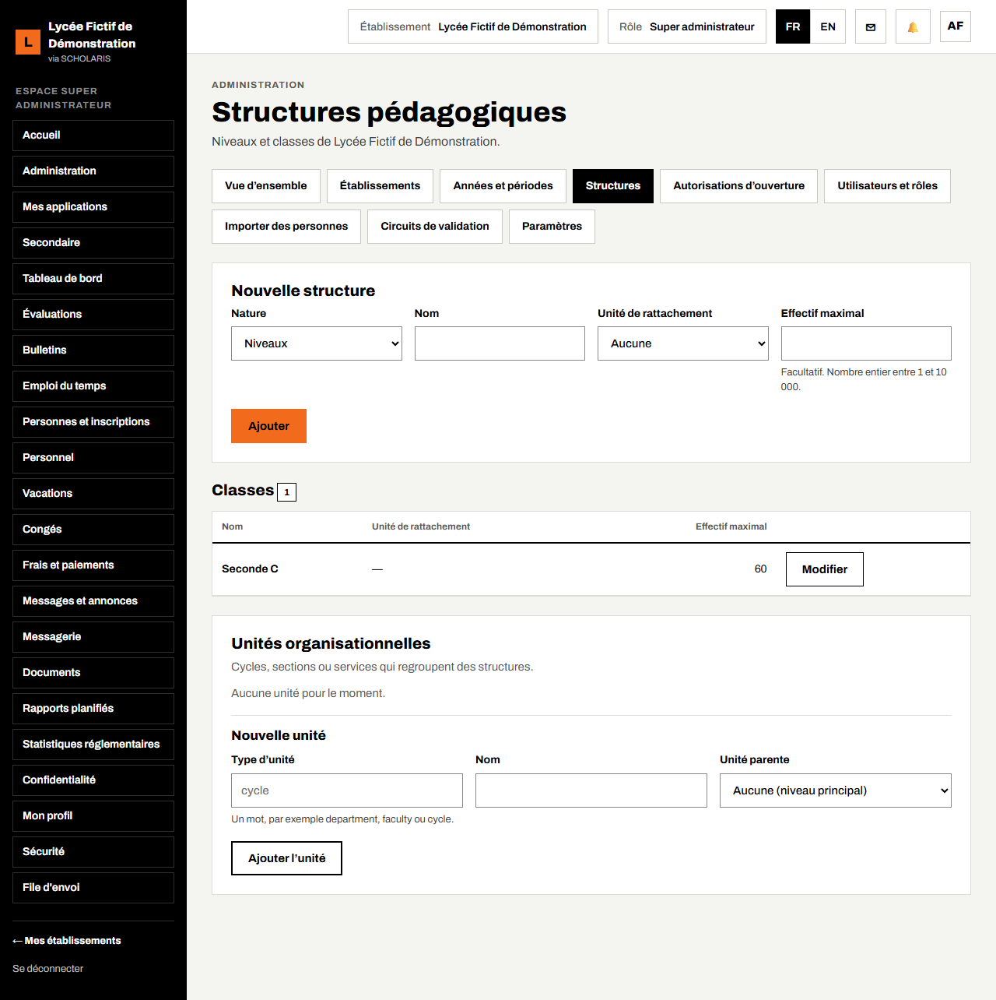

### 3. Les autorisations d'ouverture : obligatoires

**Administration > Autorisations d'ouverture**. Pour chaque classe ou filière : autorité, référence de l'acte, dates de validité. **Sans autorisation valide, aucune inscription n'est possible dans la classe.** Le cadre « Sans autorisation valide » liste les classes bloquées.

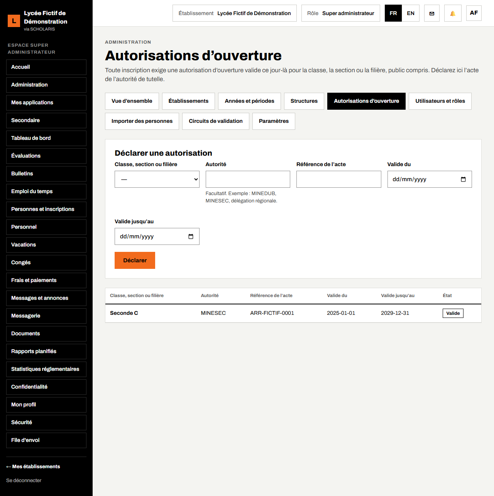

### 4. Les frais

Dans l'écran de frais de l'application : grille, tranches, échéances (privé) ; catalogue des frais autorisés (public, secondaire) ; contribution APEE (primaire public, comptes séparés).

### 5. Les rôles du personnel

Voir l'étape suivante. Pensez aussi aux **paramètres** (Administration > Paramètres), par exemple l'envoi du SMS « bulletin disponible ».

**Erreurs fréquentes**

- Oublier les **autorisations** : la scolarité ne peut pas inscrire.
- Des périodes qui se chevauchent : refusées.
- Au secondaire, ne pas **confirmer le profil** : l'application n'est pas encore ouverte.
- Commencer les inscriptions avant d'avoir posé les frais.

## 11.7 Étape 5 : créer le personnel

**Qui** : l'administrateur. **Durée** : quelques minutes par personne.

**Administration > Utilisateurs et rôles** :

1. **Créer la personne avec son compte** : nom, prénoms, téléphone ou e-mail, langue. Le compte est **utilisable tout de suite** : un **mot de passe provisoire** s'affiche **une seule fois**, à remettre en main propre (copier ou imprimer la fiche).
2. **Attribuer un rôle** et sa **portée** : tout l'établissement, une unité (école, département) ou une classe.

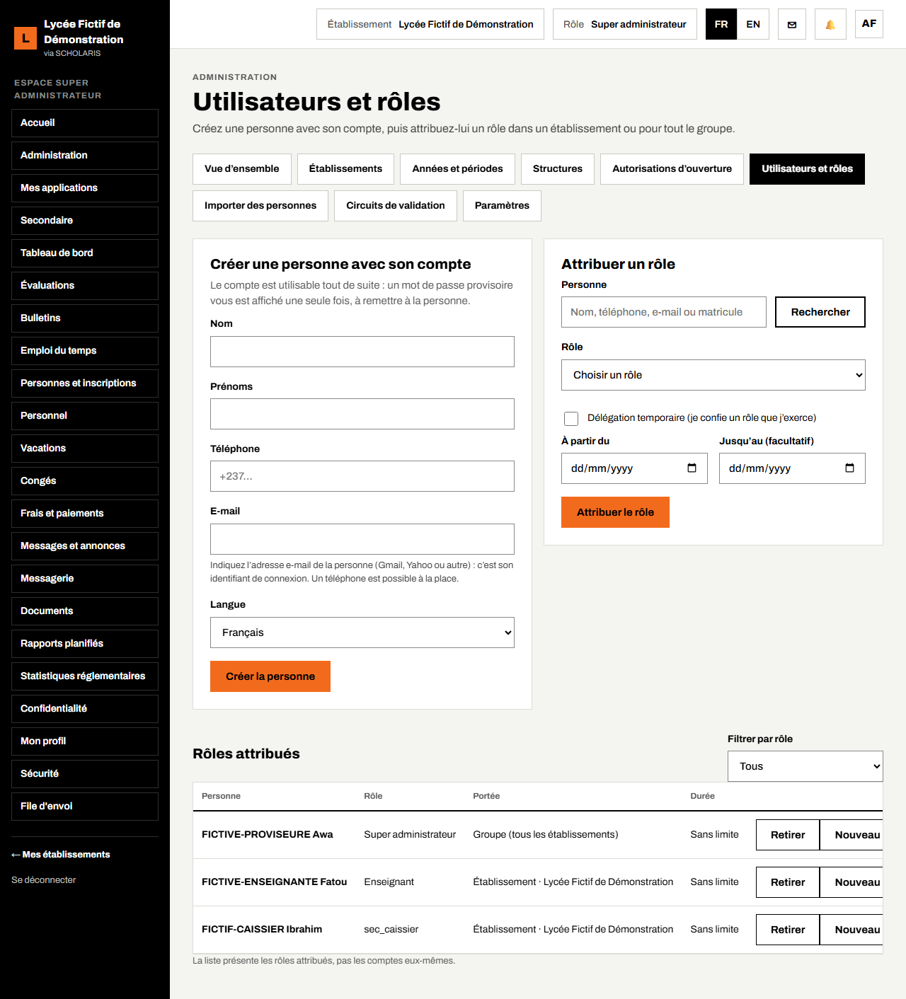

Pour beaucoup de personnes : **Administration > Importer des personnes**, à partir du modèle Excel ou CSV de l'écran (une ligne par personne, avec son rôle). Rien n'est créé avant la validation ; les mots de passe provisoires s'affichent une seule fois.

**Erreurs fréquentes**

- Un compte partagé entre deux personnes : interdit. **Un compte = une personne.**
- Oublier la **portée** : un enseignant doit être limité à ses classes ou groupes.
- Ne pas retirer les rôles d'une personne qui part.
- Au supérieur : oublier le rôle **Membre de jury** pour le directeur d'école qui préside un jury.

## 11.8 Étape 6 : les inscriptions et les garants

**Qui** : la scolarité ou le secrétariat. **Durée** : selon l'effectif.

- Inscrire chaque élève ou étudiant dans sa classe ou son groupe ; enregistrer ses **parents** et son **garant financier** (la personne qui paie). Au primaire privé, l'inscription se fait en **5 étapes**.
- Le garant financier reçoit les relances et les reçus ; il voit l'enfant dans son espace et peut payer par Mobile Money.
- La caisse peut lui attribuer une **référence de paiement famille** (par exemple FAM-0587) : une seule référence pour tous ses enfants, utilisable au guichet ou pour un paiement mobile. Elle lui est envoyée par SMS.
- Les parents et garants se **changent** sur la fiche de l'élève (ajouter, changer, retirer), sans réécrire les factures déjà émises.
- Au secondaire, une liste d'élèves peut être **importée** depuis Excel ou CSV ; une **reprise des données** d'un ancien logiciel est possible.

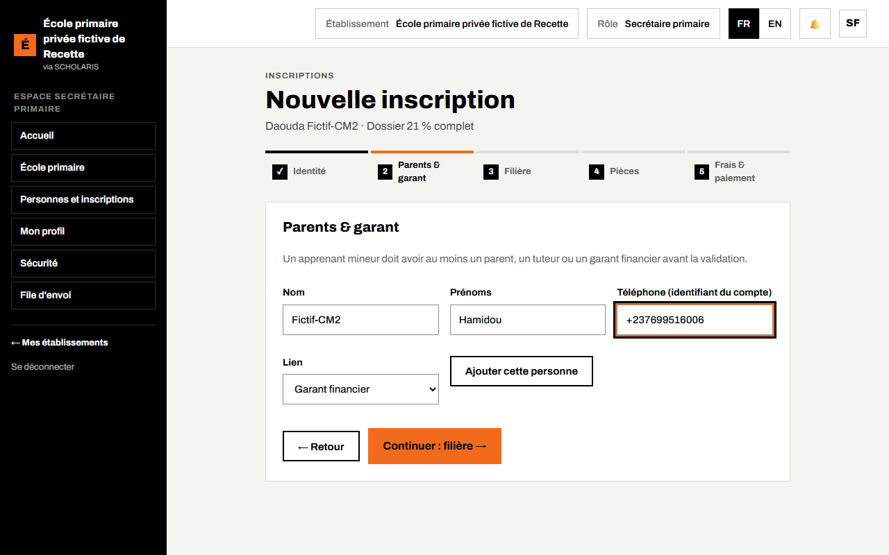

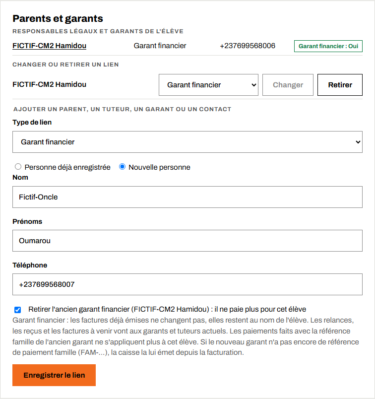

**Erreurs fréquentes**

- Pas de garant : la validation de l'inscription d'un mineur le demande ; sans garant, pas de SMS ni d'espace famille.
- Un téléphone de parent mal saisi : pas de SMS.
- Créer deux fois le même parent : l'application signale le doublon probable ; choisir la personne existante.

## 11.9 Étape 7 : les premiers usages

Visez une **première semaine simple** :

1. **Appel** chaque jour par les enseignants (sur téléphone).
2. **Caisse** ouverte le matin, arrêtée le soir ; un reçu par paiement.
3. Premières **évaluations** saisies.
4. Un **rapport planifié** pour la direction : un résumé par e-mail chaque jour, semaine ou mois (**Rapports planifiés**). Il part au personnel de l'établissement comme un message de service ; l'écran avertit si un destinataire n'a pas d'adresse e-mail et donne le motif de chaque échec dans **Historique**.

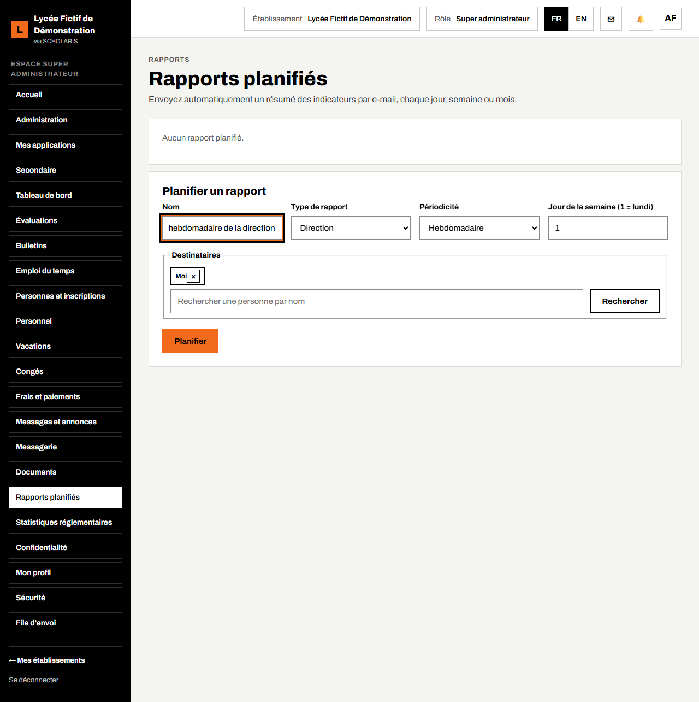

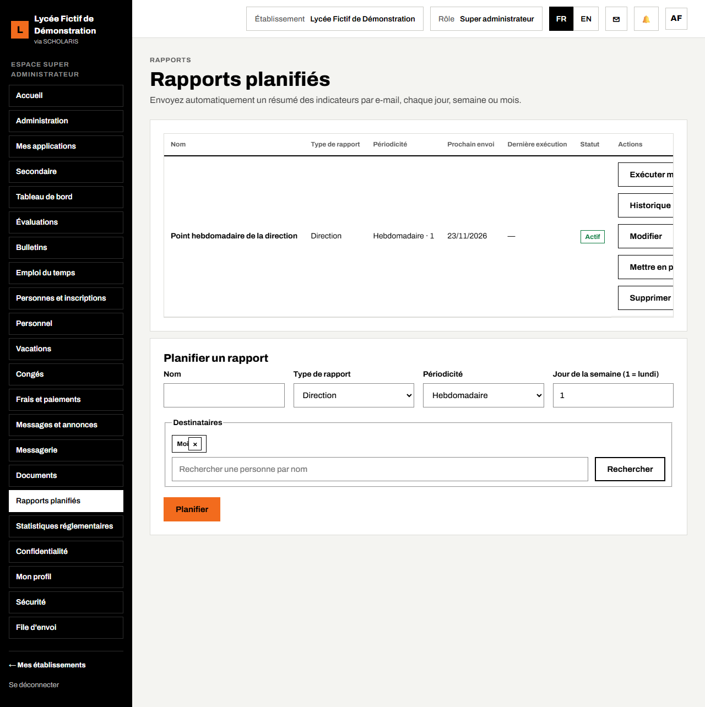

## 11.10 Ce que le super admin voit ensuite

La **fiche du client** rassemble : contact, établissements, applications et abonnements (essai, échéance, tarif), administrateurs, utilisateurs, paiements.

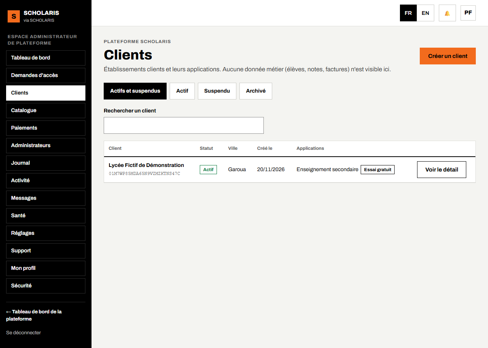

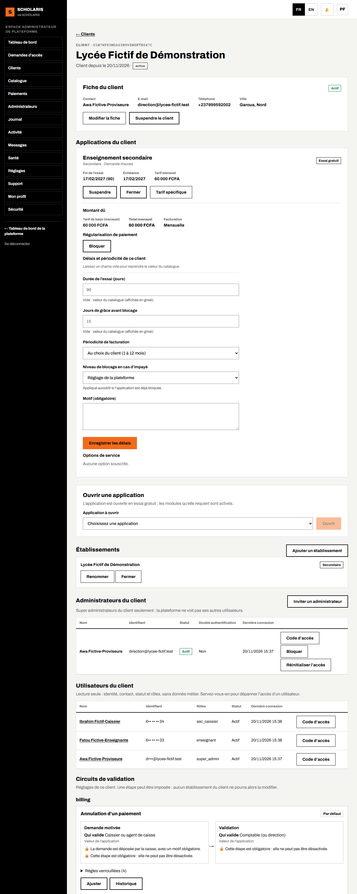

## 11.11 Dépannage des accès

| Situation | Que faire | Qui |
|---|---|---|
| Code d'activation expiré ou perdu | sur la page d'activation, **Recevoir le code** ; sinon, le super admin crée un **nouveau code** (bouton **Code d'accès** de la fiche de l'utilisateur, ou **Créer un nouveau code** après l'acceptation) et l'envoie par SMS ou e-mail | la personne, ou le super admin |
| Mot de passe oublié | **Mot de passe oublié ?** sur l'écran de connexion : un code par SMS ou e-mail permet d'en choisir un nouveau | la personne |
| Mot de passe perdu par un membre du personnel | l'administrateur de l'établissement donne un **nouveau mot de passe provisoire** depuis **Utilisateurs et rôles** | l'administrateur |
| Mot de passe perdu par l'administrateur lui-même, ou urgence | le super admin donne un **mot de passe provisoire** depuis la fiche de l'utilisateur | le super admin |
| Téléphone d'authentification perdu | la réinitialisation de la double authentification se demande à TRU GROUP, après vérification de l'identité | le super admin |
| Compte bloqué | le débloquer (super admin pour un administrateur du client) ; un compte bloqué ne reçoit pas de mot de passe provisoire | le super admin |

### Le mot de passe provisoire donné par le super admin

1. Dans le back office : **Clients** > le client > l'utilisateur. La fiche montre téléphone et e-mail masqués, statut, rôles, double authentification, dernière connexion, sessions et dernières actions.

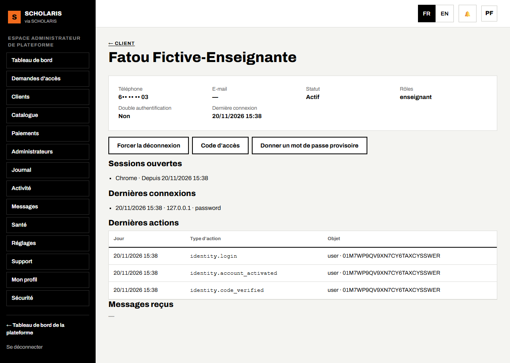

2. Cliquer sur **Donner un mot de passe provisoire**. Choisir : **Exiger un nouveau mot de passe à la connexion** (décoché par défaut) et la transmission : **Afficher seulement**, **Afficher et envoyer par e-mail** ou **Afficher et envoyer par SMS**.
3. Cliquer sur **Donner le mot de passe**, puis confirmer « Oui, remplacer le mot de passe ». Les sessions ouvertes de la personne sont fermées.

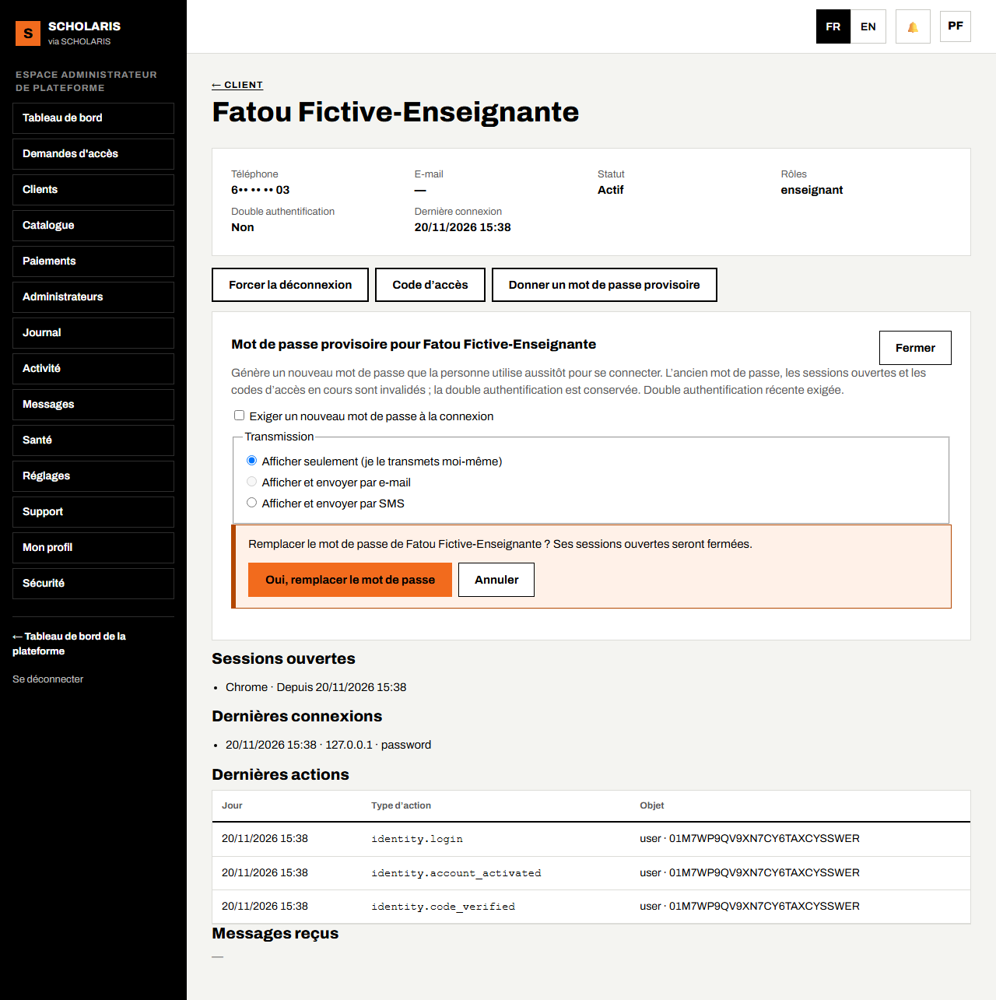

4. Le mot de passe (12 caractères) et un **message prêt à copier** s'affichent **une seule fois**. La double authentification est conservée.

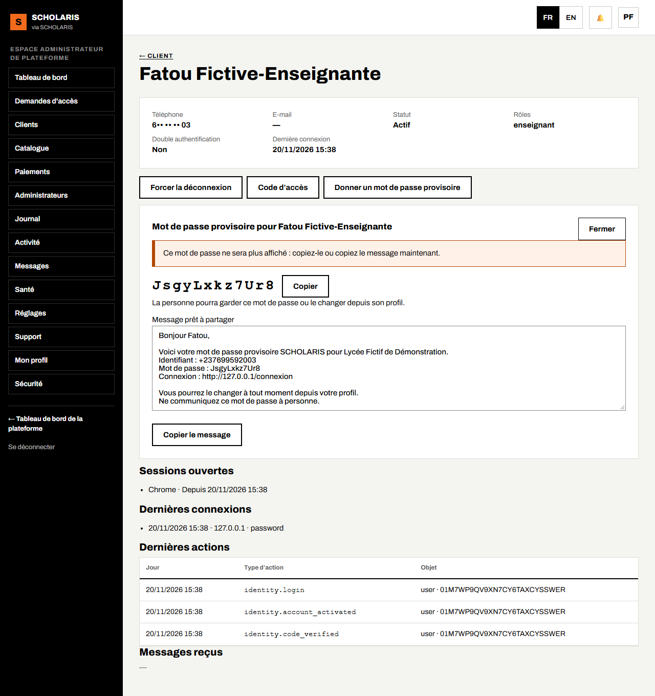

Règles : jamais pour un compte bloqué ; 5 fois par heure au plus pour un même compte ; double authentification récente du super admin ; le mot de passe n'est **jamais enregistré ni journalisé**.

**Le commercial ne reçoit jamais de mot de passe client.** Il oriente la personne vers l'administrateur de son établissement ou vers le support de TRU GROUP.
