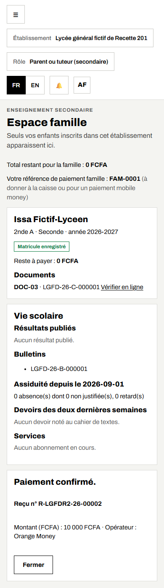
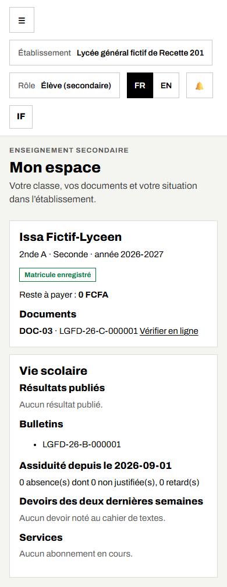
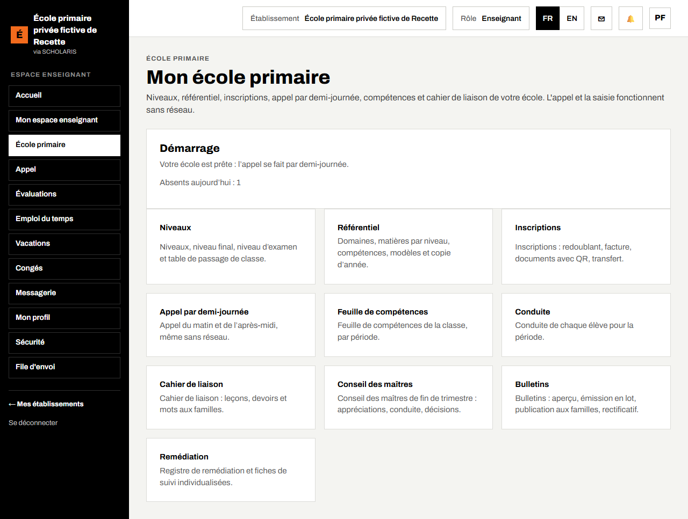
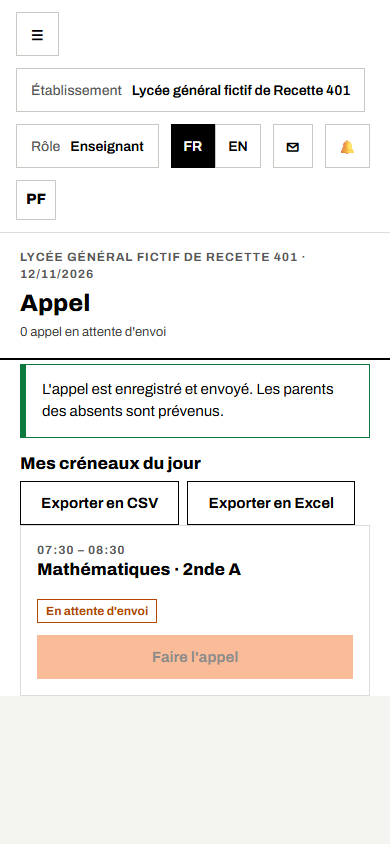
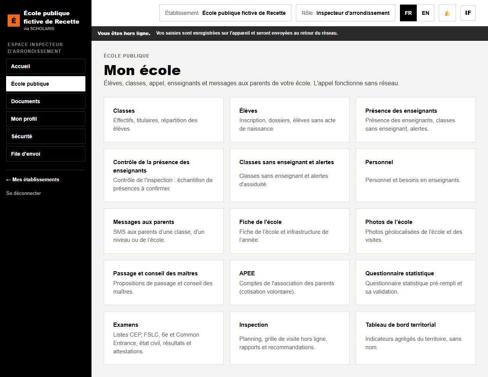

# 12. Les différents utilisateurs

Ce chapitre donne une vue d'ensemble, toutes applications confondues. Le détail par application est dans chaque fiche client (chapitres 03 à 10).

## 12.1 Trois idées à retenir

1. **Un compte = une personne.** Une personne peut avoir plusieurs rôles (directeur et enseignant, par exemple) et travailler dans plusieurs établissements du même client : elle change de rôle et d'établissement en haut de l'écran, sans se reconnecter.
2. **Le rôle décide de ce que l'on voit.** Chaque accueil n'affiche que les cartes du rôle actif. Le serveur refuse et enregistre toute tentative hors du rôle.
3. **La portée limite le périmètre.** Un enseignant ne voit que ses classes ; un chef de département, son département ; un inspecteur, son arrondissement.

## 12.2 Tableau d'ensemble

| Famille d'utilisateurs | Exemples de rôles | Ce qu'ils font | Sur ordinateur | Sur téléphone |
|---|---|---|---|---|
| **Plateforme (TRU GROUP)** | super admin (administrateur de plateforme) | accepte les demandes, crée les clients, gère le catalogue et les tarifs, enregistre les paiements, dépanne les accès ; **ne lit aucune donnée scolaire** des clients | back office complet | possible, mais pensé pour l'ordinateur |
| **Administration de l'établissement** | super administrateur du client, administrateur fonctionnel | années et périodes, structures, autorisations, comptes et rôles, paramètres, abonnement | tous les écrans d'administration | consultation |
| **Direction** | promoteur, directeur général, proviseur, principal, directeur d'école, directrice de maternelle, direction de groupe | pilote, valide, signe, préside les conseils et jurys | tableaux de bord, validations | tableaux de bord, notifications |
| **Scolarité et secrétariat** | scolarité, secrétaire | inscriptions, dossiers, documents officiels, listes d'examen | inscriptions, documents | consultation |
| **Caisse et comptabilité** | caissier, comptable, intendant, économe | frais, factures, encaissements, reçus, situation financière | caisse, journal du jour | consultation |
| **Enseignants** | enseignant, maître, professeur principal, éducatrice, formateur | appel, cahier de textes, notes ou compétences, appréciations | saisie des notes, import de fichier | **appel**, saisie des notes, même sans réseau |
| **Surveillance et vie scolaire** | surveillant général, surveillant, aide maternelle | absences, discipline, sortie sécurisée | registres | **sortie sécurisée**, appel |
| **Parents et garants** | parent, tuteur, garant financier (y compris une entreprise) | suivent leurs enfants, paient | espace famille | **espace famille**, paiement Mobile Money, SMS |
| **Élèves et étudiants** | élève, étudiant, apprenant | consultent classe, notes publiées, documents, situation | espace élève ou étudiant | **espace élève ou étudiant** |
| **Autorités (comptes externes)** | inspection, délégation, brigade de contrôle du privé, université de tutelle, auditeur | lecture limitée dans le temps ; au primaire public, chiffres agrégés sans nom | lecture | lecture |

## 12.3 Le super admin de la plateforme

C'est un compte de **TRU GROUP**, distinct des comptes des clients. Il a la **double authentification obligatoire**, et chaque action d'écriture demande une confirmation récente. Toutes ses actions sont journalisées, dans le journal de la plateforme et dans celui du client concerné. Il voit les clients, les demandes, les applications, les abonnements et les paiements, **mais pas les données scolaires** (notes, élèves, bulletins).

Le commercial **n'est pas** super admin. Il transmet au super admin : les demandes à accepter, les conditions commerciales validées par la direction, les problèmes d'accès.

## 12.4 L'administration de l'établissement

Le **premier administrateur** est la personne de contact de la demande d'accès. Il crée ensuite les autres comptes. Conseillez au client de choisir une personne **disponible et rigoureuse** (secrétaire général, censeur, informaticien de l'établissement), et d'en désigner une seconde en secours.

## 12.5 Ce que voient les familles et les élèves

Sur téléphone, le parent voit, pour chaque enfant : la classe, le reste à payer, les factures, les documents, les bulletins publiés, l'assiduité, les devoirs récents. Il paie par **Orange Money** ou **MTN MoMo** et reçoit un reçu numéroté. Il ne voit **que ses enfants**.

Au supérieur, un garant voit toujours la situation financière ; les notes et absences seulement avec l'accord de l'étudiant majeur.

## 12.6 Ce que voient les enseignants

## 12.7 Ce que voient les autorités

- **Secondaire** : inspecteur pédagogique régional, délégation départementale ou régionale, brigade de contrôle des établissements privés : **lecture seule, 30 jours au plus**, chaque lecture enregistrée.
- **Supérieur** : université de tutelle, inspection ou auditeur : **90 jours au plus**, sur le périmètre accordé.
- **Primaire public** : l'inspection d'arrondissement, les délégations et les services centraux ont leurs écrans (inspection, validation des statistiques et des examens, tableaux de bord) ; les rôles « chiffres agrégés » ne voient **jamais** le nom d'un élève.

## 12.8 La double authentification

Elle est **obligatoire** pour le super admin de la plateforme, et pour les rôles sensibles selon l'application (par exemple au supérieur : direction, caisse, comptabilité, enseignant permanent). Elle utilise une application d'authentification sur le téléphone. Prévenez le client : les personnes concernées doivent avoir un smartphone.
