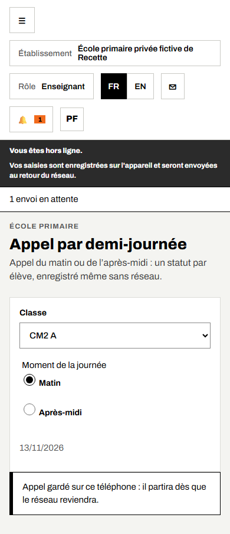

# 13. Argumentaire et objections transverses

Ces réponses valent pour tous les clients. Les objections propres à un type de client sont dans sa fiche (chapitres 03 à 10).

Méthode conseillée : **écouter** l'objection jusqu'au bout, **reformuler** (« Si je comprends bien, vous craignez que… »), **répondre** par un fait et, si possible, **montrer** l'écran.

## 13.1 Le prix

| Objection | Réponse |
|---|---|
| « C'est trop cher. » | « 60 000 FCFA par mois pour tout l'établissement, sans limite d'élèves ni de comptes. Combien vous coûtent aujourd'hui les impayés non relancés, les bulletins refaits, les heures de recopie ? » |
| « Nous ne pouvons pas payer tous les mois. » | « Le paiement se fait par Orange Money ou MTN MoMo, pour un ou plusieurs mois d'un coup. » Une périodicité trimestrielle ou annuelle existe dans la plateforme ; la proposer est **à confirmer par la direction**. |
| « Faites-nous une remise. » | « Je transmets votre demande à la direction. » Aucune remise sans accord écrit : **à confirmer par la direction**. |
| « Et si on ne paie pas à temps ? » | « 15 jours de grâce, des rappels, puis lecture seule. Vos données ne sont jamais perdues et restent exportables. » |
| « Pourquoi payer alors qu'Excel est gratuit ? » | « Excel ne fait ni l'appel sur téléphone, ni le SMS au parent, ni le paiement mobile, ni le QR qui prouve qu'un bulletin est vrai. » |

**L'essai de 90 jours** est votre meilleur argument : « Essayez une année scolaire presque complète sur un trimestre, sans payer, avec toutes les fonctions. »

## 13.2 Internet coupé

| Objection | Réponse |
|---|---|
| « Chez nous, le réseau coupe tout le temps. » | « L'**appel** fonctionne sans réseau, dans toutes les applications ; au supérieur, la **saisie des notes** aussi. Les saisies restent sur le téléphone et partent toutes seules au retour du réseau. Au primaire public, les listes gardées sur l'appareil sont chiffrées et protégées par un code personnel ; en maternelle, la liste du jour reste disponible pour la sortie. » |
| « Et pour le reste ? » | « Le reste (caisse, inscriptions, bulletins) demande une connexion. Une connexion de téléphone suffit : SCHOLARIS est léger. » |
| « Si le serveur tombe ? » | « Le serveur est surveillé par TRU GROUP (base, envois de messages, sauvegardes). » Les engagements de disponibilité sont **à confirmer par la direction**. |

À montrer : l'écran d'appel en mode avion (chapitre 14).

## 13.3 La formation du personnel

| Objection | Réponse |
|---|---|
| « Notre personnel n'est pas formé à l'informatique. » | « Les écrans sont en français simple (ou en anglais), avec un bouton par action. Chaque personne ne voit que les écrans de son rôle. » |
| « Qui va nous former ? » | « Des **guides d'utilisation illustrés** existent pour le secondaire, le primaire privé et le primaire public, et un guide complet pour l'IPES. L'IPES a aussi une **aide intégrée** avec des fiches rapides. » La formation sur site (durée, prix, nombre de séances) est **à confirmer par la direction**. |
| « Combien de temps pour démarrer ? » | « L'activation prend 5 minutes ; les premiers réglages, une demi-journée à deux jours selon la taille. » |

Pour un institut supérieur, TRU GROUP a un **plan de formation** type en 9 séances (prise en main, administration, direction, scolarité, caisse, département, enseignants, étudiants et garants, résultats), avec un **référent** par rôle dans l'établissement.

## 13.4 La sécurité des données

Le Cameroun a une **loi sur la protection des données personnelles : la loi n° 2024/017**. Les directions y sont de plus en plus attentives. Arguments factuels :

| Sujet | Ce que fait SCHOLARIS |
|---|---|
| Accès | chaque personne a son compte et son mot de passe (10 caractères au moins) ; **double authentification** pour les rôles sensibles ; blocage après plusieurs mots de passe faux |
| Cloisonnement | chaque client est isolé ; chaque rôle ne voit que son périmètre ; le parent ne voit que ses enfants ; le super admin de TRU GROUP **ne lit pas** les données scolaires |
| Traçabilité | journal d'audit inaltérable ; toute correction porte un motif, un auteur et une date |
| Consentement | écran **Confidentialité et consentements** : chacun accorde ou retire ses consentements ; demandes des personnes suivies ; pas de SMS non essentiel sans consentement ; en maternelle, aucune photo d'enfant sans consentement photo en vigueur |
| Données sur le téléphone | listes gardées hors ligne **chiffrées** au primaire public ; au primaire public, cinq codes faux effacent tout |
| Documents | le QR d'un document ne montre que le strict nécessaire pour prouver son authenticité |
| Sauvegardes | sauvegardes **chiffrées** de la base |
| Hébergement | le pied de page de SCHOLARIS indique « **Hébergé au Cameroun** » ; connexion chiffrée (https) |
| Exports | un export contient des données personnelles : à ne pas envoyer par WhatsApp ni par e-mail personnel |

Ce que vous **ne dites pas** : « SCHOLARIS est certifié conforme. » Aucune certification n'est revendiquée. Un engagement contractuel sur les données (contrat de sous-traitance, déclaration à l'autorité) est **à confirmer par la direction**.

## 13.5 La reprise de l'existant

| Objection | Réponse |
|---|---|
| « Nous avons tout dans Excel ou dans un vieux logiciel. » | « La reprise est prévue : import Excel ou CSV des élèves au secondaire, reprise des données d'un ancien logiciel, reprise des étudiants, du personnel et des soldes d'ouverture au supérieur, import des personnes (personnel) dans l'administration. » |
| « Qui fait la reprise ? » | « L'établissement importe ses listes lui-même avec les modèles fournis ; la reprise d'un ancien logiciel se fait avec l'équipe TRU GROUP. » Son prix éventuel est **à confirmer par la direction**. |
| « Nous démarrons en cours d'année. » | « C'est possible : on crée l'année en cours, on reprend les élèves et les soldes, et on démarre à la prochaine période. » |
| « Au primaire public, nous avons des registres papier. » | « L'**inscription groupée** recopie un registre papier en série. » |

## 13.6 Les SMS

| Objection | Réponse |
|---|---|
| « Combien coûtent les SMS ? » | « Ils sont comptés à l'usage ; l'ordre de grandeur est d'environ 25 FCFA par SMS. Le tarif exact et la façon de le payer vous seront précisés. » (**à confirmer par la direction**) |
| « Les parents vont être harcelés. » | « Pas de SMS non essentiel sans consentement, jamais avant 7 h ni après 21 h sauf urgence, et un parent peut se désinscrire. Le SMS « bulletin disponible » part une seule fois par bulletin. » |
| « Nos parents n'ont pas de smartphone. » | « Le SMS arrive sur n'importe quel téléphone. L'espace famille est un plus pour ceux qui ont un smartphone. » |
| « Pouvons-nous couper certains SMS ? » | « Oui : par exemple, le SMS « bulletin disponible » est un paramètre de l'établissement. » |
| « Et WhatsApp ? » | « Pas aujourd'hui : SMS et e-mail. » |

## 13.7 Les autres objections fréquentes

| Objection | Réponse |
|---|---|
| « Nous verrons l'année prochaine. » | « L'essai de 90 jours vous permet de tester maintenant, sans risque, et d'être prêts à la rentrée. » |
| « Le ministère va imposer son logiciel. » | « SCHOLARIS suit les règles camerounaises (autorisations, examens, statistiques) et exporte les listes demandées. » |
| « Nos enseignants vont refuser. » | « Commencez par l'appel : cinq minutes par jour sur téléphone. Les enseignants voient vite le gain. » |
| « Et si TRU GROUP disparaît ? » | « Vos données restent exportables à tout moment, même en lecture seule. » |
| « Nous voulons un bulletin à notre format. » | « Les documents ont des modèles ; une adaptation se discute avec l'équipe produit. » (**à confirmer**) |
