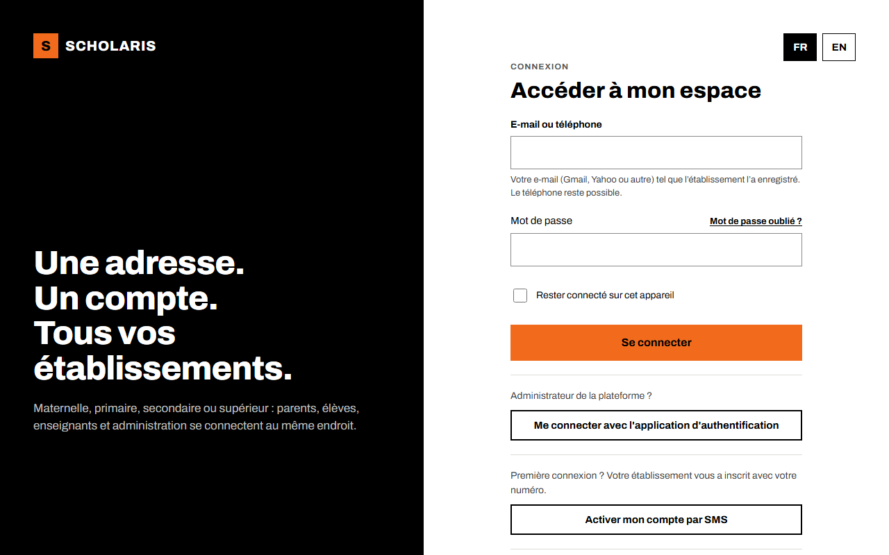
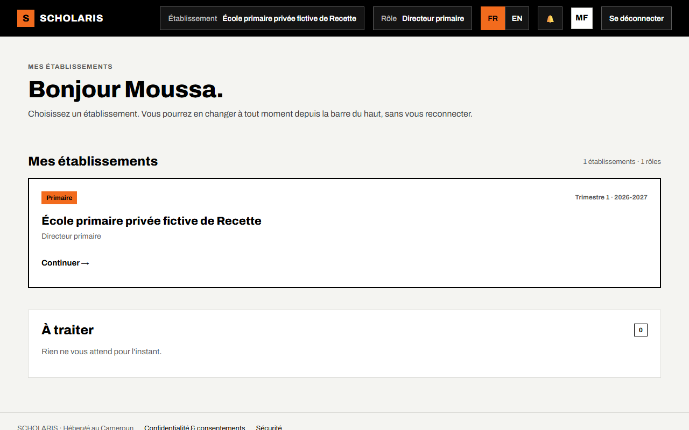
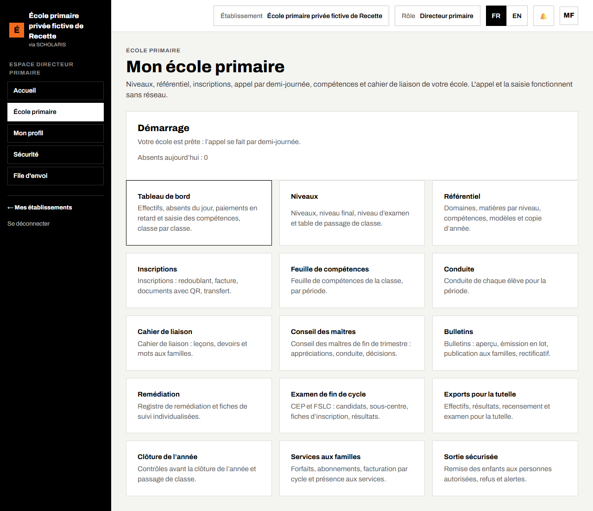

# 01. Premiers pas

Ce chapitre concerne **tout le monde** : personnel de l'école et parents.

## 1.1 Ce qu'il vous faut

- Un ordinateur, une tablette ou un téléphone avec un navigateur récent (Chrome, Firefox, Edge, Safari).
- Votre **numéro de téléphone** (ou votre adresse e-mail) tel que l'école l'a enregistré : c'est votre identifiant.
- Votre mot de passe. À la création de votre compte, vous recevez un **code à 6 chiffres par SMS** pour choisir vous-même votre mot de passe.

Adresse du site : **https://scholariserp.trugroup.cm**. Vérifiez que l'adresse commence par `https://` et que le cadenas est affiché.

Astuce : sur téléphone, ouvrez le menu du navigateur puis **Ajouter à l'écran d'accueil**. SCHOLARIS s'ouvre alors comme une application.

## 1.2 Activer son compte (première fois)

**Qui** : toute personne dont le compte vient d'être créé par l'école (personnel, parent).

1. Ouvrez la page de connexion, puis le lien **Activer mon compte par SMS**.
2. Saisissez votre numéro de téléphone et cliquez sur **Recevoir le code**.
3. Saisissez le **code à 6 chiffres** reçu par SMS, puis **Vérifier le code**.
4. Choisissez votre **nouveau mot de passe** (10 caractères au minimum), retapez-le, puis **Enregistrer le mot de passe**.
5. Cliquez sur **Aller à la connexion**.

## 1.3 Se connecter

**Où** : écran **Connexion** (`/connexion`).

1. Dans **E-mail ou téléphone**, saisissez votre identifiant.
2. Dans **Mot de passe**, saisissez votre mot de passe.
3. Cochez **Rester connecté sur cet appareil** seulement sur votre propre appareil, jamais sur un ordinateur partagé.
4. Cliquez sur **Se connecter**.

Après plusieurs mots de passe faux, la connexion est bloquée un moment. Attendez, ou utilisez **Mot de passe oublié ?**.

## 1.4 L'écran d'accueil

Après la connexion, l'accueil s'affiche.

- En haut : **Établissement** (le nom de votre école) et **Rôle** (votre fonction). Si vous avez plusieurs rôles, choisissez le bon dans la liste **Rôle** : les menus changent selon le rôle choisi.
- **FR / EN** : la langue des écrans.
- La cloche : vos notifications.
- À gauche : le menu. L'entrée **École primaire** ouvre l'application.
- En bas du menu : **Mes établissements** (si vous travaillez dans plusieurs écoles) et **Se déconnecter**.

## 1.5 L'accueil de l'application « École primaire »

**Où** : menu **École primaire** (`/primaire`).

L'écran **Mon école primaire** affiche :

- le cadre **Démarrage**, qui dit si l'école est prête et compte les **Absents aujourd'hui** ;
- une carte par rubrique : **Tableau de bord**, **Niveaux**, **Référentiel**, **Inscriptions**, **Feuille de compétences**, **Conduite**, **Cahier de liaison**, **Conseil des maîtres**, **Bulletins**, **Remédiation**, **Examen de fin de cycle**, **Exports pour la tutelle**, **Clôture de l'année**, **Services aux familles**, **Sortie sécurisée**.

Chacun ne voit que les cartes de son rôle. Un maître, par exemple, voit l'appel, la feuille de compétences, la conduite et le cahier de liaison.

## 1.6 Le démarrage de l'école (une seule fois)

**Qui** : le directeur. **Où** : **École primaire**, cadre **Démarrage**.

À la première ouverture, le cadre **Démarrage** liste quelques réglages recommandés pour une école primaire (par exemple l'appel par demi-journée), avec leur valeur **actuel** et **recommandé**.

1. Lisez la liste.
2. Cliquez sur **Appliquer les réglages recommandés**.
3. Le message « Votre école est prête : l'appel se fait par demi-journée. » s'affiche.

Les valeurs déjà choisies par l'école ne sont jamais écrasées. Si vous n'êtes pas directeur, le cadre affiche « Demandez au directeur d'appliquer ces réglages. »

## 1.7 Sécurité de votre compte

- Menu **Sécurité** : changer votre mot de passe, voir les appareils connectés, se déconnecter partout.
- Menu **Mon profil** : vos coordonnées et votre langue.
- Menu **File d'envoi** : les saisies faites sans réseau qui attendent d'être envoyées (voir le chapitre 05).
- Quittez toujours avec **Se déconnecter** sur un appareil partagé.
