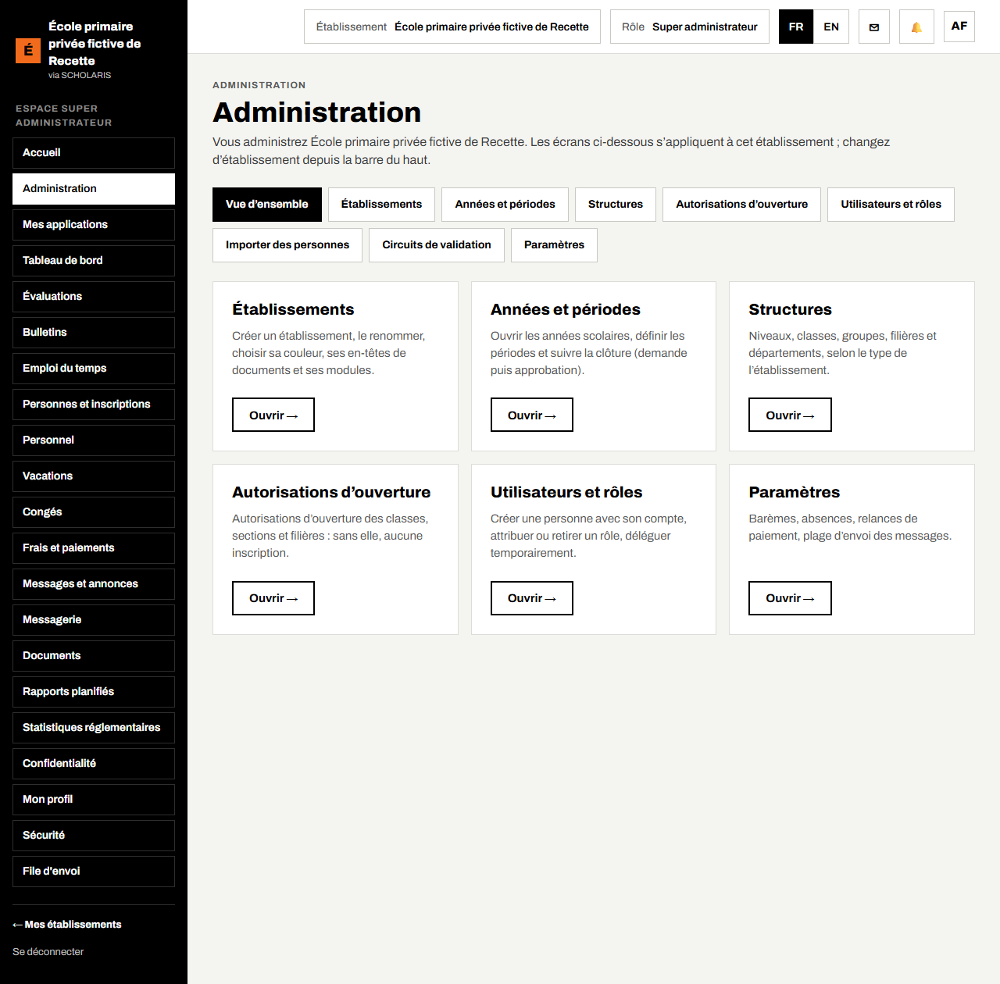
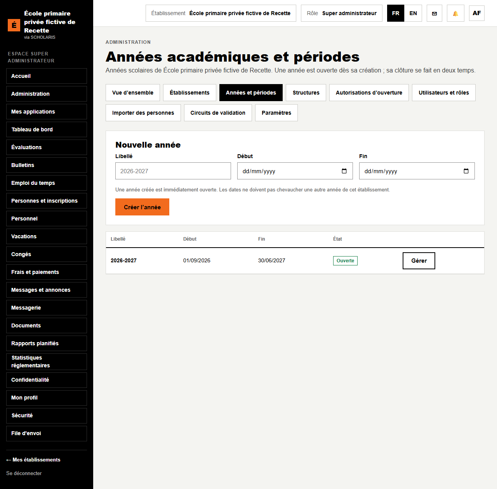
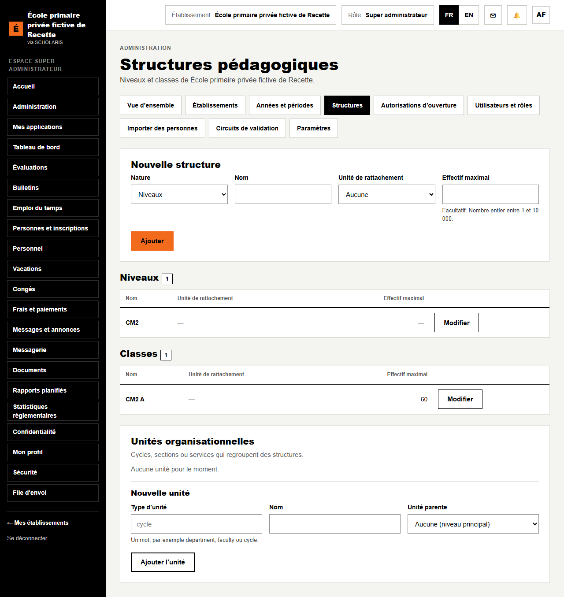
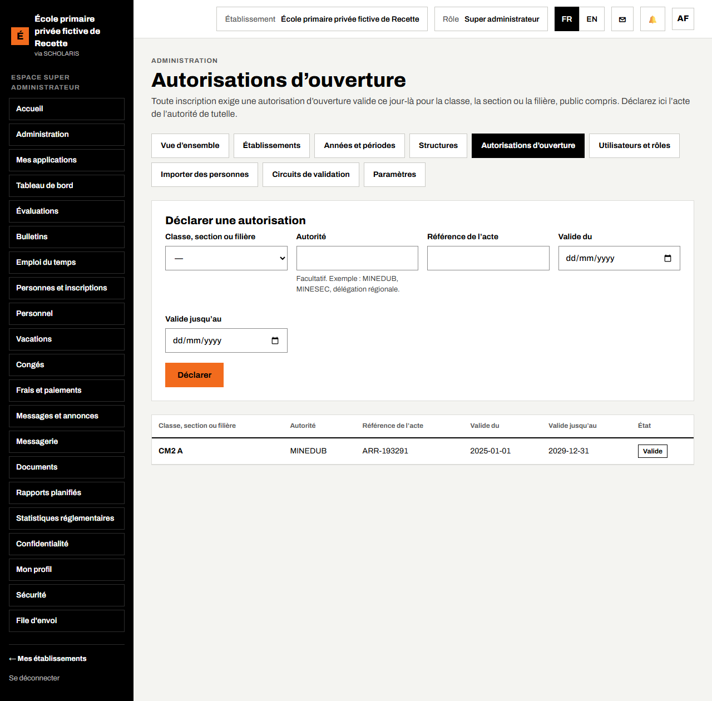
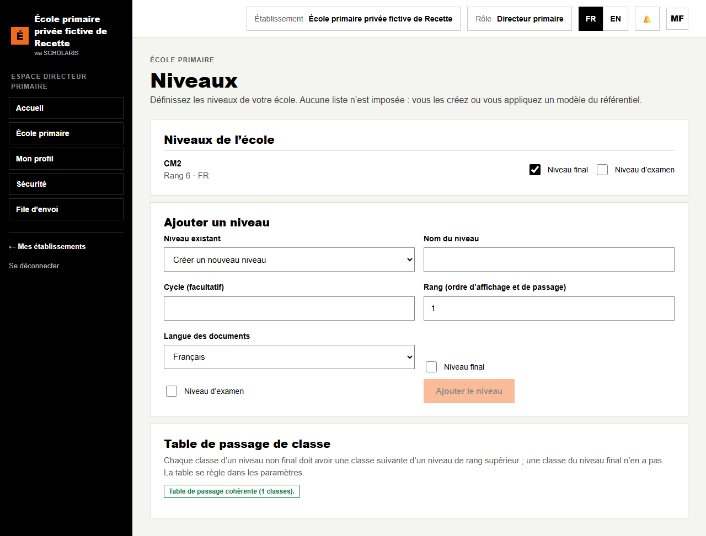
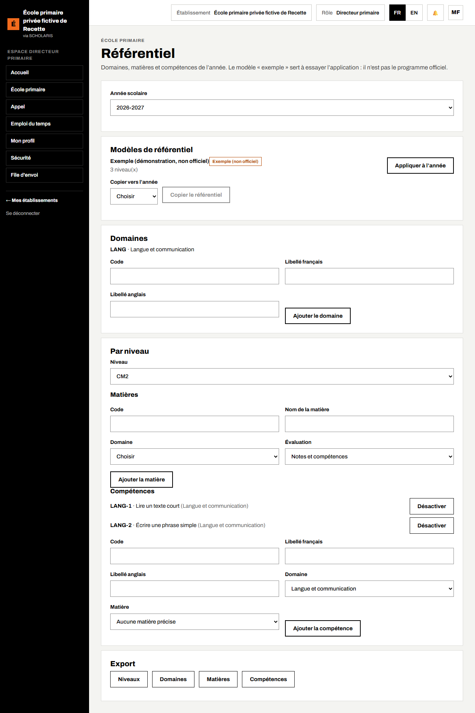
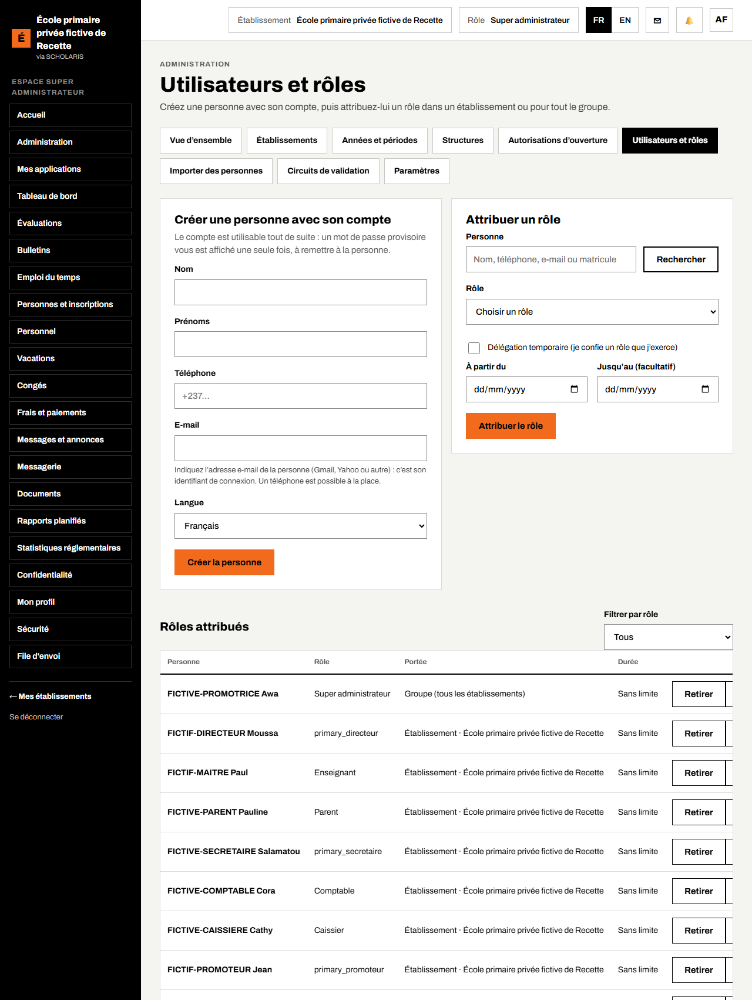
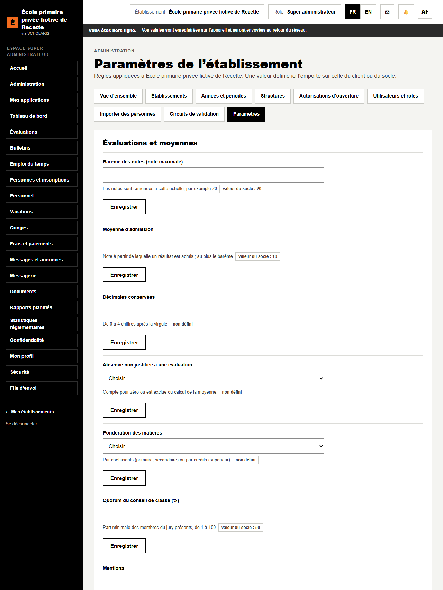

# 02. Paramétrage de l'école

Ce chapitre se fait **une fois par an**, avant la rentrée. Il se lit dans l'ordre : année et trimestres, classes, autorisations d'ouverture, niveaux, référentiel de compétences, comptes du personnel.

**Qui fait quoi**

| Tâche | Qui |
|---|---|
| Année scolaire, trimestres, classes, autorisations d'ouverture, comptes du personnel, paramètres | Promoteur ou administrateur de l'école (rôle **Super administrateur**) |
| Démarrage, niveaux, table de passage | Directeur |
| Référentiel (domaines, matières, compétences) | Directeur et responsable pédagogique (adjoint) |

## 2.1 L'administration de l'école

**Où** : menu **Administration** (`/administration`).

La page **Administration** affiche une carte par rubrique : **Établissements**, **Années et périodes**, **Structures**, **Autorisations d'ouverture**, **Utilisateurs et rôles**, **Paramètres**. Cliquez sur **Ouvrir** dans la carte voulue.

## 2.2 L'année scolaire et les trimestres (calendrier)

**Où** : **Administration > Années et périodes** (`/administration/annees`).

Créer l'année :

1. Dans **Nouvelle année**, saisissez le **Libellé** (exemple : 2026-2027), la date de **Début** et la date de **Fin**.
2. Cliquez sur **Créer l'année**. Une année créée est tout de suite **Ouverte**.

Créer les trimestres :

1. Sur la ligne de l'année, cliquez sur **Gérer**.
2. Dans **Nouvelle période**, choisissez la **Nature** **Trimestre**, le **Numéro** (1, 2 ou 3), les dates de début et de fin.
3. Cliquez sur **Ajouter la période**. Recommencez pour les trois trimestres.

Les trimestres servent partout : feuille de compétences, conseil des maîtres, bulletins. Les dates d'une année ne doivent pas chevaucher une autre année.

## 2.3 Les classes

**Où** : **Administration > Structures** (`/administration/structures`).

1. Dans **Nouvelle structure**, choisissez la **Nature** (classe), saisissez le **Nom** (exemple : CM2 A) et, si vous le souhaitez, l'**Effectif maximal**.
2. Choisissez le niveau de rattachement s'il vous est proposé.
3. Cliquez sur **Ajouter**.

Astuce : créez d'abord les niveaux (chapitre 2.5), puis les classes de chaque niveau.

## 2.4 Les autorisations d'ouverture

**Où** : **Administration > Autorisations d'ouverture** (`/administration/autorisations`).

**Important** : sans autorisation d'ouverture valide ce jour-là, **aucune inscription n'est possible** dans la classe.

1. Dans **Déclarer une autorisation**, choisissez la **Classe, section ou filière**.
2. **Autorité** : par exemple MINEDUB ou la délégation régionale.
3. **Référence de l'acte** : le numéro de l'arrêté ou de l'agrément.
4. **Valide du** et **Valide jusqu'au** : la période de validité.
5. Cliquez sur **Déclarer**. Le message « Autorisation enregistrée. » s'affiche.

La liste indique l'**État** de chaque autorisation : **Valide**, **Expirée** ou **À venir**. Le cadre **Sans autorisation valide** liste les classes qui refusent toute inscription aujourd'hui.

## 2.5 Les niveaux et la table de passage

**Qui** : directeur. **Où** : **École primaire > Niveaux** (`/primaire/niveaux`).

Aucune liste n'est imposée : vous créez les niveaux de votre école (SIL, CP, CE1, CE2, CM1, CM2, ou Class 1 à Class 6 pour le sous-système anglophone).

1. Dans **Ajouter un niveau**, choisissez **Créer un nouveau niveau** ou un **Niveau existant**.
2. **Nom du niveau**, **Cycle (facultatif)**, **Rang (ordre d'affichage et de passage)** et **Langue des documents**.
3. Cochez **Niveau final** pour le dernier niveau de l'école, et **Niveau d'examen** pour le niveau qui présente le CEP ou le FSLC (en général le CM2 ou la Class 6).
4. Cliquez sur **Ajouter le niveau**.

La **Table de passage de classe** vérifie que chaque classe d'un niveau non final a une classe suivante. Le message « Table de passage cohérente » confirme que tout va bien. Sinon, chaque problème est écrit en clair (par exemple « aucune classe suivante »).

## 2.6 Le référentiel de compétences

**Qui** : directeur, responsable pédagogique. **Où** : **École primaire > Référentiel** (`/primaire/referentiel`).

Le référentiel contient, pour l'année : les **domaines**, les **matières** de chaque niveau et les **compétences** évaluées.

### Partir d'un modèle

Le cadre **Modèles de référentiel** propose des modèles. Le modèle **Exemple (non officiel)** sert à essayer l'application : il n'est pas le programme officiel. Cliquez sur **Appliquer à l'année**. Rien n'est dupliqué si vous recommencez.

### Ajouter un domaine

1. Dans **Domaines**, saisissez le **Code** (exemple : LANG), le **Libellé français** (exemple : Langue et communication) et, si besoin, le **Libellé anglais**.
2. Cliquez sur **Ajouter le domaine**.

### Ajouter une matière

1. Dans **Par niveau**, choisissez le **Niveau** (exemple : CM2).
2. Dans **Matières**, saisissez le **Nom de la matière**, choisissez le **Domaine** et le mode d'**Évaluation** : **Notes et compétences**, **Notes** ou **Compétences**.
3. Cliquez sur **Ajouter la matière**.

### Ajouter une compétence

1. Toujours pour le niveau choisi, dans **Compétences**, saisissez le **Code** (exemple : LANG-1) et le libellé (exemple : Lire un texte court).
2. Choisissez le **Domaine** et, si besoin, la **Matière** (ou **Aucune matière précise**).
3. Cliquez sur **Ajouter la compétence**. Elle apparaît dans la liste.

Une compétence qui ne sert plus se **Désactive** (et se **Réactive**) : elle n'est jamais effacée, pour garder les bulletins passés.

### Préparer l'année suivante

**Copier vers l'année** : choisissez l'année d'arrivée puis **Copier le référentiel**.

## 2.7 Les comptes du personnel

**Qui** : promoteur ou administrateur. **Où** : **Administration > Utilisateurs et rôles** (`/administration/utilisateurs`).

1. Dans **Créer une personne avec son compte**, saisissez le nom, le prénom et le **téléphone** (ou l'e-mail), puis **Créer la personne**. Son compte attend l'activation : la personne reçoit un code par SMS (chapitre 01).
2. Dans **Attribuer un rôle**, cherchez la personne, choisissez le **Rôle** (Directeur primaire, Secrétaire primaire, Enseignant, Comptable, Caissier, Surveillant primaire…) et la **Portée** (en général **Établissement**).
3. Cliquez sur **Attribuer le rôle**.

**Délégation temporaire** : cochez-la pour confier un rôle pendant une absence (90 jours au plus, avec une date de fin).

Les rôles sont décrits au chapitre 12.

## 2.8 Les paramètres de l'école

**Où** : **Administration > Paramètres** (`/administration/parametres`).

Les paramètres règlent le fonctionnement de l'école : absences, relances de paiement, plage d'envoi des SMS, règles du bulletin, sortie sécurisée… Une valeur définie ici l'emporte sur la valeur par défaut. Modifiez une valeur puis cliquez sur **Enregistrer**.

Plusieurs valeurs de départ du primaire sont **« à confirmer »** par l'école (barème, rang sur le bulletin, échelle des compétences, examen). Leur liste se trouve dans **École primaire > Clôture de l'année**, cadre **Paramètres à confirmer** (chapitre 10).
