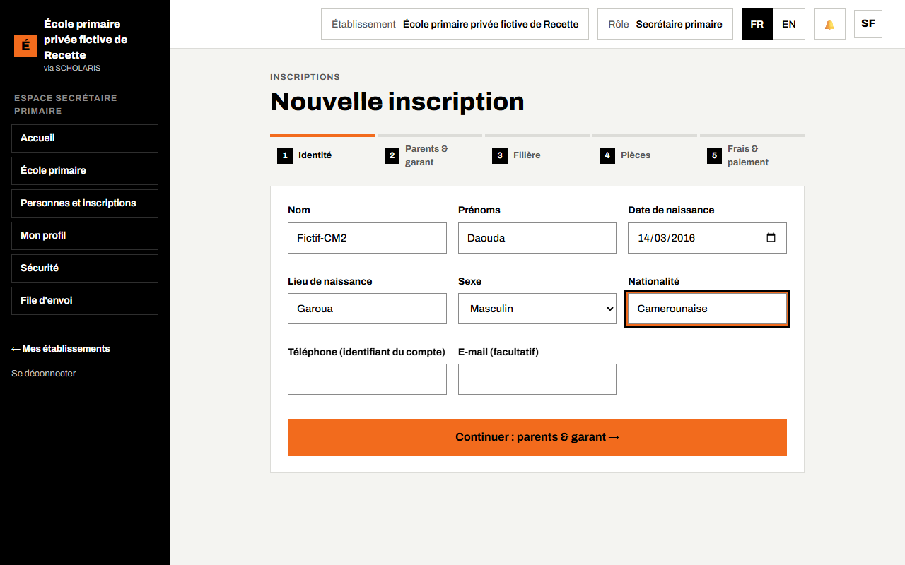
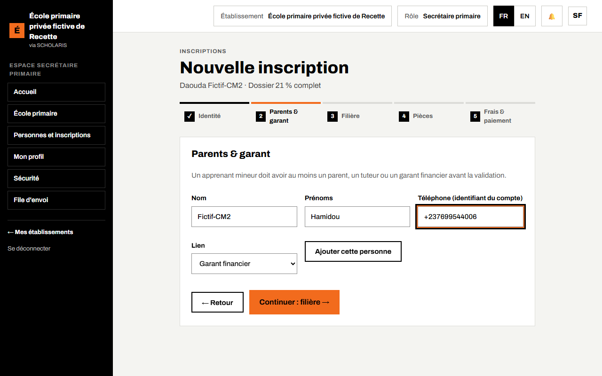
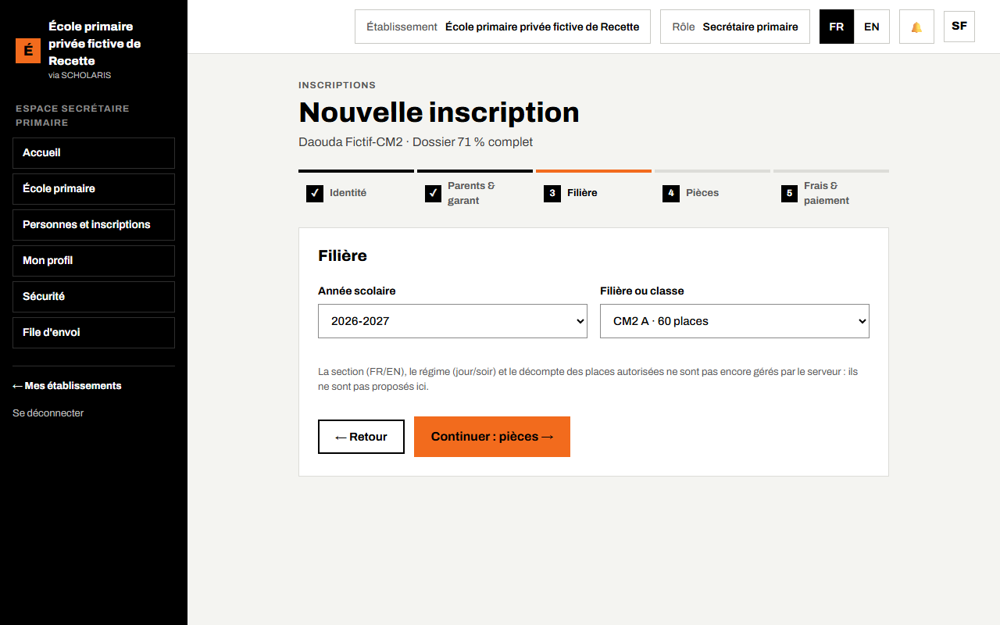
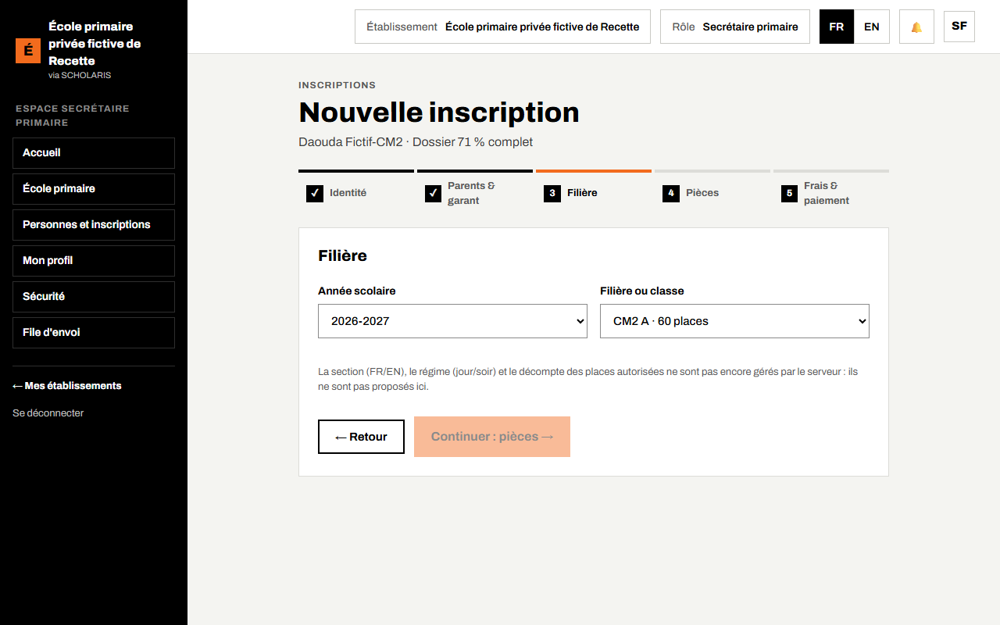
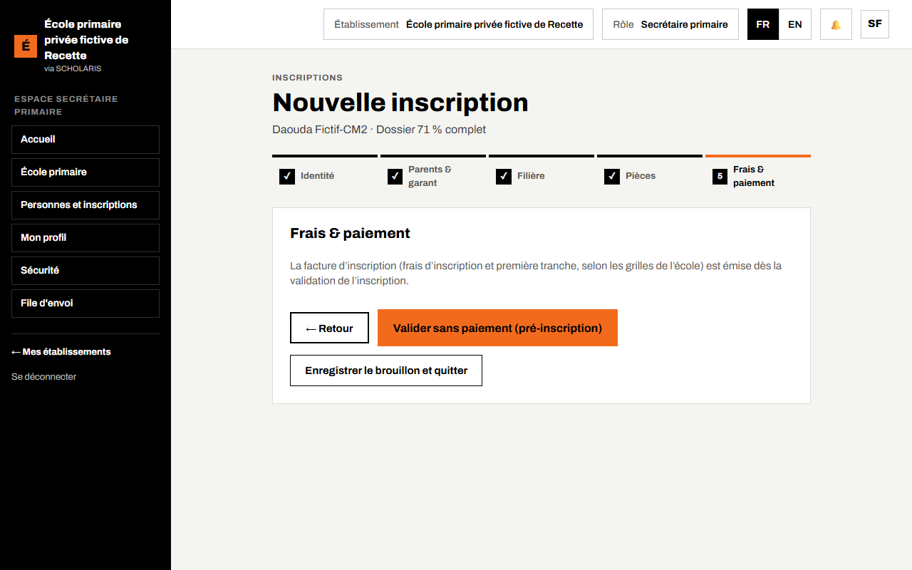
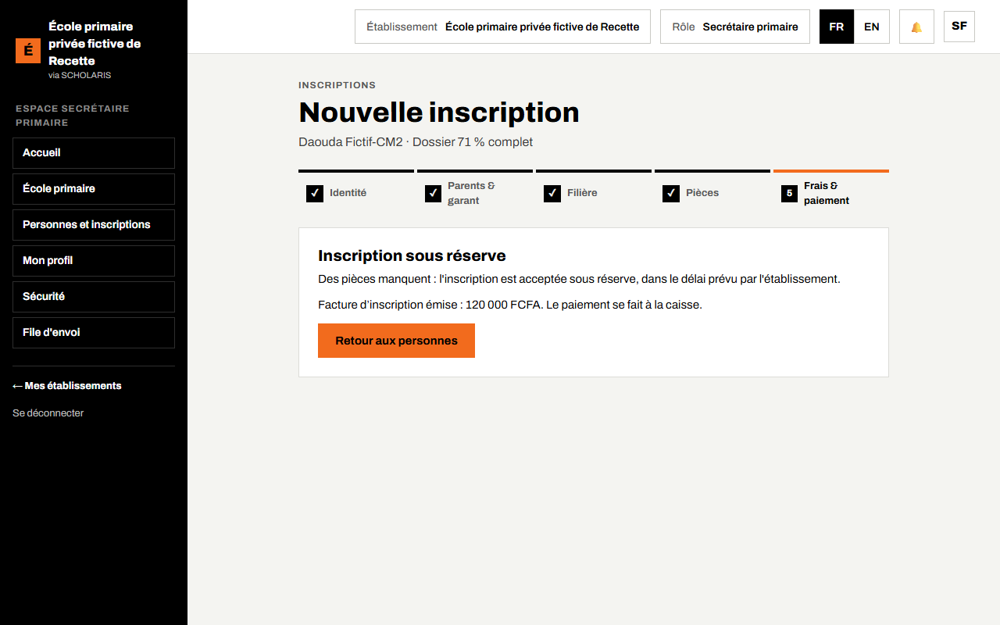
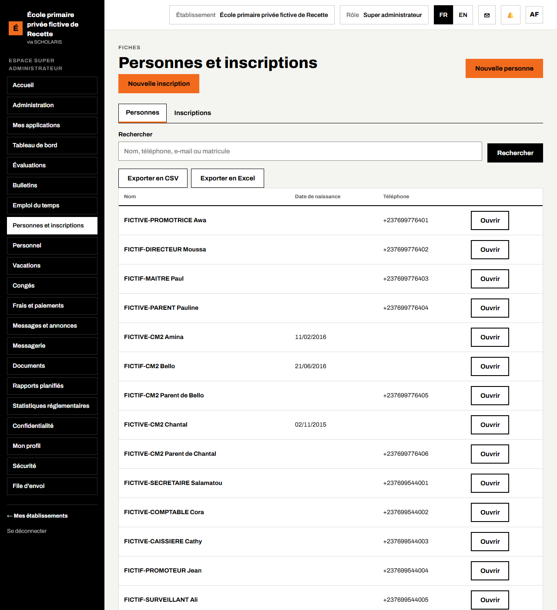
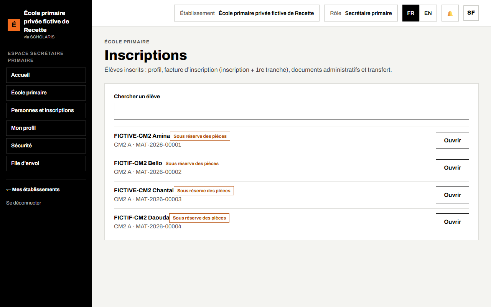
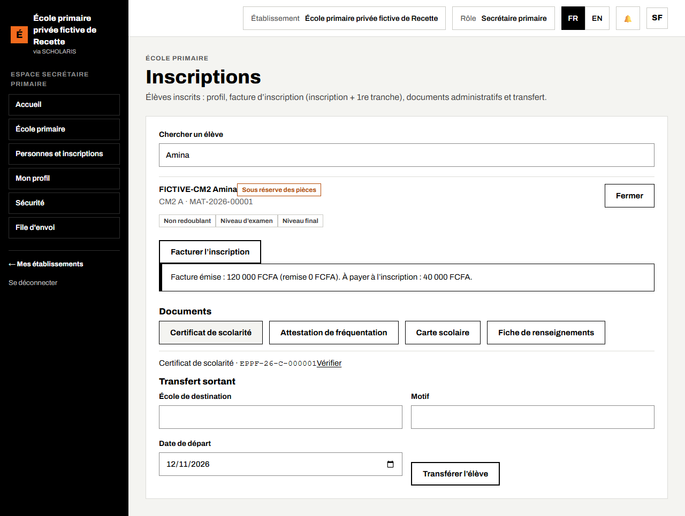

# 03. Inscriptions et parents

Ce chapitre explique comment inscrire un élève, enregistrer ses parents et son **garant financier** (la personne qui paie), retrouver son dossier, établir la facture d'inscription et délivrer les documents administratifs.

**Qui fait quoi**

| Tâche | Qui |
|---|---|
| Nouvelle inscription, parents et garant | Secrétaire, administrateur de l'école |
| Guichet des inscriptions : facture, documents, transfert | Secrétaire |
| Consultation des dossiers | Directeur, promoteur, maîtres (leur classe) |

Avant de commencer : la classe doit exister et avoir une **autorisation d'ouverture valide** (chapitre 02).

## 3.1 Nouvelle inscription, en cinq étapes

**Où** : `/inscription` (écran **Nouvelle inscription**).

L'écran suit cinq étapes, affichées en haut : **Identité**, **Parents & garant**, **Filière**, **Pièces**, **Frais & paiement**. Le pourcentage « Dossier … % complet » avance à chaque étape.

### Étape 1 : Identité

1. Saisissez le **Nom**, les **Prénoms**, la **Date de naissance**, le **Lieu de naissance**, le **Sexe** et la **Nationalité**.
2. **Téléphone** et **E-mail** : laissez vides pour un enfant (ils servent au compte d'un élève plus âgé).
3. Cliquez sur **Continuer : parents & garant →**.

Si un enfant semblable existe déjà, l'écran le signale : « Une personne existe peut-être déjà dans le groupe ». Choisissez **C'est la même personne : reprendre sa fiche** (son historique est conservé) ou **Personne différente**.

### Étape 2 : Parents et garant financier

Un élève mineur doit avoir au moins un parent, un tuteur ou un garant financier.

1. Saisissez le **Nom**, le **Prénom** et le **Téléphone** du parent.
2. Dans **Lien**, choisissez **Parent**, **Tuteur** ou **Garant financier**.
3. Cliquez sur **Ajouter cette personne**. Recommencez pour chaque parent.
4. Cliquez sur **Continuer : filière →**.

**Le garant financier est important** : c'est lui qui reçoit les factures, les reçus et la référence de paiement de la famille. C'est aussi lui qui voit les bulletins dans l'espace des parents (chapitre 11). Si un parent est déjà connu de l'école, il est retrouvé par son téléphone : aucune fiche en double n'est créée.

### Étape 3 : Classe

1. Choisissez l'**Année scolaire**.
2. Choisissez la classe dans **Filière ou classe** (exemple : CM2 A). Le nombre de places est indiqué.
3. Cliquez sur **Continuer : pièces →**.

### Étape 4 : Pièces du dossier

Chaque pièce est marquée **Reçu** ou **Manquant** : acte de naissance, photos d'identité, bulletin précédent, certificat médical, carnet de vaccination, pièce d'identité du garant, justificatif de domicile.

1. Pour une pièce reçue, cliquez sur **Scanner** et choisissez le fichier (PDF, JPG ou PNG, 5 Mo au plus) ou prenez la photo avec le téléphone.
2. Cliquez sur **Continuer : frais & paiement →**.

Une pièce manquante n'empêche pas l'inscription : l'élève est alors inscrit **sous réserve**, dans le délai prévu par l'école.

### Étape 5 : Frais et paiement

- Si la grille des frais de la classe existe et que votre rôle gère les frais, l'écran affiche le montant **À payer** et la **Référence de paiement unique de la famille** (valable au guichet, sur Orange Money et MTN MoMo). Cliquez sur **Valider l'inscription** ou **Encaisser au guichet**.
- Pour la secrétaire, l'étape annonce : « La facture d'inscription (frais d'inscription et première tranche, selon les grilles de l'école) est émise dès la validation de l'inscription. » Cliquez sur **Valider sans paiement (pré-inscription)** : la facture est émise aussitôt et l'écran final affiche « Facture d'inscription émise : … Le paiement se fait à la caisse. »

**Enregistrer le brouillon et quitter** garde le dossier pour plus tard.

Le message **Inscription validée** (dossier complet) ou **Inscription sous réserve** (pièces manquantes) confirme l'inscription.

## 3.2 La fiche de l'élève et ses garants

**Qui** : secrétaire, administrateur de l'école. **Où** : menu **Personnes et inscriptions** (`/personnes`).

1. Cherchez l'élève par son nom.
2. Cliquez sur **Ouvrir** sur sa ligne : sa fiche s'ouvre.

La fiche regroupe l'identité, l'inscription de l'année, les parents et les **garants financiers**. Depuis la fiche, vous pouvez ajouter un garant financier oublié.

## 3.3 Le guichet des inscriptions : facture, documents, transfert

**Qui** : secrétaire. **Où** : **École primaire > Inscriptions** (`/primaire/inscriptions`).

L'écran liste les élèves inscrits de l'année, y compris ceux inscrits **sous réserve** : leur ligne porte l'étiquette **Sous réserve des pièces** tant qu'une pièce du dossier manque.

1. Dans **Chercher un élève**, tapez le nom ou le matricule.
2. Cliquez sur **Ouvrir** sur la ligne de l'élève. Son profil s'affiche : **Redoublant** ou **Non redoublant**, **Niveau d'examen**, **Niveau final**.
3. **Facturer l'inscription** : établit la facture d'inscription (inscription + 1re tranche). Le message indique le net, la remise éventuelle et le montant « À payer à l'inscription ».
4. **Documents** : cliquez sur le document voulu : **Certificat de scolarité**, **Attestation de fréquentation**, **Carte scolaire**, **Fiche de renseignements**. Chaque document porte un numéro et un **QR de vérification** ; le lien **Vérifier** montre la page de contrôle.
5. **Transfert sortant** : saisissez l'**École de destination**, le **Motif** et la **Date de départ**, puis **Transférer l'élève**. Un **Certificat de radiation** peut ensuite être délivré.

