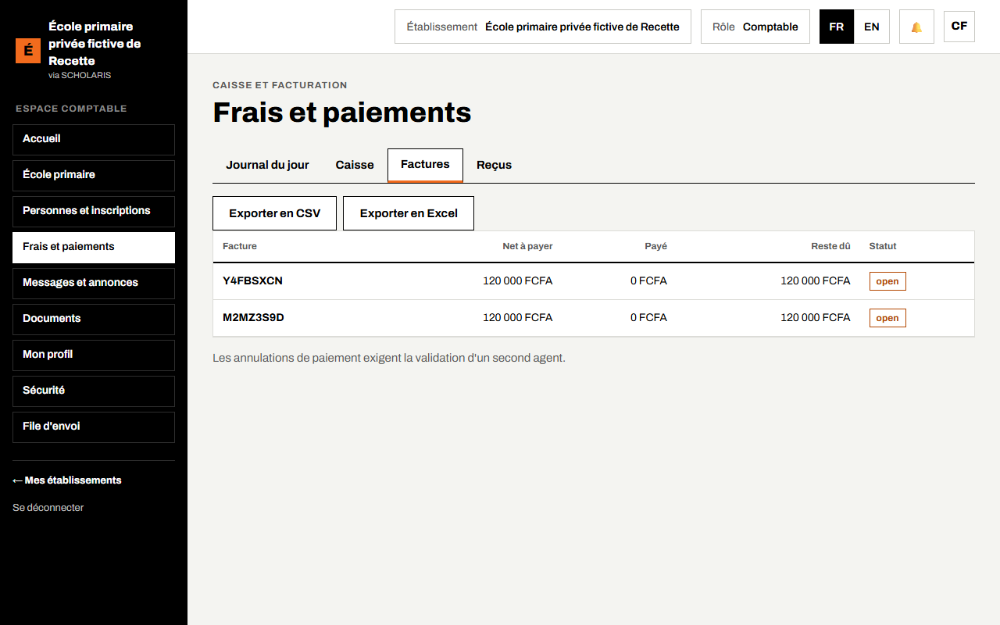
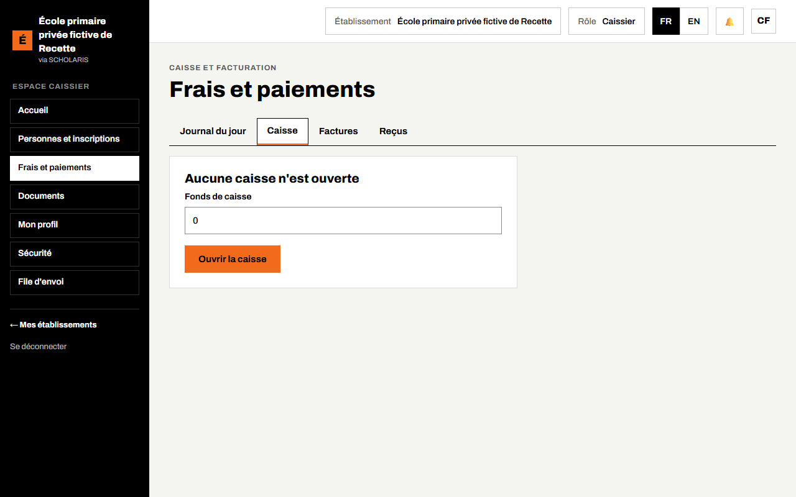
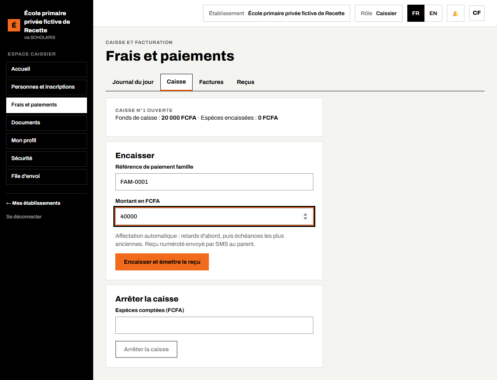
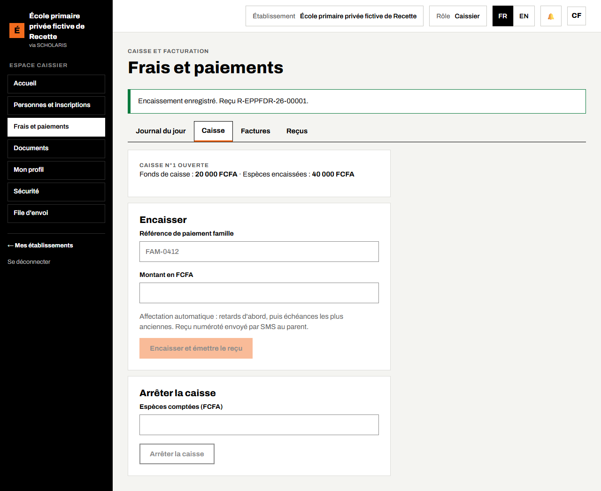
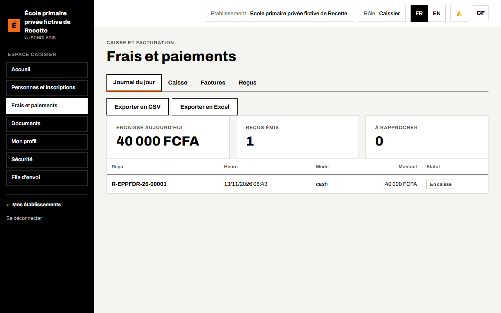
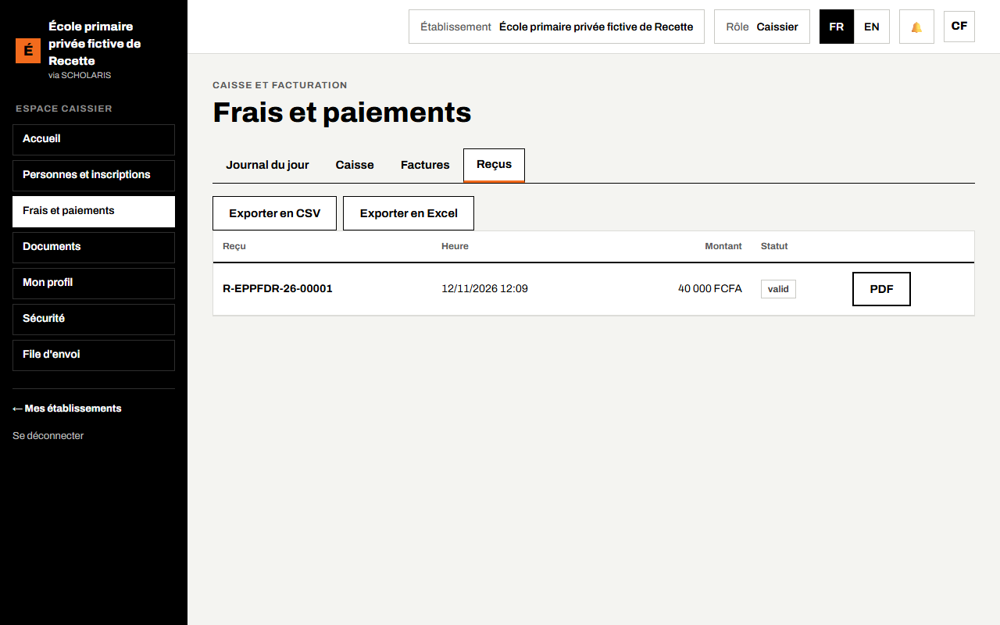

# 04. Frais et encaissements

Ce chapitre explique comment l'école suit les frais de scolarité : les factures, la caisse, l'encaissement contre reçu et le journal du jour.

**Où** : menu **Frais et paiements** (`/facturation`). L'écran a quatre onglets : **Journal du jour**, **Caisse**, **Factures**, **Reçus**.

**Qui fait quoi**

| Tâche | Qui |
|---|---|
| Catalogue des frais, échéancier (tranches), factures, remises | Comptable |
| Ouverture et arrêt de la caisse, encaissement, reçu | Caissière |
| Facture d'inscription au guichet | Secrétaire (chapitre 03) |
| Consultation | Promoteur, directeur |

## 4.1 Le principe

1. La comptable tient le **catalogue des frais** de l'année (inscription, scolarité, cantine…) et l'**échéancier** de chaque frais (par exemple trois tranches : octobre, janvier, avril).
2. Chaque élève inscrit reçoit une **facture**, adressée à son **garant financier**.
3. Chaque famille a une **référence de paiement unique**. Elle sert au guichet de l'école, sur Orange Money et sur MTN MoMo.
4. Un paiement est **affecté automatiquement** : les retards d'abord, puis les échéances les plus anciennes.
5. Chaque paiement donne un **reçu numéroté**, envoyé par SMS au parent.

## 4.2 Les factures

**Qui** : comptable. **Où** : **Frais et paiements**, onglet **Factures**.

La liste montre, pour chaque facture : l'élève, le **Net à payer**, le montant **Payé** et le **Reste dû**. Une facture se crée à l'inscription (étape 5 de l'inscription, ou bouton **Facturer l'inscription** du guichet, chapitre 03).

## 4.3 Ouvrir la caisse

**Qui** : caissière. **Où** : **Frais et paiements**, onglet **Caisse**.

Le matin, l'écran affiche « Aucune caisse n'est ouverte ».

1. Saisissez le **Fonds de caisse** (la monnaie de départ), si l'écran le demande.
2. Cliquez sur **Ouvrir la caisse**. Le titre « Caisse n°… ouverte » s'affiche.

## 4.4 Encaisser un paiement en espèces

1. Demandez au parent sa **référence de paiement famille** (elle figure sur la facture et dans les SMS de l'école).
2. Saisissez-la dans **Référence de paiement famille**.
3. Saisissez le **Montant en FCFA** reçu.
4. Cliquez sur **Encaisser et émettre le reçu**.

Le message « Encaissement enregistré. Reçu … » donne le numéro du reçu. Le parent reçoit le reçu par SMS. Vous pouvez aussi l'imprimer depuis l'onglet **Reçus**.

Attention : un même encaissement envoyé deux fois (double clic, réseau lent) n'est enregistré **qu'une seule fois**.

## 4.5 Arrêter la caisse le soir

1. Comptez les espèces.
2. Dans **Arrêter la caisse**, saisissez les **Espèces comptées (FCFA)**.
3. Cliquez sur **Arrêter la caisse**. Le message « La caisse est arrêtée. » s'affiche. Un écart éventuel est signalé.

## 4.6 Le journal du jour et les reçus

L'onglet **Journal du jour** affiche **Encaissé aujourd'hui**, le nombre de **Reçus émis** et les paiements **À rapprocher** (paiements mobiles à vérifier). Les boutons **Exporter en CSV** et **Exporter en Excel** donnent la liste pour la comptabilité.

L'onglet **Reçus** liste tous les reçus, avec leur numéro.

**Annuler un paiement** : un paiement ne s'efface jamais. Son annulation est demandée par une personne et **validée par une deuxième** (« Les annulations de paiement exigent la validation d'un second agent. »).

## 4.7 Paiement par Orange Money ou MTN MoMo

Le parent paie avec la **référence de paiement de la famille**. Le paiement arrive dans le journal ; une fois confirmé par l'opérateur, il est affecté à la facture et un reçu est émis automatiquement.

## 4.8 Bulletins et impayés

Par défaut, un retard de paiement **ne bloque pas** le bulletin. L'école peut choisir le contraire dans ses paramètres (« blocage du bulletin pour impayés »). Le **Tableau de bord** du directeur compte les élèves en retard de paiement (chapitre 10).
