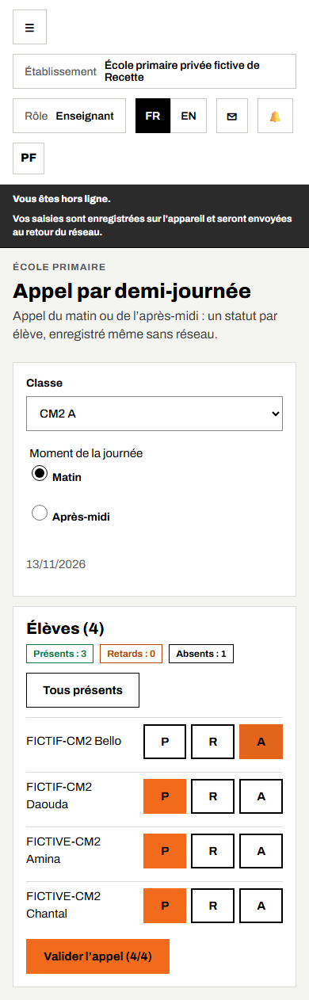
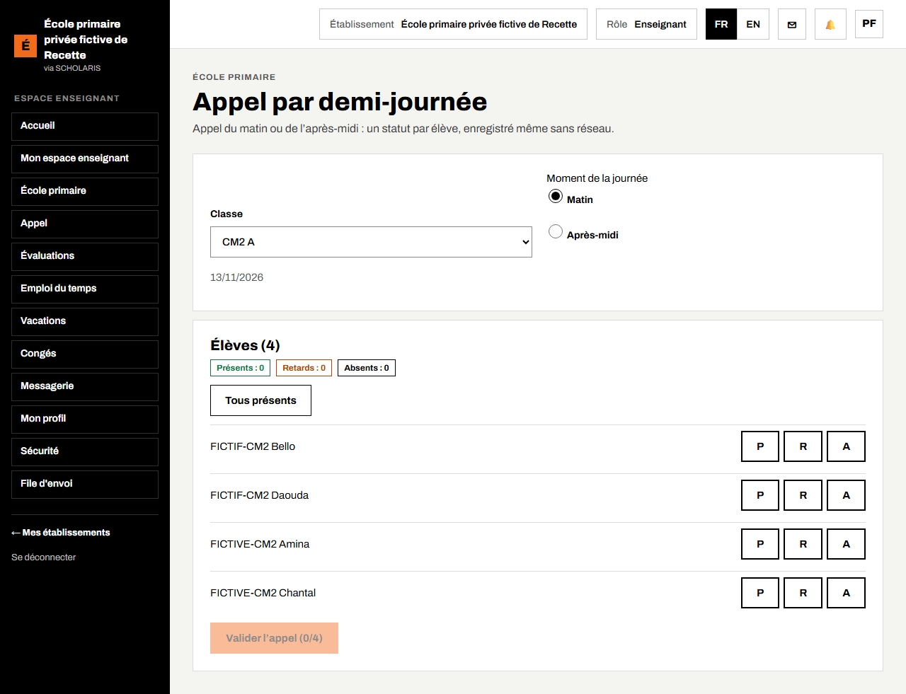
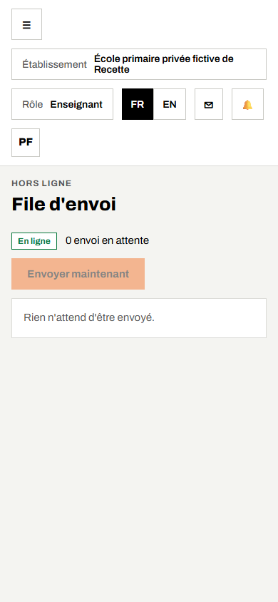
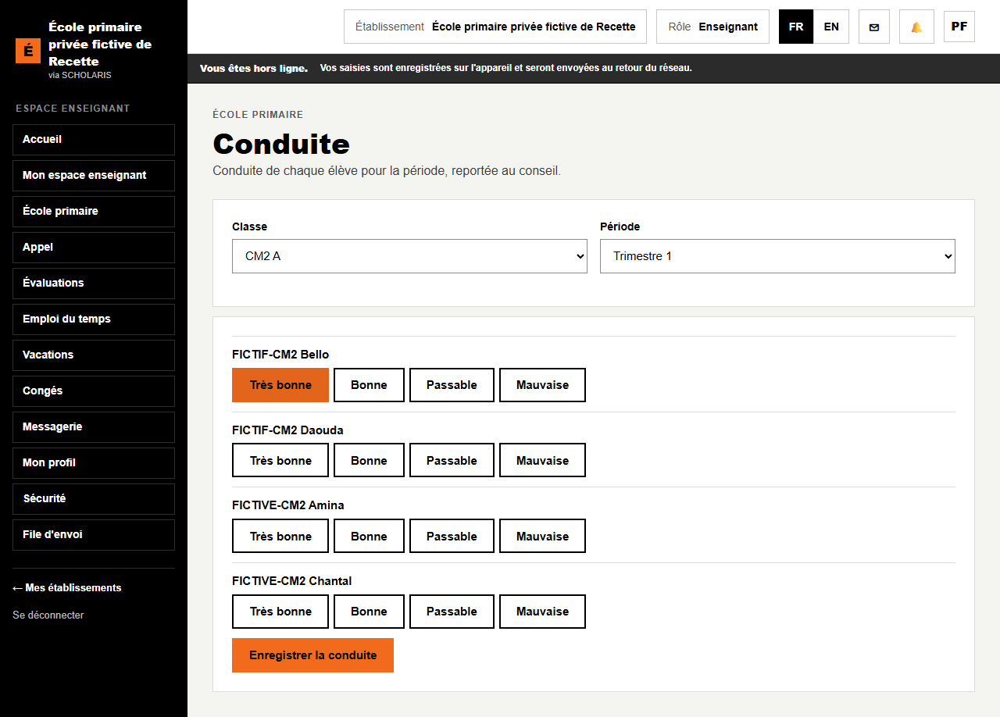
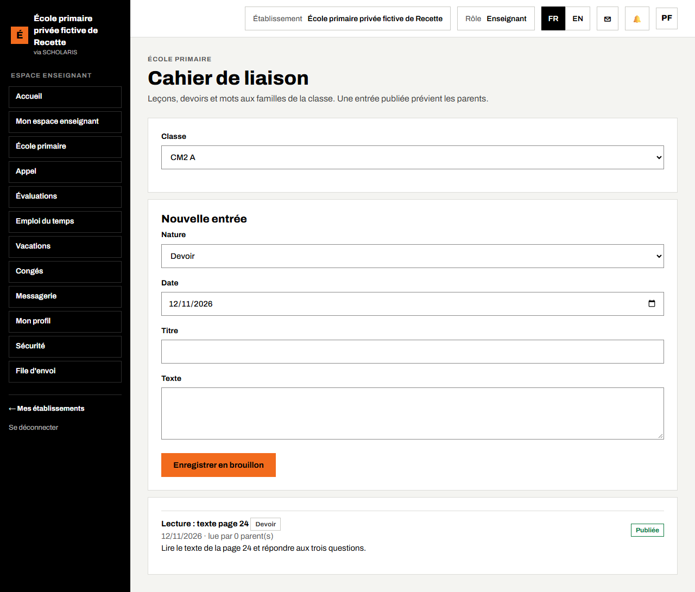

# 05. Appel et vie de la classe

Ce chapitre couvre l'appel du matin et de l'après-midi (même sans réseau), la conduite des élèves et le cahier de liaison avec les familles.

**Qui fait quoi**

| Tâche | Qui |
|---|---|
| Appel par demi-journée | Maître ou maîtresse de la classe, directeur |
| Conduite | Maître (saisie), directeur (lecture) |
| Cahier de liaison | Maître (rédaction et publication) |

## 5.1 Faire l'appel d'une demi-journée

**Où** : **École primaire > Appel** (`/primaire/appel`). L'écran s'appelle **Appel par demi-journée**.

L'appel se fait **deux fois par jour** : le **Matin** et l'**Après-midi**. Les absences se comptent en demi-journées.

1. Choisissez la **Classe**.
2. Choisissez le **Moment de la journée** : **Matin** ou **Après-midi**. La date du jour est affichée.
3. La liste **Élèves** s'affiche. En haut, trois compteurs : **Présents**, **Retards**, **Absents**.
4. Cliquez sur **Tous présents** : chaque élève est marqué présent.
5. Pour chaque élève absent ou en retard, touchez la lettre sur sa ligne : **P** (présent), **R** (retard), **A** (absent).
6. Quand tous les élèves ont un statut, cliquez sur **Valider l'appel (n/n)**.

Le message « Appel envoyé. » confirme l'envoi. Les parents des absents sont prévenus selon les réglages de l'école.

> Point constaté pendant la préparation de ce guide : sur l'école d'essai, la liste affichait « Élèves (0) » alors que la classe avait des élèves inscrits. Si la liste de votre classe est vide, prévenez la direction : elle vérifie l'inscription des élèves dans la classe et, si besoin, contacte l'équipe SCHOLARIS.

## 5.2 Faire l'appel sans réseau

L'appel fonctionne **même sans connexion** (zone sans réseau, crédit épuisé).

1. Ouvrez l'écran d'appel **une première fois avec le réseau** : la liste de la classe est alors gardée sur le téléphone (mention « liste gardée sur ce téléphone »).
2. Sans réseau, faites l'appel normalement et cliquez sur **Valider l'appel**.
3. Le message « Appel gardé sur ce téléphone : il partira dès que le réseau reviendra. » s'affiche.
4. Au retour du réseau, l'appel part tout seul.

Le menu **File d'envoi** (`/synchronisation`) montre ce qui attend d'être envoyé.

Si un appel de la même classe pour le même moment attend déjà, l'écran prévient : « Un appel de cette classe pour ce moment attend déjà son envoi. » Ne refaites pas l'appel.

## 5.3 La conduite

**Où** : **École primaire > Conduite** (`/primaire/conduite`).

1. Choisissez la **Classe** et la **Période** (exemple : Trimestre 1).
2. Pour chaque élève, cliquez sur le niveau de conduite qui convient (l'échelle de l'école, quatre niveaux par défaut).
3. Cliquez sur **Enregistrer la conduite**. Le message « Conduite enregistrée. » s'affiche.

La conduite est reprise au conseil des maîtres et sur le bulletin.

## 5.4 Le cahier de liaison

**Où** : **École primaire > Cahier de liaison** (`/primaire/cahier`).

Le cahier de liaison sert à informer les familles : leçons du jour, devoirs, mots aux parents.

1. Choisissez la **Classe**.
2. Dans **Nouvelle entrée**, choisissez la **Nature** : **Leçon**, **Devoir** ou **Mot aux familles**.
3. Saisissez la **Date**, le **Titre** et le **Texte**.
4. Cliquez sur **Enregistrer en brouillon**.
5. Relisez, puis cliquez sur **Publier aux familles**. L'entrée passe à **Publiée** et les parents sont prévenus.

Sous chaque entrée publiée, la mention « lue par n parent(s) » indique combien de parents l'ont ouverte.
