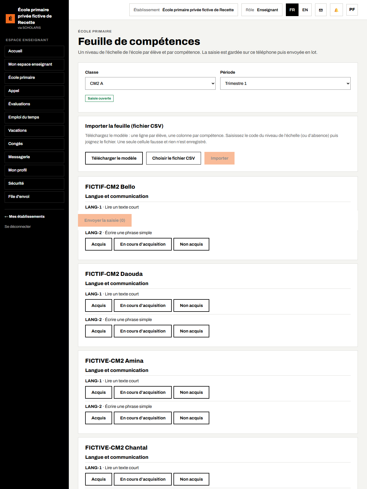
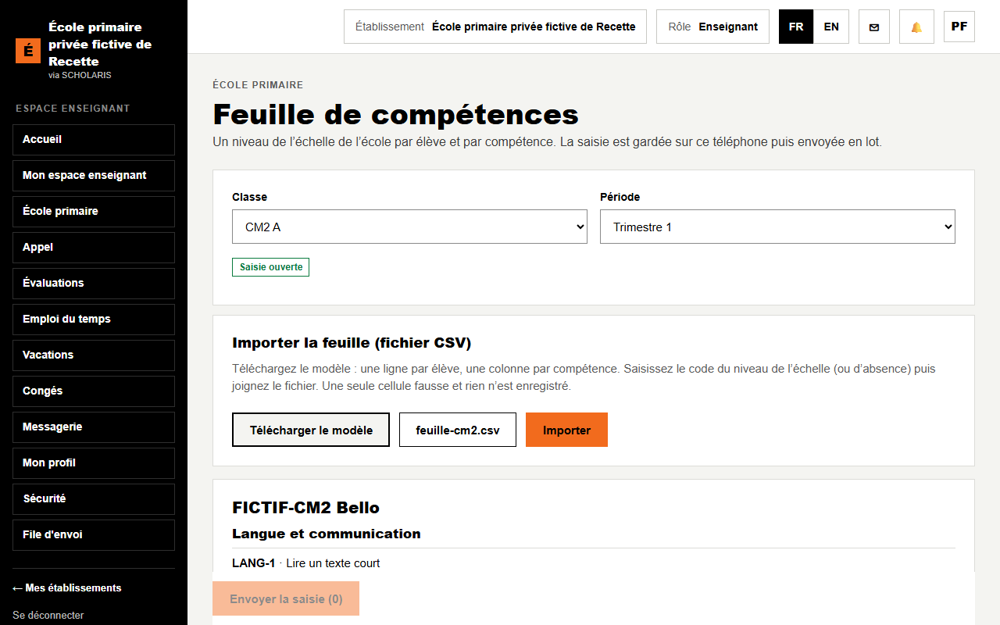
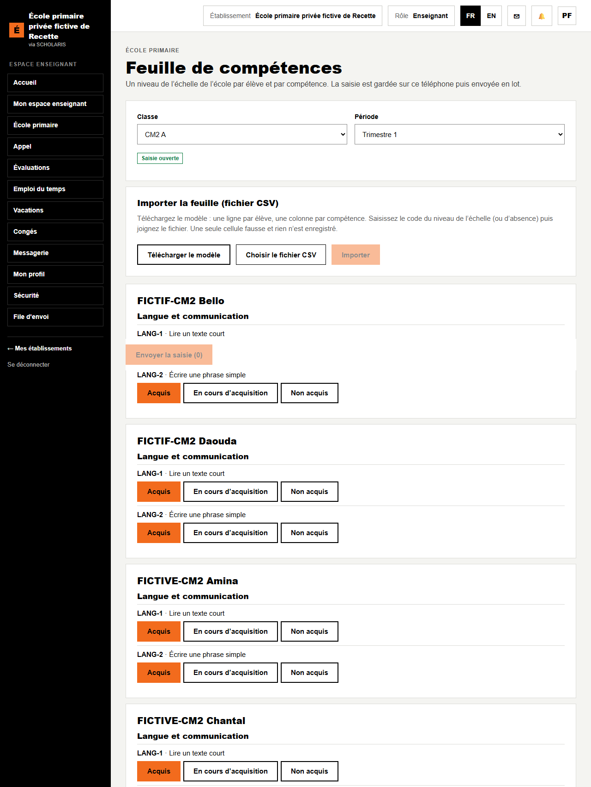
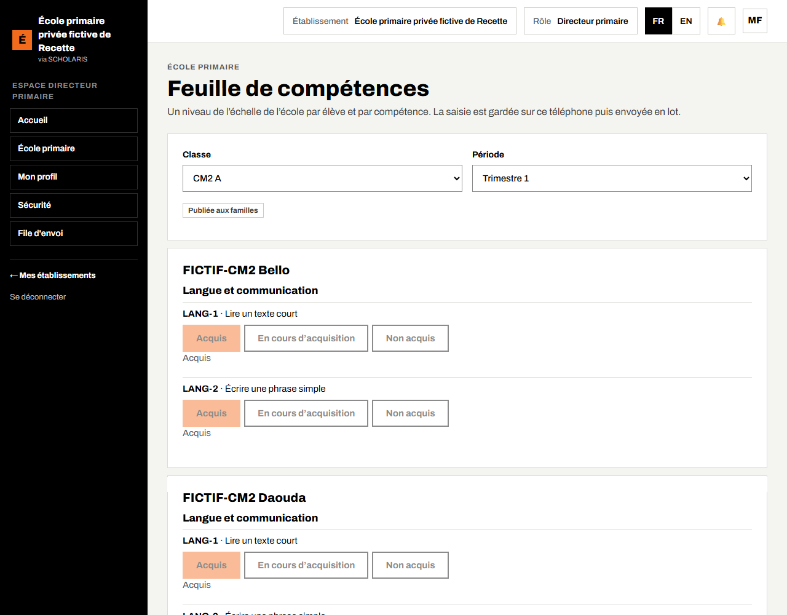

# 06. Feuille de compétences

Au primaire, l'élève est évalué **par compétence**. Pour chaque période, chaque classe a une **feuille de compétences** : une ligne par élève, une case par compétence du niveau.

**Où** : **École primaire > Feuille de compétences** (`/primaire/competences`).

**Qui fait quoi**

| Tâche | Qui |
|---|---|
| Saisie (à l'écran ou par fichier) | Maître ou maîtresse de la classe |
| Demande de correction | Maître |
| Verrouillage, publication aux familles, accord des corrections | Directeur, responsable pédagogique |

Avant de commencer : le référentiel du niveau doit contenir des compétences (chapitre 02). Sinon l'écran affiche « Aucune compétence n'est définie pour ce niveau : complétez le référentiel. »

## 6.1 Ouvrir la feuille

1. Choisissez la **Classe** (exemple : CM2 A).
2. Choisissez la **Période** (exemple : Trimestre 1).
3. L'état de la feuille est affiché : **Saisie ouverte**, **Verrouillée** ou **Publiée aux familles**.

## 6.2 Saisir à l'écran

Pour chaque élève et chaque compétence, cliquez sur le niveau de l'échelle : **Acquis**, **En cours d'acquisition** ou **Non acquis** (échelle par défaut de l'école).

- Les cases saisies sont marquées **À envoyer**.
- Cliquez sur **Envoyer la saisie (n)**. Le message « Saisie enregistrée. » s'affiche.
- Sans réseau, la saisie est gardée sur le téléphone : « Saisie gardée sur ce téléphone (n) : elle partira dès que le réseau reviendra. »

Si une évaluation a été changée entre-temps par quelqu'un d'autre, rien n'est écrasé : « Une évaluation a changé sur le serveur depuis votre lecture : rien n'a été écrasé. » Cliquez sur **Recharger la feuille (abandonne ma saisie)** puis recommencez.

## 6.3 Importer la feuille par fichier (tableur)

Pratique pour une grande classe : remplissez la feuille dans un tableur (Excel, LibreOffice), puis joignez le fichier.

1. Dans le cadre **Importer la feuille (fichier CSV)**, cliquez sur **Télécharger le modèle**. Le fichier contient une ligne par élève et une colonne par compétence.
2. Ouvrez-le dans le tableur. Dans chaque case, saisissez le code du niveau de l'échelle (par exemple `acquired` pour Acquis) ou le code d'absence.
3. Enregistrez au format **CSV**.
4. Revenez à l'écran, choisissez le fichier, puis cliquez sur **Importer**.

**Une seule cellule fausse et rien n'est enregistré** : l'écran indique la ligne et la cellule à corriger. Corrigez le fichier et importez-le de nouveau.

Après l'import, la feuille se recharge : chaque case montre le niveau importé.

## 6.4 Demander une correction

Quand la feuille est verrouillée, le maître ne peut plus modifier directement.

1. Cliquez sur **Corriger** dans la case concernée.
2. Choisissez le **Nouveau niveau** et saisissez le **Motif de la correction**.
3. Cliquez sur **Envoyer à la direction**. La direction accepte ou refuse la correction.

## 6.5 Verrouiller et publier

**Qui** : directeur.

1. Quand toutes les cases sont saisies, cliquez sur **Verrouiller la feuille**. L'état passe à **Verrouillée** : plus aucune saisie directe.
2. Cliquez sur **Publier aux familles**. L'état passe à **Publiée aux familles**.

Le verrouillage est obligatoire avant la validation du conseil des maîtres (chapitre 07) et avant la clôture de l'année (chapitre 10). Le **Tableau de bord** montre, classe par classe, l'avancement des feuilles.
