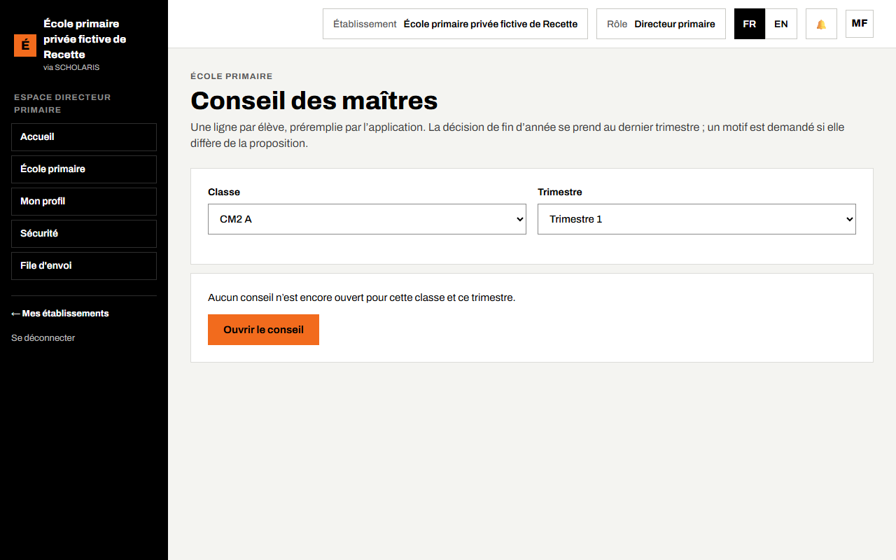
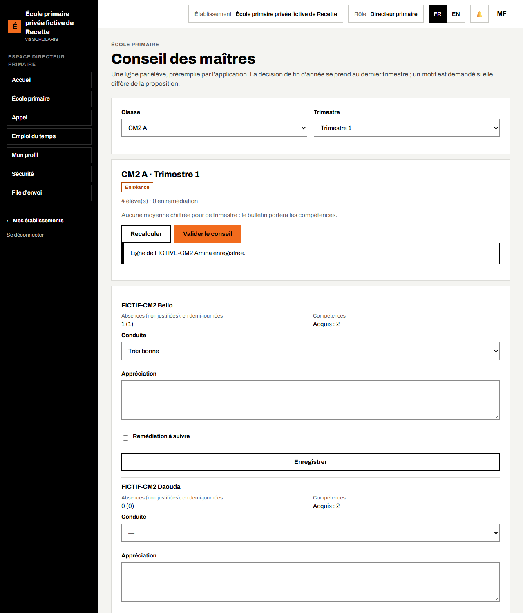
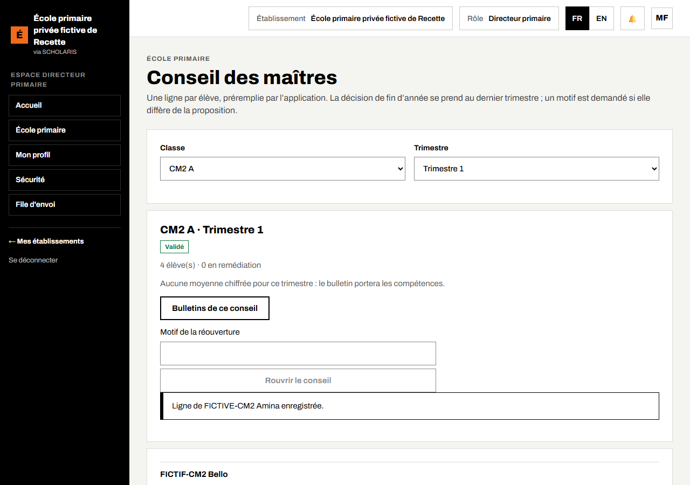
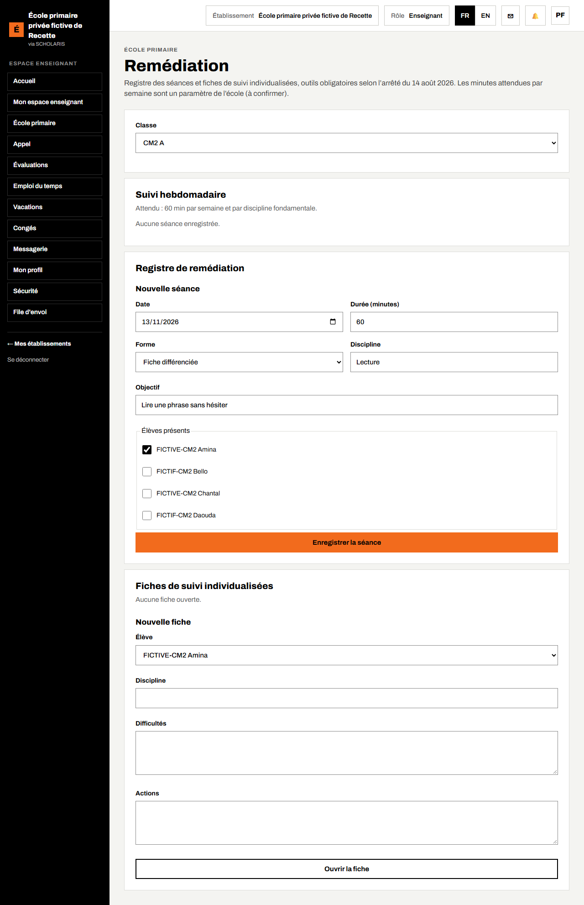
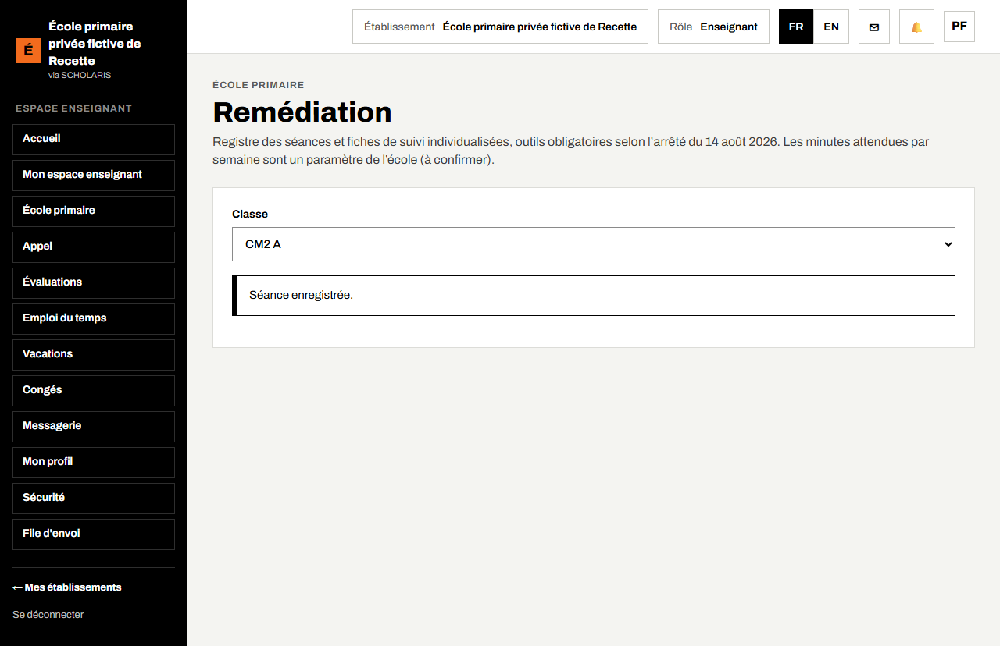
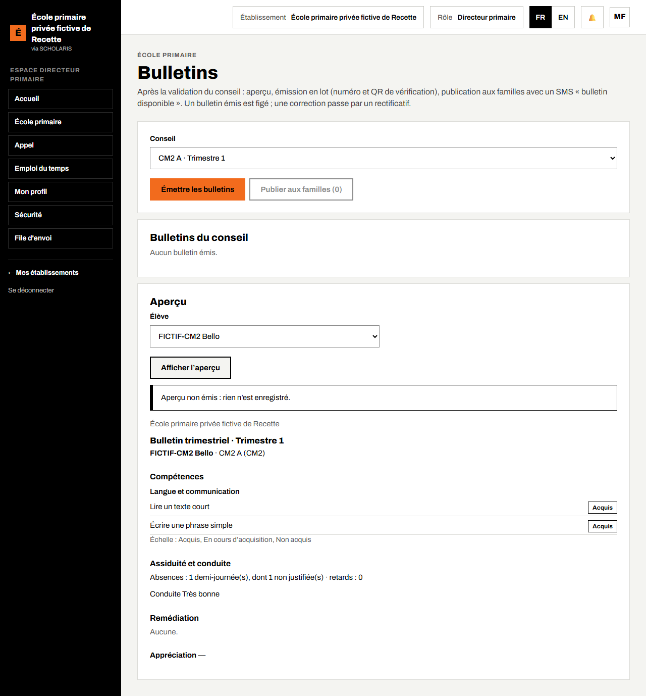
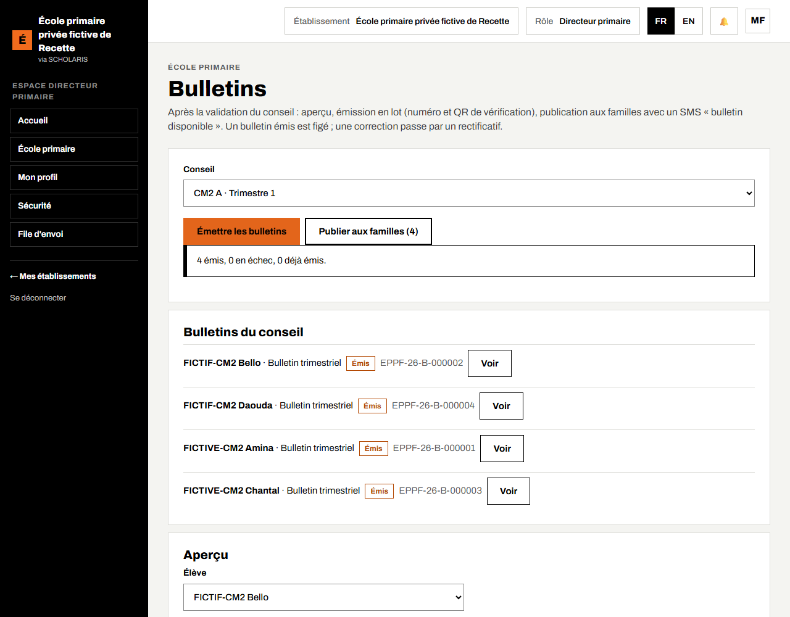
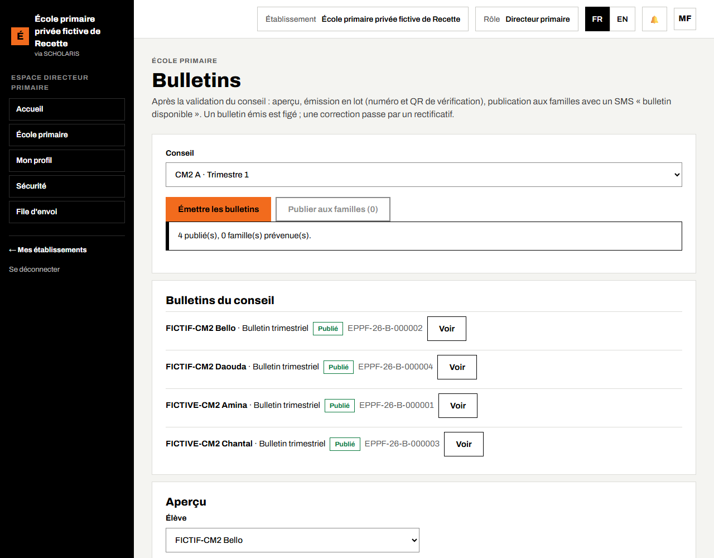
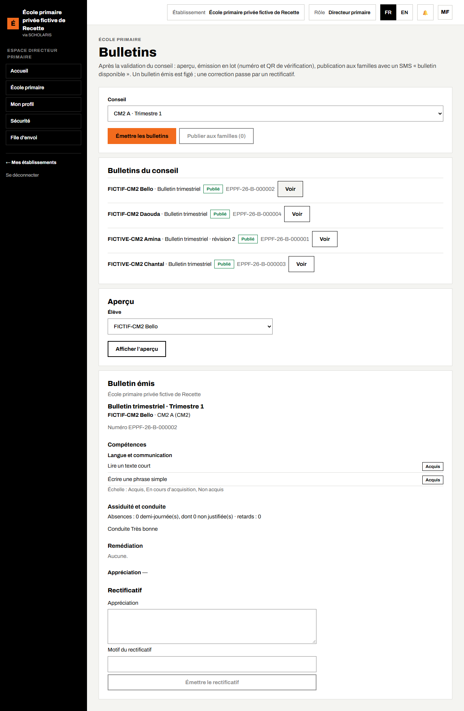
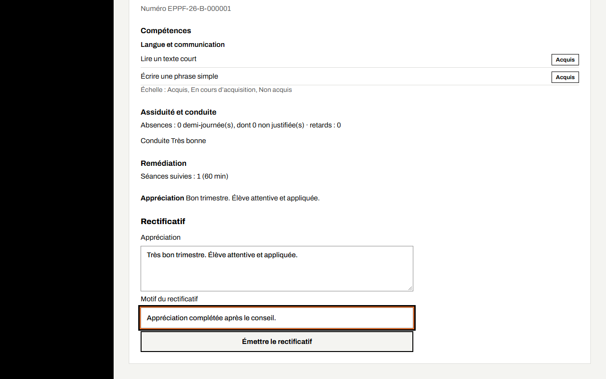

# 07. Conseil des maîtres, remédiation et bulletins

À la fin de chaque trimestre : le **conseil des maîtres** arrête la situation de chaque élève, la **remédiation** est organisée pour les élèves en difficulté, puis les **bulletins** sont émis et publiés aux familles.

**Qui fait quoi**

| Tâche | Qui |
|---|---|
| Ouvrir, remplir et valider le conseil | Directeur (présidence) ; les maîtres consultent |
| Registre de remédiation, fiches de suivi | Maîtres, responsable pédagogique, directeur |
| Aperçu, émission, publication, rectificatif des bulletins | Directeur |

## 7.1 Ouvrir le conseil des maîtres

**Où** : **École primaire > Conseil des maîtres** (`/primaire/conseils`).

1. Choisissez la **Classe** et le **Trimestre**.
2. Si aucun conseil n'existe, l'écran affiche « Aucun conseil n'est encore ouvert pour cette classe et ce trimestre. » Cliquez sur **Ouvrir le conseil**.

## 7.2 Tenir la séance

Le conseil est **En séance**. L'en-tête indique le nombre d'élèves et le nombre d'élèves en remédiation. Il y a **une ligne par élève, préremplie par l'application** : absences (en demi-journées, dont non justifiées), compétences acquises, moyenne si l'école utilise des notes.

Pour chaque élève :

1. Choisissez la **Conduite**.
2. Saisissez l'**Appréciation** (exemple : « Bon trimestre. Élève attentive et appliquée. »).
3. Cochez **Remédiation à suivre** si l'élève a besoin d'un soutien, et précisez-le.
4. Au **dernier trimestre**, la ligne affiche une **Proposition** de décision (admis, redouble, fin de cycle). Choisissez la décision ; si elle diffère de la proposition, un **Motif** est obligatoire.
5. Cliquez sur **Enregistrer** sous la ligne. Le message « Ligne de … enregistrée. » s'affiche.

**Recalculer** met à jour les données préremplies (après une correction de compétences) **sans effacer** ce que vous avez saisi.

## 7.3 Valider le conseil

1. Vérifiez que toutes les lignes sont remplies.
2. Cliquez sur **Valider le conseil**. L'état passe à **Validé**.

La validation exige que les feuilles de compétences de la classe soient **verrouillées** (chapitre 06). Un **Procès-verbal** du conseil est disponible. Tant que les bulletins ne sont pas émis, le directeur peut **Rouvrir le conseil**, avec un motif.

## 7.4 La remédiation

**Où** : **École primaire > Remédiation** (`/primaire/remediation`).

L'arrêté du 14 août 2026 rend obligatoires deux outils : le **registre de remédiation** et la **fiche de suivi individualisée**. Le temps attendu par semaine (60 minutes par discipline fondamentale par défaut) est un réglage de l'école.

### Enregistrer une séance

1. Choisissez la **Classe**.
2. Dans **Nouvelle séance** : la **Date**, la **Durée (minutes)**, la **Forme** (groupe de besoin, fiche différenciée, tutorat), la **Discipline** et l'**Objectif**.
3. Cochez les **Élèves présents**.
4. Cliquez sur **Enregistrer la séance**. Le message « Séance enregistrée. » s'affiche.

Le **Suivi hebdomadaire** compare, semaine par semaine, les minutes faites au temps attendu.

### Fiche de suivi individualisée

1. Dans **Nouvelle fiche**, choisissez l'élève, décrivez les **Difficultés** et les **Actions** prévues, puis **Ouvrir la fiche**.
2. Plus tard, ouvrez la fiche et ajoutez une revue : **Progrès constatés** et **État après la revue** (**Ouverte**, **En progrès**, **Résolue**), puis **Ajouter la revue**.

La remédiation suivie est reprise au conseil et sur le bulletin.

## 7.5 Les bulletins

**Où** : **École primaire > Bulletins** (`/primaire/bulletins`).

Le bulletin est préparé **après la validation du conseil**. Un bulletin émis porte un **numéro** et un **QR de vérification** ; il est **figé** : une correction passe par un **rectificatif**.

### Aperçu (rien n'est enregistré)

1. Choisissez le **Conseil** (exemple : CM2 A · Trimestre 1).
2. Dans **Aperçu**, choisissez l'**Élève** puis **Afficher l'aperçu**.
3. Relisez : compétences par domaine avec l'échelle, assiduité et conduite, remédiation, appréciation, décision. L'aperçu porte la mention « Aperçu non émis : rien n'est enregistré. »

### Émettre les bulletins

1. Cliquez sur **Émettre les bulletins**. Tous les bulletins du conseil sont émis en une fois.
2. Le message indique le résultat : « 3 émis, 0 en échec, 0 déjà émis. » Recommencer ne crée pas de doublon : un bulletin en échec est simplement repris.

### Publier aux familles

1. Cliquez sur **Publier aux familles (n)**.
2. Le message indique « n publié(s), n famille(s) prévenue(s). » Les familles reçoivent un SMS « bulletin disponible » et voient le bulletin dans leur espace (chapitre 11).

La liste **Bulletins du conseil** montre, pour chaque élève, l'état (**Émis**, **Publié**, **Remplacé**) et le numéro. **Voir** affiche le bulletin émis.

### Émettre un rectificatif

Un bulletin émis ne se modifie jamais. Pour corriger une erreur :

1. Cliquez sur **Voir** sur le bulletin à corriger.
2. Dans **Rectificatif**, saisissez la nouvelle **Appréciation** et le **Motif du rectificatif**.
3. Cliquez sur **Émettre le rectificatif**. Le message « Rectificatif émis (révision n). » s'affiche.

Le nouveau bulletin garde le même numéro, avec une révision de plus ; l'ancien passe à **Remplacé**.

### Récapitulatif annuel

Au dernier trimestre, l'application prépare aussi le **Récapitulatif annuel** : les trimestres, la moyenne annuelle si l'école utilise des notes, le rang (si l'école l'affiche), les absences de l'année et la décision du conseil.
