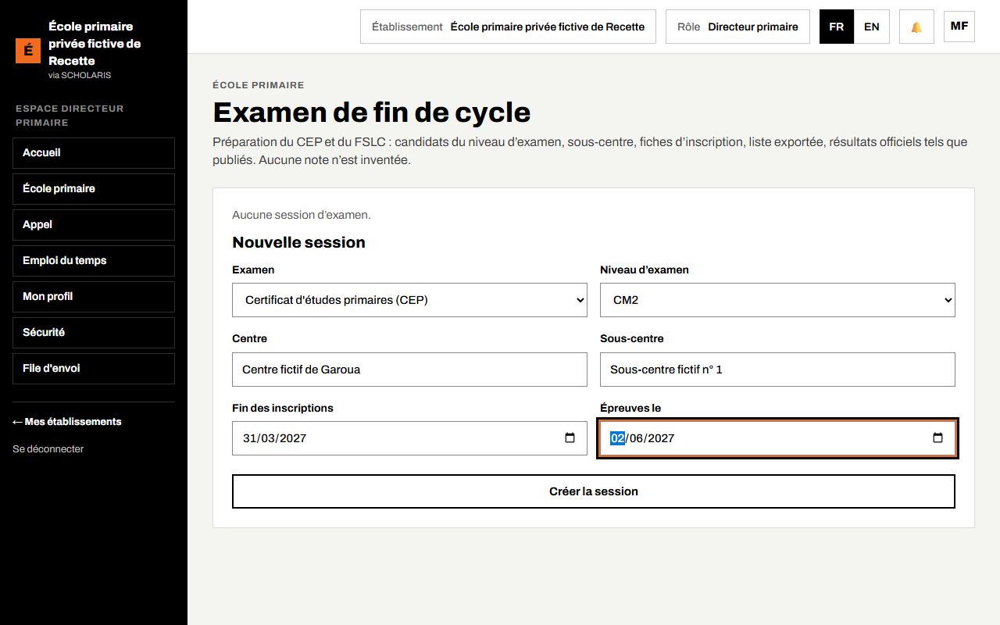
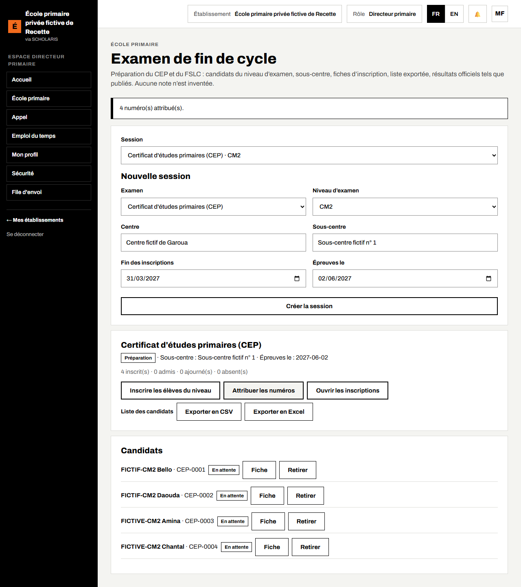

# 08. Examen de fin de cycle (CEP et FSLC)

L'école prépare l'inscription de ses élèves au **CEP** (Certificat d'études primaires, sous-système francophone) ou au **FSLC** (First School Leaving Certificate, sous-système anglophone) : liste des candidats, sous-centre, numéros, fiches d'inscription, puis résultats officiels tels qu'ils sont publiés.

**Important** : l'application **n'invente aucune note** de l'examen. Elle enregistre seulement les résultats officiels.

**Qui** : directeur, secrétaire. **Où** : **École primaire > Examen de fin de cycle** (`/primaire/examen`).

Avant de commencer : le niveau d'examen (CM2 ou Class 6) doit être coché **Niveau d'examen** (chapitre 02).

## 8.1 Créer la session

1. Dans **Nouvelle session**, choisissez l'**Examen** (exemple : Certificat d'études primaires (CEP)) et le **Niveau d'examen** (exemple : CM2).
2. Saisissez le **Centre** et le **Sous-centre** communiqués par l'inspection.
3. Saisissez la date de **Fin des inscriptions** et la date des **Épreuves le**.
4. Cliquez sur **Créer la session**. Elle est en **Préparation**.

## 8.2 Inscrire les candidats et attribuer les numéros

1. Cliquez sur **Inscrire les élèves du niveau**. Tous les élèves inscrits au niveau d'examen deviennent candidats. Le message indique « n candidat(s) inscrit(s), n déjà inscrit(s). » Un élève n'est jamais inscrit deux fois.
2. Cliquez sur **Attribuer les numéros**. Chaque candidat reçoit un numéro (exemple : CEP-0001).
3. **Ouvrir les inscriptions**, puis **Clore les inscriptions** à la date limite. **Rouvrir les inscriptions** reste possible.
4. Un élève qui ne se présente pas : **Retirer**. Il reste dans l'historique avec la mention **Retiré**.

L'en-tête de la session compte les inscrits, admis, ajournés et absents, et le taux de réussite.

## 8.3 La fiche d'inscription

1. Cliquez sur **Fiche** sur la ligne du candidat.
2. Complétez les champs demandés (lieu de naissance, nom du père, nom de la mère, numéro de carte scolaire…). L'écran signale « n champ(s) obligatoire(s) à compléter. »
3. Cliquez sur **Enregistrer la fiche**, puis **Imprimer**.

**Liste des candidats** : exporte la liste (tableur) à remettre à l'inspection.

## 8.4 Les résultats officiels

Quand les résultats sont publiés par les autorités :

- **À l'écran** : pour chaque candidat, choisissez le **Résultat** (**Admis**, **Ajourné**, **Absent**, ou **En attente**), puis **Enregistrer les résultats**.
- **Par import** : collez les lignes au format `numéro;résultat;mention` (exemple : `CEP-0001;admis;Assez bien`) puis **Importer**. Une ligne invalide est rejetée avec son motif ; les autres sont enregistrées.

Le taux de réussite est calculé ainsi : admis ÷ (admis + ajournés).

Enfin, cliquez sur **Publier aux familles** : les parents sont prévenus par SMS et voient le résultat dans leur espace (chapitre 11).

Les frais d'examen éventuels sont facturés aux familles par la comptabilité.
