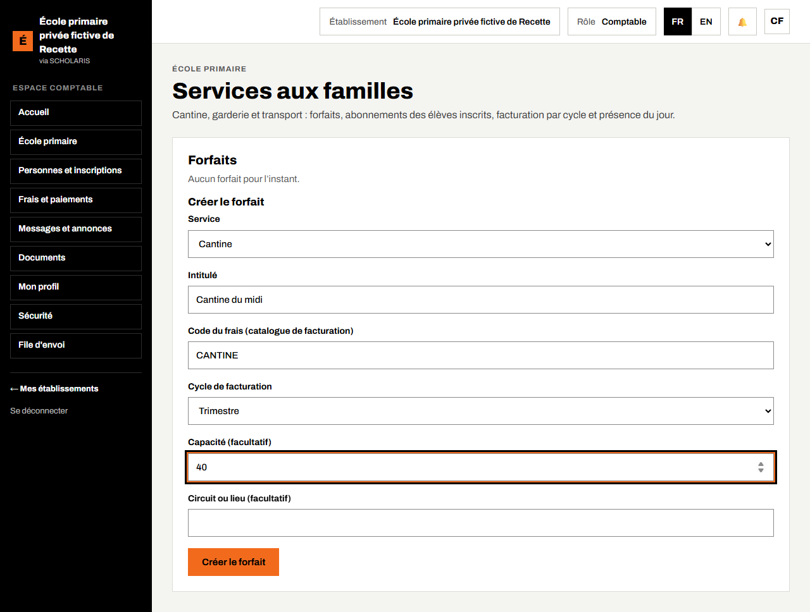
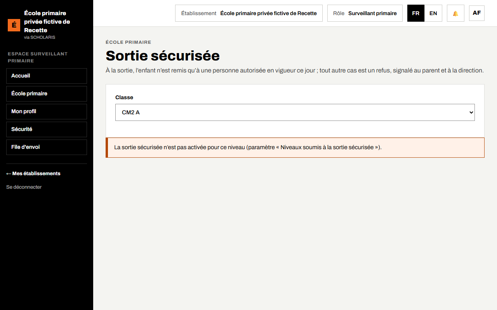

# 09. Services aux familles et sortie sécurisée

## 9.1 Services aux familles : cantine, garderie, transport

**Qui** : comptable (gestion) ; directeur et promoteur (lecture). **Où** : **École primaire > Services aux familles** (`/primaire/services`).

### Créer un forfait

1. Dans **Service**, choisissez **Cantine**, **Garderie** ou **Transport**.
2. Saisissez l'**Intitulé** (exemple : Cantine du midi).
3. **Code du frais (catalogue de facturation)** : le code du frais correspondant dans le catalogue de la comptabilité (chapitre 04).
4. **Cycle de facturation** : **Trimestre**, **Mois** ou **Année**.
5. **Capacité (facultatif)** : le nombre de places ; **Circuit ou lieu (facultatif)** pour le transport.
6. Cliquez sur **Créer le forfait**. Le message « Forfait créé. » s'affiche.

> Point constaté pendant la préparation de ce guide : sur l'école d'essai, **Créer le forfait** n'a pas abouti avec un code de frais absent du catalogue. Saisissez exactement le code d'un frais existant (demandez-le à la comptable).

### Abonner un élève

1. Cliquez sur **Ouvrir** sur le forfait.
2. Dans **Abonner un élève**, choisissez l'élève inscrit et le **Début de l'abonnement**, puis validez. « Abonnement enregistré. »
3. Pour arrêter : **Terminer l'abonnement**, saisissez la **Date de fin**, puis **Confirmer la fin**.

Un forfait plein affiche **Complet**. **Retirer de l'offre** suspend un forfait (**Proposer à nouveau** le rétablit).

### Facturer un cycle

1. Dans **Facturation par cycle**, saisissez le **Cycle facturé** (exemple : 2026-T1) et l'**Échéance**.
2. Cliquez sur **Facturer le cycle**. Le message indique le nombre de factures émises et celles déjà émises : **une famille n'est jamais facturée deux fois pour le même cycle**.

### Présence au service

1. Dans **Présence au service**, choisissez le **Jour**.
2. Pour chaque abonné : **Présent**, **Absent** ou **Non saisi**.
3. Cliquez sur **Enregistrer la présence**.

## 9.2 Sortie sécurisée

**Qui** : surveillant, directeur. **Où** : **École primaire > Sortie sécurisée** (`/primaire/sortie-securisee`).

À la sortie des classes, l'enfant n'est remis **qu'à une personne autorisée en vigueur ce jour-là**. Tout autre cas est un **refus**, signalé aux parents et à la direction.

**Activation** : la sortie sécurisée est **désactivée par défaut**. Tant qu'elle n'est pas activée, l'écran affiche « La sortie sécurisée n'est pas activée pour ce niveau ». Le directeur l'active dans **Administration > Paramètres**, réglage « Niveaux soumis à la sortie sécurisée » (par exemple pour les petites classes).

Les personnes autorisées (parents, tuteurs, chauffeur…) sont enregistrées dans la fiche de l'élève.

### Remettre un enfant

1. Choisissez la **Classe**.
2. Pour chaque enfant, la liste **Personnes autorisées aujourd'hui** s'affiche.
3. Vérifiez l'identité de la personne, puis cliquez sur **Remettre à** (son nom). Le message « Enfant remis à … » s'affiche, avec l'heure.

### Une autre personne se présente

1. Cliquez sur **Une autre personne se présente**.
2. Saisissez le **Nom de la personne présentée** et une **Note** si besoin.
3. Cliquez sur **Refuser la remise**. Les parents et la direction sont prévenus : « Refus enregistré : n personne(s) prévenue(s) ».

Si aucune personne autorisée n'est en vigueur, l'écran le dit : « Aucune personne autorisée en vigueur : toute remise serait refusée. » Appelez la direction.

