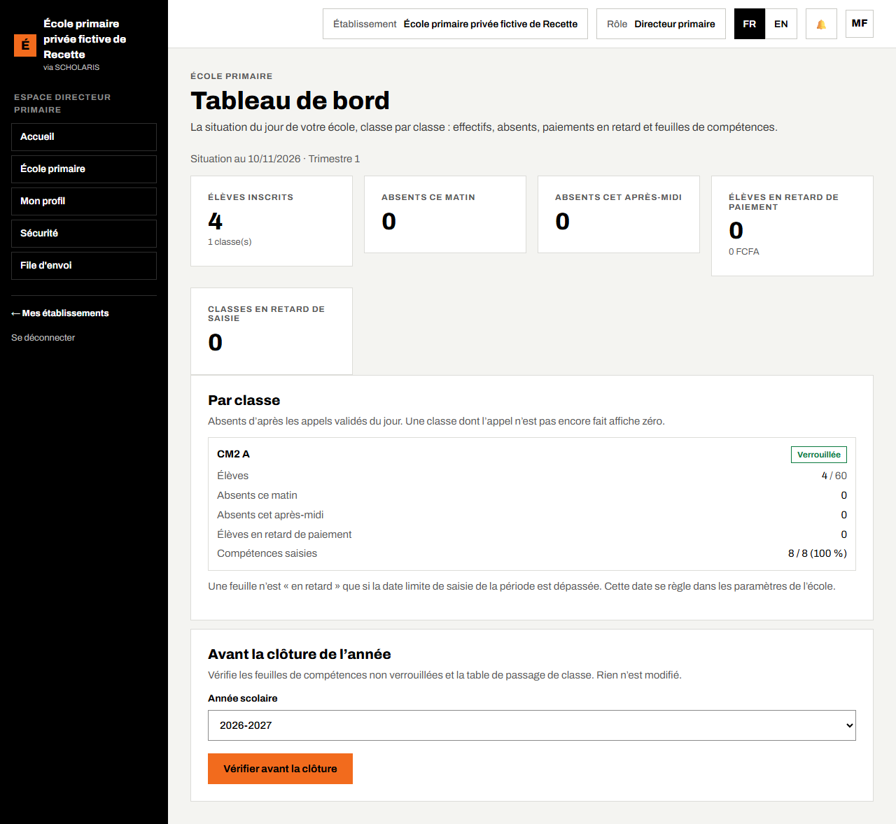
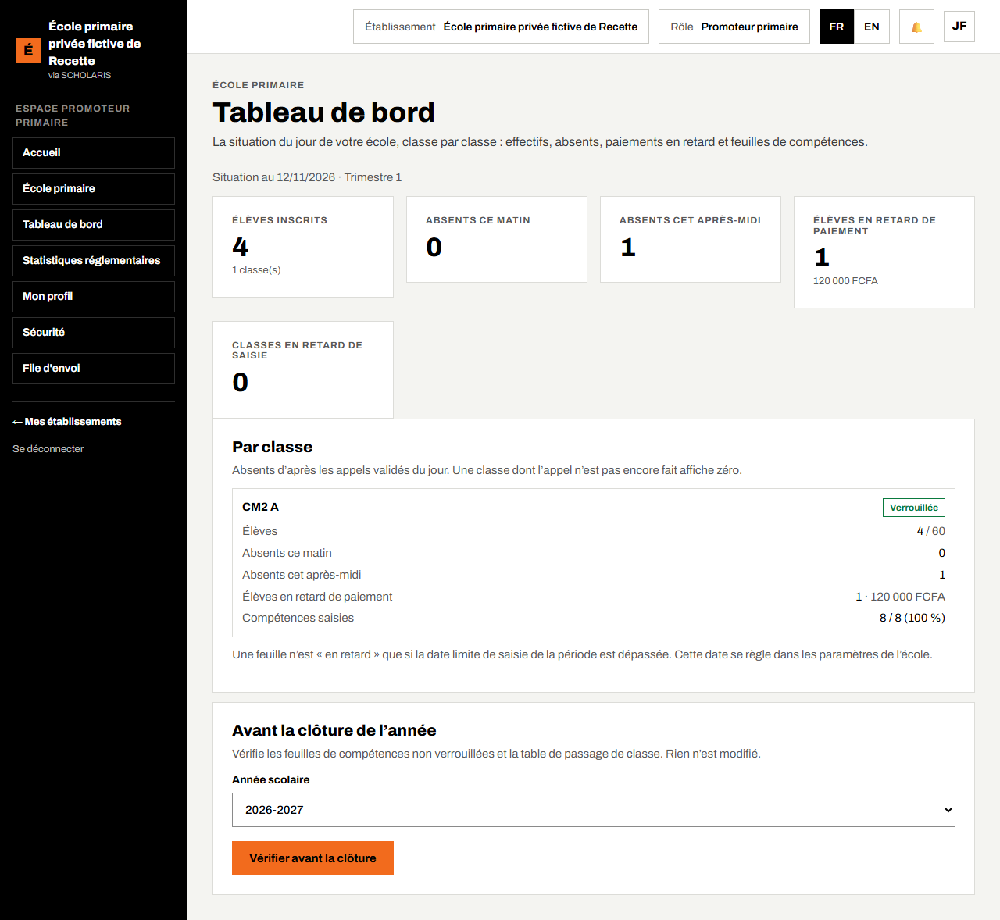
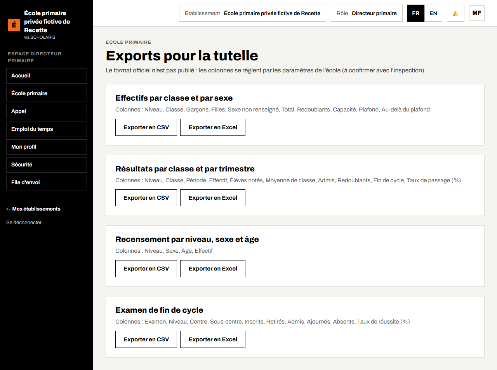
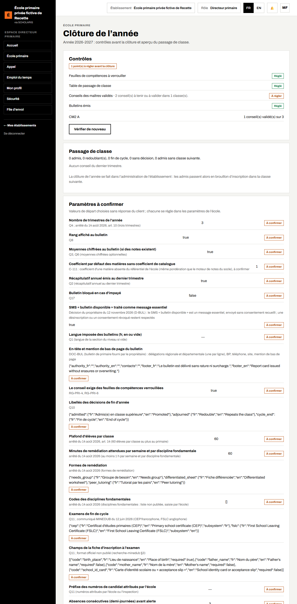

# 10. Pilotage, exports pour la tutelle et clôture de l'année

## 10.1 Le tableau de bord du directeur

**Qui** : directeur, promoteur. **Où** : **École primaire > Tableau de bord** (`/primaire/tableau-de-bord`).

Le tableau de bord donne la situation du jour, classe par classe :

- **Totaux de l'école** : **Élèves inscrits**, **Absents ce matin**, **Absents cet après-midi**, **Élèves en retard de paiement**, **Classes en retard de saisie**.
- **Par classe** : effectif (avec l'alerte **Au-delà de la capacité** si la classe dépasse son effectif maximal), absents, état de la feuille de compétences (**En cours**, **Complète**, **Verrouillée**, **En retard**, **À terminer**).

Les absents sont comptés d'après les appels validés du jour : une classe dont l'appel n'est pas encore fait affiche zéro.

Une feuille n'est « en retard » que si une date limite de saisie est réglée pour la période (dans les paramètres de l'école).

### Avant la clôture

Le cadre **Avant la clôture de l'année** vérifie, sans rien modifier, les feuilles de compétences à verrouiller et la table de passage de classe. Cliquez sur **Vérifier avant la clôture**. Le résultat affiche **Prête pour la clôture** ou « n point(s) à régler avant la clôture », avec le nom des classes et des périodes concernées.

Le promoteur voit le même tableau de bord, en lecture.

## 10.2 Les exports pour la tutelle

**Qui** : directeur, secrétaire, promoteur. **Où** : **École primaire > Exports pour la tutelle** (`/primaire/exports`).

Quatre exports sont proposés, chacun en tableur (CSV, Excel) :

| Export | Contenu |
|---|---|
| **Effectifs par classe et par sexe** | pour les statistiques de rentrée |
| **Résultats par classe et par trimestre** | pour l'inspection |
| **Recensement par niveau, sexe et âge** | l'âge est calculé à une date de référence réglée par l'école (1er janvier par défaut) |
| **Examen de fin de cycle** | les candidats et leurs résultats |

1. Cliquez sur l'export voulu, choisissez le format.
2. Enregistrez le fichier et transmettez-le à l'inspection.

Le format officiel n'étant pas publié, les **colonnes** de chaque export sont listées à l'écran et se règlent dans les paramètres de l'école (à confirmer avec l'inspection).

## 10.3 La clôture de l'année

**Qui** : directeur (contrôles), administrateur (clôture). **Où** : **École primaire > Clôture de l'année** (`/primaire/cloture`).

### Les contrôles

Le cadre **Contrôles** vérifie :

- **Conseils des maîtres validés** : « n conseil(s) validé(s) sur n » ;
- **Bulletins émis** : « n bulletin(s) à émettre ».

Cliquez sur **Vérifier de nouveau** après avoir réglé un point.

### Le passage de classe

Le cadre **Passage de classe** montre, d'après les décisions du conseil du dernier trimestre, le nombre d'**admis**, de **redoublants**, de **fins de cycle** et d'élèves **sans décision**, classe par classe. Une classe sans classe suivante est signalée : « Classe suivante manquante ». Si aucun conseil du dernier trimestre n'existe, l'écran affiche « Aucun conseil du dernier trimestre. »

### Clôturer

La clôture se fait dans **Administration > Années et périodes**, bouton **Gérer** de l'année : elle est **demandée par une personne et approuvée par une autre**. Les élèves admis passent alors en brouillon d'inscription dans la classe suivante ; les redoublants restent au même niveau.

### Les paramètres à confirmer

Le cadre **Paramètres à confirmer** liste les valeurs de départ choisies pour l'école (barème, rang, échelle, examen, effectif maximal de 60 élèves par classe…). Chacune porte la mention **À confirmer** ou **Réglé par l'école**. Faites-les valider par la direction, puis réglez-les dans **Administration > Paramètres**.
