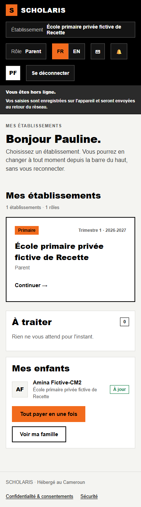
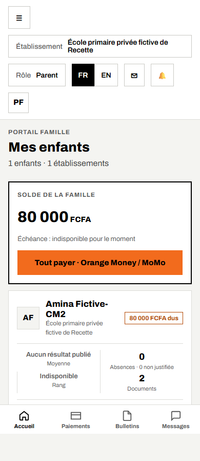
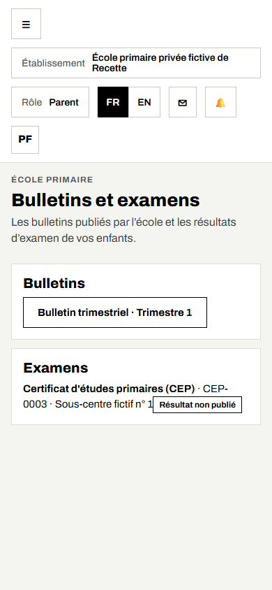
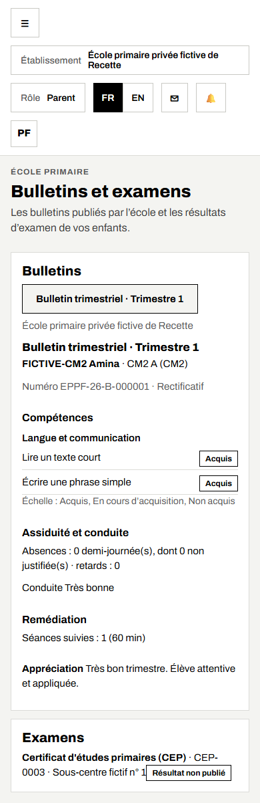

# 11. L'espace des parents

**Qui** : les parents **garants financiers** d'un élève de l'école. Le compte est créé par l'école : vous recevez un SMS avec un code pour choisir votre mot de passe (chapitre 01).

L'espace des parents se consulte surtout **sur le téléphone**.

## 11.1 L'accueil du parent

Après la connexion, touchez le bouton de menu (☰) en haut à gauche pour voir les rubriques :

- **Mes enfants** : la liste de vos enfants inscrits ;
- **École primaire** : les bulletins publiés et les résultats d'examen ;
- **Messagerie**, **Mon profil**, **Sécurité**.

## 11.2 Consulter les bulletins

**Où** : **École primaire > Bulletins et examens** (`/primaire/famille`).

1. Si vous avez plusieurs enfants dans l'école, choisissez l'**Enfant**.
2. La rubrique **Bulletins** liste les bulletins publiés (exemple : **Bulletin trimestriel · Trimestre 1**).
3. Touchez un bulletin pour l'ouvrir.

Le bulletin affiche les compétences par domaine (Acquis, En cours d'acquisition, Non acquis), les absences, la conduite, la remédiation, l'appréciation et la décision du conseil. Le **numéro** du bulletin permet de vérifier son authenticité.

Vous recevez un SMS quand un nouveau bulletin est publié.

## 11.3 Les résultats d'examen

La rubrique **Examens** affiche le résultat de votre enfant au CEP ou au FSLC une fois publié par l'école. Avant, la mention « Résultat non publié » s'affiche.

## 11.4 Ce que vous ne voyez pas

- Un bulletin qui n'est pas encore publié par l'école.
- Les enfants dont vous n'êtes pas garant financier : demandez à la secrétaire de vous enregistrer comme garant financier de l'enfant (chapitre 03).
