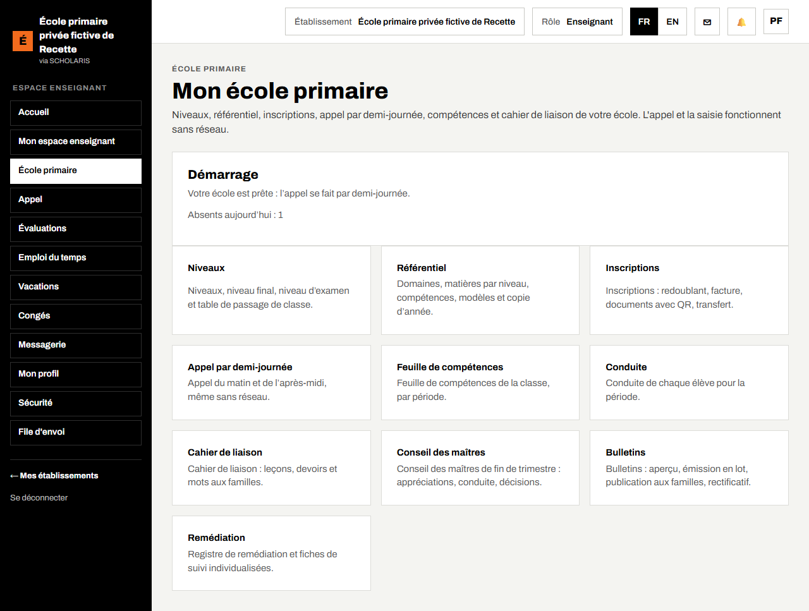
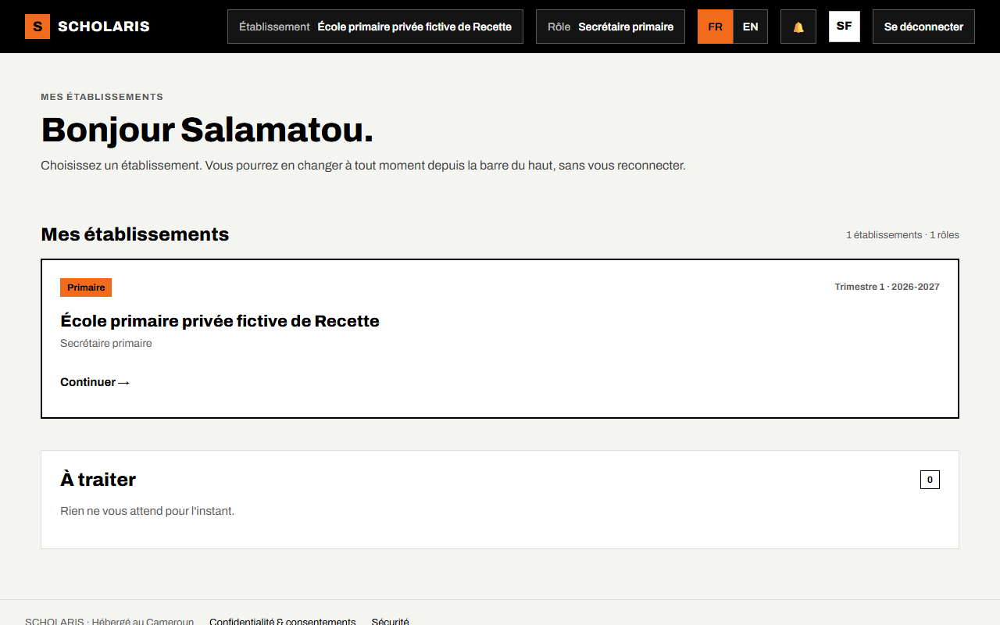
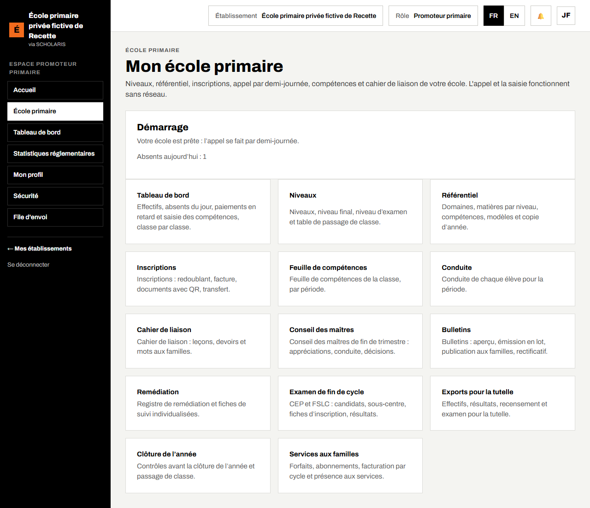

# 12. Les rôles

Chaque personne reçoit un ou plusieurs **rôles** dans l'école (chapitre 02, 2.7). Le rôle décide des menus, des cartes et des boutons affichés. Si vous ne voyez pas un écran, c'est en général que votre rôle ne le permet pas.

Choisissez votre rôle actif dans la liste **Rôle**, en haut de l'écran.

## 12.1 Tableau des rôles

| Rôle (nom à l'écran) | Ce qu'il fait | Ce qu'il ne fait pas |
|---|---|---|
| **Super administrateur** (promoteur ou administrateur de l'école) | année et trimestres, classes, autorisations d'ouverture, comptes et rôles, paramètres, frais et paiements | les écrans pédagogiques s'il n'a pas aussi un rôle de l'école primaire |
| **Promoteur primaire** | consulte le tableau de bord, les compétences, les conseils, les bulletins, l'examen, les services ; exporte pour la tutelle | ne saisit rien |
| **Directeur primaire** | démarrage, niveaux, appel de toutes les classes, conseil des maîtres (présidence), bulletins (émission, publication, rectificatif), verrouillage et publication des feuilles, accord des corrections, examen, exports, sortie sécurisée, clôture | ne tient pas la caisse |
| **Responsable pédagogique primaire** (adjoint) | référentiel, validation des feuilles de compétences, remédiation, emploi du temps | ne publie pas les bulletins |
| **Secrétaire primaire** | inscriptions (avec la facture d'inscription), fiches de **Personnes et inscriptions**, documents administratifs, examen (inscriptions des candidats), exports pour la tutelle | ne saisit pas les compétences |
| **Enseignant** (maître, maîtresse) | appel, feuille de compétences (saisie et import), conduite, cahier de liaison, remédiation ; consulte le conseil et les bulletins | ne verrouille pas, ne publie pas |
| **Surveillant primaire** | sortie sécurisée (remise et refus), sanctions | ne voit pas les bulletins |
| **Comptable** | catalogue des frais, échéanciers, factures, remises ; forfaits de services (cantine, garderie, transport) | — |
| **Caissier** | ouverture et arrêt de la caisse, encaissement, reçus | n'annule pas seul un paiement |
| **Parent** (garant financier) | consulte les bulletins publiés et les résultats d'examen de ses enfants | ne voit pas les autres élèves |

## 12.2 Accueil selon le rôle

Le maître voit les rubriques de sa classe : appel, feuille de compétences, conduite, cahier de liaison, conseil (lecture), bulletins (lecture), remédiation.

La secrétaire voit l'école primaire (inscriptions, examen, exports) et l'écran **Nouvelle inscription**.

Le promoteur voit les rubriques en lecture et les exports.

## 12.3 Bon usage

- Une personne peut avoir plusieurs rôles (par exemple directeur et enseignant dans une petite école). Changez de rôle dans la liste **Rôle**.
- Retirez les rôles d'une personne qui quitte l'école (**Administration > Utilisateurs et rôles**).
- Pour une absence, utilisez la **délégation temporaire** plutôt que de prêter votre mot de passe.
