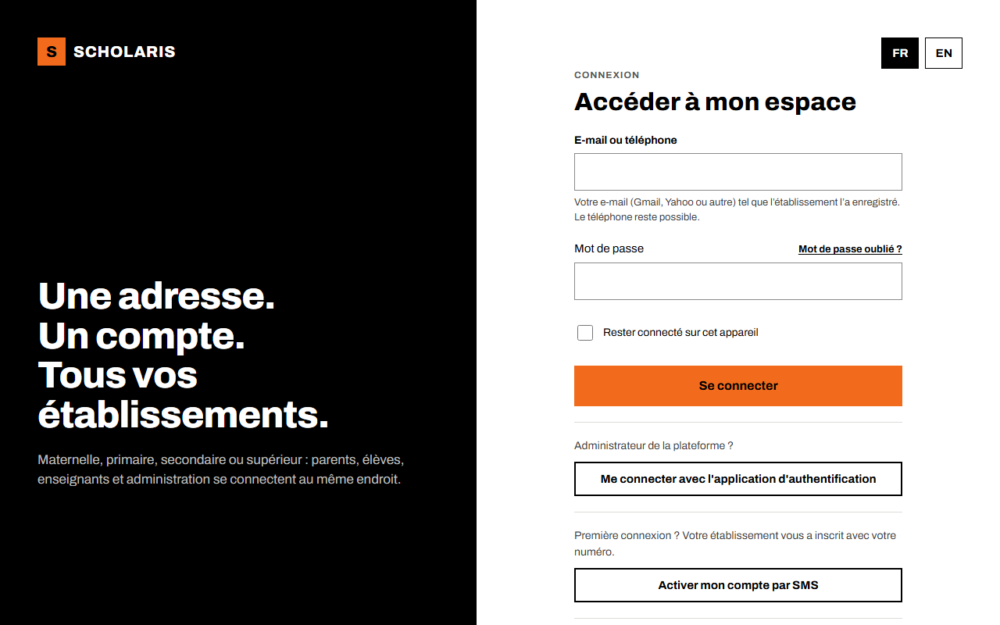
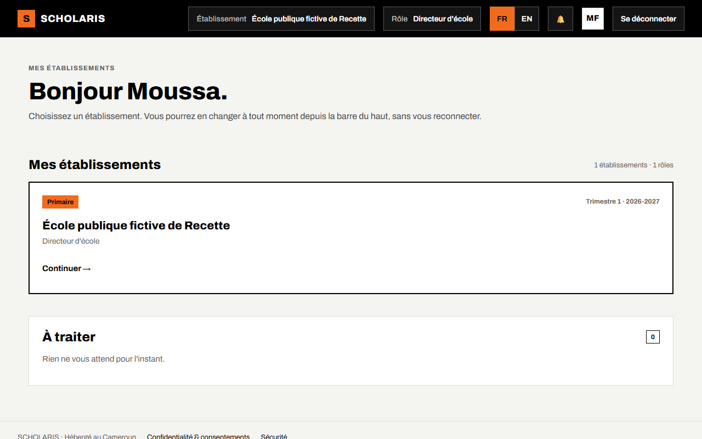
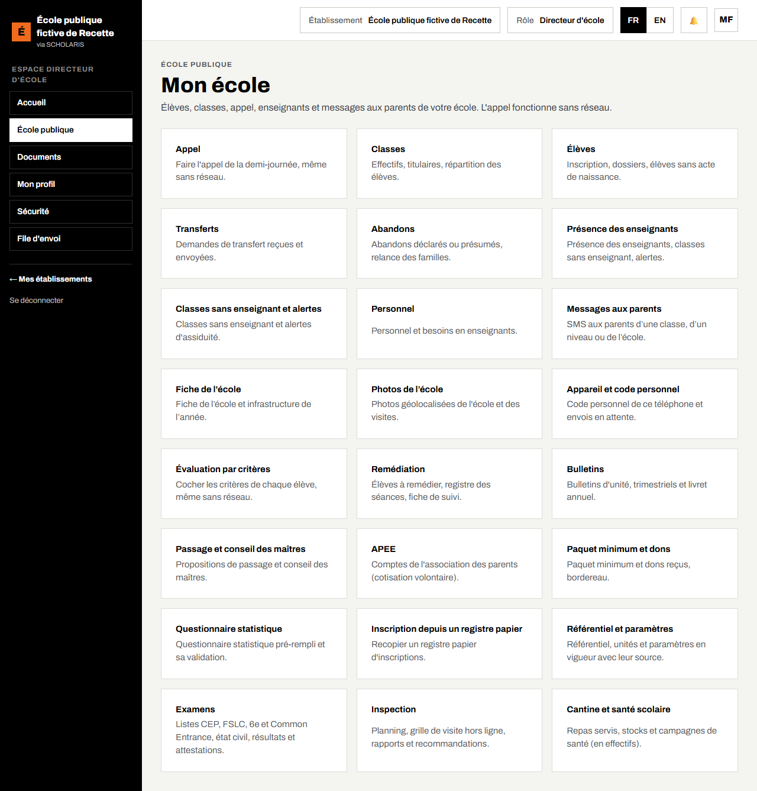
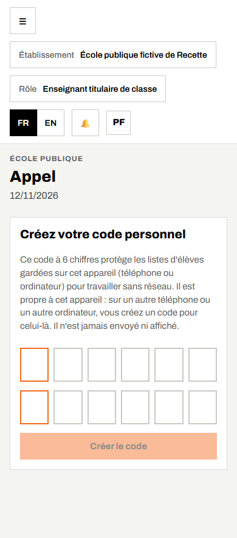
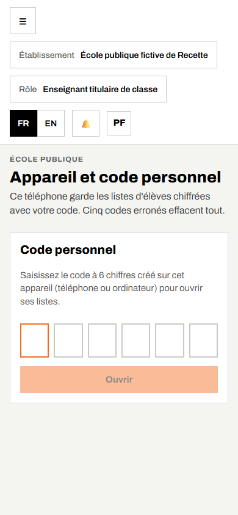

# 01. Premiers pas

Ce chapitre concerne **tout le monde**.

## 1.1 Ce qu'il vous faut

- Un téléphone ou un ordinateur avec un navigateur récent (Chrome conseillé sur téléphone).
- Votre **numéro de téléphone** tel qu'il a été enregistré : c'est votre identifiant.
- Votre mot de passe, choisi à l'activation du compte avec le **code à 6 chiffres** reçu par SMS.

Astuce : sur téléphone, menu du navigateur > **Ajouter à l'écran d'accueil**. SCHOLARIS s'ouvre alors comme une application, même sans réseau pour l'appel.

## 1.2 Activer son compte (première fois)

1. Sur la page de connexion, ouvrez **Activer mon compte par SMS**.
2. Saisissez votre numéro, puis **Recevoir le code**.
3. Saisissez le code reçu, puis **Vérifier le code**.
4. Choisissez votre mot de passe (10 caractères au moins), retapez-le, puis **Enregistrer le mot de passe**.

## 1.3 Se connecter

**Où** : `/connexion`.

1. **E-mail ou téléphone** : votre numéro.
2. **Mot de passe** : votre mot de passe.
3. Cochez **Rester connecté sur cet appareil** seulement sur votre téléphone personnel.
4. Cliquez sur **Se connecter**.

## 1.4 L'accueil

- En haut : **Établissement** (votre école) et **Rôle**. Si vous avez plusieurs rôles, choisissez le bon : les menus changent.
- **FR / EN** : la langue des écrans.
- Menu de gauche : **École publique** ouvre l'application de l'école.

## 1.5 L'accueil « Mon école »

**Où** : **École publique** (`/ecole-publique`).

L'écran **Mon école** présente une carte par rubrique : **Appel**, **Classes**, **Élèves**, **Transferts**, **Abandons**, **Présence des enseignants**, **Personnel**, **Messages aux parents**, **Fiche de l'école**, **Évaluation par critères**, **Remédiation**, **Bulletins**, **Passage**, **APEE**, **Paquet minimum**, **Questionnaire statistique**, **Examens**, **Inspection**, **Cantine**, **Référentiel**…

Chacun ne voit que les cartes de son rôle.

## 1.6 Le code personnel de l'appareil

Pour travailler sans réseau, les listes d'élèves (appel, évaluation) et les grilles d'inspection sont gardées **chiffrées** sur l'appareil. Elles sont protégées par un **code personnel à 6 chiffres**.

Le code est **propre à chaque appareil**, téléphone ou ordinateur : « Il est propre à cet appareil : sur un autre téléphone ou un autre ordinateur, vous créez un code pour celui-là. » Il n'est jamais envoyé ni affiché. Un inspecteur ou un enseignant qui ouvre l'**Inspection** ou l'**Évaluation** sur un ordinateur pour la première fois crée donc un code pour cet ordinateur : c'est normal.

La première fois que vous ouvrez l'**Appel** (ou l'**Évaluation**, l'**Inspection**) sur un appareil :

1. Saisissez un **Code personnel à 6 chiffres** de votre choix.
2. Retapez-le dans **Confirmez le code**.
3. Cliquez sur **Créer le code**.

Le code est demandé à chaque ouverture. **Cinq codes erronés effacent tout** ce qui est gardé sur le téléphone (listes et appels non envoyés). Ne communiquez jamais votre code.

La rubrique **Appareil et code personnel** (`/ecole-publique/appareil`) permet de **Verrouiller maintenant** ou d'**Effacer ce téléphone** (par exemple avant de le prêter ou de le changer).

Le directeur peut aussi **Inscrire ce téléphone** auprès de l'école : le serveur refusera alors les envois d'un téléphone révoqué (perdu ou volé).

## 1.7 Bon usage

- **Un compte = une personne.** Ne prêtez pas votre mot de passe ni votre code.
- Quittez avec **Se déconnecter** sur un appareil partagé.
- En cas d'erreur, notez le message, l'heure et l'écran, puis prévenez le directeur ou l'inspection.
