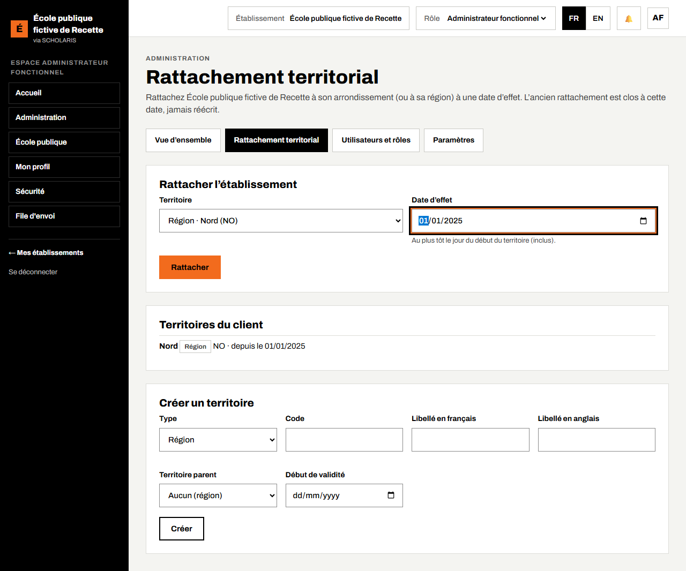
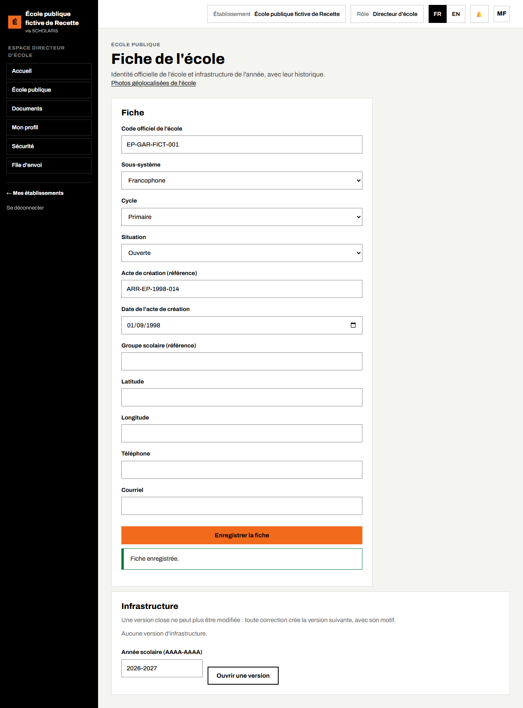

# 02. L'école et son territoire

## 2.1 Le rattachement de l'école au territoire

**Qui** : l'**administrateur fonctionnel** (rôle de l'administration centrale ou régionale). **Où** : **Administration > Rattachement territorial** (`/administration/territoire`).

Chaque école est rattachée à son territoire (région, département, arrondissement). Ce rattachement est indispensable : sans lui, l'école n'apparaît pas à l'inspection ni dans les tableaux de bord, et les élèves n'ont pas d'identifiant national.

1. Choisissez le rôle **Administrateur fonctionnel** dans la liste **Rôle** (en haut).
2. Ouvrez **Administration > Rattachement territorial**.
3. Dans **Territoire**, choisissez le territoire de l'école (exemple : Région · Nord).
4. **Date d'effet** : la date à partir de laquelle le rattachement vaut.
5. Cliquez sur **Rattacher**. Le message « Établissement rattaché à … à compter du … » s'affiche.

Le même écran permet de créer une région, un département ou un arrondissement, avec sa date de début.

## 2.2 La fiche de l'école

**Qui** : directeur. **Où** : **École publique > Fiche de l'école** (`/ecole-publique/ecole`).

Sans fiche, l'école est « inconnue » et **aucune inscription n'est possible**.

1. Saisissez le **Code officiel de l'école**.
2. Choisissez le **Sous-système** (**Francophone**, **Anglophone** ou **Bilingue**), le **Cycle** (**Primaire**, **Maternelle** ou **Groupe scolaire**) et la **Situation** (**Ouverte**, **Suspendue**, **Fermée**).
3. Saisissez l'**Acte de création (référence)** et la **Date de l'acte de création**.
4. Si vous les connaissez : **Groupe scolaire (référence)**, **Latitude**, **Longitude**, **Courriel**.
5. Cliquez sur **Enregistrer la fiche**. Le message « Fiche enregistrée. » s'affiche.

## 2.3 L'infrastructure de l'année

Toujours dans **Fiche de l'école**, le cadre **Infrastructure** décrit l'école pour l'année : **Tables-bancs**, **Points d'eau**, **Latrines filles**, **Latrines garçons**, **Électricité**, **Clôture**, **Cantine**, **Bibliothèque**, **Réseau mobile observé**.

1. Saisissez l'**Année scolaire (AAAA-AAAA)**, puis **Ouvrir une version**.
2. Remplissez les chiffres, puis **Enregistrer**.
3. Le lien **Salles et équipements** permet de lister chaque salle (nom, matériau, état, utilisée ou non) et les équipements numériques.
4. Quand tout est juste, **Clore** la version.

Une version close ne se modifie plus : **Corriger** crée la version suivante, avec un **Motif de la correction**. L'historique est conservé. Ces chiffres pré-remplissent le questionnaire statistique (chapitre 10).

## 2.4 Les photos de l'école

**Où** : **Fiche de l'école > Photos géolocalisées de l'école**. L'inspection et la direction y ajoutent des photos (JPEG ou PNG, 2 Mo au plus) avec la position (**Utiliser ma position**) et la date de prise de vue.
