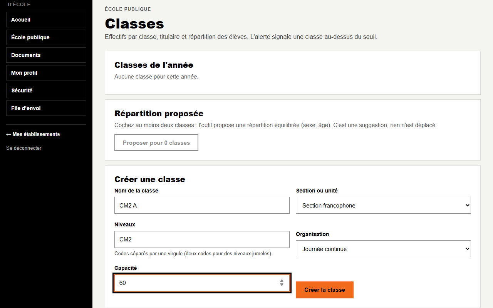
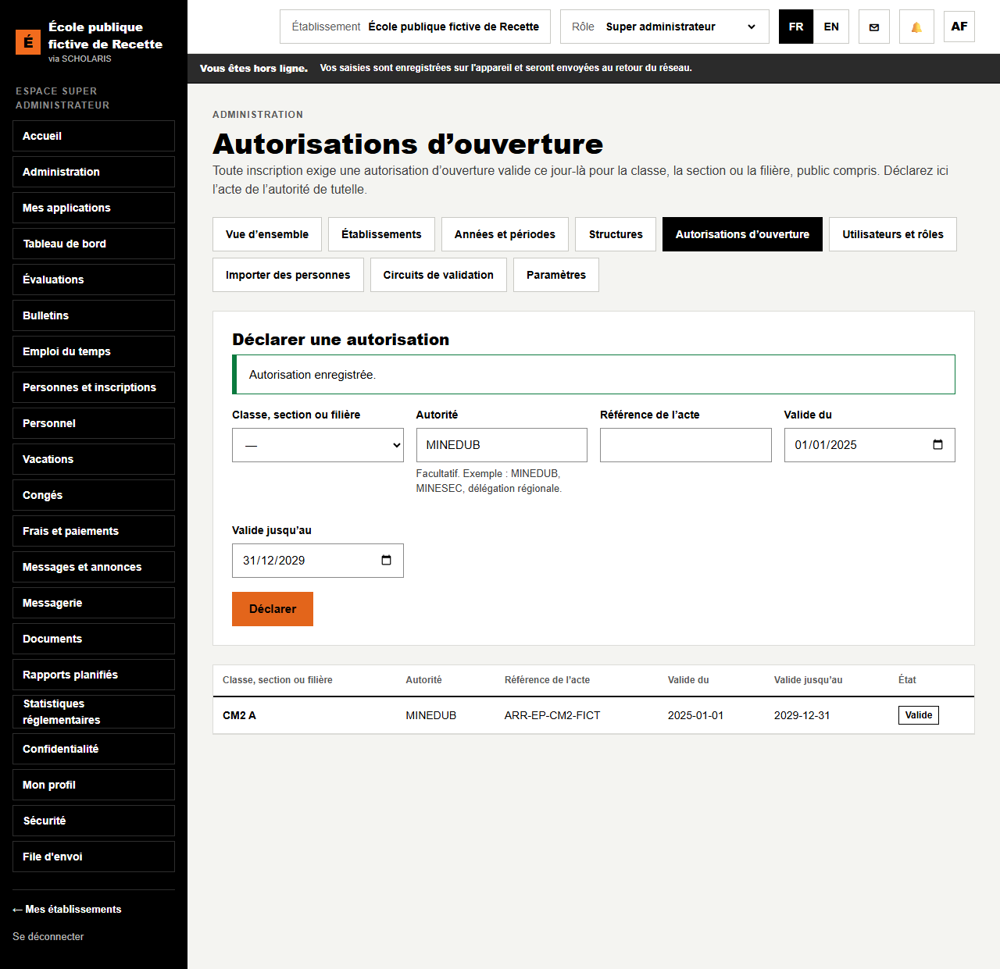
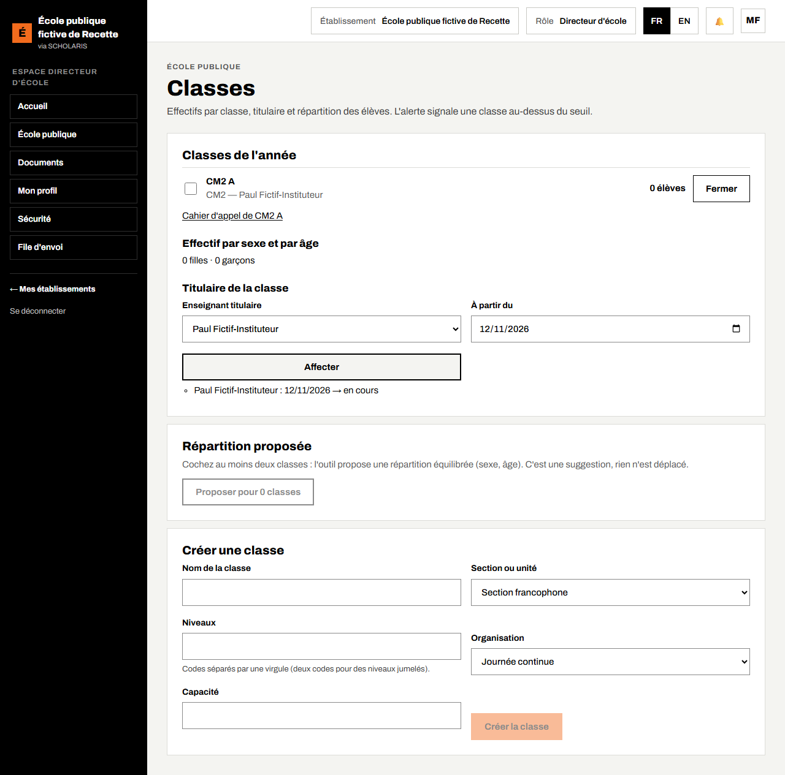

# 03. Classes et titulaires

**Qui** : directeur. **Où** : **École publique > Classes** (`/ecole-publique/classes`).

Avant de commencer : l'année scolaire et ses trimestres sont créés par l'administration, et la fiche de l'école est enregistrée (chapitre 02).

## 3.1 Créer une classe

1. Dans **Créer une classe**, saisissez le **Nom de la classe** (exemple : CM2 A).
2. Choisissez la **Section ou unité** (exemple : Section francophone).
3. **Niveaux** : le code du niveau (exemple : CM2). Pour une classe à **niveaux jumelés**, saisissez deux codes séparés par une virgule (exemple : CE2, CM1).
4. **Organisation** : précisez le cas échéant le système de double flux.
5. **Capacité** : le nombre de places.
6. Cliquez sur **Créer la classe**.

La première classe créée règle aussi l'appel **par demi-journée** pour toute l'école.

## 3.2 Déclarer l'autorisation d'ouverture

**Qui** : administrateur. **Où** : **Administration > Autorisations d'ouverture** (`/administration/autorisations`).

Toute inscription exige une autorisation d'ouverture valide ce jour-là pour la classe, **école publique comprise**.

1. Choisissez la **Classe, section ou filière**.
2. **Autorité** : MINEDUB ; **Référence de l'acte** ; **Valide du** et **Valide jusqu'au**.
3. Cliquez sur **Déclarer**. « Autorisation enregistrée. »

## 3.3 Désigner le titulaire

1. Dans **Classes de l'année**, cliquez sur **Détails** sur la ligne de la classe.
2. Dans **Enseignant titulaire**, choisissez l'enseignant (il doit figurer dans le **Personnel** de l'école).
3. Saisissez la date **À partir du** si besoin.
4. Cliquez sur **Affecter**. La ligne de la classe affiche le niveau et le titulaire (exemple : « CM2 — Paul … »).

## 3.4 Suivre les effectifs

La liste **Classes de l'année** donne, pour chaque classe, l'effectif. L'alerte **Au-dessus de …** signale une classe au-dessus du seuil (60 élèves par défaut, arrêté du 14 août 2026).

**Détails** affiche l'**Effectif par sexe et par âge** (filles, garçons, nombre par âge).

**Répartition proposée** : cochez au moins deux classes du même niveau, puis **Proposer pour n classes**. L'outil propose une répartition équilibrée (sexe, âge). C'est une suggestion : **rien n'est déplacé**.

Le lien **Cahier d'appel** de chaque classe ouvre le cahier d'appel mensuel (chapitre 05).
