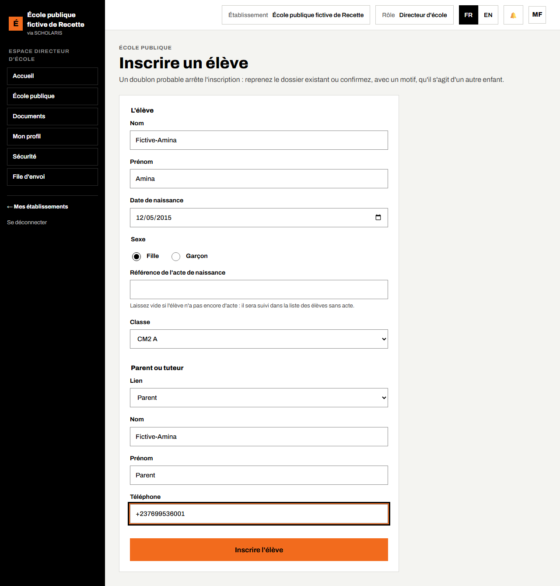
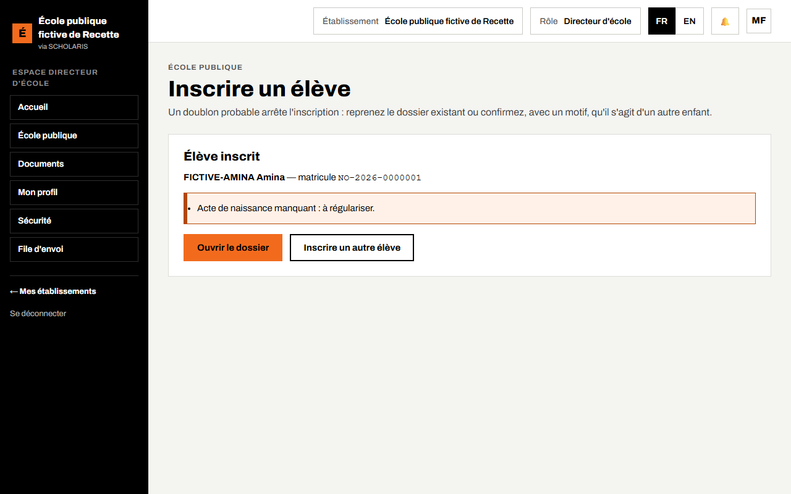
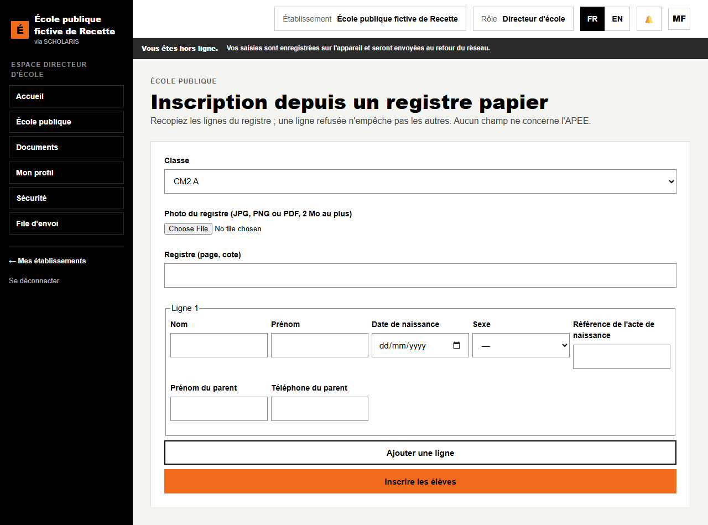
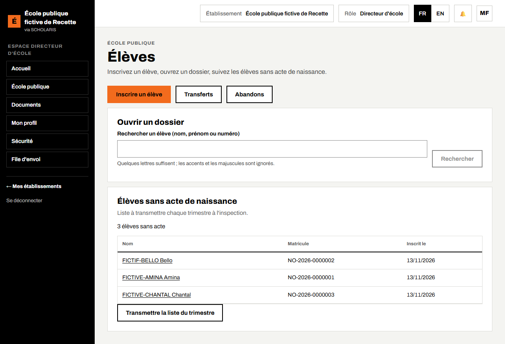
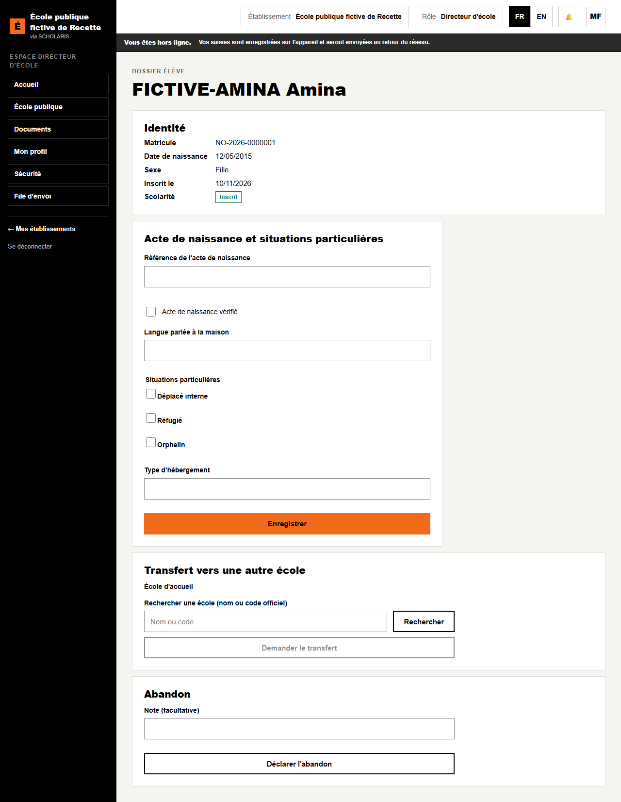
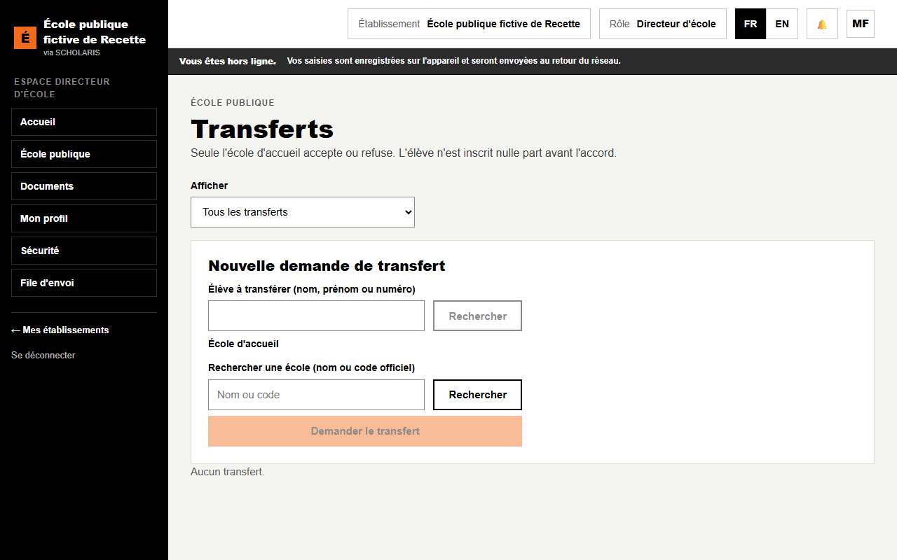
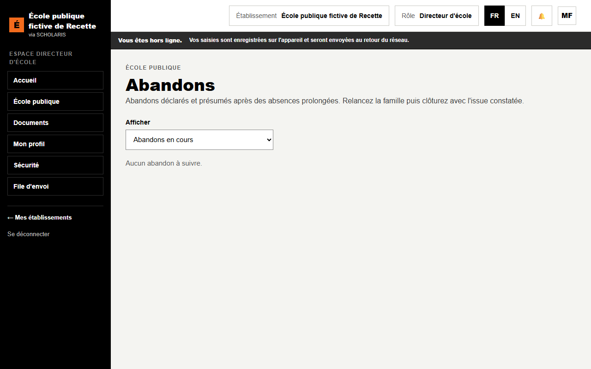

# 04. Élèves et inscriptions

**Qui** : directeur (et l'agent de saisie de l'inspection, par procuration). **Où** : **École publique > Élèves** (`/ecole-publique/eleves`).

Rappel : l'inscription à l'école publique est **gratuite**. Aucun champ ne concerne l'APEE.

## 4.1 Inscrire un élève

**Où** : **Élèves > Inscrire un élève** (`/ecole-publique/eleves/inscription`).

Cadre **L'élève** :

1. **Nom**, **Prénom**, **Date de naissance**, **Sexe** (**Fille** ou **Garçon**).
2. **Référence de l'acte de naissance** : laissez vide si l'élève n'a pas encore d'acte. Il sera suivi dans la liste des élèves sans acte (important pour l'examen, chapitre 11).
3. **Classe** : la classe de l'élève (ou **Pas encore de classe**).

Cadre **Parent ou tuteur** :

4. **Lien**, **Nom**, **Prénom** et **Téléphone** du parent. Le parent reçoit les SMS de l'école.

5. Cliquez sur **Inscrire l'élève**.

Le message **Élève inscrit** s'affiche avec son **matricule**. Des avertissements peuvent apparaître : « Acte de naissance manquant : à régulariser. », « La classe dépasse le seuil d'effectif. », « L'âge est hors de la tranche attendue pour ce niveau. »

Boutons : **Ouvrir le dossier** ou **Inscrire un autre élève**.

**Doublon probable** : si un élève semblable existe, l'inscription s'arrête : « Un élève semblable existe déjà. » Ouvrez sa fiche, ou cochez **C'est un autre enfant** et saisissez un **Motif (obligatoire)**.

## 4.2 Inscription groupée depuis un registre papier

**Où** : **Élèves > Inscription depuis un registre papier** (`/ecole-publique/eleves/registre`).

Pour recopier rapidement un registre d'inscription papier.

1. Choisissez la **Classe**.
2. **Registre (page, cote)** : la référence de la page recopiée.
3. **Photo du registre** : prenez la page en photo (JPG, PNG ou PDF, 2 Mo au plus). Elle est jointe au lot comme preuve.
4. Pour chaque élève, remplissez une ligne (nom, prénom, date de naissance, sexe, **Prénom du parent**, **Téléphone du parent**). **Ajouter une ligne** pour la suivante.
5. Cliquez sur **Inscrire les élèves**.

Le résultat affiche, ligne par ligne : **inscrit**, **déjà inscrit**, **doublon probable** ou **refusé**, et le total « n élève(s) inscrit(s) sur n ». **Une ligne refusée n'empêche pas les autres.** Renvoyer le même lot ne crée pas de doublon. La liste **Registres déjà saisis** permet de **Voir la photo du registre**.

## 4.3 La liste des élèves et le dossier

**Rechercher un élève** : quelques lettres du nom, du prénom ou du numéro suffisent (accents et majuscules ignorés).

Le **Dossier élève** contient l'identité, la scolarité, l'**Acte de naissance et situations particulières** (acte vérifié, langue parlée à la maison, déplacé interne, réfugié, orphelin, type d'hébergement). Modifiez puis **Enregistrer**.

**Changer le parent, le tuteur ou le garant d'un élève** : le directeur n'a pas ce droit. Il transmet la demande à l'administrateur du client (compte « Super administrateur » créé à la mise en service), qui ouvre la fiche de l'élève dans **Personnes et inscriptions** (`/personnes`, bouton **Ouvrir**), section **Parents et garants**. Le cadre **Ajouter un parent, un tuteur, un garant ou un contact** enregistre une personne déjà connue (recherche par nom ou téléphone) ou une nouvelle personne ; pour un **Garant financier**, la case **Retirer l'ancien garant financier** fait le remplacement en une seule action. Le cadre **Changer ou retirer un lien** change le type d'un lien ou le retire, après confirmation. Si des factures ont été émises pour l'élève, elles ne changent pas ; les relances et les reçus vont au garant actuel, et la caisse émet au nouveau garant sa référence de paiement s'il n'en a pas. Les reçus APEE restent au nom du parent payeur choisi à l'encaissement (chapitre 09).

## 4.4 Transferts

**Où** : **École publique > Transferts** (`/ecole-publique/transferts`).

- **Demander un transfert** : cherchez l'élève, choisissez l'**École d'accueil**, puis **Demander le transfert**. L'élève reste dans votre école tant que l'école d'accueil n'a pas accepté.
- **Transferts reçus** : cliquez sur **Traiter**, saisissez la **Date d'accueil** et la **Classe d'accueil**, puis **Accepter** (ou **Refuser** avec un motif). Enfin **Terminer le transfert**.
- L'école d'origine peut **Délivrer le certificat de radiation**.

## 4.5 Abandons

**Où** : **École publique > Abandons** (`/ecole-publique/abandons`).

La liste montre les abandons **Déclarés** (par le directeur, depuis le dossier de l'élève) et **Présumés** (après des absences prolongées).

1. **Relancer la famille** : un message part au parent ; la date de relance est notée.
2. Quand la situation est connue, choisissez l'**Issue** (**Retour à l'école**, **Transféré ailleurs**, **Abandon confirmé**) puis **Clôturer**.
