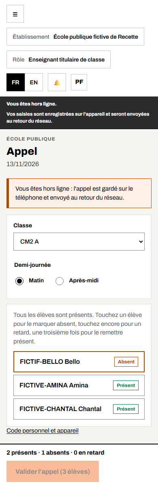
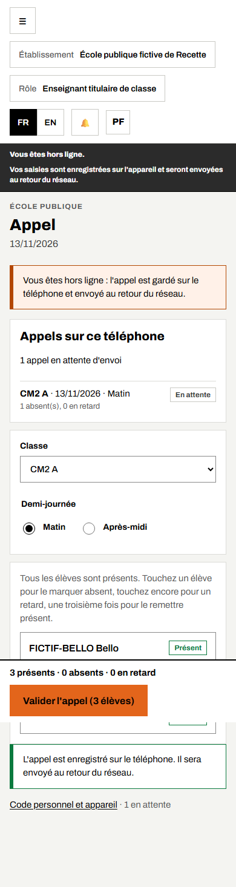
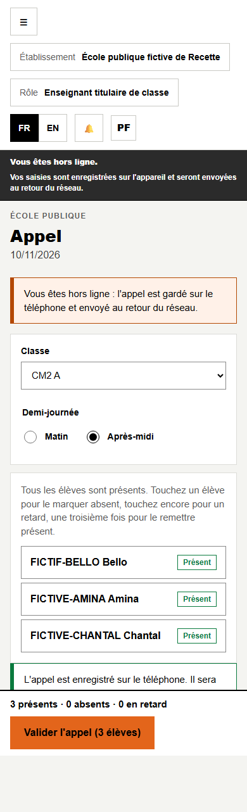
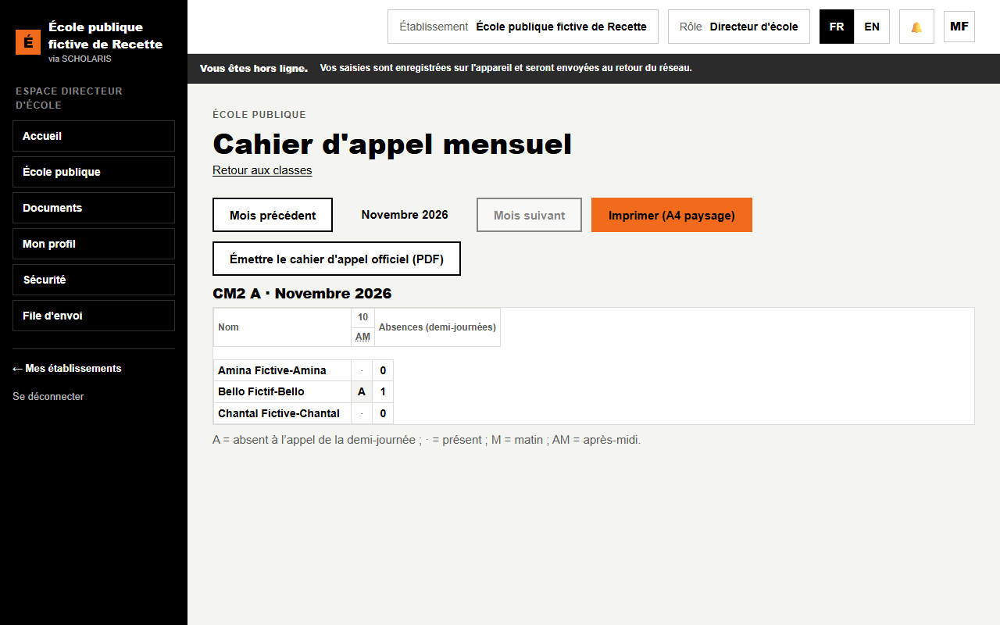

# 05. L'appel par demi-journée

**Qui** : enseignant titulaire, directeur. **Où** : **École publique > Appel** (`/ecole-publique/appel`).

L'appel se fait **le matin et l'après-midi**. Il fonctionne **sans réseau** : l'appel est gardé sur le téléphone et envoyé au retour du réseau.

## 5.1 Avant le premier appel

1. Ouvrez l'**Appel** une première fois **avec le réseau**.
2. Créez votre **code personnel** (chapitre 01, 1.6).
3. Choisissez votre classe : la liste des élèves est alors gardée, chiffrée, sur le téléphone.

## 5.2 Faire l'appel

1. Dans **Choix de la classe et de la demi-journée**, choisissez la **Classe** et la **Demi-journée** (**Matin** ou **Après-midi**).
2. La **Liste d'appel** s'affiche : **tous les élèves sont présents** au départ.
3. **Touchez** un élève pour le marquer **Absent** ; touchez encore pour **En retard** (l'heure d'arrivée est demandée) ; une troisième fois pour le remettre **Présent**.
4. Le **Résumé de l'appel** compte les présents, absents et retards (exemple : « 2 présents · 1 absents · 0 en retard »).
5. Cliquez sur **Valider l'appel (n élèves)**.

Avec le réseau : « Appel enregistré et envoyé. »

## 5.3 Sans réseau

Si le téléphone est hors ligne, le bandeau le dit : « Vous êtes hors ligne : l'appel est gardé sur le téléphone et envoyé au retour du réseau. »

Après **Valider l'appel**, le message « L'appel est enregistré sur le téléphone. Il sera envoyé au retour du réseau. » s'affiche. Le compteur « n en attente » rappelle les appels non envoyés.

Au retour du réseau, l'appel part tout seul. Vous pouvez aussi toucher **Envoyer maintenant**.

Quand plus rien n'attend, le compteur disparaît.

## 5.4 Corriger un appel

Si l'appel de la demi-journée est déjà fait, l'écran le signale : « L'appel de cette demi-journée est déjà fait. Une correction demande un motif. » Modifiez les élèves concernés, saisissez le **Motif de la correction**, puis validez.

## 5.5 Le cahier d'appel mensuel

**Où** : **Classes**, lien **Cahier d'appel** de la classe.

Le cahier montre le mois choisi : une colonne par demi-journée (**M** matin, **AM** après-midi), **A** pour un absent, **·** pour un présent, et le total des **Absences (demi-journées)** par élève.

- **Mois précédent** / **Mois suivant** pour naviguer.
- **Imprimer (A4 paysage)**, ou **Émettre le cahier d'appel officiel (PDF)**.

## 5.6 Alertes d'assiduité

Les absences répétées d'un élève créent une alerte (chapitre 06, **Classes sans enseignant et alertes**). Les parents d'un élève absent sont prévenus selon les réglages de l'école.
