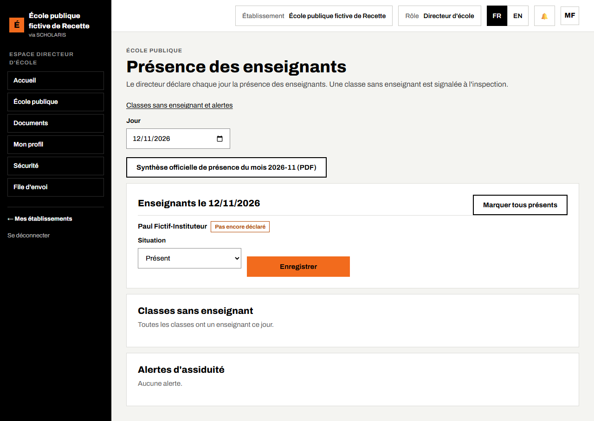
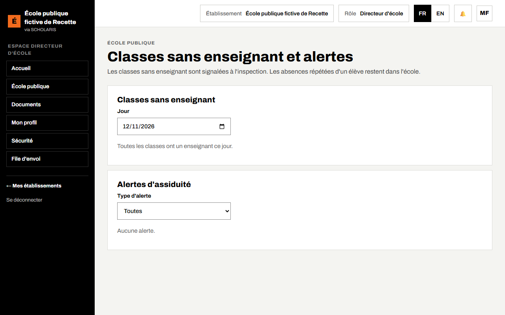
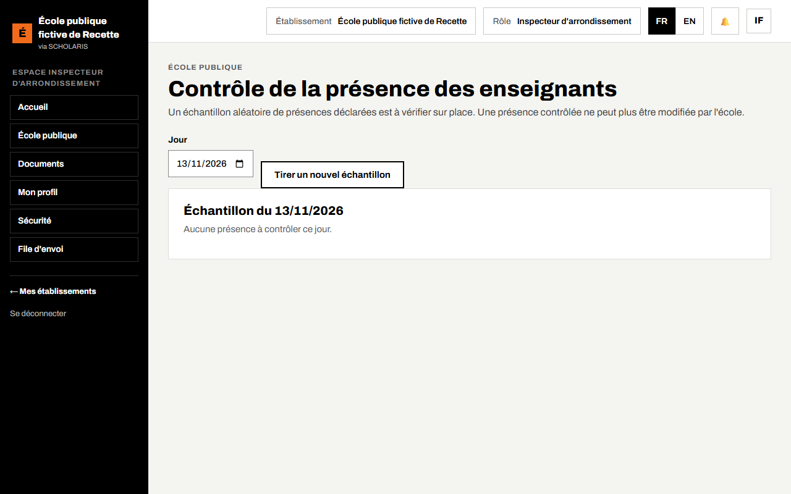
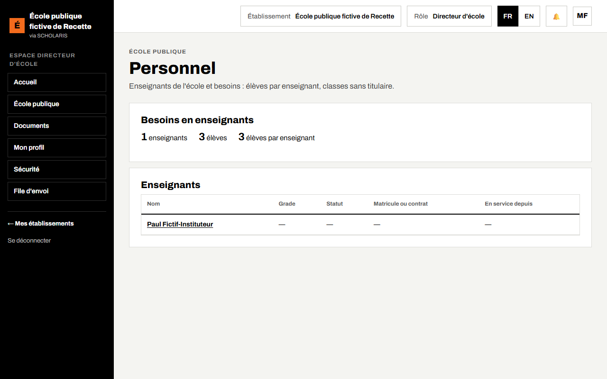
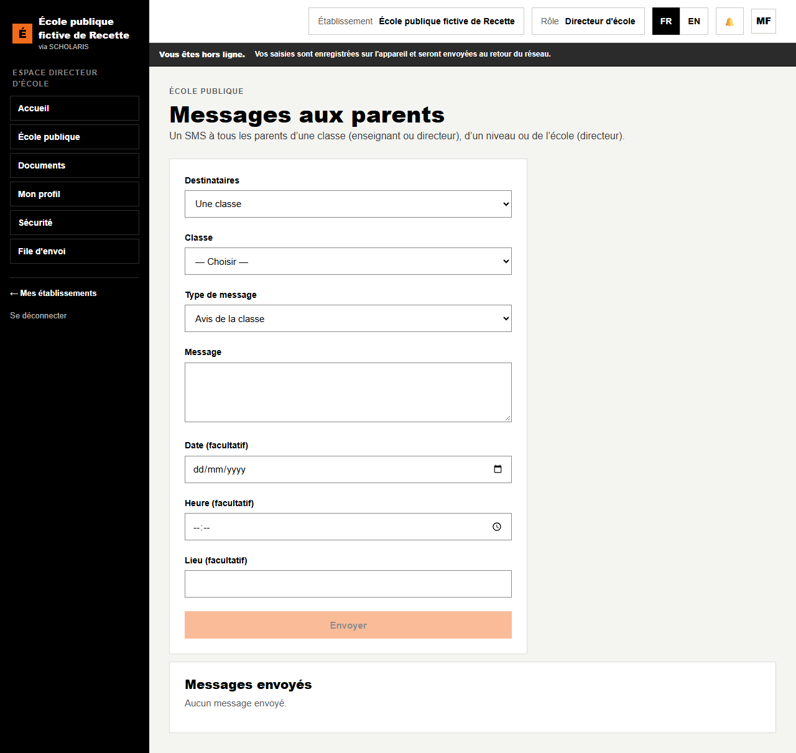

# 06. Présence des enseignants, personnel et messages

## 6.1 Déclarer la présence des enseignants

**Qui** : directeur. **Où** : **École publique > Présence des enseignants** (`/ecole-publique/presence-enseignants`).

Le directeur déclare **chaque jour** la présence des enseignants. Une classe sans enseignant est signalée à l'inspection.

1. Choisissez le **Jour** (aujourd'hui par défaut).
2. Cliquez sur **Marquer tous présents**.
3. Pour un enseignant absent, choisissez sa **Situation** : **Absent**, **En permission** ou **En mission** ; saisissez le **Motif** et le **Remplaçant** éventuel (ou **Pas de remplaçant**).
4. Cliquez sur **Enregistrer** sur sa ligne. « Présence de … enregistrée. »

Le cadre **Classes sans enseignant** liste les classes non couvertes ce jour-là. Le bouton **Synthèse officielle de présence du mois (PDF)** émet le document mensuel.

Une présence déjà **Contrôlée par l'inspection** ne peut plus être modifiée.

## 6.2 Classes sans enseignant et alertes

**Où** : **École publique > Classes sans enseignant et alertes** (`/ecole-publique/alertes`).

Filtrez par **Type d'alerte** : **Appel non fait**, **Classe sans enseignant**, **Absences répétées**. Pour une absence répétée, **Ouvrir le dossier de l'élève**. Les classes sans enseignant remontent à l'inspection ; les absences répétées d'un élève restent dans l'école.

## 6.3 Le contrôle de l'inspection

**Qui** : inspecteur, conseiller pédagogique. **Où** : **Contrôle de la présence des enseignants** (`/ecole-publique/controle-presence`).

1. Cliquez sur **Tirer un nouvel échantillon** : l'application choisit au hasard des présences déclarées à vérifier sur place.
2. Pour chaque présence de l'échantillon : **Présence confirmée** ou **Signaler un écart**.

Une présence contrôlée ne peut plus être modifiée par l'école.

## 6.4 Le personnel

**Où** : **École publique > Personnel** (`/ecole-publique/personnel`).

- **Besoins en enseignants** : nombre d'enseignants, d'élèves, **élèves par enseignant**, **enseignants manquants**, **Classes sans titulaire**.
- **Enseignants** : la liste, avec le grade, le statut et la date de prise de service.

Cliquez sur un enseignant pour ouvrir sa **Fiche de carrière** : **Statut** (**Fonctionnaire**, **Contractuel**, **Maître des parents**, **Bénévole**), matricule ou numéro de contrat, diplôme professionnel, **Formations suivies** (**Ajouter la formation**) et **Mutations**. Le matricule, le contrat et les formations sont réservés au directeur.

## 6.5 Messages aux parents

**Où** : **École publique > Messages aux parents** (`/ecole-publique/messages`).

1. **Destinataires** : **Une classe** (enseignant ou directeur), **Un niveau** ou **Toute l'école** (directeur).
2. **Type de message** : **Avis de la classe** ou **Message essentiel (sécurité)**.
3. Saisissez le **Message**, et si besoin la **Date**, l'**Heure** et le **Lieu**.
4. Cliquez sur **Envoyer**. « Message envoyé à n parents. »

Un message renvoyé par erreur ne part pas deux fois. La liste **Messages envoyés** garde l'historique.
