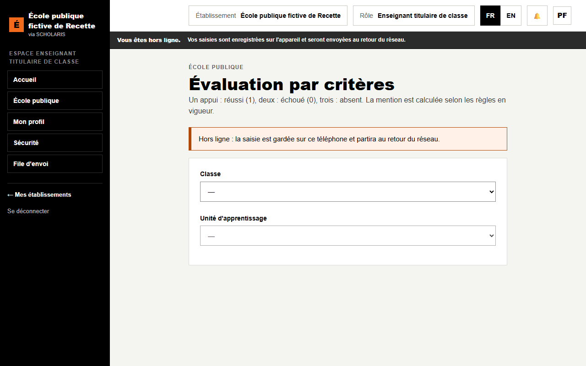
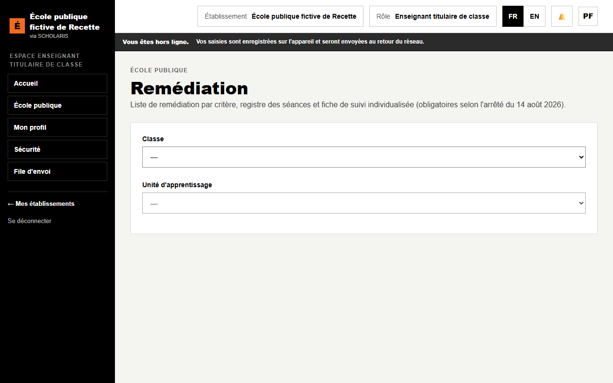
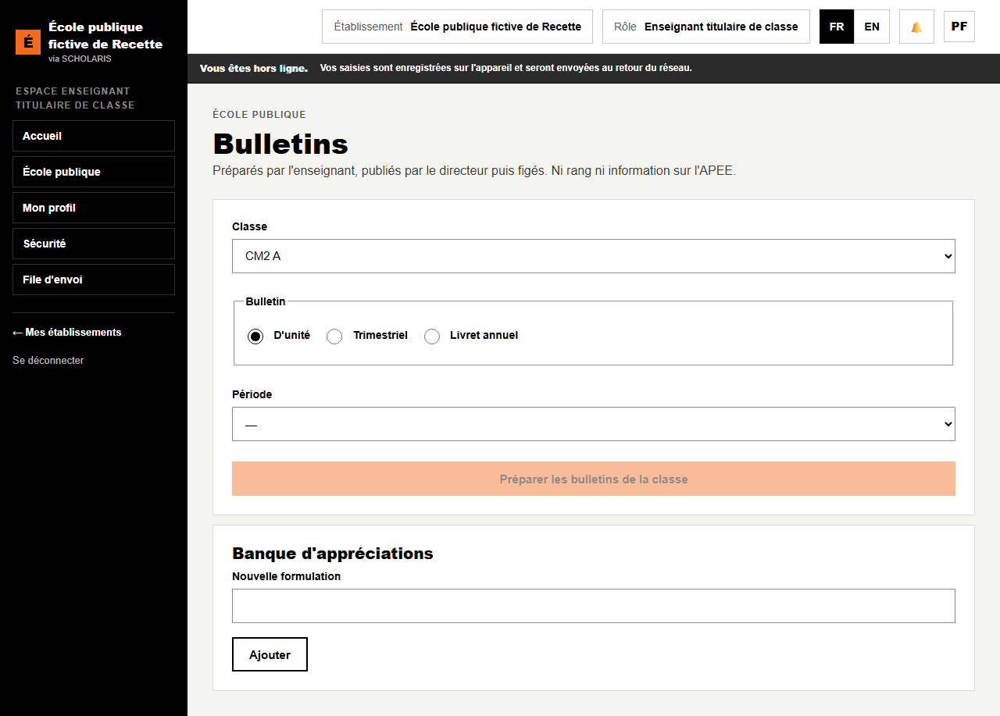
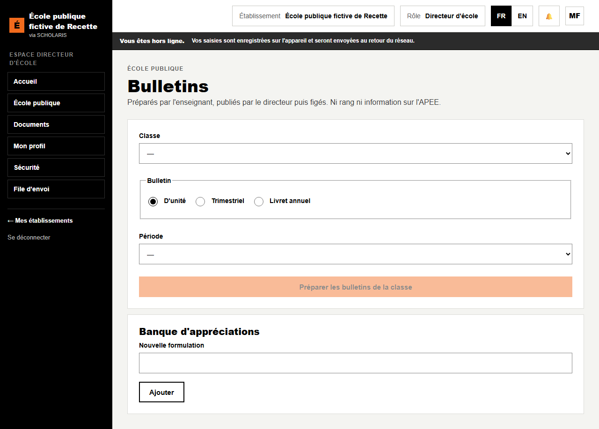

# 07. Évaluation par critères, remédiation et bulletins

À l'école primaire publique, l'élève est évalué **par critères**, unité d'apprentissage par unité. Chaque discipline reçoit une **mention** : **A** (acquis), **ECA** (en cours d'acquisition) ou **NA** (non acquis). **Il n'y a jamais de rang.**

**Qui fait quoi**

| Tâche | Qui |
|---|---|
| Référentiel national, unités d'apprentissage | Niveau national (référentiel) ; directeur (génération des unités) |
| Saisie des critères, remédiation, préparation des bulletins, appréciations | Enseignant titulaire |
| Publication des bulletins, rectificatif | Directeur seulement |

## 7.1 Le référentiel et les unités d'apprentissage

**Où** : **École publique > Référentiel et paramètres** (`/ecole-publique/referentiel`).

> Point constaté pendant la préparation de ce guide : sur l'école d'essai, le directeur ne voyait pas les boutons **Importer le référentiel d'exemple** et **Générer les unités** ; sans unités, l'écran d'évaluation n'a ni classe ni unité à proposer. Les unités se génèrent alors avec le compte qui gère le référentiel (niveau national). La génération demande aussi l'**identifiant** de chaque trimestre, à recopier depuis l'administration.

- **Disciplines et critères** : choisissez le **Niveau** puis **Afficher**. Chaque discipline liste ses critères ; une **discipline clé** compte pour le passage. Le référentiel est réglé **au niveau national**. Tant que le référentiel officiel n'est pas chargé, **Importer le référentiel d'exemple (à remplacer par l'officiel)** permet de commencer.
- **Unités d'apprentissage** : l'année compte plusieurs unités (8 par défaut), réparties sur les trimestres, chacune avec une **semaine d'évaluation**. Le directeur clique sur **Générer les unités**.
- **Paramètres en vigueur** : chaque règle (occasions, seuil de maîtrise, remédiation, passage…) affiche sa **Valeur**, son **Statut** et sa **Source** (**texte officiel**, **cahier des charges, à valider**, ou **à confirmer**).

## 7.2 Saisir l'évaluation par critères

**Qui** : enseignant titulaire. **Où** : **École publique > Évaluation par critères** (`/ecole-publique/evaluation`).

1. Dans **Choisir la classe, l'unité et la discipline**, choisissez la **Classe**, l'**Unité d'apprentissage** et la **Discipline**.
2. La **Grille de saisie** affiche une ligne par élève, et pour chaque critère trois **occasions**.
3. Pour chaque case : **un appui = réussi (1)**, **deux appuis = échoué (0)**, **trois appuis = absent**. Une case vide reste « non saisi ».
4. Un critère est **maîtrisé** quand l'élève réussit au moins 2 occasions sur 3 (règle affichée en haut de la grille).
5. Cliquez sur **Valider la saisie**. « Saisie envoyée, mentions recalculées. »

La **Mention** de chaque élève est calculée automatiquement selon les règles en vigueur. Un élève absent partout est « Non évalué ».

**Sans réseau** : « Saisie gardée sur ce téléphone : elle partira au retour du réseau. » Le cadre **Saisies en attente** montre l'état : **en attente**, **conflit (rien n'est écrasé)** ou **refusée** ; **Renvoyer** ou **Abandonner**.

Si un élève obtient NA, son parent reçoit un message (une seule fois).

## 7.3 La remédiation

**Où** : **École publique > Remédiation** (`/ecole-publique/remediation`).

L'arrêté du 14 août 2026 impose trois outils : la **liste des élèves à remédier**, le **registre des séances** et la **fiche de suivi individualisée**.

1. Choisissez la **Classe** et l'**Unité**.
2. **Élèves à remédier** : la liste par critère non maîtrisé. **Commencer** passe une remédiation « en cours » ; **Résolue** la clôt (une **Observation pour la fiche de suivi** est obligatoire).
3. **Registre de remédiation : nouvelle séance** : **Date**, **Groupe de besoin (critère)**, **Durée (minutes)**, **Forme** (**Groupe de besoin**, **Fiche différenciée**, **Tutorat par les pairs**), **Observations**, puis **Enregistrer la séance**.
4. Le bilan de la **Semaine du … au …** indique **minimum atteint** ou **minimum non atteint** (60 minutes par semaine et par discipline fondamentale).
5. **Fiche de suivi** d'un élève : minutes suivies et remédiations en cours ; **Imprimer**.

## 7.4 Les bulletins

**Où** : **École publique > Bulletins** (`/ecole-publique/bulletins`).

Trois bulletins : **D'unité**, **Trimestriel** et **Livret annuel**. Ils ne portent **ni rang ni information sur l'APEE**.

### Préparer (enseignant)

1. Dans **Choisir la classe et le bulletin**, choisissez la **Classe**, le **Bulletin** (d'unité, trimestriel, livret annuel) et la **Période**.
2. Cliquez sur **Préparer les bulletins de la classe**. Chaque bulletin est en **brouillon**, avec les **Mentions**.
3. Saisissez l'**Appréciation de l'enseignant**, ou **Reprendre une formulation** de la **Banque d'appréciations** (vous pouvez y ajouter une **Nouvelle formulation**).
4. Cliquez sur **Enregistrer l'appréciation**.

### Publier (directeur)

1. Relisez le bulletin, puis **Publier aux parents**.
2. Confirmez : « Publier ce bulletin ? Il sera figé et les parents seront prévenus. »
3. « Bulletin publié, parents prévenus. » Le bulletin est **figé**. **Ouvrir le PDF** pour l'imprimer.

### Rectifier

Une erreur après publication : **Rectifier une mention**, choisissez la **Nouvelle mention**, puis **Rééditer en « Rectificatif »**. Le bulletin est réédité **au même numéro** avec la mention « Rectificatif ».
