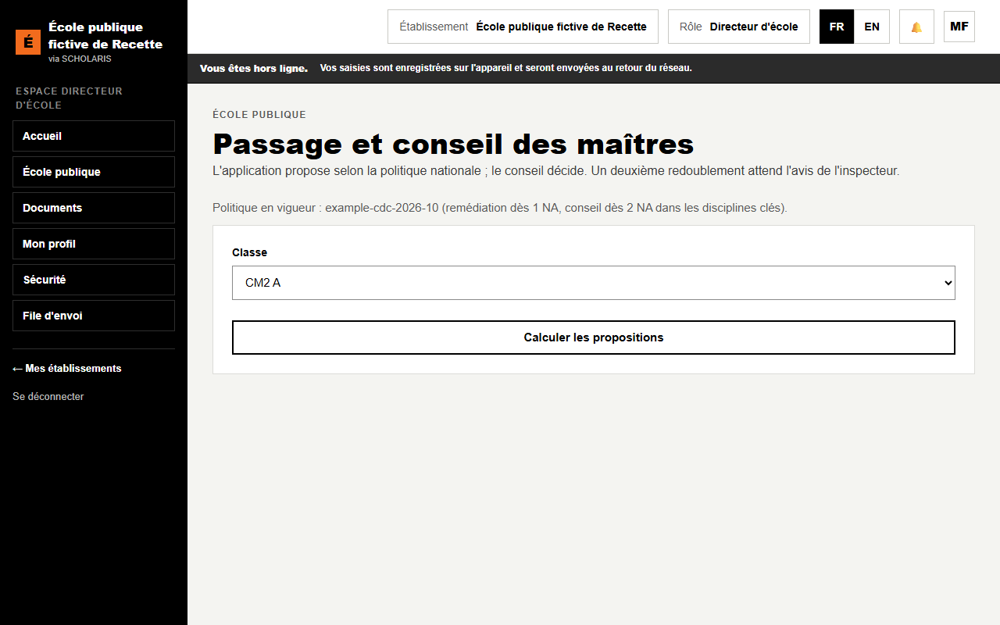

# 08. Passage de classe et conseil des maîtres

**Qui** : directeur et enseignants (conseil) ; inspecteur (avis). **Où** : **École publique > Passage** (`/ecole-publique/passage`).

« L'application propose selon la politique nationale ; le conseil décide. Un deuxième redoublement attend l'avis de l'inspecteur. »

## 8.1 La politique en vigueur

En haut de l'écran : « Politique en vigueur : … (remédiation dès 1 NA, conseil dès 2 NA dans les disciplines clés). » Cette politique est **nationale** : le directeur ne peut pas la modifier.

## 8.2 Calculer les propositions

1. Choisissez la **Classe**.
2. Cliquez sur **Calculer les propositions**.
3. La liste **Élèves de la classe** affiche, pour chaque élève, la **Proposition** et le nombre de NA en discipline clé : **Passe**, **Passe avec remédiation** ou **Examen par le conseil**.

## 8.3 Tenir le conseil des maîtres

1. Pour chaque élève, choisissez la **Décision** : **Passe**, **Passe avec remédiation** ou **Redouble**. Un redoublement doit être **motivé**.
2. Saisissez la **Date du conseil** et les **Présents (séparés par des virgules)**.
3. Cliquez sur **Enregistrer les décisions du conseil**. « Décisions enregistrées, familles prévenues. »
4. **Procès-verbal (PDF)** : le PV du conseil.

L'état de chaque décision : **proposée**, **décidée**, ou **avis de l'inspecteur attendu**.

## 8.4 Deuxième redoublement : l'avis de l'inspecteur

Si un élève redoublerait **une deuxième fois** dans le même niveau, la décision attend l'avis de l'inspecteur. L'inspecteur ouvre l'écran **Passage**, saisit son **Avis motivé de l'inspecteur** et choisit **Avis favorable** ou **Avis défavorable**.

## 8.5 Les recours des familles

Après la décision, la famille peut faire un recours jusqu'à la date affichée (« Recours possible jusqu'au … »).

1. **Enregistrer un recours** avec son **Motif**.
2. Le conseil choisit **Maintenir la décision** ou **Réviser (passe avec remédiation)**.
