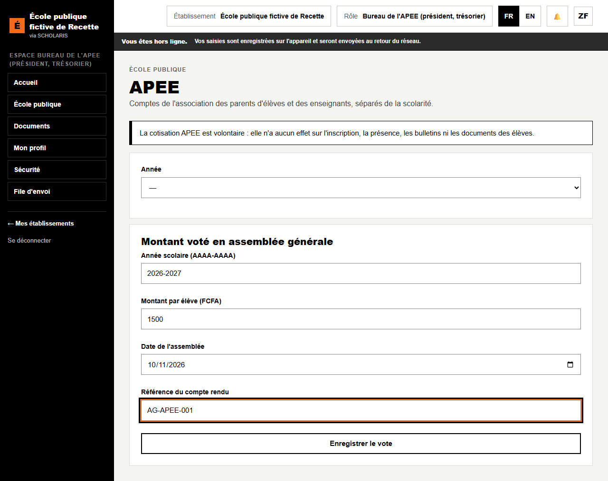
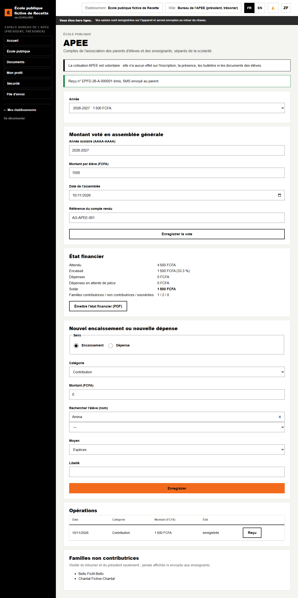
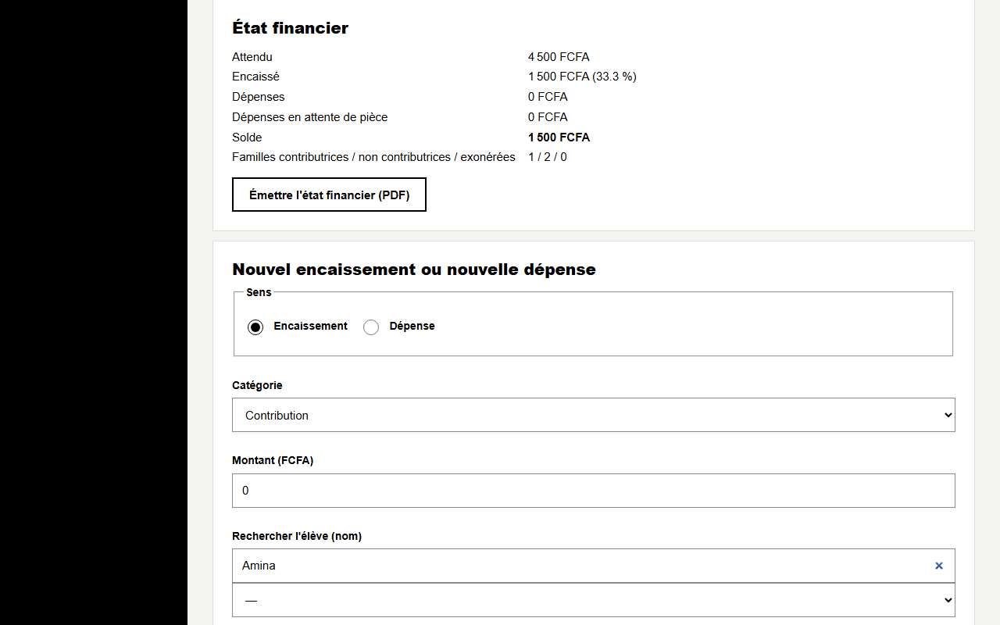
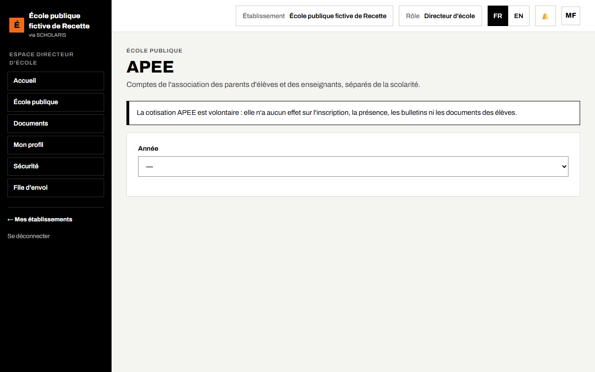
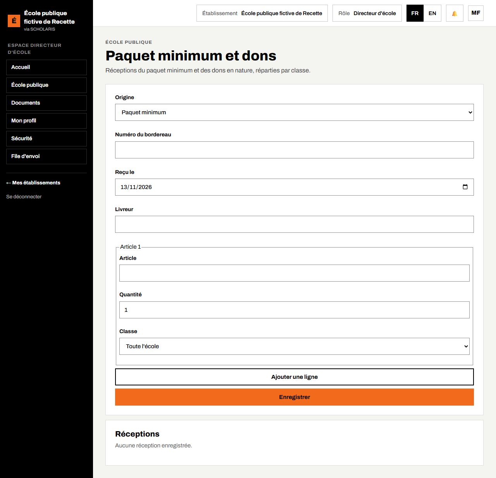

# 09. APEE et paquet minimum

## 9.1 Principes

L'**APEE** (association des parents d'élèves et des enseignants) a ses **comptes séparés** de l'école.

**La cotisation APEE est volontaire** : elle n'a **aucun effet** sur l'inscription, la présence, les bulletins ni les documents des élèves. Aucune contribution n'est exigible au primaire public (circulaire du 7 mars 2022).

**Qui fait quoi**

| Tâche | Qui |
|---|---|
| Vote du montant, encaissements, dépenses, état financier | Bureau de l'APEE (président, trésorier) |
| Consultation des comptes | Directeur (lecture seule) |
| Liste des familles non contributrices | Bureau de l'APEE seulement (jamais les enseignants) |

**Où** : **École publique > APEE** (`/ecole-publique/apee`).

## 9.2 Enregistrer le montant voté en assemblée générale

1. **Année scolaire (AAAA-AAAA)** : exemple 2026-2027.
2. Dans **Montant voté en assemblée générale** : **Montant par élève (FCFA)**, **Date de l'assemblée**, **Référence du compte rendu**.
3. Cliquez sur **Enregistrer le vote**. « Vote enregistré. »

## 9.3 Encaisser une cotisation et remettre le reçu

1. Dans **Nouvel encaissement ou nouvelle dépense**, choisissez le **Sens** **Encaissement** et la **Catégorie** **Contribution**.
2. **Rechercher l'élève (nom)** : tapez le nom puis Entrée ; choisissez l'**Élève**.
3. **Montant (FCFA)** et **Moyen** : **Espèces**, **Mobile money** (saisissez la **Référence de la transaction de l'opérateur**) ou **Banque**.
4. Cliquez sur **Enregistrer**.

Le message « Reçu n° … émis, SMS envoyé au parent. » s'affiche. Le reçu est au nom du **parent payeur**. Le bouton **Reçu** de l'opération l'affiche pour impression.

## 9.4 Enregistrer une dépense

1. **Sens** : **Dépense** ; **Catégorie** : **Maîtres des parents**, **Entretien et réparations**, **Petit matériel**, **Examens blancs** ou **Autre dépense**.
2. **Libellé**, **Montant (FCFA)**, **Référence de la pièce justificative**.
3. **Enregistrer**.

Sans pièce justificative, la dépense reste « **en attente de pièce** » : cliquez plus tard sur **Joindre la pièce**.

## 9.5 L'état financier

Le cadre **État financier** donne : **Attendu**, **Encaissé**, **Dépenses**, **Dépenses en attente de pièce**, **Solde**, et le nombre de **familles contributrices / non contributrices / exonérées**. **Émettre l'état financier (PDF)** produit le document à présenter en assemblée générale.

La liste **Familles non contributrices** est visible du trésorier et du président seulement.

Le directeur consulte les comptes **en lecture seule**.

## 9.6 Paquet minimum et dons

**Où** : **École publique > Paquet minimum et dons** (`/ecole-publique/paquet-minimum`).

1. **Origine** : **Paquet minimum** ou **Don en nature**.
2. **Numéro du bordereau**, **Reçu le**, **Livreur**.
3. Pour chaque article : **Article**, **Quantité**, et la classe destinataire (ou **Toute l'école**).
4. Enregistrez. La liste **Réceptions** garde l'historique ; **Bordereau (PDF)** l'imprime.
