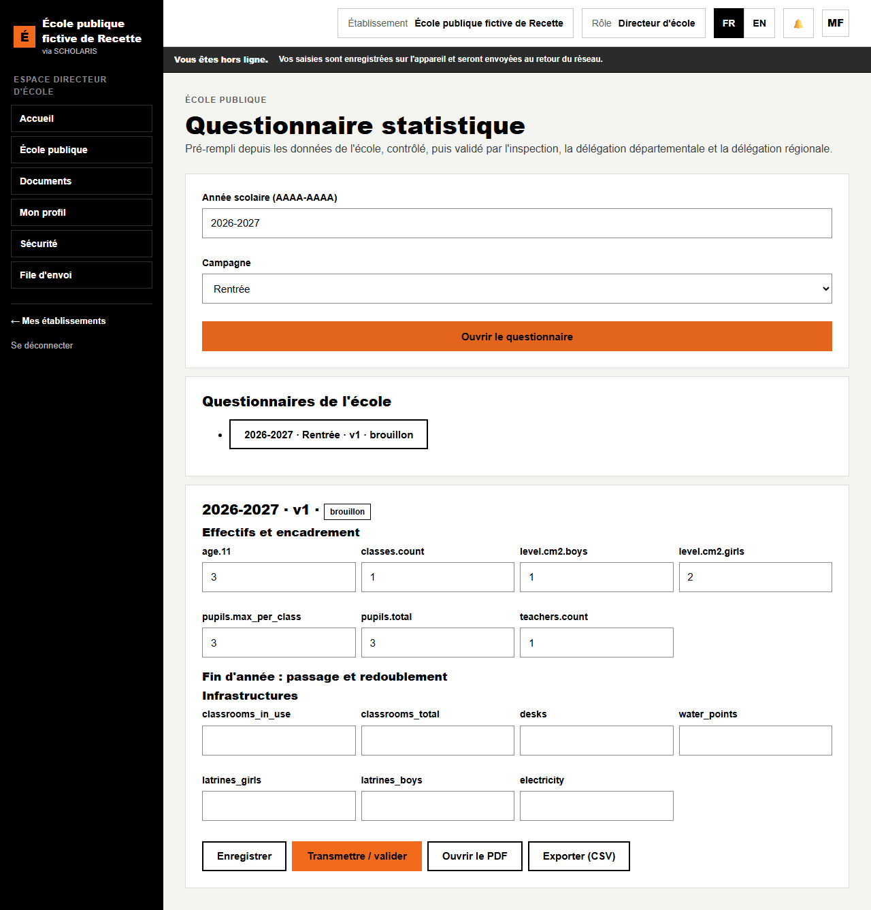

# 10. Questionnaire statistique

**Où** : **École publique > Questionnaire statistique** (`/ecole-publique/statistiques`).

Le questionnaire statistique de l'école est **pré-rempli** depuis les données de l'école (effectifs, enseignants, infrastructure, fin d'année), **contrôlé**, puis **validé** par l'inspection, la délégation départementale et la délégation régionale.

**Qui fait quoi**

| Tâche | Qui |
|---|---|
| Ouvrir, compléter, transmettre | Directeur (ou l'agent de saisie de l'inspection, par procuration) |
| Valider ou renvoyer | Inspection, délégation départementale, délégation régionale |
| Consolider | Division de la planification |

## 10.1 Ouvrir le questionnaire

1. Choisissez l'**Année** et la **Campagne** : **Rentrée** ou **Fin d'année**.
2. Cliquez sur **Ouvrir le questionnaire**. Les valeurs connues sont déjà remplies.

## 10.2 Compléter et contrôler

1. Vérifiez chaque section et complétez les cases vides.
2. Cliquez sur **Enregistrer**. « Valeurs enregistrées. »
3. Les **Contrôles de cohérence** s'affichent :
   - **à corriger** (bloquant) : par exemple le total par âge différent du total par niveau, une valeur négative, l'année d'infrastructure manquante ;
   - **à justifier** : par exemple une classe au-dessus du plafond, trop d'élèves par salle, une école sans enseignant. Saisissez la **Justification**.

## 10.3 Transmettre et valider

1. Quand il ne reste rien **à corriger**, cliquez sur **Transmettre / valider**. « Questionnaire transmis au niveau suivant. »
2. L'inspection, puis la délégation départementale, puis la délégation régionale valident à leur tour avec le même bouton. Chacun peut **Renvoyer à l'école** avec un motif.
3. Après la validation régionale, le questionnaire est **gelé**. Une erreur se corrige par **Corriger (nouvelle version)**, avec un motif.

L'état du questionnaire : **brouillon**, **renvoyé**, **en validation**, **gelé (validation régionale)**, **consolidé**.

**Exporter (CSV)** et **Imprimer** donnent le questionnaire au format du gabarit.
