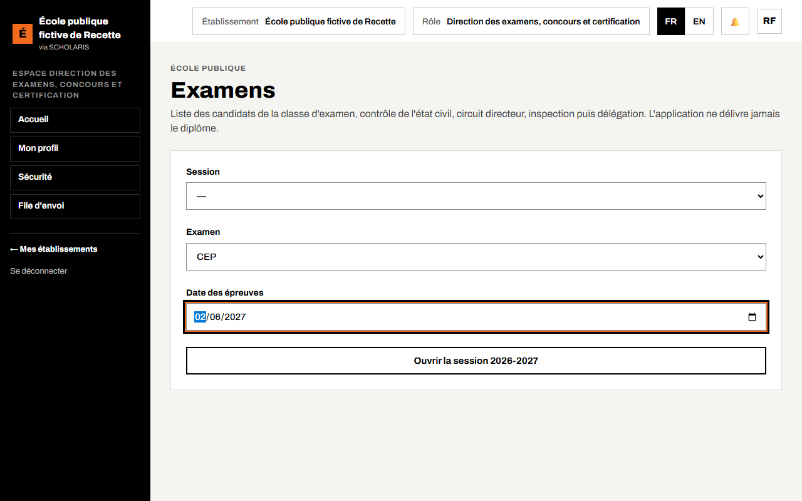
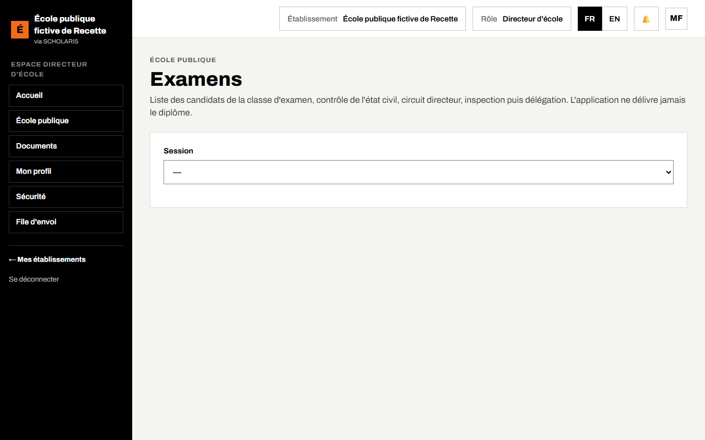
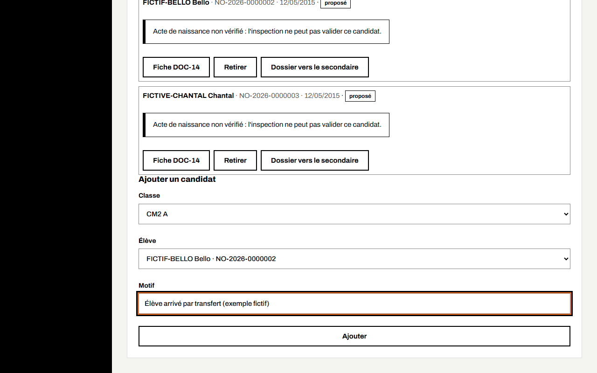
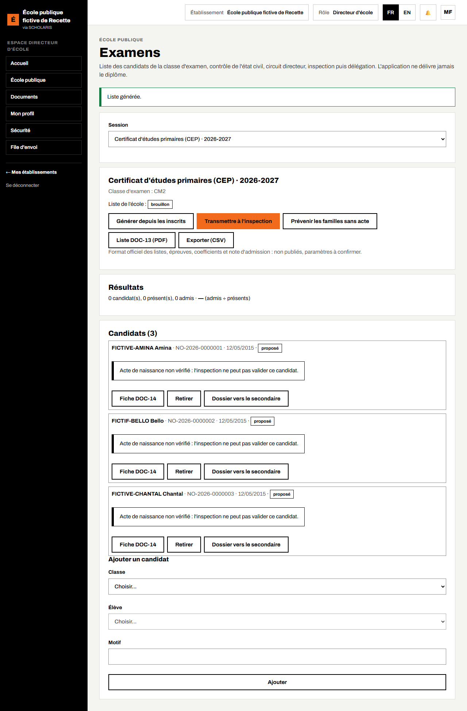
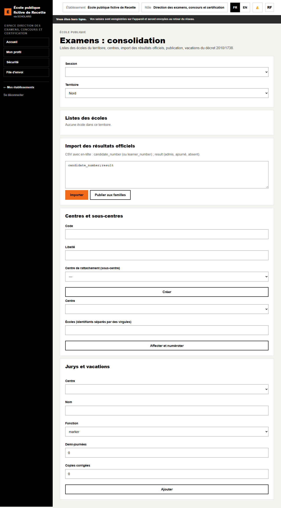

# 11. Examens : CEP, FSLC et entrée en 6e

L'application prépare les **listes de candidats** au **CEP** (francophone), au **FSLC** (anglophone), au concours d'**entrée en 6e** et au **Common Entrance**. Elle suit le contrôle de l'état civil, le circuit de validation et les résultats officiels.

**L'application ne délivre jamais le diplôme.** Le format officiel des listes, les épreuves, les coefficients et la note d'admission ne sont pas publiés : ce sont des paramètres « à confirmer ».

**Qui fait quoi**

| Tâche | Qui |
|---|---|
| Ouvrir la session de l'année | Direction des examens ou délégation départementale |
| Générer la liste, la transmettre, prévenir les familles sans acte | Directeur d'école |
| Contrôler l'état civil, valider ou renvoyer la liste | Inspection d'arrondissement |
| Valider (gel de la liste), centres, import des résultats, publication, attestations | Délégation départementale, direction des examens |

## 11.1 Ouvrir la session

**Où** : **École publique > Examens** (`/ecole-publique/examens`).

1. Choisissez l'**Examen** (CEP, FSLC, **Entrée en 6e**, Common Entrance).
2. Saisissez la **Date des épreuves**.
3. Cliquez sur **Ouvrir la session …** (le bouton indique l'année, par exemple « Ouvrir la session 2026-2027 »).

**Qui** : la direction des examens (niveau national) ou la délégation départementale. La direction des examens lit l'année scolaire en cours pour la proposer sur le bouton ; elle ne voit aucune donnée nominative d'élève avant la transmission des listes.

Une fois la session ouverte, chaque directeur d'école la retrouve dans son écran **Examens** (11.2).

## 11.2 La liste de l'école (directeur)

1. Choisissez la **Session**. L'écran rappelle la **Classe d'examen** (CM2 ou Class 6) et l'état de la **Liste de l'école** (**pas encore générée**, **brouillon**, **transmise**, **contrôlée par l'inspection**, **validée par la délégation**, **renvoyée**).
2. Cliquez sur **Générer depuis les inscrits**. « Liste générée. » Les élèves de la classe d'examen deviennent candidats.
3. Vérifiez chaque candidat : **Acte de naissance vérifié** ou « Acte de naissance non vérifié : l'inspection ne peut pas valider ce candidat. »
4. **Prévenir les familles sans acte** : un SMS part aux familles concernées (une seule fois par candidat).
5. **Retirer** un candidat avec un **Motif du retrait** ; **Ajouter un candidat** si besoin (voir ci-dessous).

### Ajouter un candidat

Sous la liste, le cadre **Ajouter un candidat** se remplit sans aucun identifiant à saisir :

1. Choisissez la **Classe** : seules les classes des niveaux de l'examen sont proposées (toutes les classes à défaut).
2. Choisissez l'**Élève** par son nom dans la liste nominative de la classe, triée, avec son numéro d'apprenant. « Aucun élève inscrit dans cette classe. » signale une classe vide.
3. Indiquez le **Motif** (obligatoire une fois la liste gelée), puis **Ajouter**. « Candidat ajouté. »

6. Cliquez sur **Transmettre à l'inspection**. « Liste transmise. »

Documents : **Liste DOC-13 (PDF)** (examens) ou **DOC-15** (concours), **Fiche DOC-14** de chaque candidat (avec un cadre « photo à coller »), **Exporter (CSV)**.

## 11.3 Le contrôle de l'inspection

L'inspecteur ouvre la même liste :

- **Valider la liste** : les candidats dont l'acte est vérifié sont **validés**, les autres **bloqués** (« n candidat(s) validé(s), n bloqué(s) faute d'acte vérifié »).
- Ou **Renvoyer au directeur** avec un **Motif du renvoi**.

## 11.4 La délégation : gel, centres, résultats

**Où** : **Examens : consolidation** (`/ecole-publique/examens/consolidation`).

- **Listes des écoles** du **Territoire** : validés, bloqués, proposés. La validation de la délégation **gèle** la liste ; après le gel, tout ajout ou retrait est motivé et compté.
- **Centres et sous-centres** : **Code**, **Libellé**, **Centre de rattachement**, puis **Créer** ; **Affecter et numéroter** les candidats (numéros du type `<code centre>-0001`).
- **Import des résultats officiels** : fichier CSV (colonnes numéro de candidat et résultat : admis, ajourné, absent), **Importer**. Les lignes rejetées sont listées avec leur motif.
- **Publier aux familles** : « Résultats publiés. » L'école voit ses résultats seulement après la publication.
- **Jurys et vacations** : intervenants, demi-journées, copies corrigées ; totaux selon le décret 2010/1738.

Le **taux de réussite** = admis ÷ présents.

## 11.5 Après les résultats

- **Relevé DOC-17 (PDF)** : les résultats de l'école.
- **Préparer les attestations** (délégation) pour les admis du CEP ou du FSLC ; le délégué départemental **Saisit la signature**. L'attestation « ne tient pas lieu de diplôme ».
- **Dossier vers le secondaire** : dossier signé de l'élève à remettre au collège ou au lycée d'accueil.
