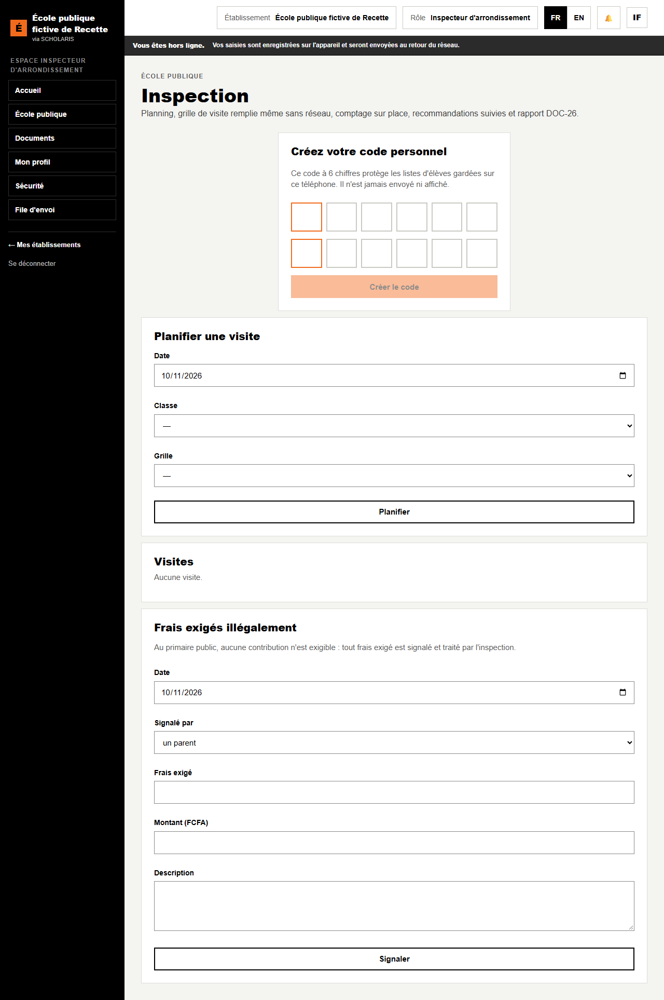
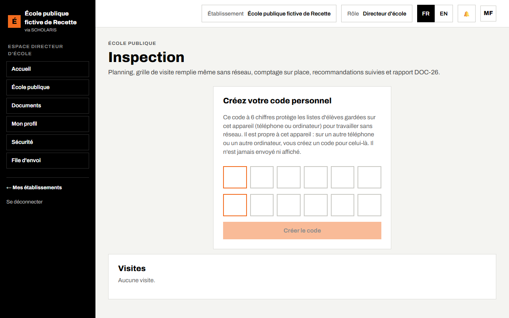
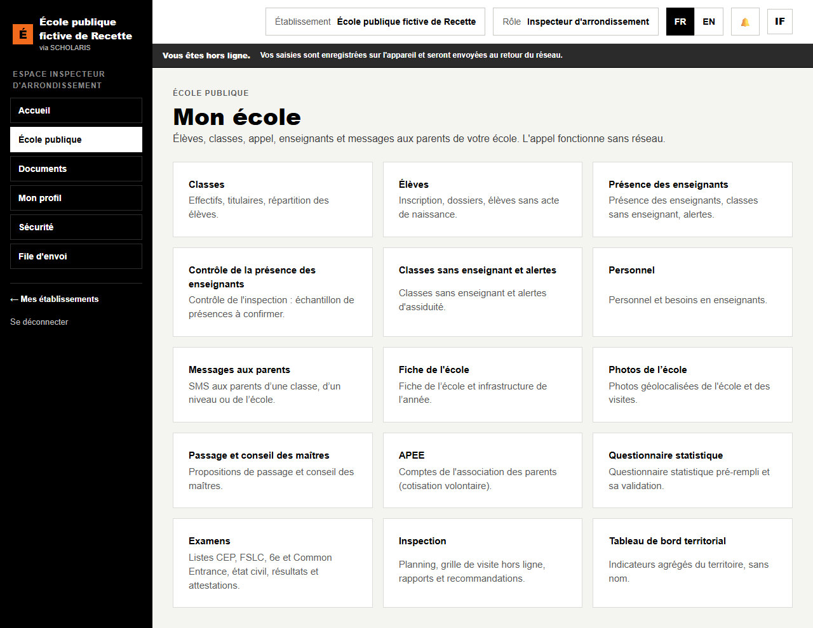

# 12. Inspection

**Qui** : inspecteur d'arrondissement, conseillers pédagogiques (visites) ; directeur (lecture des rapports de son école) ; enseignant (visites de sa classe). **Où** : **École publique > Inspection** (`/ecole-publique/inspection`).

« Planning, grille de visite remplie même sans réseau, comptage sur place, recommandations suivies et rapport DOC-26. »

## 12.1 Les grilles de visite

Les grilles sont réglées au niveau national. Tant que la grille officielle n'est pas chargée, **Importer la grille d'exemple (à valider)** (préparation, déroulement, évaluation, tenue des registres).

## 12.2 Planifier une visite

1. Dans **Planifier une visite**, choisissez l'école, la **Classe**, la **Date** et la **Grille**.
2. Cliquez sur **Planifier**. « Visite planifiée. »

## 12.3 Faire la visite, même sans réseau

1. Ouvrez la grille **avant de partir**, avec le réseau : elle est gardée dans le coffre chiffré de l'appareil.
2. Sur place, dans la liste **Visites**, cliquez sur **Remplir**.
3. **Élèves comptés sur place** : comptez les élèves présents. L'application compare avec le registre (« Comptés : … · registre : … · écart : … % »).
4. Remplissez chaque rubrique de la grille et les **Observations**.
5. **Suivi des recommandations précédentes** : pour chacune, **réalisée**, **en cours** ou **non réalisée**.
6. **Nouvelles recommandations (une par ligne)**.
7. Cliquez sur **Enregistrer le rapport**.

Sans réseau : « Rapport gardé sur l'appareil, envoyé dès le retour du réseau. » Le cadre **Rapports en attente** propose **Renvoyer maintenant** ou **Abandonner**. Un rapport déjà envoyé pour une visite n'est jamais écrasé.

Une fois envoyé, le **Rapport DOC-26** est émis et le directeur est prévenu.

## 12.4 Frais exigés illégalement

Au primaire public, **aucune contribution n'est exigible** : tout frais exigé est signalé et traité par l'inspection.

1. Dans **Frais exigés illégalement**, saisissez le **Frais exigé**, le **Montant (FCFA)**, la date, la **Description** et qui l'a signalé (**un parent**, **l'inspection**, **un enseignant**, **autre**).
2. Cliquez sur **Signaler**.
3. L'inspection traite : **Instruire**, **Confirmer** ou **Classer**, avec la **Suite donnée**.

## 12.5 Ce que voit l'école

Le directeur lit les visites et les rapports de son école. L'enseignant lit les visites de sa classe seulement.

