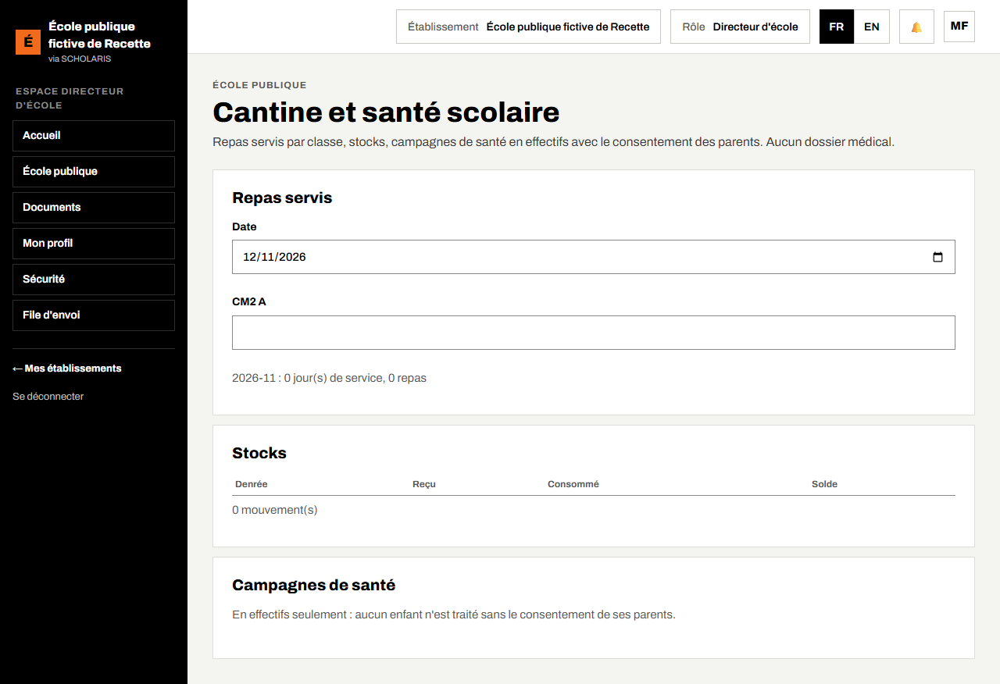

# 13. Cantine et santé scolaire

**Qui** : responsable de la cantine (saisie) ; directeur (lecture) ; agent de santé scolaire (campagnes). **Où** : **École publique > Cantine** (`/ecole-publique/cantine`).

« Repas servis par classe, stocks, campagnes de santé en effectifs avec le consentement des parents. **Aucun dossier médical.** »

## 13.1 Repas servis

1. Dans **Repas servis**, choisissez le **Jour**.
2. Pour chaque classe, saisissez le nombre de repas servis.
3. Enregistrez. « Enregistré. »

Si le nombre dépasse l'effectif de la classe, l'écran prévient : « Repas servis supérieurs à l'effectif de la classe : vérifiez la saisie. » La saisie n'est pas refusée.

La synthèse du mois indique le nombre de jours de service et le total des repas.

## 13.2 Stocks

1. Dans **Stocks**, choisissez la **Denrée** et l'**Unité**.
2. **Mouvement** : **entrée** (avec la **Provenance**) ou **sortie**.
3. Saisissez la **Quantité**, puis enregistrez.

Le tableau donne, par denrée : **Reçu**, **Consommé**, **Solde**. Une sortie supérieure au solde est refusée.

## 13.3 Campagnes de santé

**En effectifs seulement : aucun enfant n'est traité sans le consentement de ses parents.**

1. Dans **Campagnes de santé**, choisissez la **Campagne** : **Déparasitage**, **Vaccination**, **Moustiquaires**, **Vitamine A** ou **Autre**.
2. Saisissez la date, les **Filles traitées**, les **Garçons traités**, les **Consentements des parents** et les **Refus**.
3. Enregistrez.

Le nombre de traités ne peut pas dépasser le nombre de consentements. Aucun nom d'enfant n'est saisi.
