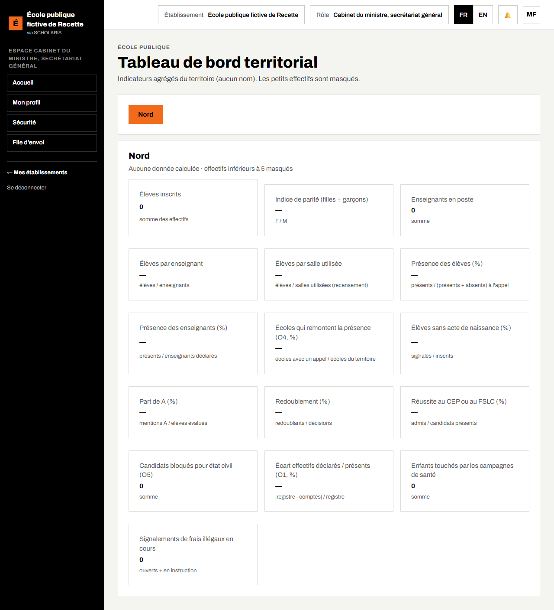
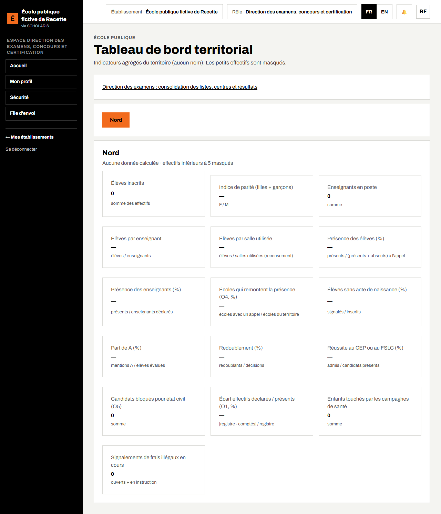
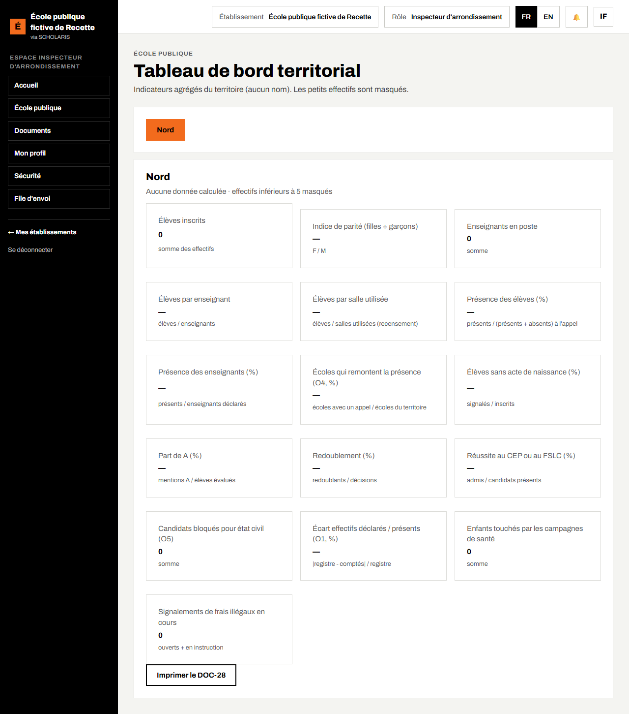

# 14. Tableau de bord territorial

**Qui** : inspection, délégations départementale et régionale, direction des examens, planification, cabinet, partenaires techniques. **Où** : **Tableau de bord territorial** (`/tableau-de-bord-territorial`).

« Indicateurs agrégés du territoire (aucun nom). Les petits effectifs sont masqués. »

## 14.1 Choisir le territoire

- **Rôle national** (cabinet, planification, direction des examens) : choisissez la **Région**, puis le **Département** et l'**Arrondissement** dans les listes, puis **Afficher**.
- **Rôle territorial** (inspecteur, délégué) : votre territoire s'affiche directement ; les boutons des **Territoires rattachés** permettent de descendre.

## 14.2 Lire les indicateurs

La date des données est indiquée (« Données au … »). Les indicateurs comprennent notamment :

- les effectifs par niveau et par sexe, la **parité filles-garçons** ;
- les **élèves par enseignant** et les **élèves par salle utilisée** ;
- les élèves **sans acte de naissance** ;
- la **présence des élèves** et la **présence des enseignants** (%), et la part des **écoles qui remontent la présence** ;
- la part des mentions **A**, le **redoublement**, la **réussite aux examens** ;
- l'**écart de comptage** constaté par l'inspection, les **campagnes de santé**, les **frais signalés**.

Une case calculée sur un trop petit effectif affiche **masqué** (« effectifs inférieurs à n masqués ») : c'est voulu, pour protéger les élèves.

**Imprimer le DOC-28** produit le tableau de bord imprimable.

## 14.3 Entrée de la direction des examens

Pour la direction des examens, le tableau de bord affiche le lien **Direction des examens : consolidation des listes, centres et résultats** vers l'écran du chapitre 11.

