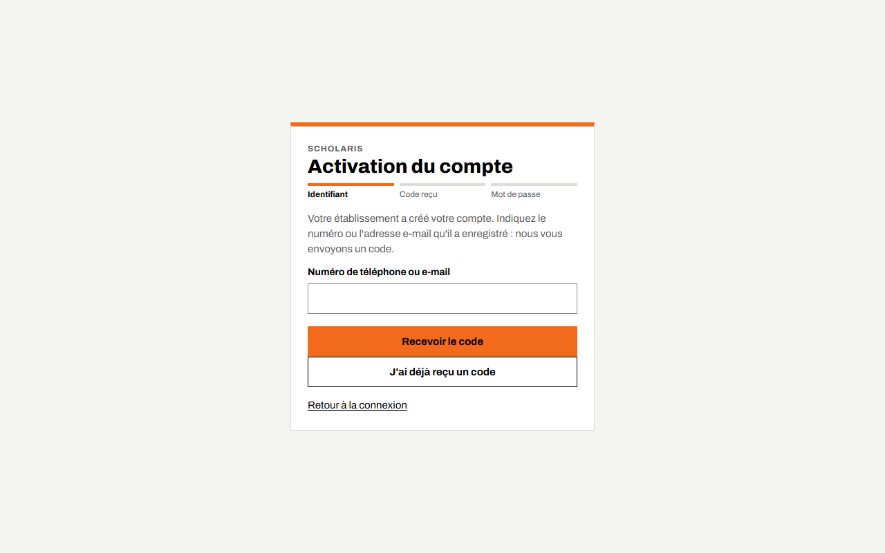
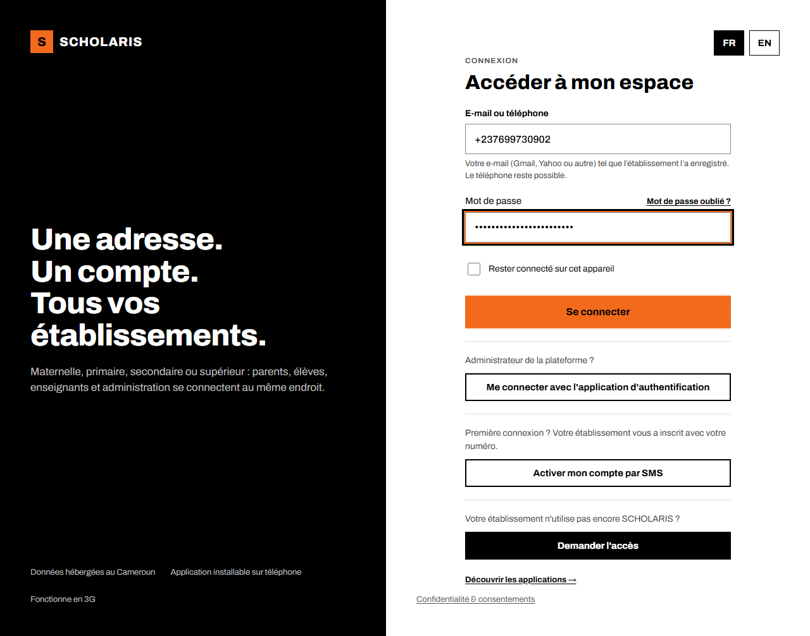
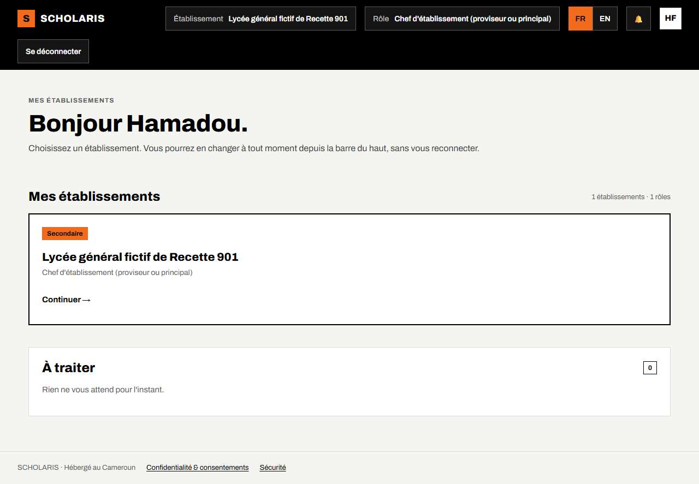
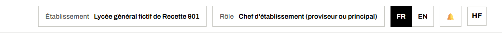
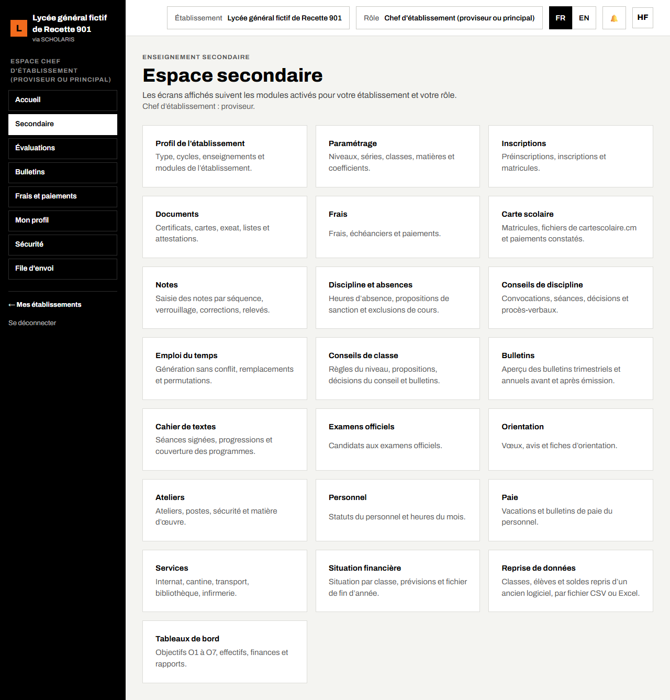
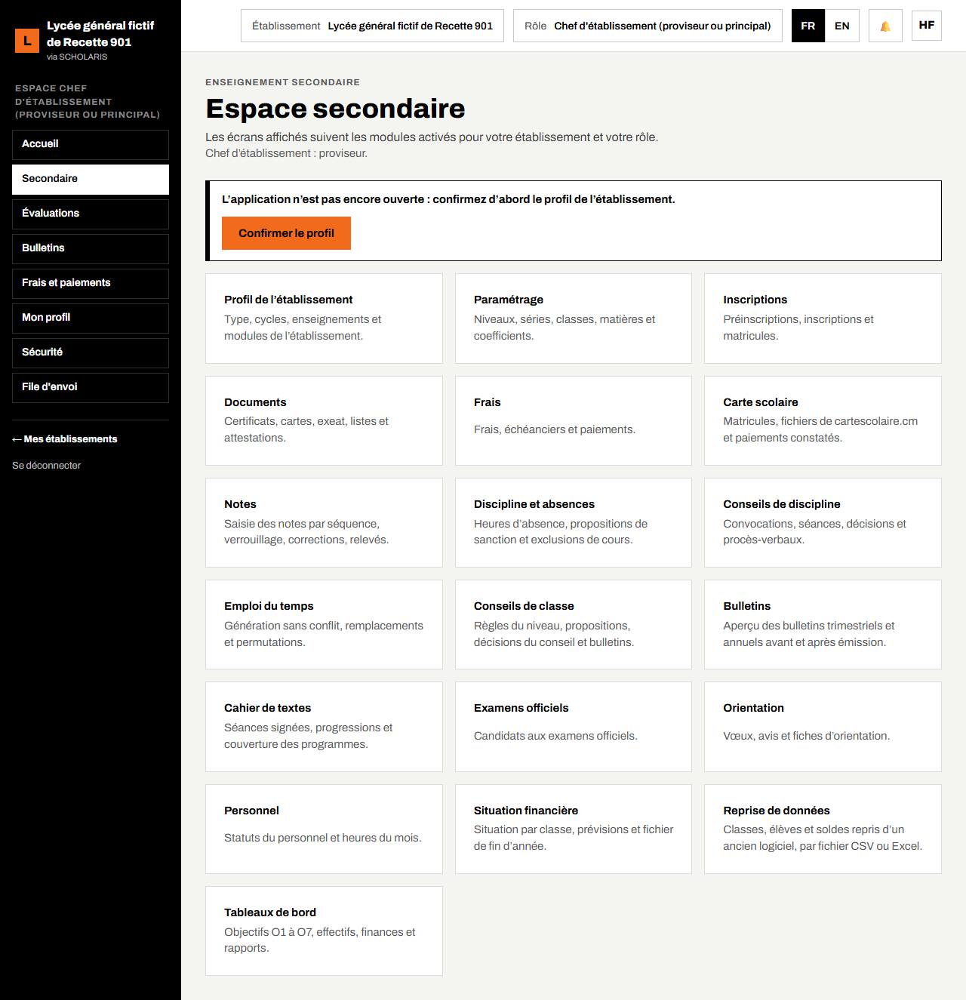

# 01. Premiers pas

Ce chapitre explique comment activer votre compte, vous connecter, choisir votre établissement et votre rôle, changer de langue et vous repérer dans l'application **Secondaire**.

**Qui** : tout le monde.

## 1.1 Activer votre compte (première fois)

Votre établissement crée votre compte avec votre **numéro de téléphone** (ou votre adresse e-mail). Vous choisissez vous-même votre mot de passe.

1. Ouvrez **https://scholariserp.trugroup.cm** sur votre téléphone ou votre ordinateur.
2. Sous le formulaire de connexion, cliquez sur **Activer mon compte par SMS**.
3. Saisissez le numéro que l'établissement a enregistré, puis cliquez sur **Recevoir le code**.
4. Vous recevez un **code à 6 chiffres** par SMS. Saisissez-le, puis cliquez sur **Vérifier le code**.
5. Choisissez votre mot de passe (**10 caractères au minimum**), confirmez-le, puis cliquez sur **Enregistrer le mot de passe**.
6. Message : « Votre mot de passe est enregistré. Vous pouvez vous connecter. » Cliquez sur **Aller à la connexion**.

Rien reçu ? Attendez une minute, puis cliquez sur **Renvoyer le SMS**, ou choisissez **Recevoir par e-mail** si l'établissement a enregistré votre adresse.

## 1.2 Se connecter

1. Ouvrez **https://scholariserp.trugroup.cm/connexion**.
2. Dans **Numéro de téléphone ou e-mail**, saisissez votre numéro (par exemple +237 6xx xx xx xx).
3. Dans **Mot de passe**, saisissez votre mot de passe.
4. Cochez **Rester connecté sur cet appareil** seulement sur un appareil personnel.
5. Cliquez sur **Se connecter**.

Après plusieurs mots de passe faux, la connexion est bloquée quelques minutes : « Nouvel essai possible dans … ». Attendez, ou utilisez **Mot de passe oublié ?** : vous recevez un code par SMS pour choisir un nouveau mot de passe (mêmes étapes que l'activation).

## 1.3 Choisir son établissement

Après la connexion, l'écran **Mes établissements** affiche une carte par établissement où vous avez un rôle. Cliquez sur **Continuer** sous l'établissement voulu.

Si vous travaillez dans plusieurs établissements, vous en changez à tout moment avec la liste **Établissement** de la barre du haut, sans vous reconnecter. Si vous avez plusieurs rôles (par exemple enseignant et professeur principal), la liste **Rôle** vous permet de passer de l'un à l'autre : les menus changent avec le rôle.

## 1.4 La barre du haut et la langue

De gauche à droite :

- **Établissement** : l'établissement ouvert ;
- **Rôle** : votre rôle actif ;
- **FR / EN** : la langue de l'interface. Cliquez sur **EN** pour passer en anglais (section anglophone), sur **FR** pour revenir au français. Le choix est gardé sur l'appareil ;
- la **cloche** : vos notifications et les envois en attente (saisies faites sans réseau) ;
- vos **initiales**.

Sur téléphone, le menu de gauche est replié : touchez le bouton **☰** en haut à gauche pour l'ouvrir.

## 1.5 L'accueil « Espace secondaire »

Dans le menu de gauche, cliquez sur **Secondaire**. L'écran **Espace secondaire** affiche une carte par rubrique. Cliquez sur une carte pour l'ouvrir.

**Vous ne voyez que les cartes de votre rôle**, et seulement celles des modules activés pour votre établissement (par exemple, **Ateliers** n'apparaît que si le module est actif). Le chef d'établissement voit presque tout ; un enseignant voit **Notes**, **Emploi du temps**, **Cahier de textes**, **Discipline et absences** et **Espace enseignant**.

Le titre du chef d'établissement (**proviseur** ou **principal**) est rappelé sous le titre. Il se règle dans le profil de l'établissement (chapitre 02).

### Avant l'ouverture

Tant que le profil de l'établissement n'est pas confirmé, l'accueil affiche : « L'application n'est pas encore ouverte : confirmez d'abord le profil de l'établissement. » Seuls le chef d'établissement et l'administrateur fonctionnel peuvent le faire, avec le bouton **Confirmer le profil** (chapitre 02).

## 1.6 Se déconnecter et sécurité

- Cliquez sur **Se déconnecter** en bas du menu de gauche, surtout sur un ordinateur partagé.
- **Un compte = une personne.** Ne prêtez jamais votre mot de passe.
- Le menu **Sécurité** vous permet de changer votre mot de passe et de voir vos sessions ouvertes.
- En cas de message d'erreur, notez la **Référence à communiquer au support**, l'heure et l'écran, puis prévenez l'administrateur fonctionnel de votre établissement.
