# 02. Ouverture et paramétrage

Ce chapitre explique comment ouvrir l'application pour votre établissement (profil), puis saisir les niveaux, les séries, les classes, les matières, les coefficients et les volumes horaires, les autorisations d'ouverture et le calendrier (trimestres et séquences).

**Où** : **Secondaire > Profil de l'établissement** (`/secondaire/profil`), **Secondaire > Paramétrage** (`/secondaire/parametrage`), **Administration > Autorisations** (`/administration/autorisations`) et **Administration > Années** (`/administration/annees`).

**Qui fait quoi**

| Tâche | Qui |
|---|---|
| Confirmer le profil, ouvrir l'application, changer un réglage du profil | Chef d'établissement, administrateur fonctionnel |
| Niveaux, séries, classes, matières, coefficients | Chef d'établissement ; le censeur peut compléter (droit d'écriture du paramétrage) |
| Autorisations d'ouverture, année scolaire, trimestres et séquences | Administrateur de l'établissement |
| Consulter | Censeur, intendant, promoteur, surveillant général (lecture du profil) |

**Rien n'est fixé à l'avance.** Les niveaux et valeurs proposés sont des **exemples à confirmer** : c'est l'établissement qui décide.

## 2.1 Ordre conseillé

1. L'administrateur crée l'**année scolaire** (par exemple 2026-2027) et ses **trimestres** et **séquences** (2.9).
2. Le chef d'établissement confirme le **profil** et ouvre l'application (2.2).
3. Il charge les **niveaux**, ouvre les **séries**, crée les **classes** (2.3 à 2.5).
4. L'administrateur déclare l'**autorisation d'ouverture** de chaque classe (2.8).
5. Le chef d'établissement saisit les **matières**, les **coefficients** et les **volumes horaires** (2.6).
6. Le chef d'établissement pose le **cycle des notes** (chapitre 07, onglet **Paramètres**).

Ensuite seulement, la scolarité peut inscrire les élèves (chapitre 03).

## 2.2 Confirmer le profil et ouvrir l'application

Le **type d'établissement** a été choisi lors de la demande d'accès (par exemple **Lycée d'enseignement général**, **Lycée technique**, **Collège d'enseignement secondaire**, **CETIC**, **Collège privé**, **Lycée privé** ou **Autre établissement**). Il propose des réglages de départ que vous vérifiez.

1. Ouvrez **Secondaire > Profil de l'établissement**, ou cliquez sur **Confirmer le profil** depuis l'accueil.
2. Vérifiez la **Propriété** : **Public**, **Privé laïc** ou **Privé confessionnel**. Cela change surtout les frais, la paie et les contrôles.
3. Cochez les **Cycles** (**Premier cycle**, **Second cycle**), l'**Enseignement** (**Général**, **Technique**) et les **Sections** (**Francophone**, **Anglophone**).
4. Choisissez le **Titre du chef d'établissement** : **proviseur** ou **principal**.
5. Cochez les **Modules** utiles. Ceux marqués « proposé pour ce type » sont cochés d'avance. Exemples : **Orientation**, **Examens officiels**, **Ateliers**, **Stages**, **Paie simplifiée**, **Internat**, **Cantine et transport**, **Bibliothèque**, **Infirmerie**.
6. Saisissez si vous le connaissez le **Code officiel de l'établissement**.
7. Cliquez sur **Ouvrir l'application**. Message : « L'application est ouverte avec ce profil. »

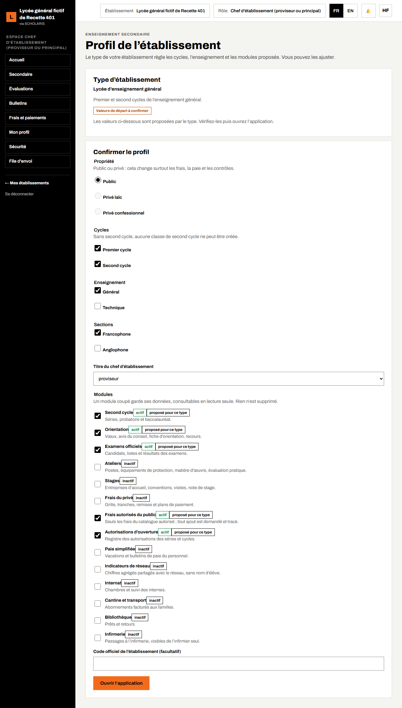

**Frais du public ou du privé** : un établissement public utilise le module **Frais autorisés du public** (seuls les frais d'un catalogue autorisé, chapitre 04). Un établissement privé utilise **Frais du privé** (grille, tranches, remises et plans de paiement).

### Changer un réglage plus tard

Après l'ouverture, l'écran montre les **Réglages actuels** et l'**Historique du profil**.

1. Modifiez la valeur (par exemple cochez le module **Infirmerie**).
2. Dans **Ce que vous changez**, choisissez la nature du changement (**Modules**, **Propriété**, **Cycles**…).
3. Saisissez le **Motif du changement**, puis cliquez sur **Enregistrer le changement**.

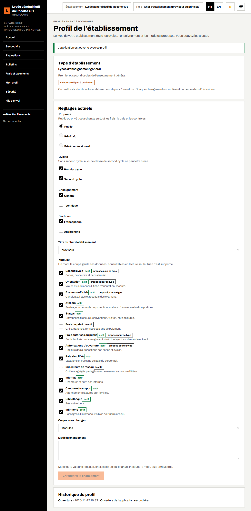

Un module coupé **garde ses données**, consultables en lecture seule. Rien n'est supprimé. On ne peut pas retirer un cycle qui porte déjà des classes.

## 2.3 Les niveaux

1. Ouvrez **Secondaire > Paramétrage**. Vérifiez l'**Année scolaire** en haut de l'écran.
2. Dans l'onglet **Niveaux**, cliquez sur **Charger les niveaux d'exemple**. Les niveaux de vos cycles apparaissent (Sixième à Troisième, Seconde à Terminale…), marqués **À confirmer**.
3. Pour chaque niveau : **Renommer** ou **Désactiver** si besoin.
4. Pour un niveau absent, remplissez **Ajouter un niveau** (**Code**, **Libellé**, **Cycle**, **Enseignement**, **Section**) puis cliquez sur **Ajouter**.

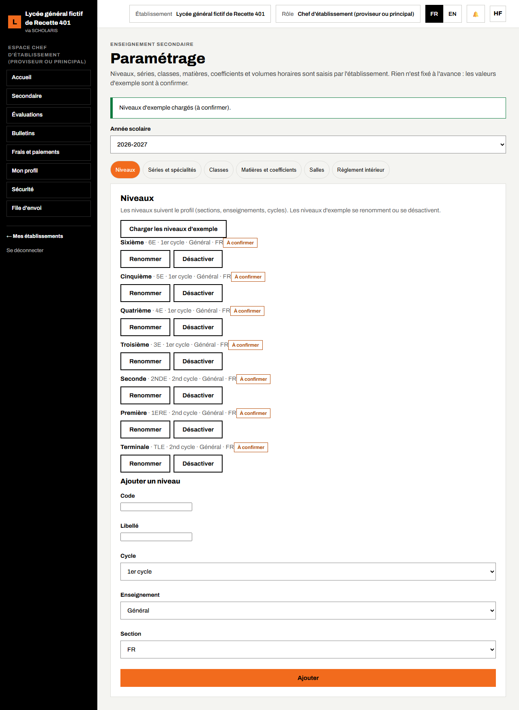

## 2.4 Les séries et spécialités

Au second cycle (et en enseignement technique), chaque classe appartient à une **série** ou une **spécialité** du catalogue du MINESEC (A4, C, D, TI, E, F…).

1. Onglet **Séries et spécialités**.
2. Dans **Série ou spécialité du catalogue**, choisissez la série (par exemple **C**).
3. Cliquez sur **Ouvrir**. Message : « Enregistré. »

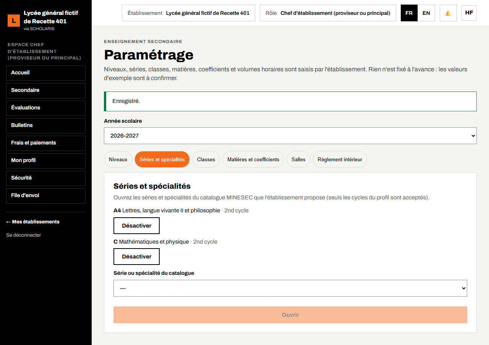

## 2.5 Les classes

1. Onglet **Classes**, formulaire **Créer une classe**.
2. Saisissez le **Libellé** (par exemple « 2nde A »), choisissez le **Niveau** et, au second cycle, la **Série ou spécialité** (obligatoire). Indiquez si vous voulez la **Capacité** (nombre de places).
3. Cliquez sur **Ajouter**.

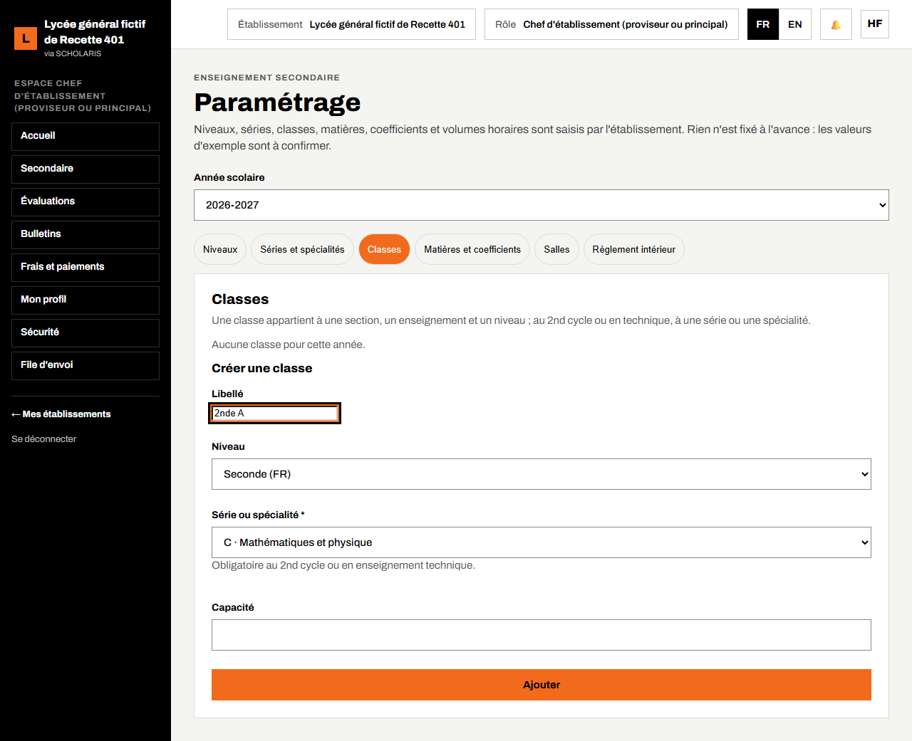

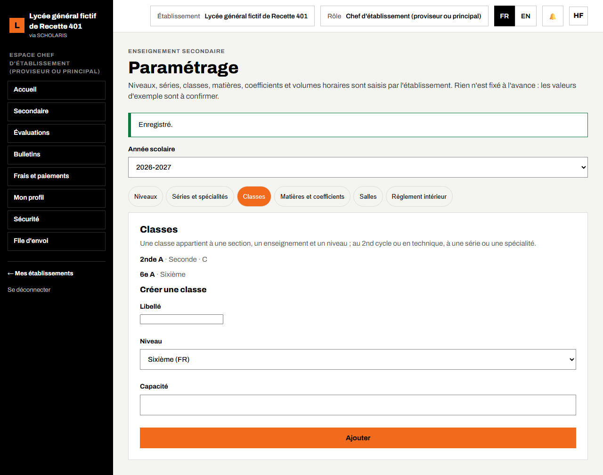

Une classe d'un cycle ou d'une section absents du profil est refusée.

## 2.6 Matières, coefficients et volumes horaires

Les coefficients et les heures par semaine sont **saisis par l'établissement**. Chaque modification crée une **nouvelle version** (date d'effet, auteur, motif) : l'ancienne reste visible.

1. Onglet **Matières et coefficients**.
2. Dans **Matières**, saisissez le **Code** (par exemple MATH) et le **Libellé** (Mathématiques), puis cliquez sur **Ajouter la matière**.
3. Dans **Saisir un coefficient**, choisissez le **Niveau**, la **Série ou spécialité** (ou **Tout le niveau**) et la **Matière**.
4. Saisissez le **Coefficient** et les **Heures par semaine**.
5. Choisissez le **Rôle de la matière** : **Officielle**, **Projet (hors moyenne)**, **Pratique** ou **Stage**. Une matière de projet ne compte pas dans la moyenne.
6. Choisissez l'**Origine** : **Exemple (à confirmer)**, **Propre à l'établissement** ou **Texte officiel** (la **Référence du texte** est alors exigée).
7. Saisissez la **Date d'effet** si besoin et le **Motif**, puis cliquez sur **Enregistrer la version**. Message : « Nouvelle version enregistrée. »

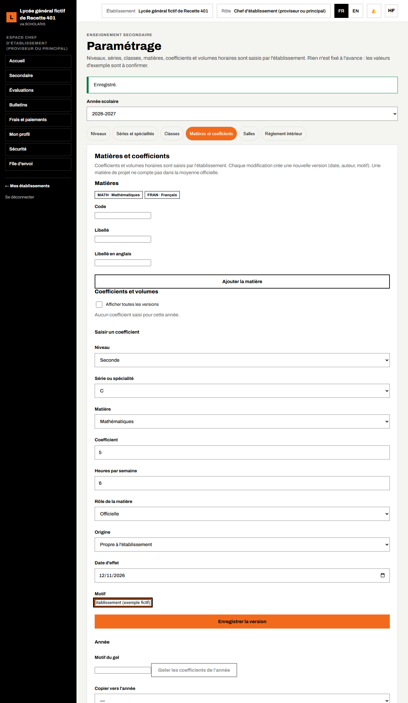

La liste affiche par exemple « MATH · Mathématiques — coef. 5 · 6 h/sem. ». Cliquez sur **Afficher toutes les versions** pour voir l'historique.

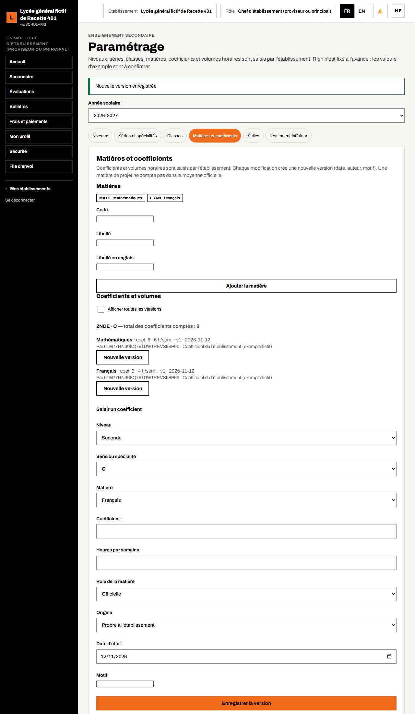

**En fin d'année** (bloc **Année**) : **Geler les coefficients de l'année** les fige définitivement (avec un motif) ; **Copier vers l'année** prépare l'année suivante.

## 2.7 Salles et règlement intérieur

- Onglet **Salles** : déclarez les salles de classe, laboratoires et ateliers (un atelier exige le module **Ateliers**), avec leurs **Équipements**.
- Onglet **Règlement intérieur** : règles propres à l'établissement (barème des absences et sanctions, âges d'admission, séquences par trimestre, distinctions, conditions de passage, délai de recours, test d'entrée du privé). Vide = aucune règle. Chaque règle est versionnée. La saisie se fait dans un format technique (JSON) : demandez l'aide de l'administrateur fonctionnel.

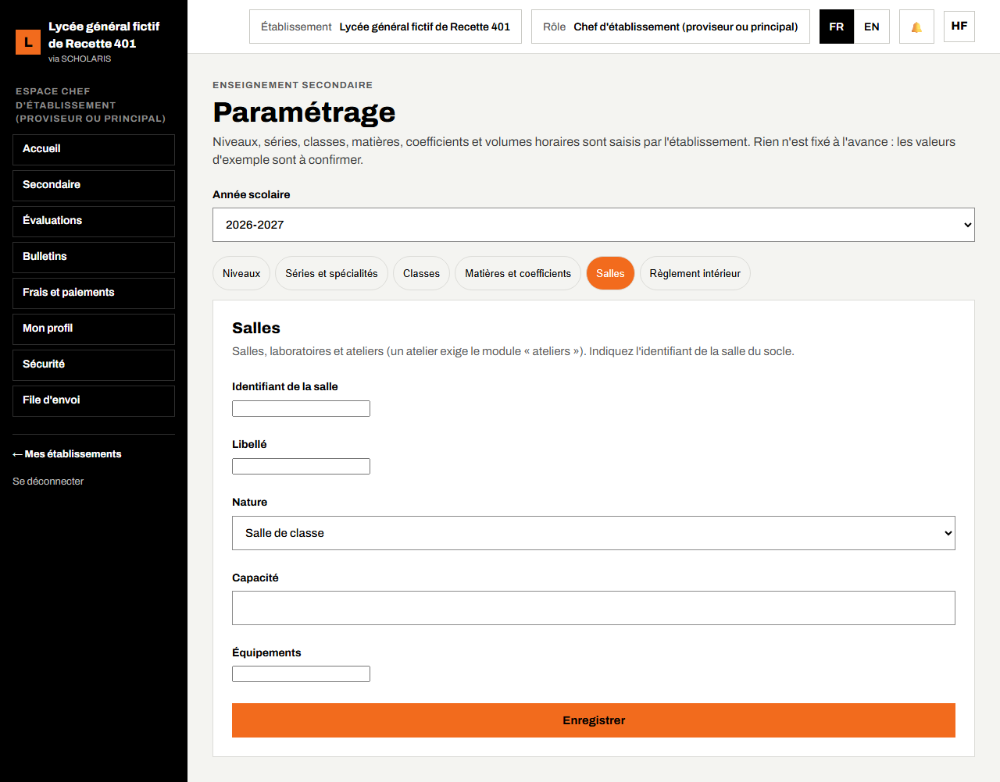

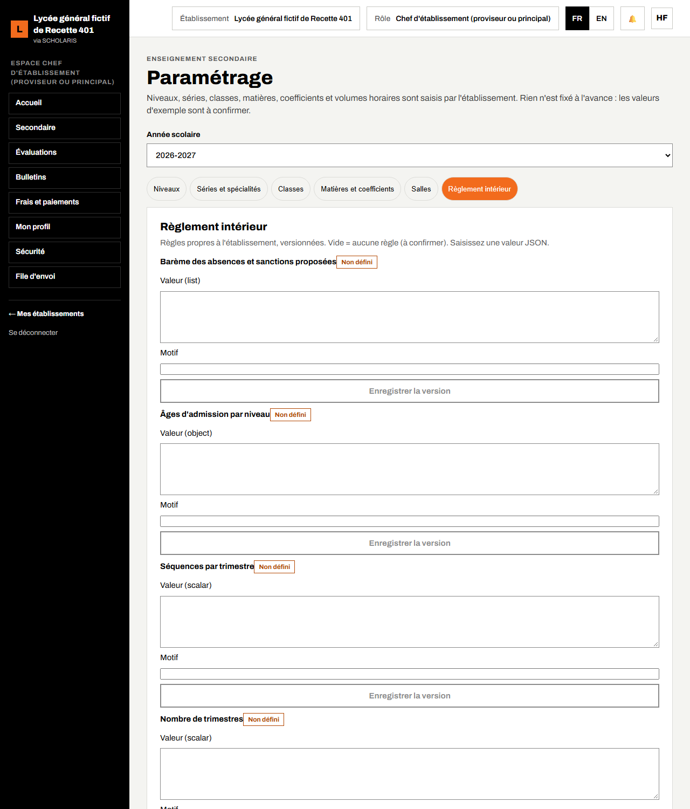

## 2.8 Autorisations d'ouverture

**Toute inscription exige une autorisation d'ouverture valide pour la classe** (public compris). Sans elle, l'inscription est refusée. Le module **Autorisations d'ouverture** est actif d'office dans les profils des établissements publics (lycée général, lycée technique, CES, CETIC) créés depuis cette version. Un établissement ouvert plus tôt l'active lui-même dans l'assistant de profil (section 2.1).

**Qui** : l'administrateur de l'établissement (rôle « Super administrateur » du client). **Où** : **Administration > Autorisations d'ouverture** (`/administration/autorisations`).

1. Dans **Classe, section ou filière**, choisissez la classe (par exemple 2nde A).
2. **Autorité** : MINESEC (ou l'autorité qui a signé l'acte).
3. **Référence de l'acte** : le numéro de l'arrêté ou de la décision.
4. **Valide du** et **Valide jusqu'au** : par exemple du 1er septembre au 31 août.
5. Cliquez sur **Déclarer**. Message : « Autorisation enregistrée. »

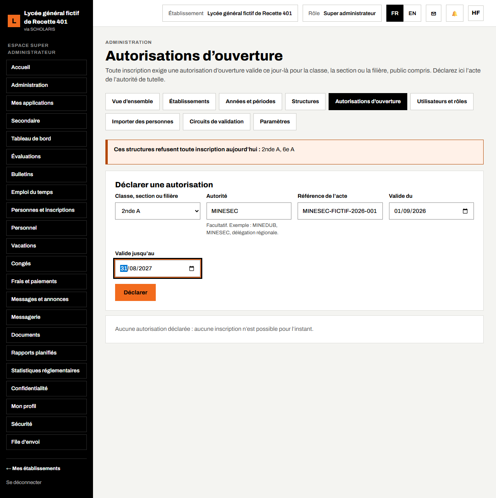

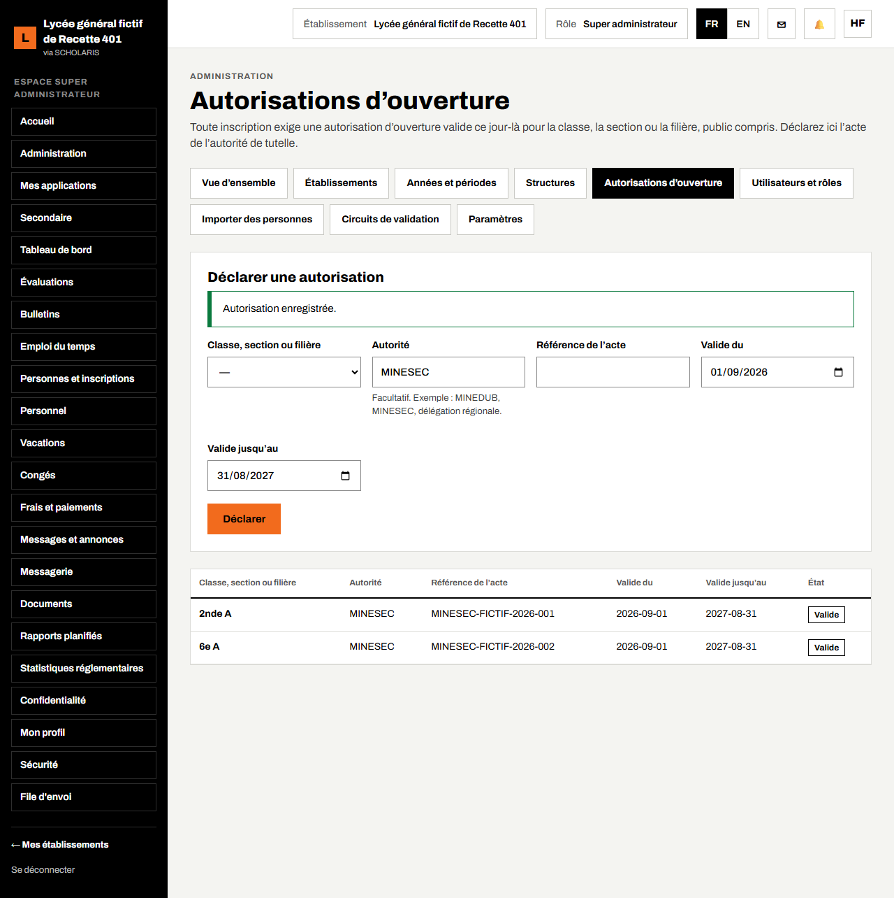

## 2.9 Calendrier : trimestres et séquences

**Qui** : l'administrateur de l'établissement. **Où** : **Administration > Années et périodes** (`/administration/annees`).

1. Si l'année n'existe pas, remplissez **Nouvelle année** (**Libellé** 2026-2027, **Début**, **Fin**) puis cliquez sur **Créer l'année**.
2. Cliquez sur **Gérer** sur la ligne de l'année scolaire. Le bloc **Périodes de 2026-2027** s'ouvre.
3. Dans **Nouvelle période**, choisissez la **Nature** **Trimestre**, le **Numéro** 1, le **Début** et la **Fin**, puis cliquez sur **Ajouter la période**.
4. Ajoutez ensuite les séquences du trimestre : **Nature** **Séquence**, **Rattachée à** **Trimestre 1** (« Une séquence appartient à un trimestre de l'année »), numéro, dates, puis **Ajouter la période**.
5. Recommencez pour les trimestres 2 et 3 et leurs séquences (deux séquences par trimestre, soit six séquences dans l'année, selon votre règlement).

Le bloc **Clôture** du bas de l'écran sert en fin d'année : il contrôle les notes non verrouillées, les bulletins non émis et les impayés, puis la clôture est demandée par une personne et approuvée par une autre.

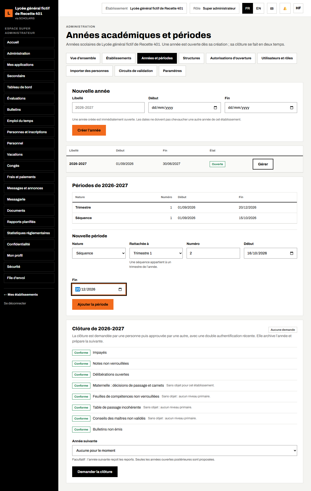

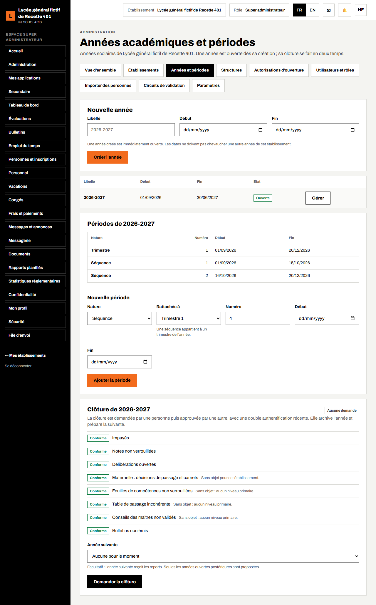

Les notes se saisissent par **séquence** ; le conseil de classe et le bulletin se font par **trimestre**.

## 2.10 Les comptes du personnel

**Où** : **Administration > Utilisateurs** (`/administration/utilisateurs`). L'administrateur crée la personne avec son téléphone et lui attribue son rôle (chef d'établissement, censeur, surveillant général, intendant, caissier, secrétaire de la scolarité, enseignant, professeur principal, infirmier…). La personne active ensuite son compte par SMS (chapitre 01). Voir le chapitre 17 pour ce que permet chaque rôle.

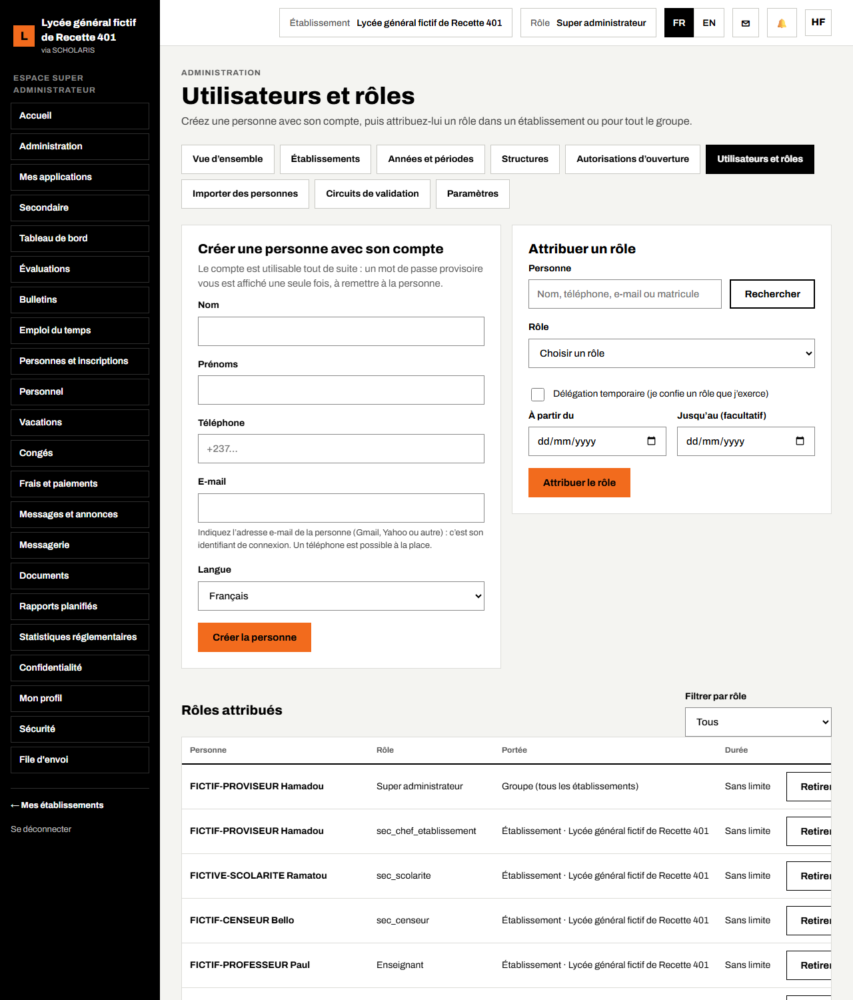
