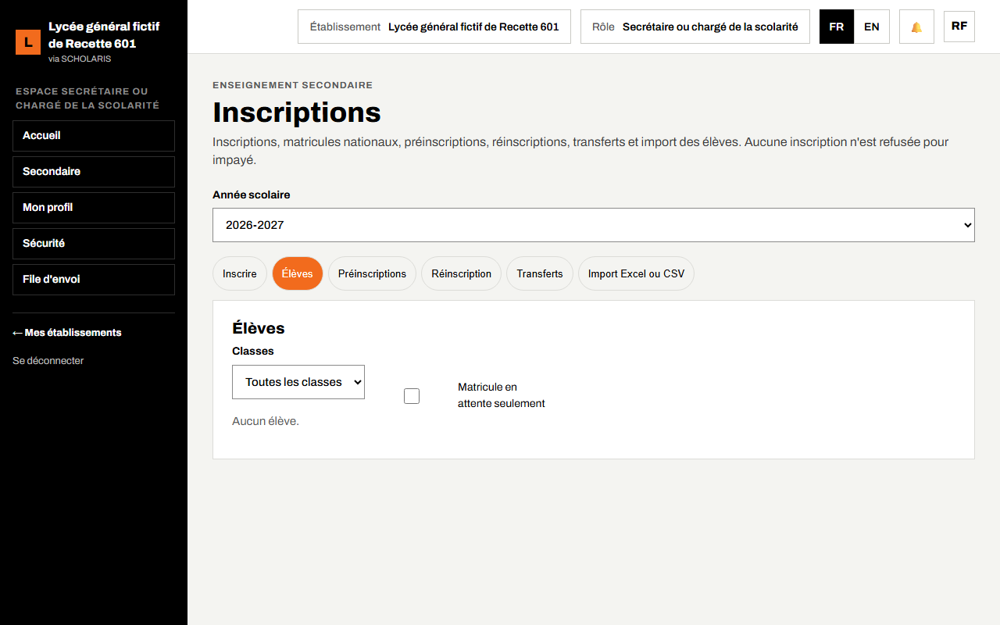
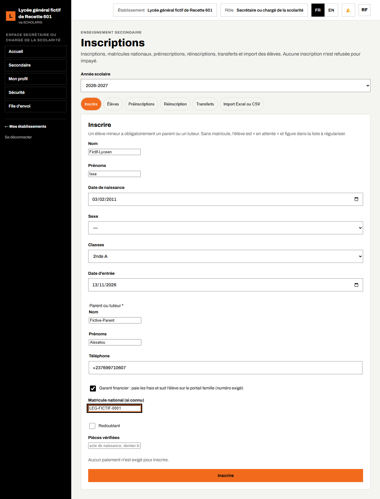
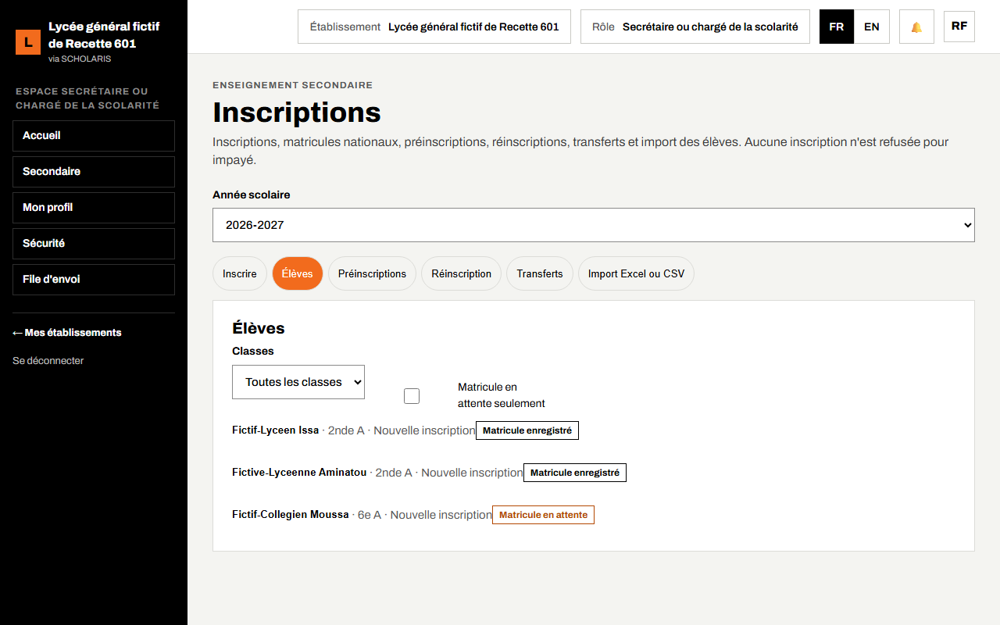
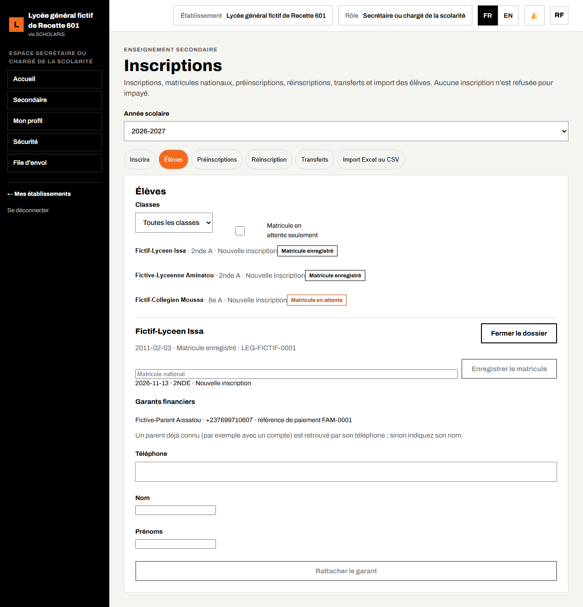
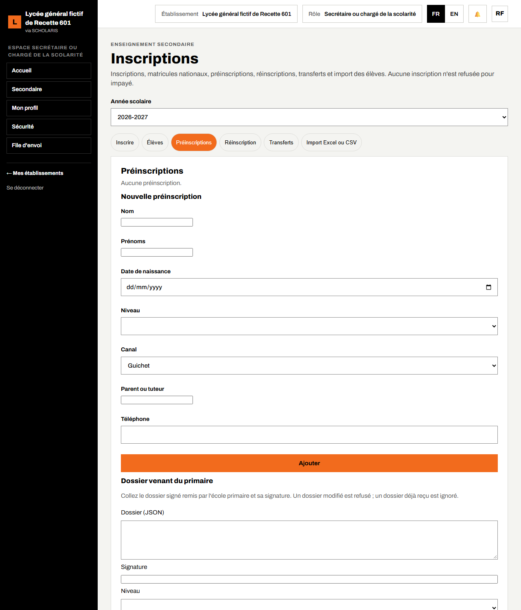
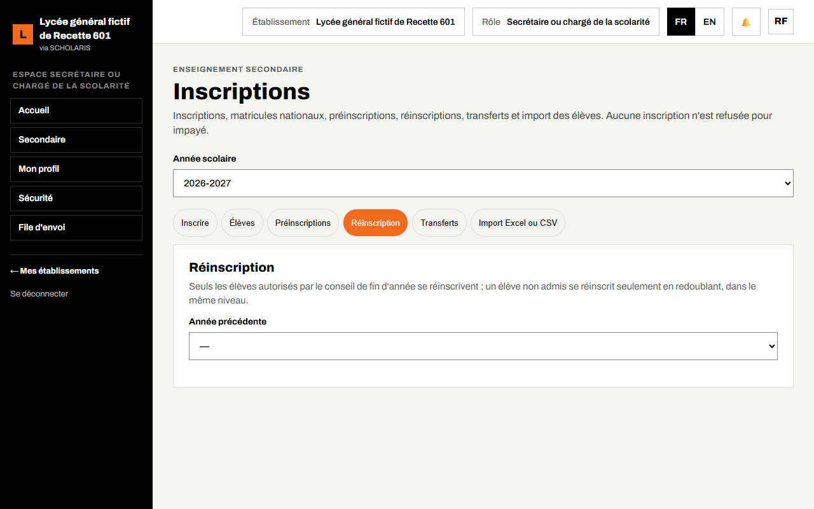
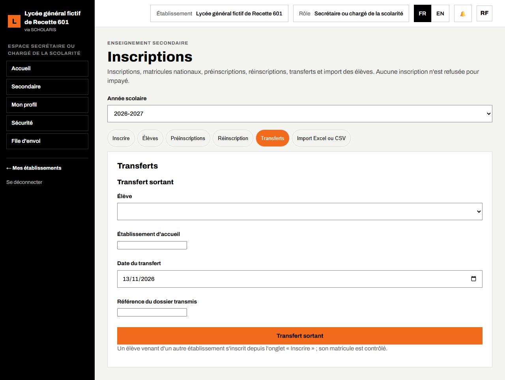
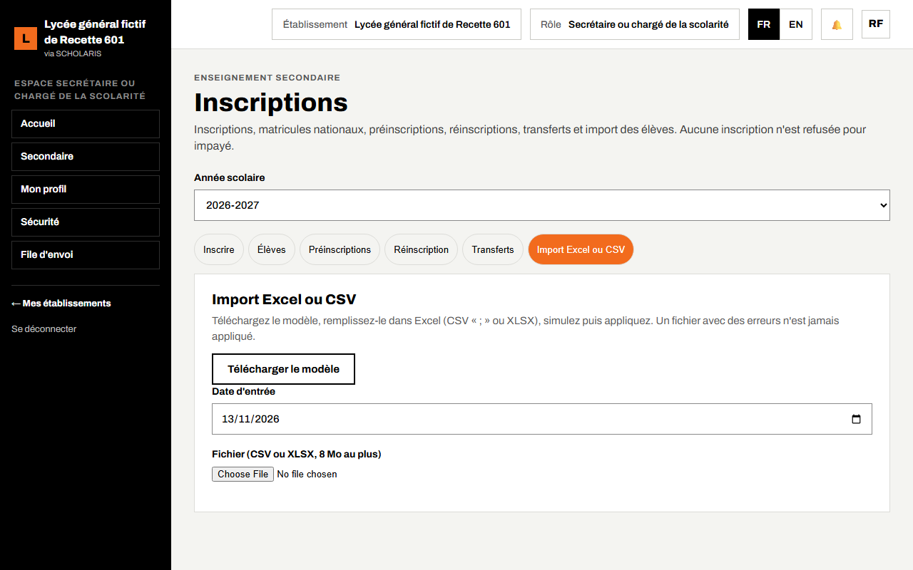
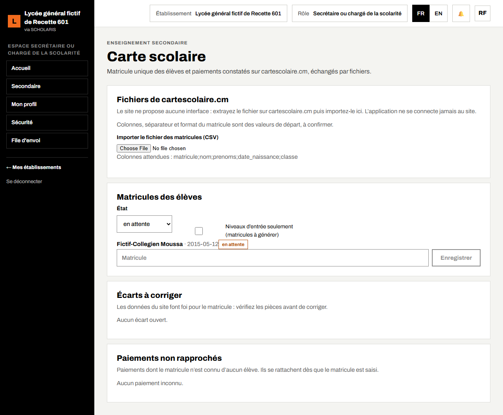
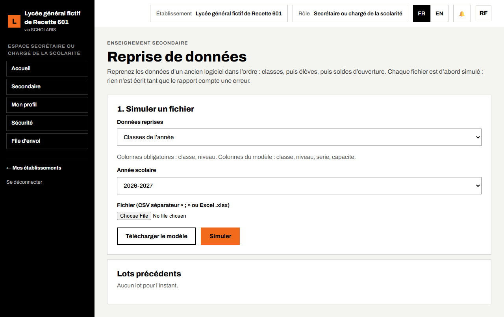

# 03. Inscriptions

Ce chapitre explique comment inscrire un élève, rattacher son garant financier, enregistrer son matricule national, gérer les préinscriptions, les réinscriptions, les transferts, l'import d'une liste d'élèves, la carte scolaire et la reprise des données d'un ancien logiciel.

**Où** : **Secondaire > Inscriptions** (`/secondaire/inscriptions`), **Secondaire > Carte scolaire** (`/secondaire/carte-scolaire`), **Secondaire > Reprise de données** (`/secondaire/reprise`).

**Qui fait quoi**

| Tâche | Qui |
|---|---|
| Inscrire, préinscrire, réinscrire, transférer, importer, saisir le matricule | Secrétaire ou chargé de la scolarité |
| Décision motivée (âge hors limites, réadmission d'un exclu) | Chef d'établissement |
| Consulter la liste des élèves | Chef d'établissement, censeur, surveillant général, intendant, professeur principal |
| Reprise des données | Chef d'établissement (classes), scolarité (élèves), intendant (soldes) |

**Deux règles à retenir**

1. **Aucune inscription n'est refusée pour impayé.** « Aucun paiement n'est exigé pour inscrire. »
2. **La classe doit avoir une autorisation d'ouverture valide** (chapitre 02, section 2.8), sinon l'inscription est refusée.

## 3.1 L'écran Inscriptions

L'écran a six onglets : **Élèves**, **Inscrire**, **Préinscriptions**, **Réinscription**, **Transferts** et **Import Excel ou CSV**.

## 3.2 Inscrire un élève

**Qui** : la scolarité.

1. Ouvrez **Secondaire > Inscriptions**, onglet **Inscrire**.
2. Saisissez le **Nom**, les **Prénoms**, la **Date de naissance** et le **Sexe** de l'élève.
3. Choisissez la **Classe** (par exemple 2nde A) et la **Date d'entrée**.
4. Dans le cadre **Parent ou tuteur** (obligatoire pour un élève mineur), saisissez le **Nom**, les **Prénoms** et le **Téléphone** du parent.
5. Laissez cochée la case **Garant financier** : ce parent paie les frais et suit l'élève sur le portail famille. Le numéro de téléphone est alors exigé.
6. Si vous le connaissez, saisissez le **Matricule national (si connu)**.
7. Notez dans **Pièces vérifiées** les pièces contrôlées (acte de naissance, dernier bulletin…).
8. Cliquez sur **Inscrire**. Message : « Élève inscrit. »

Pendant l'envoi, les champs du formulaire sont inactifs : attendez le message « Élève inscrit. » avant de saisir l'élève suivant. Le formulaire se vide ensuite pour un nouvel élève, et aucun dossier ne s'ouvre d'office.

**Parent déjà connu** : si le téléphone saisi est celui d'un parent déjà enregistré (par exemple un parent qui a déjà un enfant dans l'établissement, ou qui a déjà un compte), l'application le **retrouve** au lieu de créer un doublon. Ses enfants apparaîtront tous sur son portail.

**Alerte d'âge** : si l'âge est hors des limites du règlement intérieur, le message « L'âge est hors des limites du règlement : la décision motivée du chef d'établissement est exigée » s'affiche. Seul le chef d'établissement peut alors inscrire, en saisissant le **Motif de la décision**.

**Sans matricule**, l'élève est inscrit avec l'état **Matricule en attente** et figure dans la liste à régulariser.

## 3.3 La liste des élèves et le dossier

1. Onglet **Élèves**. Filtrez par classe ou cochez **Matricule en attente seulement**.
2. Chaque ligne montre le nom, la classe, la nature de l'inscription (**Nouvelle inscription**, **Réinscription**, **Transfert entrant**, **Import**…) et l'état du matricule (**Matricule enregistré**, **Matricule en attente**, **Matricule à vérifier**).
3. Cliquez sur le nom pour ouvrir le **dossier** de l'élève, affiché sous la liste.
4. Cliquez sur **Fermer le dossier** pour le refermer et ne garder que la liste.

Le dossier montre l'identité, l'inscription, le matricule et la rubrique **Garants financiers**. Chaque garant y figure avec son téléphone et, si la caisse la lui a déjà attribuée, sa **référence de paiement** (par exemple « référence de paiement FAM-0587 »). C'est la référence que la famille donne à la caisse ou utilise pour un paiement mobile money (chapitres 04 et 15).

### Enregistrer ou corriger le matricule

Dans le dossier, saisissez le **Matricule national** puis cliquez sur **Enregistrer le matricule**. Message : « Matricule enregistré. » Un matricule déjà pris par un autre élève est refusé.

### Rattacher un garant financier après l'inscription

Si l'élève n'a pas de garant financier (« Aucun garant financier : le portail famille ne montre cet élève à personne »), saisissez dans le dossier le **Téléphone** du parent (et son nom s'il est nouveau), puis cliquez sur **Rattacher le garant**. Message : « Garant financier rattaché. »

## 3.4 Préinscriptions

**Où** : onglet **Préinscriptions**.

1. Remplissez **Nouvelle préinscription** (identité, niveau demandé, **Canal** : **Guichet**, **En ligne** ou **Dossier du primaire**).
2. La préinscription est **En attente**. Cliquez sur **Accepter** ou **Refuser** (le **Motif du refus** est demandé). Au privé, la note du test d'entrée peut être saisie.
3. Une préinscription acceptée se transforme en inscription avec **Inscrire dans la classe**.

**Dossier venant du primaire** : collez le dossier signé remis par l'école primaire et sa signature, puis cliquez sur **Recevoir le dossier**. Un dossier modifié est refusé ; un dossier déjà reçu est ignoré.

## 3.5 Réinscription (année suivante)

**Où** : onglet **Réinscription**. « Seuls les élèves autorisés par le conseil de fin d'année se réinscrivent ; un élève non admis se réinscrit seulement en redoublant, dans le même niveau. »

1. Choisissez l'**Année précédente** et la classe d'arrivée.
2. Cochez les élèves (**Admis**, **Non admis**, **Déjà réinscrit**).
3. Cliquez sur **Réinscrire la sélection**. Message : « 3 élève(s) réinscrit(s). »

Un élève exclu définitivement ne se réinscrit qu'avec la décision motivée du chef d'établissement.

## 3.6 Transferts

**Où** : onglet **Transferts**.

- **Transfert sortant** : choisissez l'**Élève**, saisissez l'**Établissement d'accueil**, la **Date du transfert** et la **Référence du dossier transmis**, puis confirmez « Clore l'inscription de cet élève (transfert) ? ». L'exeat peut ensuite être délivré (chapitre 16).
- **Transfert entrant** : l'élève venant d'un autre établissement s'inscrit depuis l'onglet **Inscrire** ; son matricule est contrôlé (état **Matricule à vérifier** en cas d'écart).

## 3.7 Importer une liste d'élèves (Excel ou CSV)

**Où** : onglet **Import Excel ou CSV**.

1. Cliquez sur **Télécharger le modèle**.
2. Remplissez-le dans Excel (une ligne par élève), puis enregistrez-le en CSV (séparateur « ; ») ou en XLSX (8 Mo au plus).
3. Choisissez le fichier, puis cliquez sur **Simuler**. Le résumé indique par exemple « 120 valide(s), 2 en erreur, 1 doublon(s) sur 123 ligne(s) », avec le détail ligne par ligne.
4. Corrigez les lignes en erreur dans le fichier et recommencez.
5. Quand tout est valide, cliquez sur **Appliquer l'import**. Message : « Import appliqué. »

**Un fichier avec des erreurs n'est jamais appliqué.**

## 3.8 Carte scolaire (cartescolaire.cm)

**Où** : **Secondaire > Carte scolaire**. L'application **ne se connecte jamais** au site cartescolaire.cm : vous extrayez un fichier sur le site, puis vous l'importez ici.

- **Importer le fichier des matricules (CSV)** : l'application rapproche chaque ligne d'un élève (nom, prénoms et date de naissance). Le compte rendu donne les lignes rapprochées, rejetées, en doublon et inconnues.
- **Importer le relevé des paiements (CSV)** (intendant) : paiements constatés sur le site (contribution, frais d'examen), rapprochés par matricule.
- **Matricules des élèves** : filtre par **État** (**en attente**, **enregistré**, **écart à vérifier**) et **Niveaux d'entrée seulement** ; saisie du matricule puis **Enregistrer**.
- **Écarts à corriger** : « Les données du site font foi pour le matricule : vérifiez les pièces avant de corriger. » Cliquez sur **Reporter le matricule du site** ou **Marquer comme résolu** (une note de vérification est demandée).
- **Paiements non rapprochés** : ils se rattachent dès que le matricule de l'élève est saisi.

Un même fichier importé deux fois ne modifie rien : « Ce fichier avait déjà été importé : rien n'a été modifié. »

## 3.9 Reprise des données d'un ancien logiciel

**Où** : **Secondaire > Reprise de données** (`/secondaire/reprise`). Pour démarrer avec SCHOLARIS en cours d'année, reprenez les **classes**, les **élèves** et les **soldes** d'un ancien logiciel par fichier CSV ou Excel.

1. Choisissez le jeu de données (classes, élèves, soldes).
2. Téléchargez le modèle et remplissez-le.
3. Joignez le fichier et **simulez** : le rapport liste les lignes valides et les erreurs.
4. Appliquez quand le rapport est sans erreur.

Reprenez dans l'ordre : classes, puis élèves, puis soldes. Chaque jeu exige son droit : le chef d'établissement pour les classes, la scolarité pour les élèves, l'intendant pour les soldes.

