# 04. Frais, encaissement et situation financière

Ce chapitre explique le catalogue des frais autorisés (établissement public), la création des frais, les échéanciers, les factures des élèves, l'encaissement, les reçus et la situation financière par classe. Il dit aussi ce qui change dans un établissement privé.

**Où** : **Secondaire > Frais** (`/secondaire/frais`), **Secondaire > Situation financière** (`/secondaire/situation-financiere`), **Frais et paiements** (`/facturation`, écran commun de la caisse) et le portail famille (chapitre 15).

**Qui fait quoi**

| Tâche | Qui |
|---|---|
| Tenir le catalogue des frais autorisés, décider des demandes d'ajout | Administrateur fonctionnel (pour le client) |
| Créer les frais, les échéanciers, les factures ; proposer un plan de paiement ; relevé de la carte scolaire | Intendant ou économe |
| Encaisser au guichet, délivrer le reçu | Caissier (et intendant) |
| Valider un plan de paiement ou une annulation | Chef d'établissement, promoteur (jamais l'auteur) |
| Payer par mobile money | Parent garant financier (portail famille) |
| Consulter | Chef d'établissement, promoteur, intendant |

**Règles du secondaire**

- **Aucun élève n'est renvoyé ni privé de cours ou d'évaluation pour impayé.**
- Les **frais d'examen** ne sont jamais facturés par l'établissement : ils se paient sur **cartescolaire.cm**.
- Aucun document scolaire (certificat, bulletin…) ne mentionne une dette.

## 4.1 L'écran Frais de scolarité

L'écran suit le profil de l'établissement :

- **Catalogue des frais autorisés (public)** : seuls les frais du catalogue peuvent être créés. Un frais hors catalogue est refusé et une demande est envoyée au client.
- **Frais du privé** : grille par niveau, série ou spécialité, tranches, remises, plans de paiement et relances.

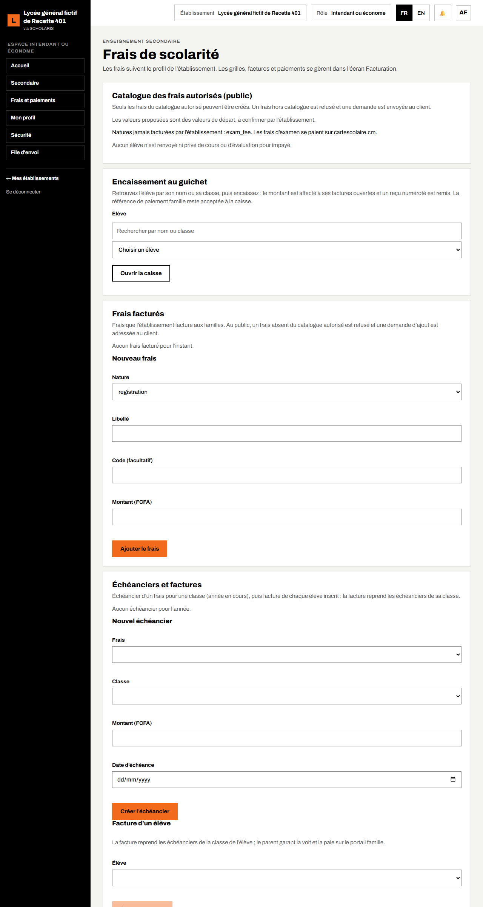

## 4.2 Le catalogue des frais autorisés (public)

**Qui** : l'administrateur fonctionnel. Le catalogue est **vide à l'ouverture** : aucun frais ne peut être créé tant qu'il n'est pas rempli.

1. Ouvrez **Secondaire > Frais**, bloc **Catalogue des frais autorisés**.
2. Choisissez la **Nature** (par exemple **APEE**, contribution, frais d'atelier, de laboratoire, tenue, assurance, frais médicaux, internat, cantine, transport).
3. Saisissez le **Libellé** (par exemple « Contribution APEE ») et, si besoin, le **Plafond (FCFA, facultatif)**.
4. Saisissez le **Texte ou procès-verbal de référence** (obligatoire), par exemple la délibération de l'assemblée générale de l'APEE.
5. Cochez **Tous les établissements du client** si la ligne vaut pour tous vos établissements.
6. Cliquez sur **Ajouter au catalogue**.

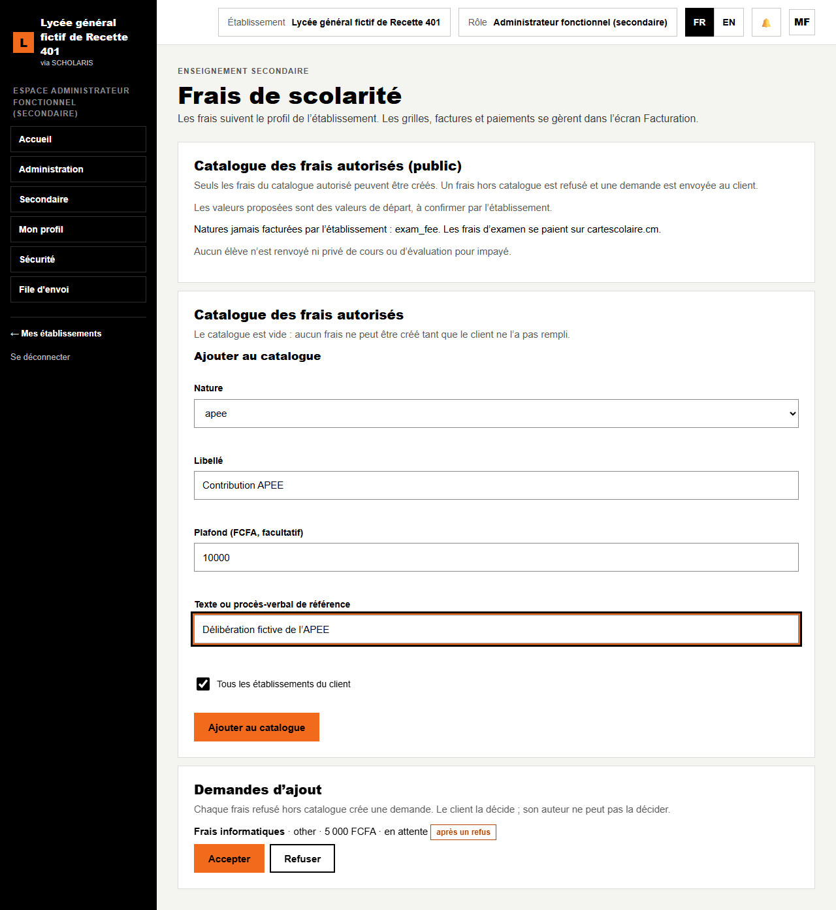

Une ligne se retire à une date ; elle n'est jamais effacée.

## 4.3 Créer un frais

**Qui** : l'intendant.

1. Bloc **Frais facturés**, formulaire **Nouveau frais**.
2. Choisissez la **Nature**, saisissez le **Libellé**, le **Code (facultatif)** et le **Montant (FCFA)**.
3. Cliquez sur **Ajouter le frais**. Message : « Frais ajouté. »

**Frais hors catalogue** : si le frais n'est pas dans le catalogue (ou dépasse le plafond), il est refusé : « Frais absent du catalogue des frais autorisés… ». Une **demande d'ajout** est créée automatiquement (marquée « après un refus ») dans le bloc **Demandes d'ajout**. Le client l'accepte ou la refuse ; son auteur ne peut pas la décider. Vous pouvez aussi faire une demande directe avec **Demander l'ajout d'un frais** (justification obligatoire).

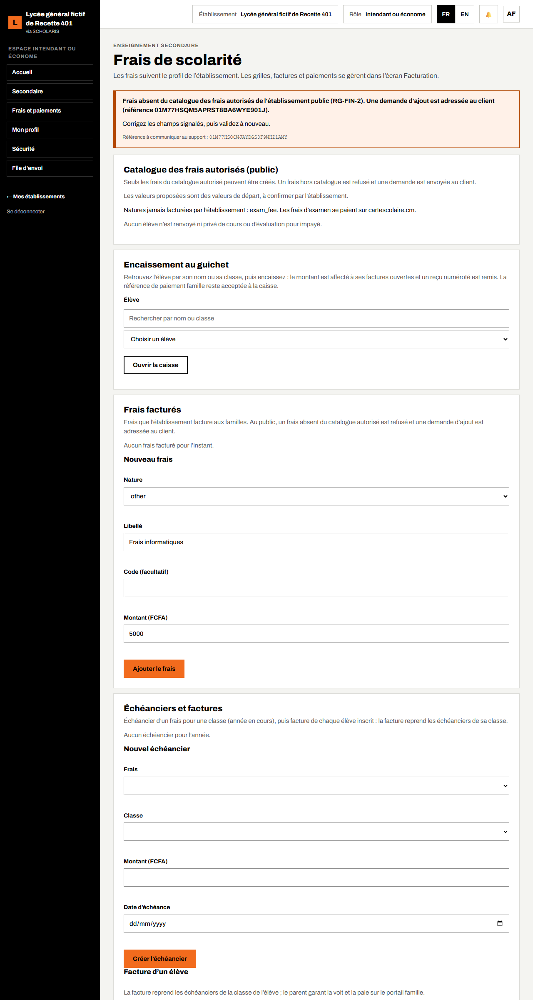

## 4.4 Échéancier et facture d'un élève

**Qui** : l'intendant. **Où** : bloc **Échéanciers et factures** de l'écran Frais.

1. Formulaire **Nouvel échéancier** : choisissez le **Frais** (par exemple Contribution APEE) et la **Classe** (2nde A). Le **Montant** est repris du frais.
2. Saisissez la **Date d'échéance**, puis cliquez sur **Créer l'échéancier**. Message : « Échéancier créé. »
3. Formulaire **Facture d'un élève** : choisissez l'**Élève** par son nom, puis cliquez sur **Établir la facture**. Message : « Facture établie pour Fictif-Lyceen Issa : 10 000 FCFA, reste à payer 10 000 FCFA. »

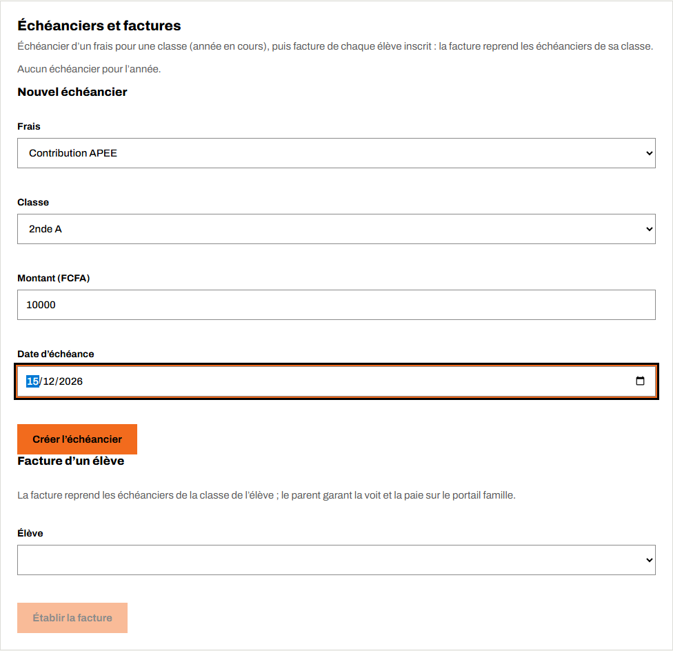

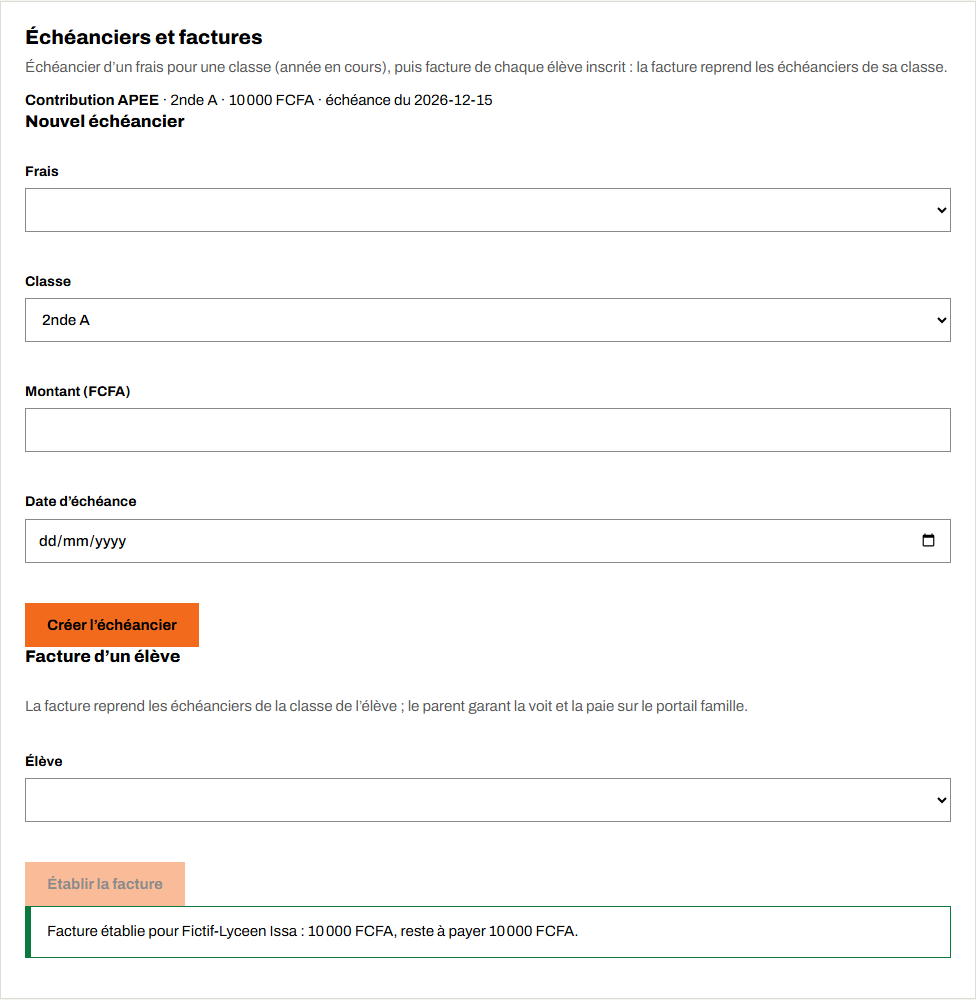

La facture reprend tous les échéanciers de la classe de l'élève. Le parent **garant financier** la voit aussitôt sur son portail et peut la payer (chapitre 15).

## 4.5 Encaisser au guichet et délivrer le reçu

**Qui** : le caissier (ou l'intendant). **Où** : la carte **Frais** de l'espace **Secondaire** (`/secondaire/frais`), qui ouvre ensuite **Frais et paiements** (`/facturation`), l'écran de caisse commun à toutes les applications SCHOLARIS.

L'espace **Secondaire** du caissier affiche la carte **Frais**. Il y voit l'aperçu des frais et le bloc **Encaissement au guichet**.

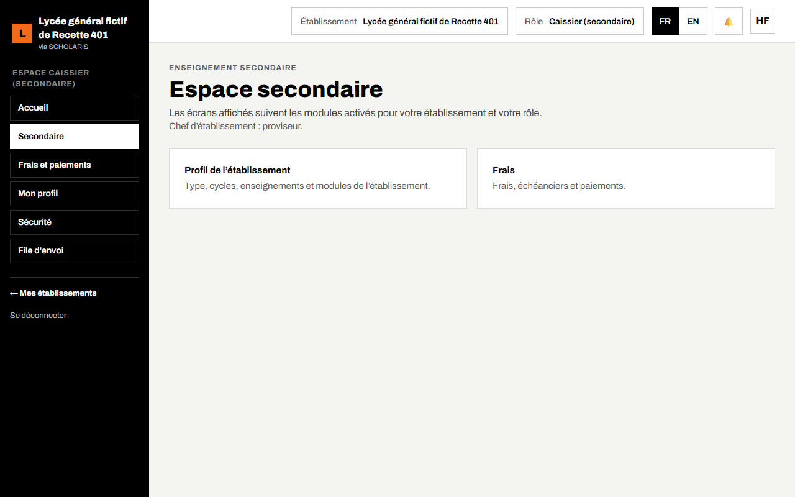

L'écran **Frais et paiements** a quatre onglets : **Journal du jour**, **Caisse**, **Factures** et **Reçus**.

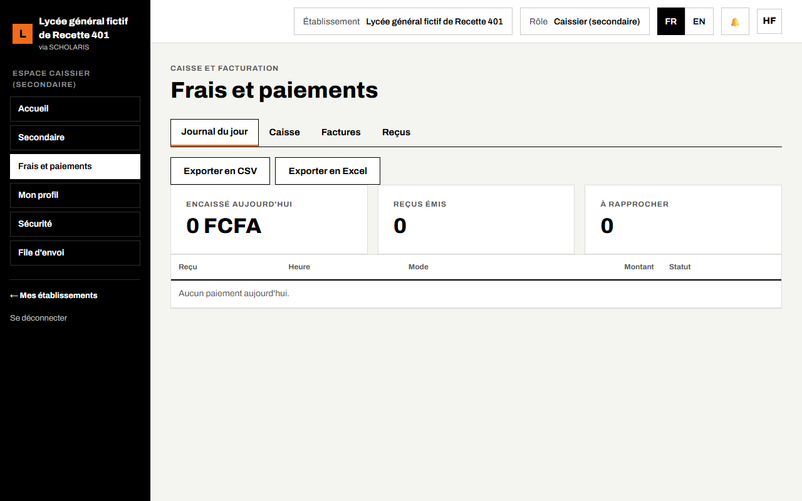

### Ouvrir la caisse (le matin)

Onglet **Caisse** : saisissez le **Fonds de caisse** puis cliquez sur **Ouvrir la caisse**. L'écran affiche « Caisse n° … ouverte », le fonds de caisse et les **Espèces encaissées**.

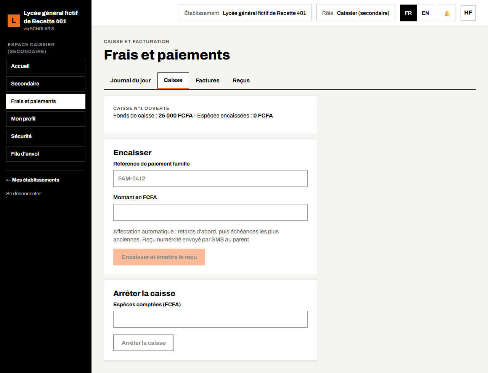

### Encaisser pour un élève

Le parent se présente au guichet sans référence : retrouvez l'élève par son nom.

1. Ouvrez **Secondaire > Frais**, bloc **Encaissement au guichet**.
2. Dans le champ de recherche, tapez une partie du nom ou la classe, puis choisissez l'**Élève** dans la liste (nom et classe).
3. Cliquez sur **Encaisser pour cet élève**. L'onglet **Caisse** s'ouvre avec la mention « Élève : … Le montant est affecté à ses factures ouvertes. »
4. Saisissez le **Montant en FCFA**, puis cliquez sur **Encaisser et émettre le reçu**. Message : « Encaissement enregistré. Reçu … ».

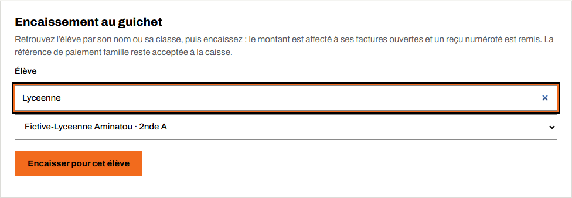

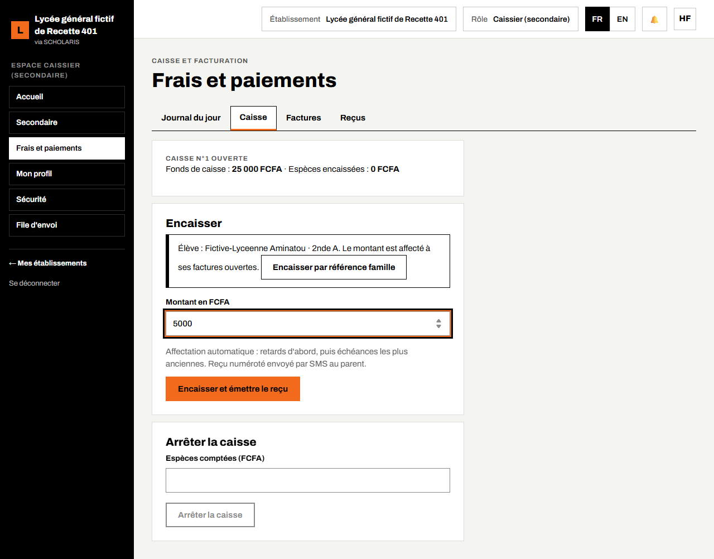

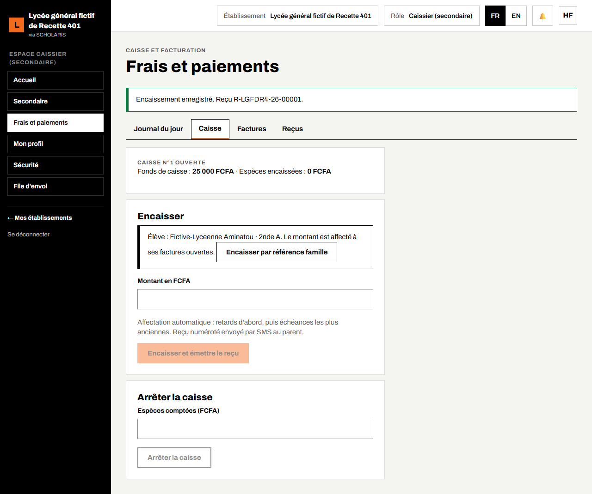

Le montant est affecté automatiquement (retards d'abord, puis échéances les plus anciennes) et le reçu numéroté est envoyé par SMS au parent.

Si le parent donne sa **Référence de paiement famille** (par exemple après un paiement mobile money), cliquez sur **Encaisser par référence famille** : le champ de la référence remplace le nom de l'élève.

### Arrêter la caisse (le soir)

Saisissez les **Espèces comptées (FCFA)** puis cliquez sur **Arrêter la caisse**. Message : « La caisse est arrêtée. »

- L'onglet **Factures** liste les factures avec **Net à payer**, **Payé** et **Reste dû**.
- L'onglet **Reçus** liste les reçus ; le bouton **PDF** les réimprime.
- Le **Journal du jour** totalise l'encaissé du jour, les reçus émis et les paiements à rapprocher ; il s'exporte en CSV ou Excel.

Un paiement ne s'efface jamais : « Les annulations de paiement exigent la validation d'un second agent » (le caissier demande, l'intendant approuve).

Les paiements faits par les parents sur le portail (mobile money) arrivent seuls, avec leur reçu, dès la confirmation de l'opérateur.

## 4.6 Situation financière

**Qui** : chef d'établissement, intendant, promoteur. **Où** : **Secondaire > Situation financière**.

L'écran donne la **situation par classe** (facturé, encaissé, reste à recouvrer), les **prévisions** d'encaissement et le **fichier de fin d'année**. Choisissez l'année et, si besoin, la classe.

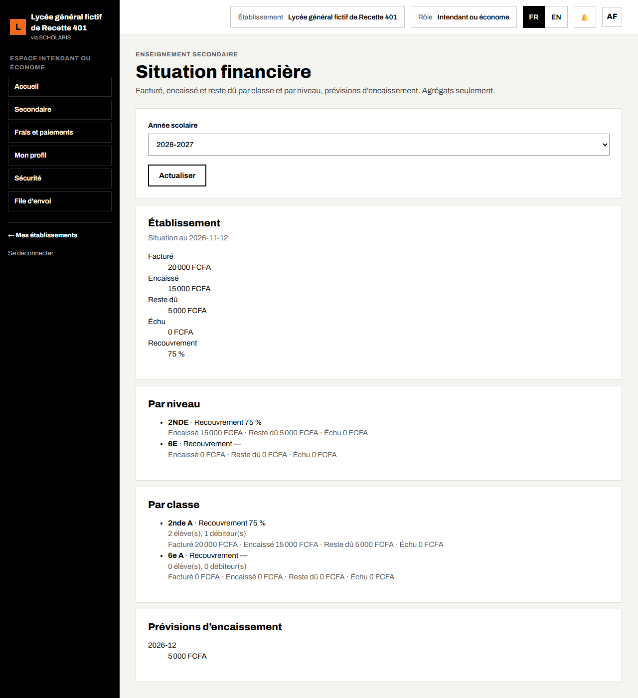

## 4.7 Établissement privé

Avec le module **Frais du privé** :

- le bloc **Règles de paiement** propose la **Règle d'affectation** (ordre des natures : inscription, APEE, scolarité…), l'**Ordre des enfants** d'une même famille et les **Relances** (jours avant et après l'échéance). Cliquez sur **Appliquer les valeurs proposées** : rien de déjà choisi n'est remplacé ;
- la grille de frais par niveau, série ou spécialité se crée dans **Frais et paiements** ;
- un **Nouveau plan de paiement** (échéances, motif) est proposé par l'intendant puis validé par une autre personne (« Plan proposé : il doit être validé par une autre personne ») ;
- la remise de certains documents peut être retenue tant que la famille n'a pas régularisé (sauf plan de paiement en vigueur). L'inscription, les cours et les évaluations ne le sont jamais.
