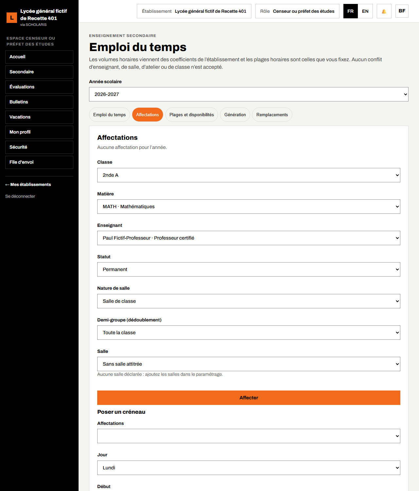
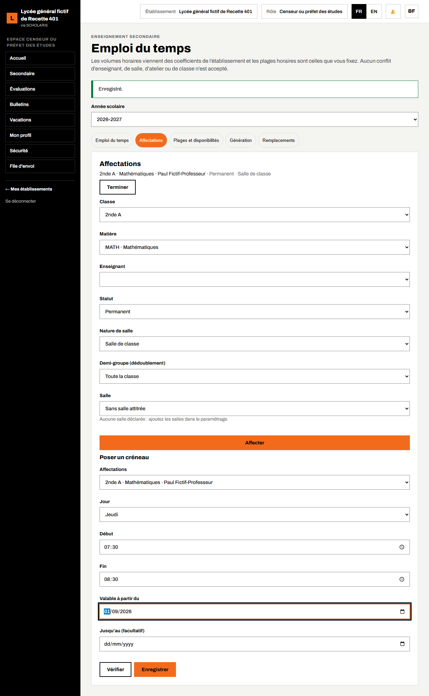
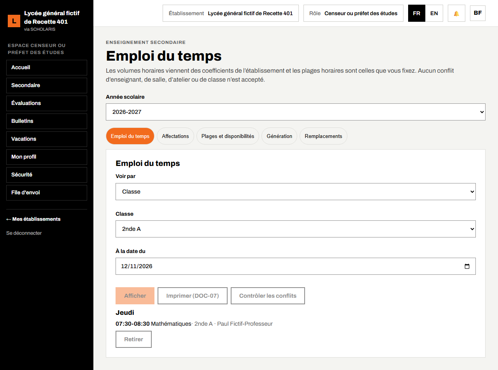
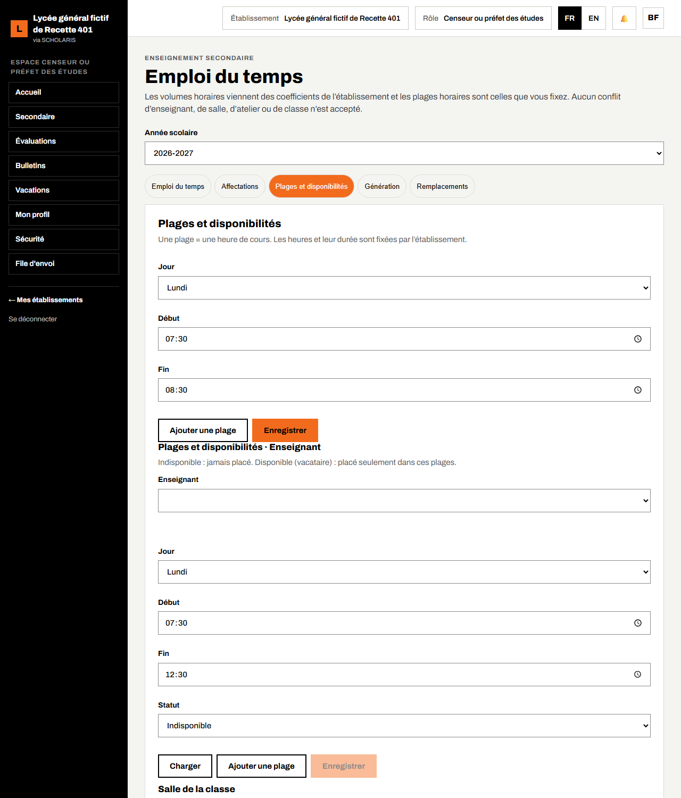
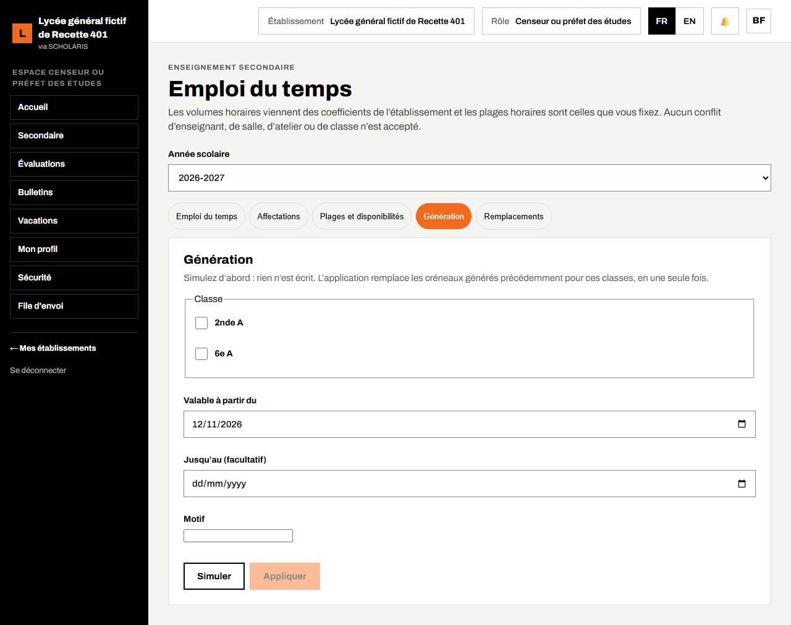
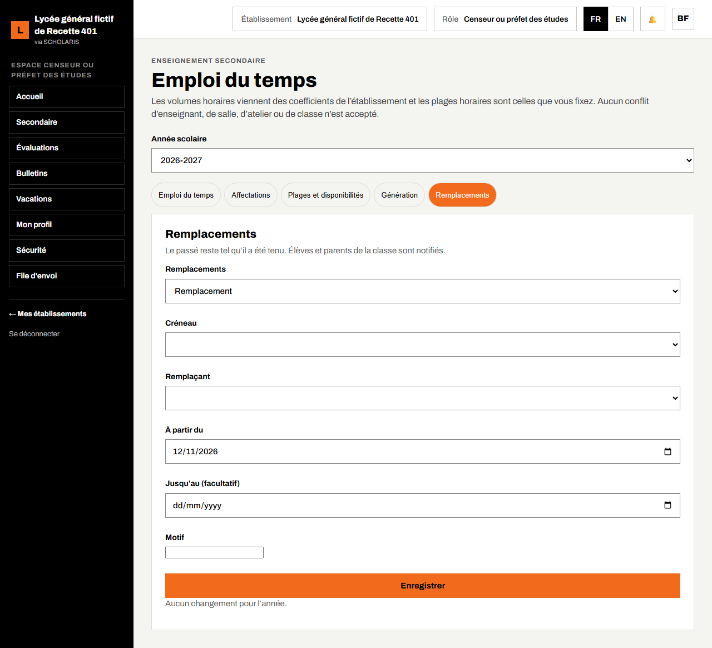
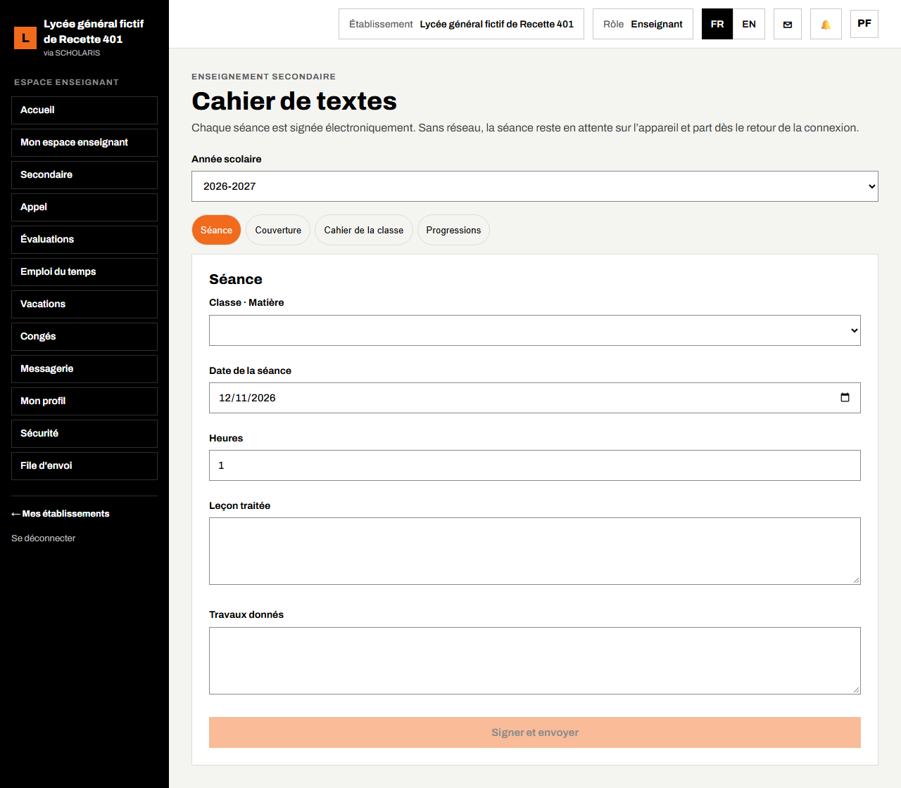
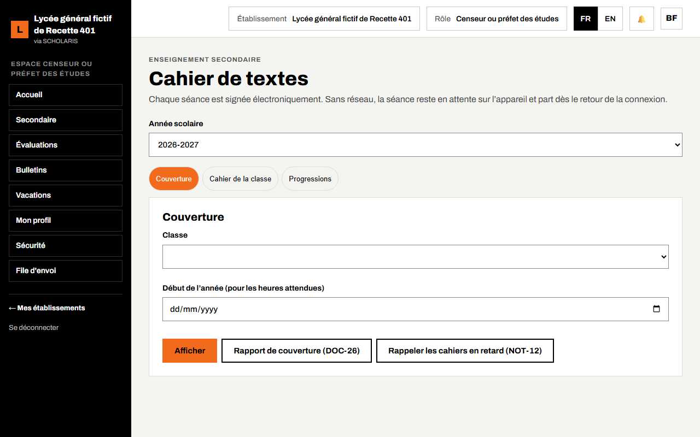
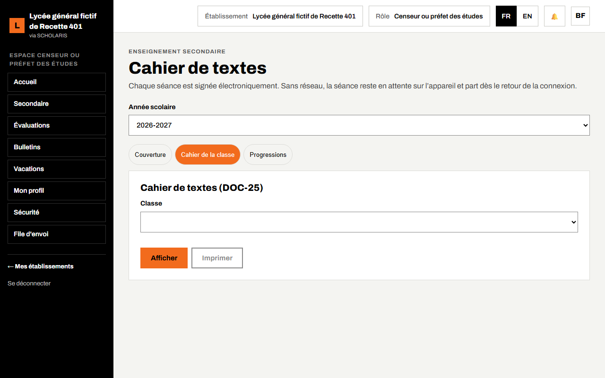

# 05. Emploi du temps et cahier de textes

Ce chapitre explique comment le censeur affecte les enseignants aux classes, pose les créneaux de l'emploi du temps (à la main ou par génération), gère les remplacements, et comment l'enseignant remplit le cahier de textes.

**Où** : **Secondaire > Emploi du temps** (`/secondaire/emploi-du-temps`) et **Secondaire > Cahier de textes** (`/secondaire/cahier-de-textes`).

**Qui fait quoi**

| Tâche | Qui |
|---|---|
| Affectations, plages horaires, disponibilités, génération, remplacements et permutations | Censeur |
| Valider l'emploi du temps | Chef d'établissement |
| Consulter | Tous les personnels de l'établissement, élèves et parents (emploi du temps de la classe) |
| Remplir le cahier de textes (séances signées) | Enseignant |
| Progressions | Animateur pédagogique ou chef de département |
| Visa du cahier de textes | Censeur, animateur pédagogique |

« Aucun conflit d'enseignant, de salle, d'atelier ou de classe n'est accepté. » Les volumes horaires viennent des coefficients saisis au paramétrage (chapitre 02).

## 5.1 Affecter un enseignant à une classe

L'affectation dit **qui enseigne quelle matière dans quelle classe**. Elle commande aussi la saisie des notes et l'appel.

1. Ouvrez **Secondaire > Emploi du temps**, vérifiez l'**Année scolaire**, puis l'onglet **Affectations**.
2. Choisissez la **Classe** (2nde A) et la **Matière** (MATH · Mathématiques).
3. Choisissez l'**Enseignant** dans la liste des noms (personnel actif de l'établissement).
4. Choisissez le **Statut** (**Permanent** ou vacataire), la **Nature de salle** (salle de classe, laboratoire, atelier), la **Salle** dans la liste des salles déclarées (chapitre 02) ou **Sans salle attitrée** et le **Demi-groupe** (**Toute la classe**, ou G1 / G2 pour un dédoublement).
5. Cliquez sur **Affecter**. L'affectation apparaît en haut : « 2nde A · Mathématiques · Paul Fictif-Professeur · Permanent · Salle de classe ».

Le bouton **Terminer** clôt une affectation (par exemple en cas de départ de l'enseignant).

L'enseignant doit avoir une **fiche du personnel** (chapitre 12) pour figurer dans la liste.

## 5.2 Poser un créneau à la main

Toujours dans l'onglet **Affectations**, bloc **Poser un créneau** :

1. Choisissez l'**Affectation** (2nde A · Mathématiques · Paul Fictif-Professeur).
2. Choisissez le **Jour** (Mardi), le **Début** (07:30) et la **Fin** (08:30).
3. Saisissez **Valable à partir du** (par exemple le 1er septembre) et, si besoin, **Jusqu'au (facultatif)**.
4. Cliquez sur **Vérifier** pour contrôler les conflits, puis sur **Enregistrer**. Message : « Enregistré. »

En cas de conflit (enseignant déjà en cours, salle occupée, classe déjà prise, y compris dans un autre établissement du même promoteur), l'enregistrement est refusé avec la nature du conflit.

## 5.3 Afficher l'emploi du temps

1. Onglet **Emploi du temps**.
2. Dans **Voir par**, choisissez **Classe**, **Enseignant** ou **Salle ou atelier**, puis la classe (2nde A).
3. Cliquez sur **Afficher**. Les créneaux de la semaine s'affichent par jour.

L'emploi du temps peut être imprimé (document DOC-07, sans numéro ni QR).

## 5.4 Plages horaires, disponibilités et génération

- Onglet **Plages et disponibilités** : « Une plage = une heure de cours. Les heures et leur durée sont fixées par l'établissement. » Saisissez les plages de la journée (7 h 30-8 h 25…). Pour un vacataire, déclarez ses plages **Disponible** (il n'est placé que dedans) ; une plage **Indisponible** n'est jamais utilisée.
- Onglet **Génération** : choisissez les classes, cliquez d'abord sur **Simuler** (rien n'est écrit), lisez la proposition et la liste de ce qui n'a pas pu être placé, puis **Appliquer**. Les créneaux posés à la main sont respectés ; les créneaux générés précédemment pour ces classes sont remplacés.

## 5.5 Remplacements et permutations

Onglet **Remplacements** : choisissez le créneau, le **Remplaçant** dans la liste des noms (ou le créneau à échanger), la date de début et, si besoin, la date de fin. « Le passé reste tel qu'il a été tenu. Élèves et parents de la classe sont notifiés. » Le titulaire reprend son créneau le lendemain de la date de fin.

## 5.6 Le cahier de textes (enseignant)

« Chaque séance est signée électroniquement. Sans réseau, la séance reste en attente sur l'appareil et part dès le retour de la connexion. »

1. Ouvrez **Secondaire > Cahier de textes**, onglet **Séance**.
2. Choisissez **Classe · Matière** (seulement vos affectations).
3. Vérifiez la **Date de la séance** (pas de date future) et le nombre d'**Heures** (au quart d'heure).
4. Saisissez la **Leçon traitée** (ou choisissez-la dans la progression) et les **Travaux donnés** (devoirs).
5. Cliquez sur **Signer et envoyer**. Message : « Séance signée et enregistrée. » Sans réseau : « 1 séance(s) en attente d’envoi sur cet appareil » ; le bouton **Envoyer maintenant** relance l’envoi.

Les devoirs donnés apparaissent sur le portail des parents (« Devoirs des deux dernières semaines »).

## 5.7 Couverture, cahier de la classe, progressions, visas

- **Couverture** : heures faites (séances signées) sur heures prévues par la progression, et leçons traitées, par classe et matière. Exemple : 4,25 h faites sur 10 h prévues = 42,5 %.
- **Cahier de la classe** : toutes les séances de la classe, avec les **visas** du censeur et de l'animateur pédagogique. Il s'imprime (DOC-25).
- **Progressions** : l'animateur pédagogique saisit et approuve la progression d'une matière pour un niveau (et une série) : la liste des leçons et leurs heures.

Un enseignant qui n'a consigné aucune séance depuis plusieurs jours reçoit un rappel.

