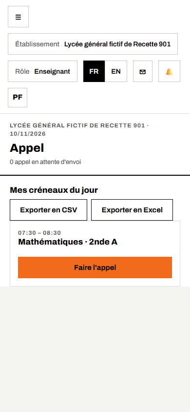
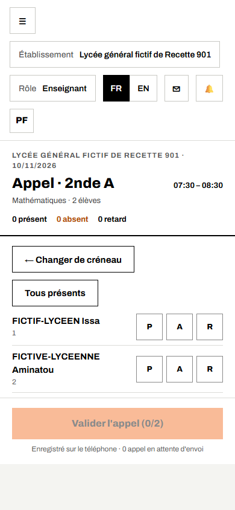
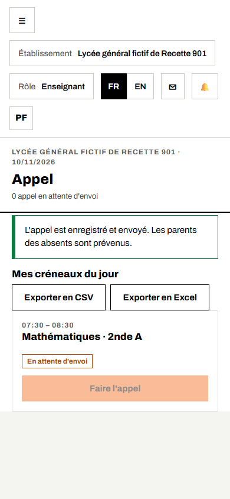
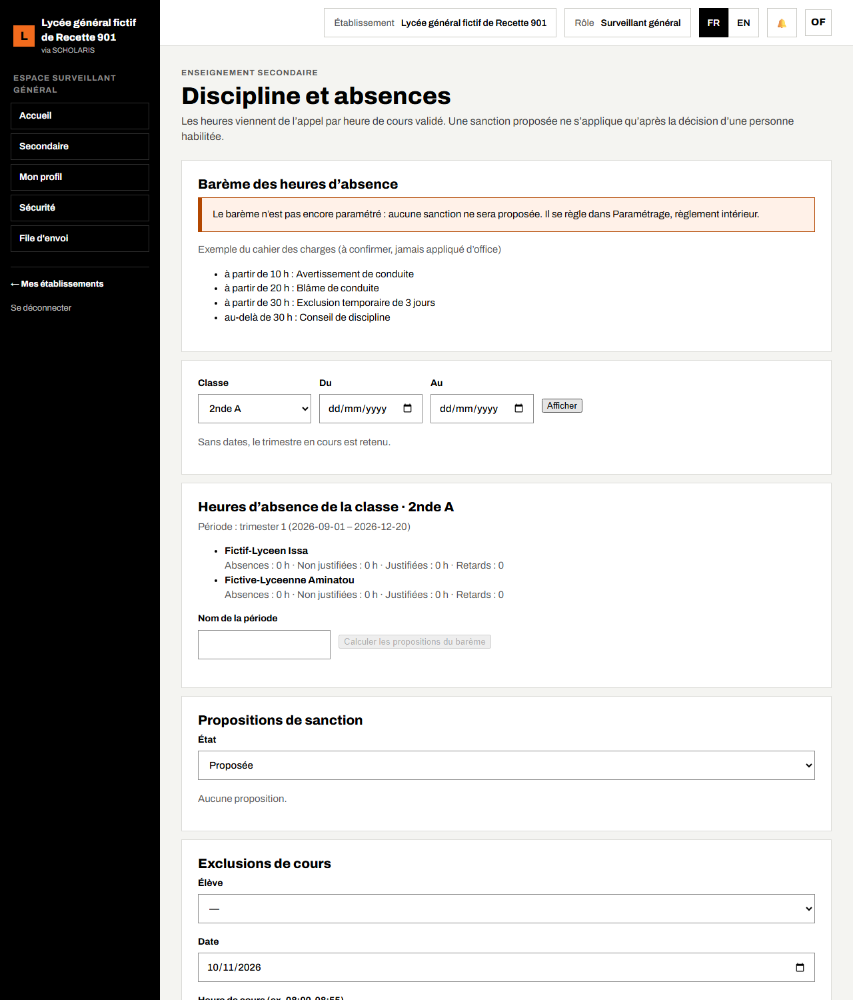
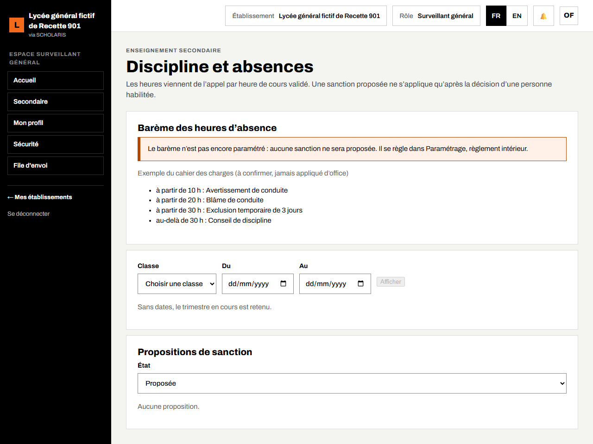
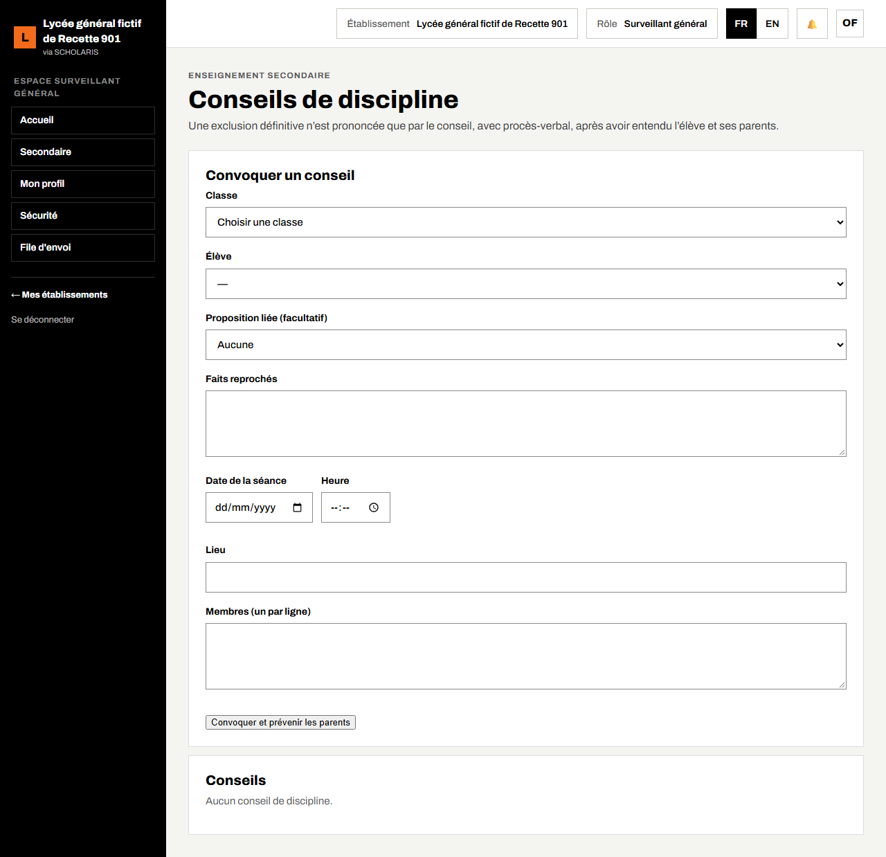

# 06. Appel et discipline

Ce chapitre explique comment l'enseignant fait l'appel de son heure de cours depuis son téléphone, et comment le surveillant général suit les heures d'absence, les propositions de sanction, les exclusions de cours et les conseils de discipline.

**Où** : **Appel** (`/appel`, dans le menu de gauche), **Secondaire > Discipline et absences** (`/secondaire/discipline`) et **Secondaire > Conseils de discipline** (`/secondaire/conseils-de-discipline`).

**Qui fait quoi**

| Tâche | Qui |
|---|---|
| Faire l'appel de son heure de cours | Enseignant |
| Contresigner la feuille d'appel (si l'établissement le demande) | Délégué de classe |
| Justifier les absences, suivre les heures, calculer et appliquer les propositions de sanction, signaler une exclusion de cours, convoquer le conseil de discipline | Surveillant général |
| Décider les sanctions de son niveau, présider le conseil de discipline | Chef d'établissement |
| Consulter | Censeur, professeur principal, parents (portail) |

## 6.1 Faire l'appel sur le téléphone

L'appel se fait **par heure de cours**, pour les créneaux de votre emploi du temps du jour (chapitre 05).

1. Ouvrez SCHOLARIS sur votre téléphone, touchez **☰** puis **Appel**.
2. La liste **Mes créneaux du jour** affiche vos cours (par exemple « 07:30 – 08:30 · Mathématiques · 2nde A »). Touchez **Faire l'appel** sous le cours.

3. La feuille d'appel affiche les élèves de la classe. Pour chaque élève, touchez **P** (présent), **A** (absent) ou **R** (retard). Les compteurs en haut se mettent à jour (« 0 présent · 0 absent · 0 retard »).
4. Si tout le monde est là, touchez **Tous présents**, puis corrigez seulement les absents.
5. Touchez **Valider l'appel (2/2)** : le bouton n'est actif que lorsque tous les élèves sont marqués. Message : « L'appel est enregistré. »

**Sans réseau**, l'appel est **enregistré sur le téléphone** (« 1 appel en attente d'envoi ») et part seul au retour du réseau. Ne videz pas les données du navigateur entre-temps.

**Changer de créneau** revient à la liste des cours du jour. Les boutons **Exporter en CSV** et **Exporter en Excel** donnent la liste des créneaux.

## 6.2 Suivre les heures d'absence (surveillant général)

1. Ouvrez **Secondaire > Discipline et absences**.
2. Choisissez la **Classe** et, si besoin, les dates **Du** et **Au** (« Sans dates, le trimestre en cours est retenu »). Cliquez sur **Afficher**.
3. Le bloc **Heures d'absence de la classe** donne pour chaque élève : **Absences**, **Non justifiées**, **Justifiées** (en heures) et **Retards**.

Les heures viennent uniquement des **appels validés**. Elles alimentent le conseil de classe (chapitre 08) et le portail des parents.

## 6.3 Barème et propositions de sanction

Le bloc **Barème des heures d'absence** rappelle les paliers (exemple du cahier des charges, à confirmer : avertissement à partir de 10 h, blâme à partir de 20 h, exclusion temporaire de 3 jours à partir de 30 h, conseil de discipline au-delà). Tant que le barème n'est pas réglé dans **Paramétrage > Règlement intérieur**, « aucune sanction ne sera proposée ».

Quand le barème est réglé :

1. Saisissez le **Nom de la période** (par exemple « Trimestre 1 ») puis cliquez sur **Calculer les propositions du barème**. Message : « 2 nouvelle(s) proposition(s), 0 déjà connue(s), 45 élève(s) examiné(s). »
2. Bloc **Propositions de sanction** : filtrez par **État** (**Proposée**, **Appliquée**, **Rejetée**, **Remplacée**).
3. Pour chaque proposition, cliquez sur **Appliquer** ou **Rejeter** (motif obligatoire). Un palier qui relève du conseil affiche « Ce palier relève du conseil de discipline » et le bouton **Convoquer le conseil**.

**Une sanction proposée ne s'applique qu'après la décision d'une personne habilitée.**

## 6.4 Exclusion de cours

Bloc **Exclusions de cours** : choisissez l'**Élève**, la **Date**, l'**Heure de cours** (par exemple 08:00-08:55) et le **Motif**, puis cliquez sur **Signaler l'exclusion**. Message : « Exclusion enregistrée. »

## 6.5 Conseil de discipline

**Où** : **Secondaire > Conseils de discipline**. « Une exclusion définitive n'est prononcée que par le conseil, avec procès-verbal, après avoir entendu l'élève et ses parents. »

1. Bloc **Convoquer un conseil** : choisissez l'**Élève**, la **Proposition liée (facultatif)**, décrivez les **Faits reprochés**, la **Date de la séance**, l'**Heure**, le **Lieu** et les **Membres** (un par ligne).
2. Cliquez sur **Convoquer et prévenir les parents**. Le conseil apparaît comme **Convoqué**.
3. Après la séance, dans **Décision du conseil** : choisissez la **Décision**, saisissez le **Motif de la décision**, le **Procès-verbal de la séance**, cochez **L'élève a été entendu** et **Les parents ont été entendus**, et la **Durée de l'exclusion (jours)** si besoin. Cliquez sur **Enregistrer la décision**.

Pour une exclusion définitive, le procès-verbal et les deux auditions sont obligatoires.

