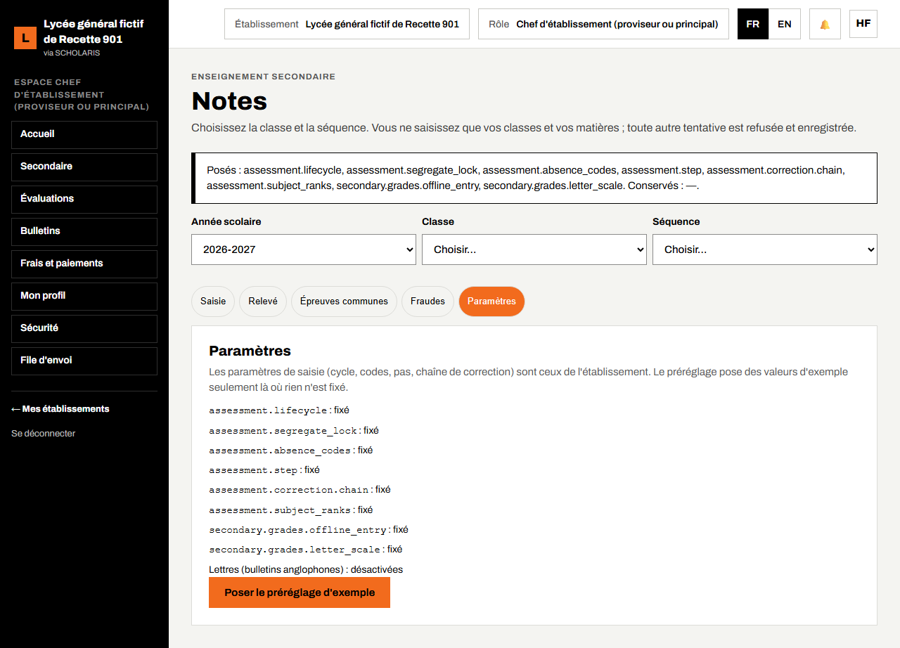
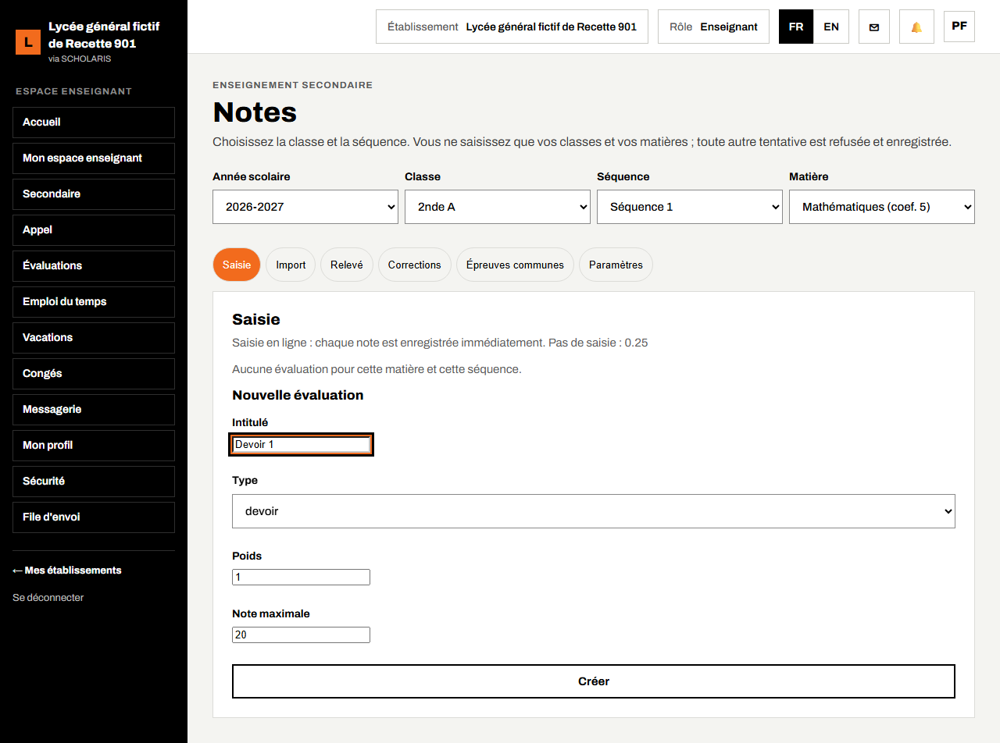
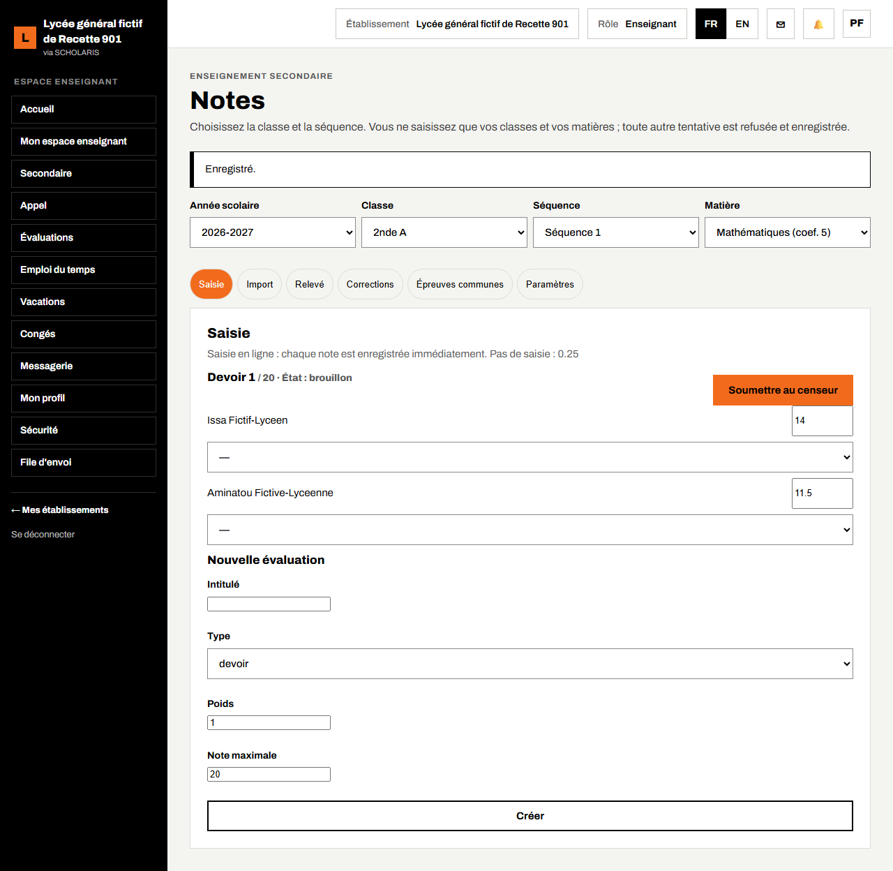
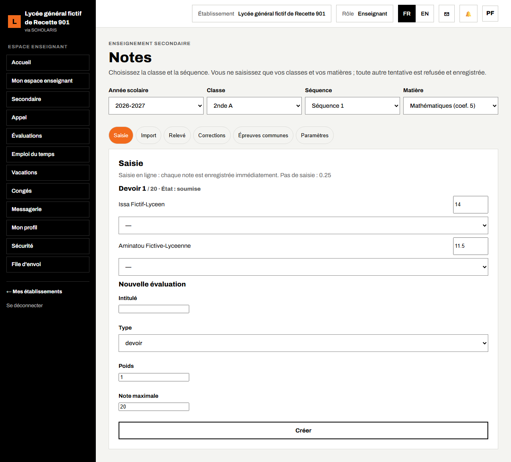
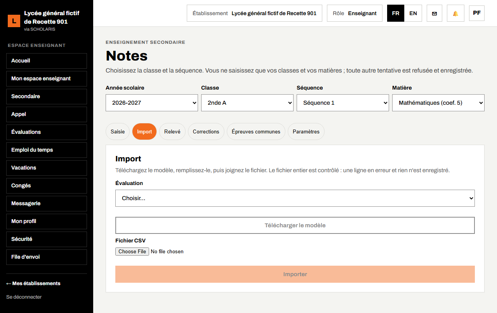
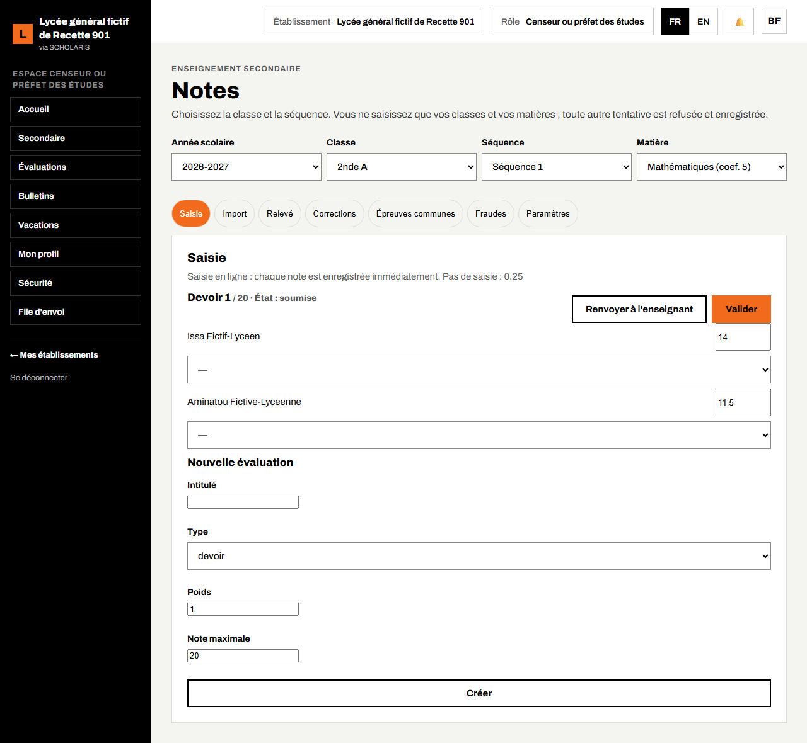
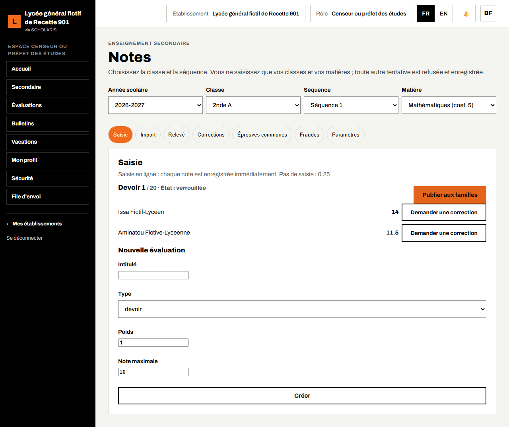
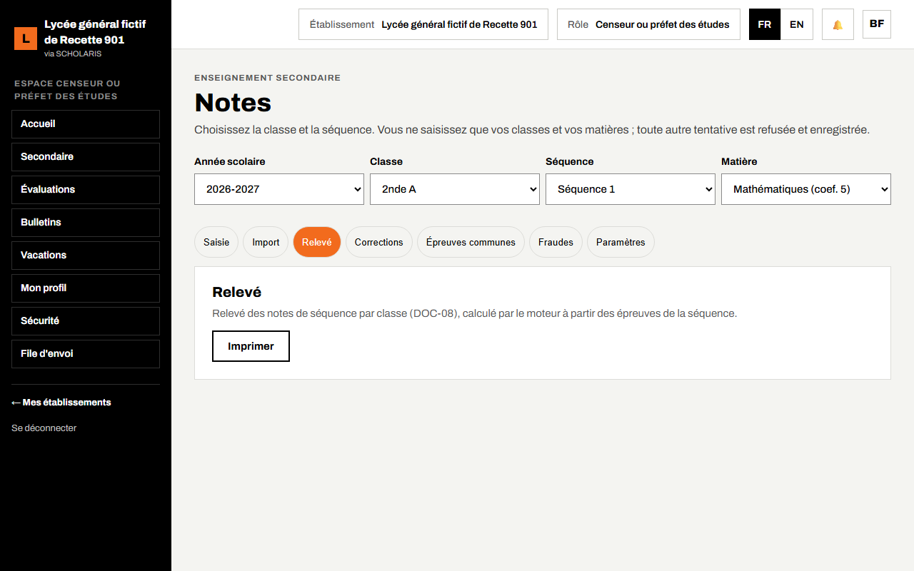
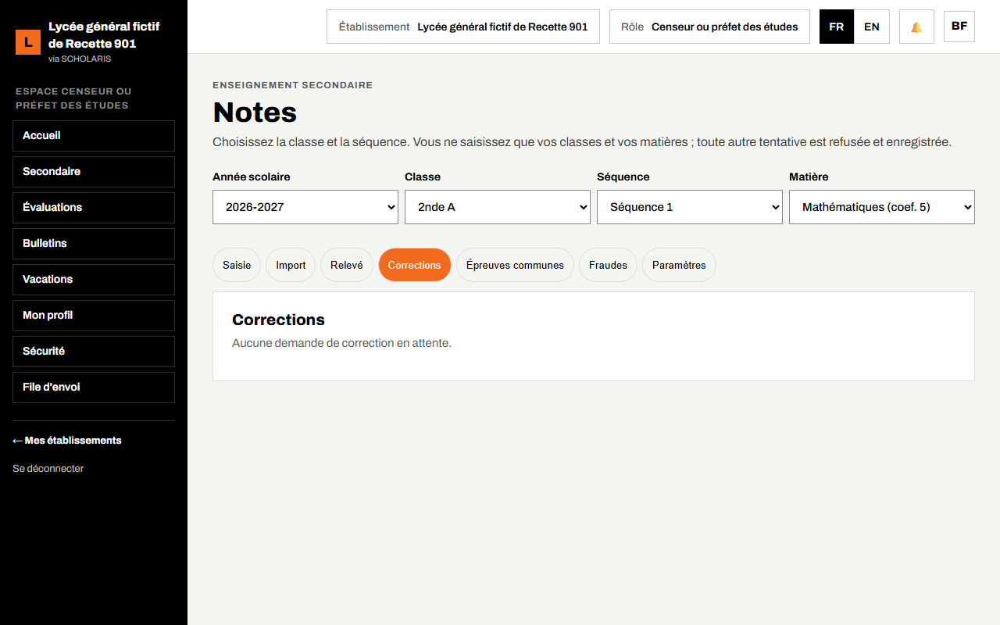

# 07. Notes de séquence

Ce chapitre explique comment l'enseignant crée une évaluation et saisit les notes d'une séquence (à l'écran ou par fichier), puis comment le censeur les valide et les verrouille avant le conseil de classe. Il présente aussi le relevé, les corrections, les épreuves communes et les fraudes.

**Où** : **Secondaire > Notes** (`/secondaire/notes`). Onglets : **Saisie**, **Import**, **Relevé**, **Corrections**, **Épreuves communes**, **Fraudes** (censeur) et **Paramètres**.

**Qui fait quoi**

| Étape | Qui |
|---|---|
| Poser le cycle des notes (une fois pour l'établissement) | Chef d'établissement (onglet **Paramètres**) |
| Créer l'évaluation, saisir ou importer les notes, soumettre au censeur, demander une correction | Enseignant affecté à la classe et à la matière |
| Valider, renvoyer à l'enseignant, verrouiller, publier aux familles | Censeur |
| Approuver une correction après verrouillage | Censeur puis chef d'établissement |
| Consulter | Chef d'établissement, professeur principal |

**Vous ne saisissez que vos classes et vos matières** (celles de vos affectations à l'emploi du temps, chapitre 05). Toute autre tentative est refusée et enregistrée.

## 7.1 Le cycle des notes

```
Brouillon  →  Soumise  →  Validée  →  Verrouillée  →  Publiée
(enseignant)  (enseignant)  (censeur)    (censeur)       (censeur)
```

- **brouillon** : l'enseignant saisit et corrige librement ;
- **soumise** : la saisie est finie ; le censeur peut la **Renvoyer à l'enseignant** ;
- **validée** : le censeur a contrôlé ;
- **verrouillée** : les notes sont figées ; elles ne changent plus que par une **demande de correction** motivée (7.6) ;
- **publiée** : les familles voient les notes sur leur portail.

Le conseil de classe ne peut valider ses décisions que si **toutes les notes de la période sont verrouillées**.

## 7.2 Avant la première saisie : poser le cycle

**Qui** : le chef d'établissement, une seule fois.

1. Ouvrez **Secondaire > Notes**, onglet **Paramètres**.
2. Lisez les réglages (cycle, codes d'absence, pas de saisie, chaîne de correction) : **fixé** ou **non fixé**.
3. Cliquez sur **Poser le préréglage d'exemple**. Message : « Posés : … Conservés : … ». Rien de ce que l'établissement a déjà choisi n'est remplacé.



Sans ce préréglage, les notes se saisissent mais aucune étape (soumission, validation, verrouillage) n'est proposée : l'écran affiche « Le cycle des notes … n'est pas encore préréglé », avec le bouton **Aller au préréglage du cycle** (chef d'établissement) ou l'invitation à le demander.

## 7.3 Créer une évaluation et saisir les notes

**Qui** : l'enseignant.

1. Ouvrez **Secondaire > Notes**.
2. Choisissez l'**Année scolaire**, la **Classe** (2nde A), la **Séquence** (Séquence 1) et la **Matière** (Mathématiques, coef. 5).
3. Dans **Nouvelle évaluation**, saisissez l'**Intitulé** (« Devoir 1 »), le **Type** (devoir…), le **Poids** et la **Note maximale** (20), puis cliquez sur **Créer**.



4. La liste des élèves de la classe s'affiche. Saisissez chaque note dans la case à droite du nom. **Chaque note est enregistrée dès que vous quittez la case** : message « Enregistré. »
5. Pour un absent, choisissez dans la liste sous le nom **Absent justifié** ou **Absent non justifié** au lieu d'une note.



**Règles de saisie** : le **pas de saisie** est rappelé en haut (par exemple 0.25 : 13 ; 13,25 ; 13,5 ; 13,75). Une note hors du pas ou au-dessus du maximum est refusée : « 13.3 n'est pas au pas de 0.25 », « 21 dépasse le maximum de 20 ».

**Sans réseau** : si le message « Saisie hors ligne activée » s'affiche, vos notes sont gardées sur l'appareil (« Gardé sur l'appareil, envoi au retour du réseau ») et partent seules au retour du réseau.

6. Quand toutes les notes sont saisies, cliquez sur **Soumettre au censeur**. Vous ne pouvez plus modifier.



## 7.4 Importer les notes par fichier

**Où** : onglet **Import**.

1. Choisissez l'**Évaluation**.
2. Cliquez sur **Télécharger le modèle**, remplissez-le (une ligne par élève), enregistrez-le en CSV.
3. Joignez le **Fichier CSV**, puis cliquez sur **Importer**. Message : « 30 créée(s), 2 modifiée(s), 0 inchangée(s). »

« Le fichier entier est contrôlé : une ligne en erreur et rien n'est enregistré. »



## 7.5 Valider et verrouiller (censeur)

1. Le censeur ouvre **Secondaire > Notes**, choisit la **Classe** et la **Séquence**. L'état de l'évaluation est **soumise**.
2. Il contrôle les notes, puis clique sur **Valider** (ou **Renvoyer à l'enseignant** s'il faut corriger).
3. Il clique sur **Verrouiller**. Les notes sont figées. Le verrouillage peut exiger une double authentification récente : « confirmez votre second facteur depuis votre compte, puis recommencez ».
4. Quand l'établissement le décide, il clique sur **Publier aux familles**.





## 7.6 Relevé, corrections, épreuves communes, fraudes

- **Relevé** : relevé des notes de séquence de la classe (DOC-08) avec **Moyenne**, **Rang** et moyenne de la classe (min, max). Bouton **Imprimer**.
- **Corrections** : après verrouillage, l'enseignant clique sur **Demander une correction** sur la note, saisit la **Nouvelle note** et le **Motif**, puis **Envoyer**. « Demande envoyée : elle sera validée par le censeur puis le chef d'établissement. » Chacun clique sur **Approuver** ou **Refuser**.
- **Épreuves communes** : l'animateur pédagogique planifie une épreuve commune à un **Niveau** (intitulé, date), puis **Marquer tenue** et **Clore**.
- **Fraudes** (censeur) : une fraude saisie par l'enseignant saisit le surveillant général ; le censeur indique la **Suite donnée** puis **Traiter**.





**Relancer une saisie en retard** (onglet **Paramètres**, censeur ou chef) : choisissez la **Date limite** puis cliquez sur **Relancer** ; les enseignants concernés reçoivent une notification.
