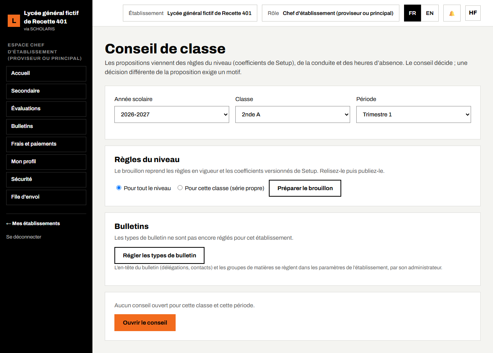
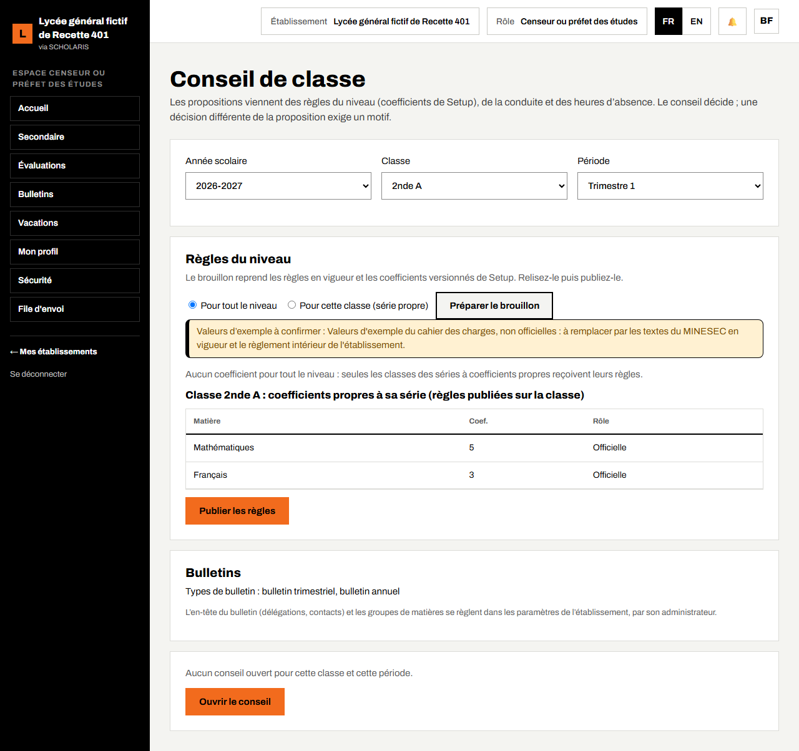
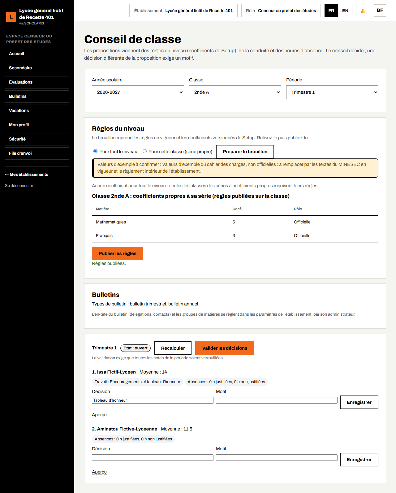
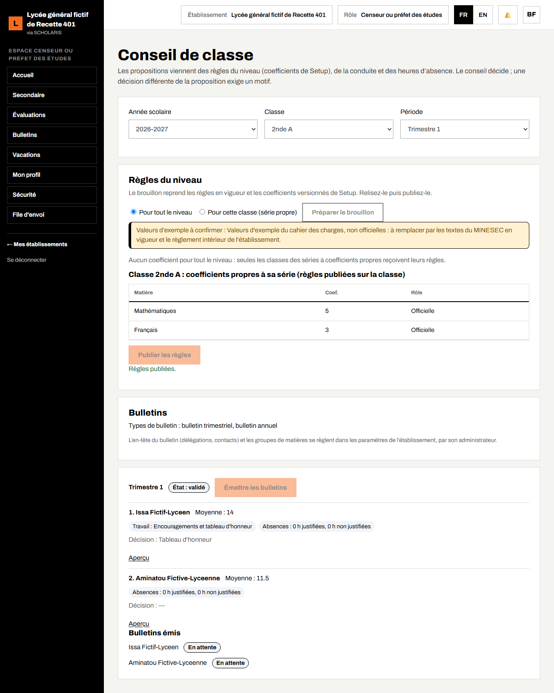
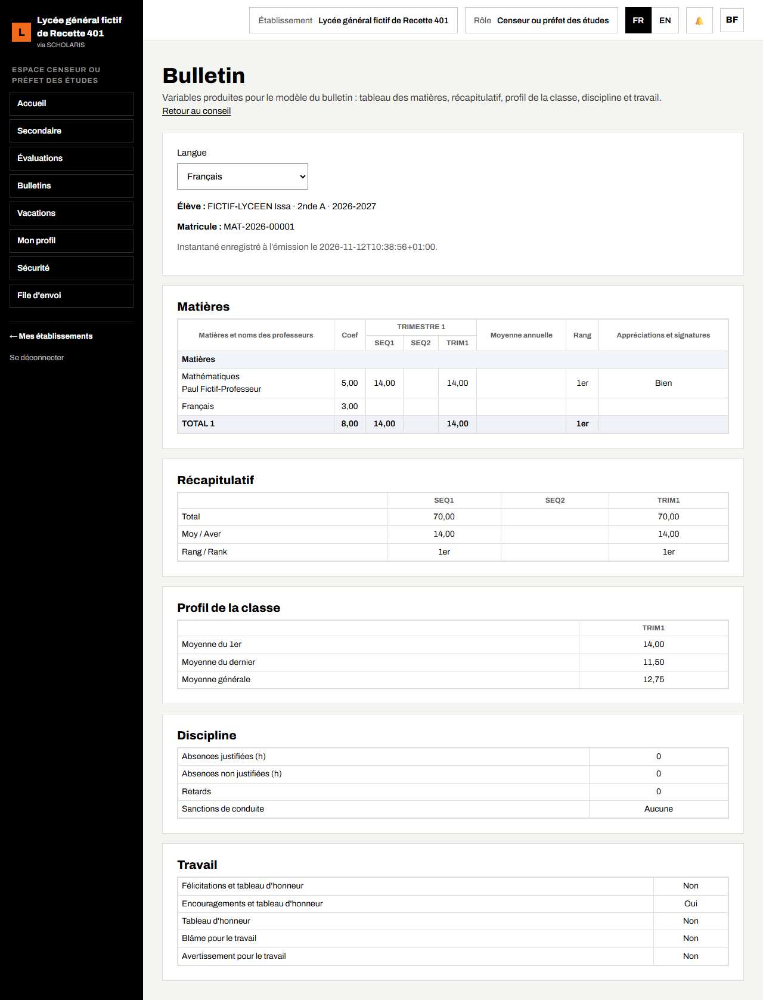

# 08. Conseil de classe et bulletins

Ce chapitre explique comment préparer les règles du conseil, tenir le conseil de classe d'un trimestre, enregistrer les décisions, émettre les bulletins et les consulter.

**Où** : **Secondaire > Conseils de classe** (`/secondaire/conseils-de-classe`) et **Secondaire > Bulletins** (`/secondaire/bulletins`).

**Qui fait quoi**

| Tâche | Qui |
|---|---|
| Régler les types de bulletin (une fois) | Chef d'établissement |
| Préparer et publier les règles, ouvrir le conseil, recalculer, valider, émettre les bulletins | Censeur |
| Présider le conseil, valider les bulletins | Chef d'établissement |
| Appréciation générale et synthèse de la classe | Professeur principal |
| Consulter les bulletins | Direction, surveillant général, professeur principal, parents (portail) |

**Avant le conseil** : toutes les notes des séquences du trimestre doivent être **verrouillées** (chapitre 07).

## 8.1 Régler les types de bulletin

**Qui** : le chef d'établissement, une seule fois.

1. Ouvrez **Secondaire > Conseils de classe**.
2. Dans le bloc **Bulletins**, si le message « Les types de bulletin ne sont pas encore réglés pour cet établissement » s'affiche, cliquez sur **Régler les types de bulletin**.

## 8.2 Préparer et publier les règles du niveau

Les règles reprennent les **coefficients** saisis au paramétrage (chapitre 02) et le règlement intérieur (distinctions, conditions de passage).

1. Le censeur choisit l'**Année scolaire**, la **Classe** et la **Période** (**Trimestre 1**).
2. Dans **Règles du niveau**, laissez coché **Pour tout le niveau** (ou **Pour cette classe (série propre)**).
3. Cliquez sur **Préparer le brouillon**. Le tableau montre chaque **Matière**, son **Coef.** et son **Rôle**. Une classe de série à coefficients propres (par exemple la 2nde C) reçoit sa propre version.
4. Relisez, puis cliquez sur **Publier les règles**. Message : « Règles publiées. »

Le bandeau jaune « Valeurs d'exemple à confirmer » rappelle que les seuils proposés viennent d'un exemple : remplacez-les par les textes du MINESEC en vigueur et votre règlement intérieur.

## 8.3 Tenir le conseil

1. Cliquez sur **Ouvrir le conseil**.
2. Chaque élève apparaît avec sa **Moyenne**, son rang et des **propositions** en pastilles : travail (par exemple « Encouragements et tableau d'honneur »), passage, absences justifiées et non justifiées, conduite, matières sous le seuil.
3. Dans **Décision**, la proposition est préremplie. Pendant la séance, modifiez-la si le conseil en décide autrement : le **Motif** est alors obligatoire. Cliquez sur **Enregistrer** sur la ligne.
4. Après une correction de note ou d'absence, cliquez sur **Recalculer**.
5. Le lien **Aperçu** montre le bulletin de l'élève avant émission.

## 8.4 Valider et émettre les bulletins

1. Cliquez sur **Valider les décisions**. « La validation exige que toutes les notes de la période soient verrouillées. »
2. Cliquez sur **Émettre les bulletins**. L'émission peut prendre quelques minutes pour une grande classe.
3. Le bloc **Bulletins émis** liste chaque bulletin avec son état : **En attente**, **Émis** ou **Échec**.

Chaque bulletin reçoit un **numéro unique**. Le parent le retrouve sur son portail (chapitre 15).

## 8.5 Consulter un bulletin

Depuis le conseil, cliquez sur **Aperçu** à côté de l'élève : l'écran **Bulletin** affiche les tableaux **Matières**, **Récapitulatif**, **Profil de la classe**, **Discipline** et **Travail**, la **Décision du conseil** et les **Observations**. Choisissez la **Langue** (français ou anglais). Après émission, l'aperçu indique « Instantané enregistré à l'émission le … » : le bulletin émis ne change plus.

L'aperçu est calculé à la demande : l'écran affiche « Calcul du bulletin en cours… » pendant quelques secondes, puis le bulletin. « Aucun bulletin à afficher » signale un élève sans bulletin pour cette période.

Cliquez sur **Retour au conseil** pour revenir.
