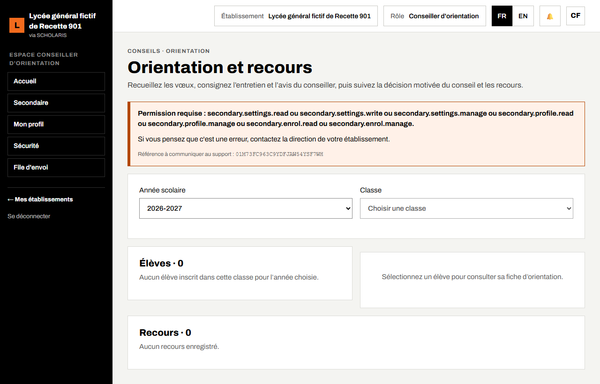

# 09. Orientation

Ce chapitre explique comment recueillir les vœux d'orientation des élèves (fin de Troisième, de Seconde…), consigner l'entretien et l'avis du conseiller d'orientation, enregistrer la décision du conseil et traiter les recours.

**Où** : **Secondaire > Orientation** (`/secondaire/orientation`). L'écran n'apparaît que si le module **Orientation** est actif dans le profil (chapitre 02).

**Qui fait quoi**

| Tâche | Qui |
|---|---|
| Saisir les vœux, l'entretien et l'avis motivé | Conseiller d'orientation |
| Enregistrer la décision du conseil, examiner un recours | Chef d'établissement (président du conseil) |
| Consulter la fiche, déposer un recours | Élève et parent (portail) |

## 9.1 Choisir la classe et l'élève

1. Ouvrez **Secondaire > Orientation**.
2. Dans **Sélection de l'année et de la classe**, choisissez l'**Année scolaire** et la **Classe**.
3. La liste des **Élèves** s'affiche avec leur état : **En attente de décision** ou **Décision : …**. Cliquez sur un élève pour ouvrir sa fiche.

## 9.2 Vœux de l'élève

1. Dans **Vœux de l'élève** (8 au maximum), choisissez les séries ou spécialités dans l'ordre de préférence. Seules les séries ouvertes par l'établissement sont proposées.
2. Cliquez sur **Enregistrer les vœux**.

## 9.3 Avis du conseiller

1. Dans **Avis du conseiller**, saisissez la date de l'**Entretien**.
2. Choisissez la **Série ou spécialité proposée**.
3. Rédigez l'**Avis motivé**, puis cliquez sur **Enregistrer l'avis**.

## 9.4 Décision du conseil

1. Le président du conseil choisit la **Série ou spécialité retenue** et saisit le **Motif**.
2. Il clique sur **Enregistrer la décision**. La fiche d'orientation (DOC-16) est émise avec la décision.

## 9.5 Recours

1. L'élève ou son parent dépose un recours : **Motif du recours**, puis **Déposer le recours**, dans le délai du règlement intérieur.
2. Le chef d'établissement clique sur **Examiner**, choisit **Accepter** (avec la **Série révisée**) ou **Rejeter**, saisit le **Motif de la décision** et enregistre.
3. Le recours passe à **Accepté** ou **Rejeté**.
