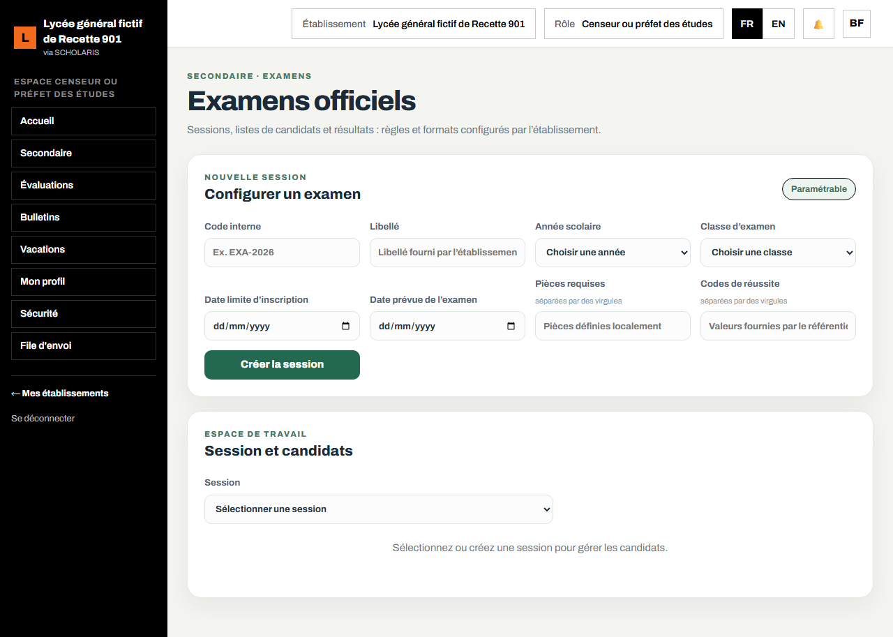

# 10. Examens officiels

Ce chapitre explique comment préparer la liste des candidats d'une classe d'examen (BEPC, CAP, probatoire, baccalauréat, GCE…), contrôler leurs pièces, leur matricule et leurs frais d'examen, puis importer les résultats.

**Où** : **Secondaire > Examens officiels** (`/secondaire/examens`). L'écran n'apparaît que si le module **Examens officiels** est actif.

**Qui fait quoi**

| Tâche | Qui |
|---|---|
| Créer la session, générer et compléter la liste des candidats, importer les résultats | Censeur |
| Éditer les listes (fiche de candidat DOC-19, liste DOC-20) | Scolarité |
| Valider les listes | Chef d'établissement |
| Consulter | Intendant (frais constatés), professeur principal |

**Les frais d'examen ne sont jamais encaissés par l'établissement** : ils se paient sur cartescolaire.cm. L'application les voit grâce au relevé importé dans **Carte scolaire** (chapitre 03).

## 10.1 Créer une session d'examen

1. Ouvrez **Secondaire > Examens officiels**, bloc **Configurer un examen**.
2. Saisissez le **Code interne** (par exemple EXA-2026) et le **Libellé** (par exemple « Probatoire 2027, série C »).
3. Choisissez l'**Année scolaire** et la **Classe d'examen**.
4. Saisissez la **Date limite d'inscription** et la **Date prévue de l'examen**.
5. Saisissez les **Pièces requises** et les **Codes de réussite** (séparés par des virgules), tels que fixés par l'organisateur.
6. Cliquez sur **Créer la session**. Message : « Session créée. »

## 10.2 Préparer la liste des candidats

1. Dans **Session et candidats**, choisissez la **Session**.
2. Cliquez sur **Générer depuis les inscriptions actives** : tous les élèves inscrits de la classe sont ajoutés. Message : « 45 candidat(s) ajouté(s), 0 déjà présent(s). »
3. Chaque candidat montre son état :
   - **Prêt** : tout est en ordre ;
   - **À compléter** : il manque des pièces (« Pièces manquantes : … ») ;
   - **Bloqué** : matricule en attente ou frais d'examen non constatés.
4. Pour chaque candidat, cochez les **Pièces reçues**, les **Matières optionnelles** et ajoutez la **Photo du candidat**.
5. **Retirer le candidat** le sort de la liste de travail (il n'est pas effacé).

Le bouton **Exporter CSV** produit la liste à transmettre.

## 10.3 Résultats

1. Récupérez le fichier des résultats auprès de l'organisateur (colonnes key, result_code, result_mark).
2. Dans **Importer les résultats CSV**, joignez le fichier puis cliquez sur **Importer les résultats**. Message : « Résultats importés : 44, lignes rejetées : 1. »
3. L'écran affiche **Candidats**, **Résultats reçus**, **Admis**, **Taux de réussite**, et compare la note d'examen à la **Moyenne scolaire** (écart).
4. En fin de campagne, cliquez sur **Clôturer la session**.

L'attestation interne de résultat (DOC-31) peut ensuite être délivrée.
