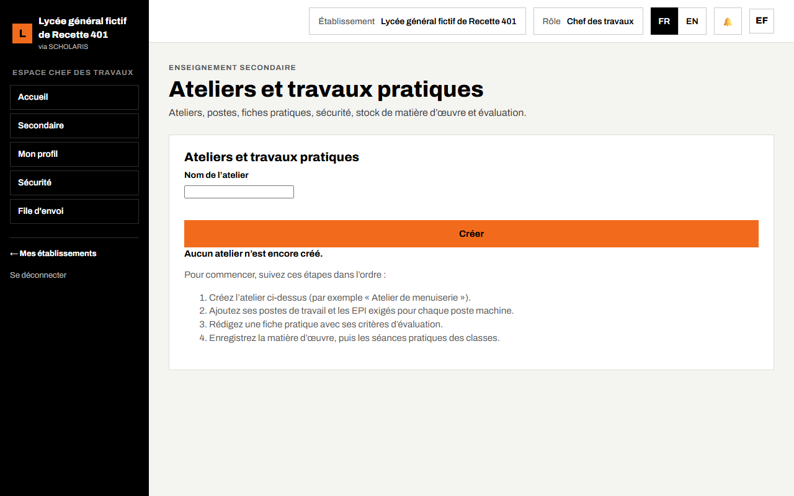
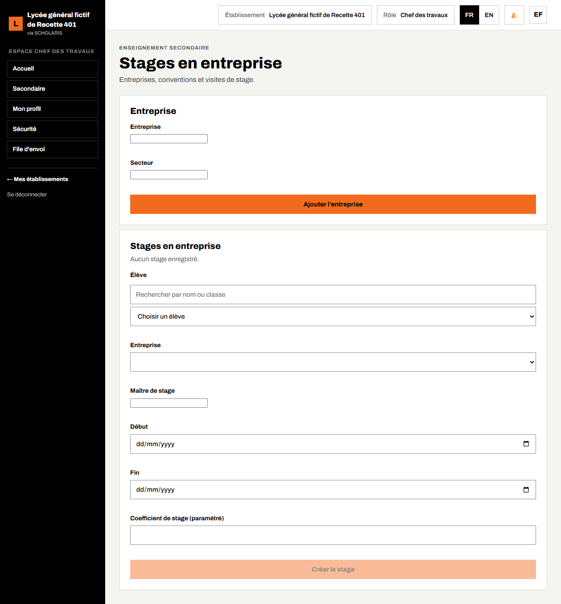

# 11. Ateliers et stages (enseignement technique)

Ce chapitre concerne surtout les lycées techniques, les CETIC et les établissements qui ont activé les modules **Ateliers** et **Stages** dans leur profil (chapitre 02). Il présente les ateliers, les postes, les fiches pratiques, la sécurité, la matière d'œuvre et les stages en entreprise.

**Où** : **Secondaire > Ateliers** (`/secondaire/ateliers`) et **Secondaire > Stages** (`/secondaire/stages`).

**Qui fait quoi**

| Tâche | Qui |
|---|---|
| Ateliers, postes, fiches pratiques, sécurité, matière d'œuvre, stages | Chef des travaux |
| Séance pratique (présence, postes, équipements de protection) | Enseignant d'atelier |
| Coûts de la matière d'œuvre | Intendant (lecture) |
| Consulter | Chef d'établissement, censeur |

## 11.1 Ateliers et travaux pratiques

1. Ouvrez **Secondaire > Ateliers**. Choisissez un atelier dans **Choisir un atelier**, ou créez-le : **Nom de l'atelier** puis **Créer**.
2. **Postes** : saisissez le **Nom du poste**, cochez **Poste machine** si c'est le cas, indiquez les **EPI requis** (équipements de protection individuelle, séparés par des virgules), puis **Ajouter un poste**.
3. **Fiches pratiques** : **Titre de la fiche**, **Objectif**, critères d'évaluation (code, libellé et points maximum), **Base de la note** et **Plafond en cas de manquement grave**, puis **Créer une fiche**.
4. **Matière d'œuvre et stock** : **Article**, **Unité**, **Coût unitaire**, **Quantité initiale**, puis **Ajouter un article**. Chaque **Sortie de stock** est enregistrée.
5. **Registre de sécurité** : saisissez l'**Observation de sécurité** puis **Enregistrer**.

### Séance pratique

Dans **Séance pratique**, l'enseignant indique la classe, la date et, pour chaque élève, son poste et les EPI portés, puis **Enregistrer la séance**. « Sans tous les EPI requis, l'élève reste observateur et aucun poste machine ne lui est attribué. »

La **Classe** et l'**Enseignant** se choisissent dans des listes. Les élèves de la classe s'affichent avec une case à cocher : cochez les présents, puis choisissez pour chacun son poste et les EPI portés.

Tant qu'aucun atelier n'existe, l'écran du chef des travaux affiche les quatre étapes à suivre. Les autres rôles lisent une courte explication.

Les notes d'atelier remontent au conseil de classe (« Atelier : 14 / 20 »).

## 11.2 Stages en entreprise

1. Ouvrez **Secondaire > Stages**.
2. **Entreprise** : saisissez le nom et le **Secteur**, puis **Ajouter l'entreprise**.
3. **Créer le stage** : choisissez l'**Élève** par son nom (sa classe est reprise automatiquement), l'entreprise, **Maître de stage**, **Début**, **Fin**, **Coefficient de stage (paramétré)**.
4. Saisissez la **Référence de convention** (la convention DOC-21 peut être émise).
5. Pendant le stage : **Ajouter une visite** (visiteur, **Date de visite**, **Notes**).
6. À la fin : **Évaluation du tuteur** et **Note de stage** (fiche d'appréciation DOC-22).

