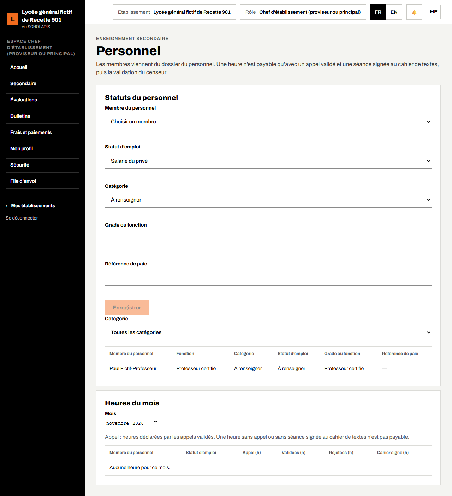
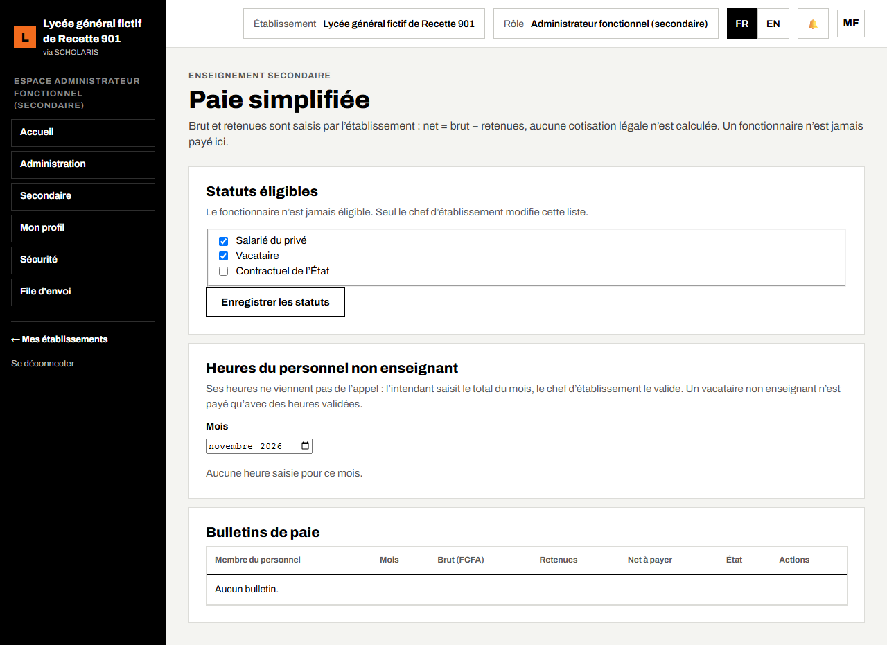

# 12. Personnel et paie

Ce chapitre explique comment renseigner le statut de chaque membre du personnel, suivre les heures du mois, et préparer, valider et payer les bulletins de paie simplifiée (vacataires et personnel du privé).

**Où** : **Secondaire > Personnel** (`/secondaire/personnel`) et **Secondaire > Paie** (`/secondaire/paie`, module **Paie simplifiée**).

**Qui fait quoi**

| Tâche | Qui |
|---|---|
| Statut d'emploi, grade, référence de paie | Chef d'établissement, administrateur fonctionnel |
| Consulter les heures du mois | Chef d'établissement, censeur, intendant |
| Statuts éligibles à la paie | Chef d'établissement |
| Heures du personnel non enseignant | Intendant (saisie), chef d'établissement (validation) |
| Préparer un bulletin de paie | Intendant |
| Valider, marquer payé | Une autre personne que l'auteur (chef d'établissement ou intendant) |

## 12.1 Statuts du personnel

Les membres viennent du dossier du personnel (menu **Personnel** de l'administration).

1. Ouvrez **Secondaire > Personnel**, bloc **Statuts du personnel**.
2. Choisissez le **Membre du personnel** dans la liste.
3. Choisissez le **Statut d'emploi** (par exemple **Vacataire**, permanent, fonctionnaire), la **Catégorie** (**Enseignant**, **Administratif**, **Service**, **Entretien**), le **Grade ou fonction** et la **Référence de paie**.
4. Cliquez sur **Enregistrer**. Message : « Statut enregistré. »

## 12.2 Heures du mois

Bloc **Heures du mois** : choisissez le **Mois**. Pour chaque enseignant : heures **Appel (h)** (déclarées par les appels validés), **Validées (h)**, **Rejetées (h)** et **Cahier signé (h)**. « Une heure n'est payable qu'avec un appel validé et une séance signée au cahier de textes. »

## 12.3 Paie simplifiée

« Brut et retenues sont saisis par l'établissement : net = brut − retenues. » Aucune cotisation n'est calculée par l'application.

1. **Statuts éligibles** : le chef d'établissement coche les statuts payés par l'établissement, puis **Enregistrer les statuts**. Le fonctionnaire n'est jamais éligible.
2. **Heures du personnel non enseignant** : l'intendant choisit le membre, saisit les **Heures du mois** et une **Remarque**, puis **Saisir les heures** ; le chef d'établissement les valide.
3. **Préparer un bulletin** : choisissez le **Membre du personnel**, le **Mois**, le **Brut (FCFA)**, ajoutez les retenues (**Libellé de la retenue**, **Montant**, **Ajouter la retenue**). Le **Net à payer** se calcule. Cliquez sur **Préparer le bulletin**. Message : « Bulletin préparé en brouillon. »
4. **Bulletins de paie** : une autre personne clique sur **Valider** (« Préparé par vous : un autre valide »), puis **Marquer payé**. Message : « Bulletin payé : DOC-30 n° … émis. »

